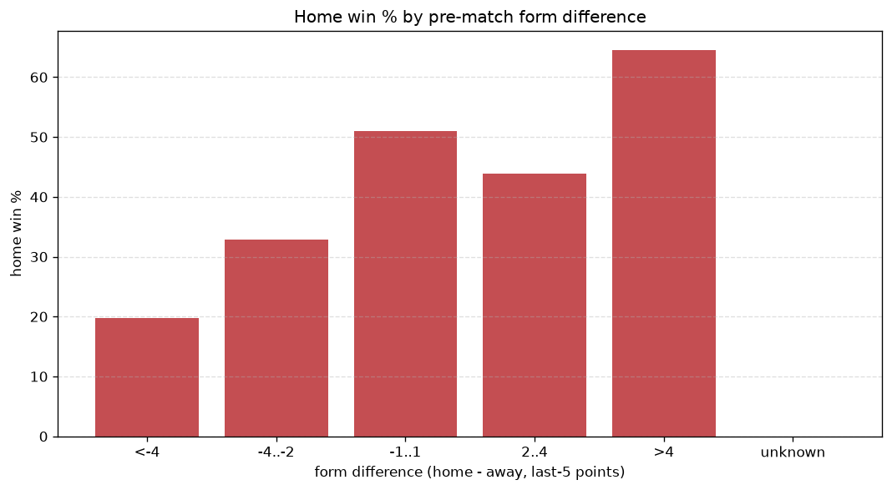
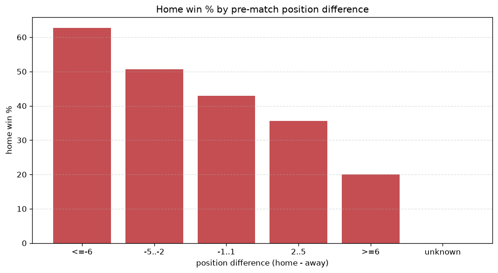

# Relationships Analysis
- Report: `relationships`
- Generated: 2026-10-27T01:42:10+00:00
- Script: `backend/scripts/analyze_relationships.py` v1.0.0
- League: efbet League (Bulgaria)
- Scope: league `bulgaria1`

- Matches analysed: **1378** (23 leakage-safe pre-match features).

## 1. Correlation matrix
_Pearson correlation of each pre-match feature with observed goals; sorted by |corr(total goals)|._

| feature | corr(home) | corr(away) | corr(total) |
|---|---|---|---|
| home_team_home_conceded_avg | -0.141 | 0.088 | -0.047 |
| home_team_goals_scored_last_5 | 0.167 | -0.122 | 0.043 |
| home_team_goals_conceded_last_5 | -0.150 | 0.114 | -0.036 |
| away_team_goals_conceded_last_5 | 0.103 | -0.157 | -0.031 |
| home_team_wins_last_5 | 0.168 | -0.141 | 0.031 |
| position_difference | -0.293 | 0.279 | -0.030 |
| away_points_before_match | -0.139 | 0.112 | -0.029 |
| points_difference | 0.280 | -0.266 | 0.028 |
| home_position_before_match | -0.202 | 0.184 | -0.026 |
| home_team_points_last_5 | 0.162 | -0.143 | 0.025 |
| rest_days_difference | 0.007 | 0.025 | 0.024 |
| home_rest_days | -0.011 | 0.038 | 0.019 |
| away_team_points_last_5 | -0.153 | 0.142 | -0.018 |
| home_team_home_win_rate | 0.140 | -0.131 | 0.016 |
| away_position_before_match | 0.199 | -0.197 | 0.015 |
| away_team_away_conceded_avg | 0.113 | -0.104 | 0.013 |
| away_team_away_goals_avg | -0.151 | 0.148 | -0.012 |
| away_team_away_win_rate | -0.147 | 0.144 | -0.012 |
| away_team_goals_scored_last_5 | -0.142 | 0.140 | -0.012 |
| home_team_home_goals_avg | 0.139 | -0.137 | 0.011 |
| away_rest_days | -0.014 | 0.030 | 0.010 |
| home_points_before_match | 0.087 | -0.103 | -0.006 |
| away_team_wins_last_5 | -0.140 | 0.147 | -0.004 |

## 2. Form vs outcome
_Home win/draw/away % per bucket of `home_team_points_last_5 - away_team_points_last_5`._

| bucket | matches | home | draw | away | home % | draw % | away % |
|---|---|---|---|---|---|---|---|
| <-4 | 255 | 67 | 61 | 127 | 26.3% | 23.9% | 49.8% |
| -4..-2 | 269 | 94 | 70 | 105 | 34.9% | 26.0% | 39.0% |
| -1..1 | 374 | 172 | 97 | 105 | 46.0% | 25.9% | 28.1% |
| 2..4 | 258 | 147 | 66 | 45 | 57.0% | 25.6% | 17.4% |
| >4 | 222 | 145 | 45 | 32 | 65.3% | 20.3% | 14.4% |
| unknown | 0 | 0 | 0 | 0 | - | - | - |

## 3. Position vs outcome
_Home win/draw/away % per bucket of `position_difference` (home position - away position; negative favours the home team)._

| bucket | matches | home | draw | away | home % | draw % | away % |
|---|---|---|---|---|---|---|---|
| <=-6 | 258 | 184 | 46 | 28 | 71.3% | 17.8% | 10.9% |
| -5..-2 | 312 | 169 | 84 | 59 | 54.2% | 26.9% | 18.9% |
| -1..1 | 236 | 105 | 68 | 63 | 44.5% | 28.8% | 26.7% |
| 2..5 | 289 | 109 | 73 | 107 | 37.7% | 25.3% | 37.0% |
| >=6 | 283 | 58 | 68 | 157 | 20.5% | 24.0% | 55.5% |
| unknown | 0 | 0 | 0 | 0 | - | - | - |

## 4. Rest advantage
_Home win/draw/away % per bucket of `rest_days_difference` (home rest - away rest). Matches with unknown rest are bucketed separately._

| bucket | matches | home | draw | away | home % | draw % | away % |
|---|---|---|---|---|---|---|---|
| <-1 | 222 | 97 | 58 | 67 | 43.7% | 26.1% | 30.2% |
| -1..0 | 294 | 151 | 64 | 79 | 51.4% | 21.8% | 26.9% |
| 0 | 315 | 149 | 73 | 93 | 47.3% | 23.2% | 29.5% |
| 1..2 | 403 | 167 | 109 | 127 | 41.4% | 27.0% | 31.5% |
| >2 | 97 | 42 | 22 | 33 | 43.3% | 22.7% | 34.0% |
| unknown | 47 | 19 | 13 | 15 | 40.4% | 27.7% | 31.9% |
- *47 match(es) had unknown rest difference (missing rest data on at least one side).*

## 5. Home team quality
_Home win rate by `home_team_home_win_rate` tier (split at 0.5)._

- `< 0.5` tier: **37.8%** home win (292/772)
- `>= 0.5` tier: **55.0%** home win (333/606)
- Home-win gap (>= split minus < split): **+17.2 pp**

| tier | label | matches | home | draw | away | home % |
|---|---|---|---|---|---|---|
| low | < 0.5 | 772 | 292 | 193 | 287 | 37.8% |
| high | >= 0.5 | 606 | 333 | 146 | 127 | 55.0% |

## 6. Feature averages by result
_Mean feature value per outcome; `range` is home-minus-away spread of the group means._

| feature | home mean | draw mean | away mean | range |
|---|---|---|---|---|
| points_difference | 4.174 | -0.900 | -6.188 | 10.363 |
| away_points_before_match | 17.936 | 20.448 | 23.862 | 5.926 |
| position_difference | -2.130 | 0.428 | 3.220 | 5.349 |
| home_points_before_match | 22.110 | 19.549 | 17.674 | 4.436 |
| away_position_before_match | 9.515 | 8.162 | 6.795 | 2.721 |
| home_position_before_match | 7.386 | 8.590 | 10.014 | 2.629 |
| home_team_points_last_5 | 6.795 | 5.985 | 5.094 | 1.701 |
| away_team_points_last_5 | 5.603 | 6.324 | 7.285 | 1.682 |
| home_rest_days | 9.189 | 9.678 | 10.717 | 1.527 |
| away_team_goals_scored_last_5 | 4.899 | 5.383 | 6.319 | 1.420 |
| away_rest_days | 9.106 | 9.650 | 10.479 | 1.373 |
| home_team_goals_scored_last_5 | 5.922 | 5.165 | 4.551 | 1.371 |
| away_team_goals_conceded_last_5 | 5.789 | 5.425 | 4.432 | 1.356 |
| home_team_goals_conceded_last_5 | 4.968 | 5.463 | 6.242 | 1.274 |
| away_team_wins_last_5 | 1.488 | 1.717 | 2.058 | 0.570 |
| home_team_wins_last_5 | 1.896 | 1.619 | 1.329 | 0.567 |
| home_team_home_goals_avg | 1.441 | 1.232 | 1.117 | 0.324 |
| away_team_away_goals_avg | 0.872 | 0.963 | 1.155 | 0.284 |
| away_team_away_conceded_avg | 1.403 | 1.255 | 1.126 | 0.276 |
| home_team_home_conceded_avg | 0.879 | 0.976 | 1.131 | 0.252 |
| rest_days_difference | 0.089 | 0.028 | 0.238 | 0.210 |
| home_team_home_win_rate | 0.489 | 0.426 | 0.348 | 0.141 |
| away_team_away_win_rate | 0.235 | 0.271 | 0.345 | 0.110 |

---
*All features are leakage-safe pre-match values built by `ml.features.build_features.build_rows` from strictly prior matches. Run with `python backend/scripts/analyze_relationships.py` to regenerate.*

## Charts

