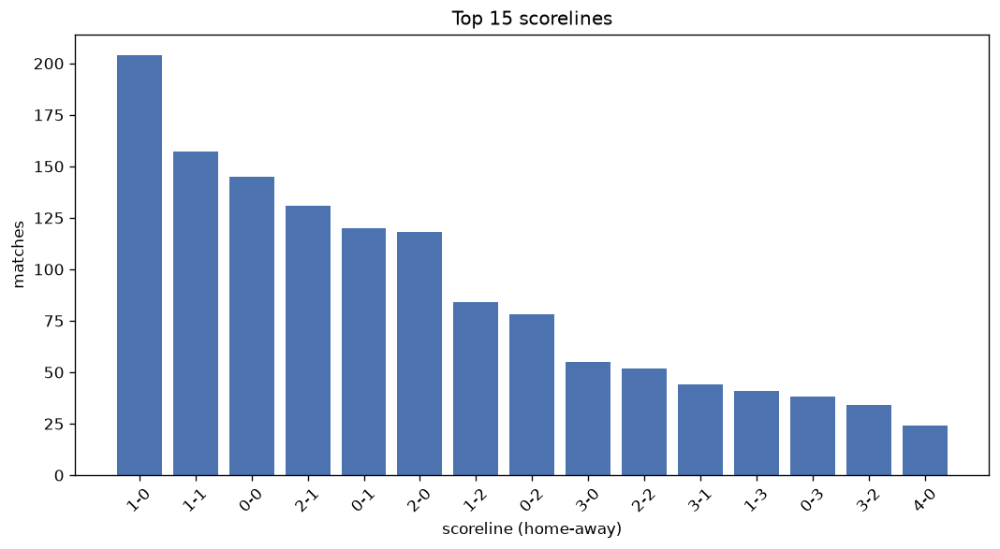
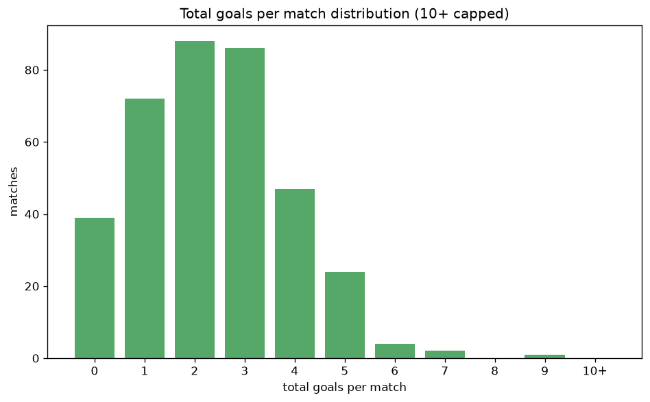

# Scoreline Analysis
- Report: `scoreline_analysis`
- Generated: 2026-10-30T03:46:26+00:00
- Script: `backend/scripts/analyze_scorelines.py` v1.0.0
- League: efbet League (Bulgaria)
- Scope: league `bulgaria1`

## 1. Scoreline frequency
- Matches analysed: **1461** across **7** seasons.
- Distinct scorelines seen: **38**.

| scoreline | count | pct |
|---|---|---|
| 1-0 | 204 | 14.0% |
| 1-1 | 157 | 10.7% |
| 0-0 | 145 | 9.9% |
| 2-1 | 131 | 9.0% |
| 0-1 | 120 | 8.2% |
| 2-0 | 118 | 8.1% |
| 1-2 | 84 | 5.7% |
| 0-2 | 78 | 5.3% |
| 3-0 | 55 | 3.8% |
| 2-2 | 52 | 3.6% |
| 3-1 | 44 | 3.0% |
| 1-3 | 41 | 2.8% |
| 0-3 | 38 | 2.6% |
| 3-2 | 34 | 2.3% |
| 4-0 | 24 | 1.6% |
| 2-3 | 22 | 1.5% |
| 0-4 | 19 | 1.3% |
| 5-0 | 16 | 1.1% |
| 1-4 | 12 | 0.8% |
| 5-1 | 11 | 0.8% |

## 2. Scoreline frequency per season

### 2020-2021
| scoreline | count | pct |
|---|---|---|
| 1-0 | 27 | 14.8% |
| 0-0 | 22 | 12.1% |
| 1-1 | 18 | 9.9% |
| 2-1 | 17 | 9.3% |
| 2-0 | 12 | 6.6% |

### 2021-2022
| scoreline | count | pct |
|---|---|---|
| 1-0 | 29 | 15.9% |
| 2-1 | 21 | 11.5% |
| 1-1 | 21 | 11.5% |
| 0-0 | 19 | 10.4% |
| 2-0 | 19 | 10.4% |

### 2022-2023
| scoreline | count | pct |
|---|---|---|
| 1-0 | 35 | 14.6% |
| 0-1 | 28 | 11.7% |
| 0-0 | 25 | 10.4% |
| 1-1 | 24 | 10.0% |
| 2-1 | 22 | 9.2% |

### 2023-2024
| scoreline | count | pct |
|---|---|---|
| 1-0 | 36 | 15.0% |
| 1-2 | 23 | 9.6% |
| 0-0 | 22 | 9.2% |
| 2-0 | 20 | 8.3% |
| 1-1 | 19 | 7.9% |

### 2024-2025
| scoreline | count | pct |
|---|---|---|
| 1-0 | 33 | 13.8% |
| 0-1 | 28 | 11.7% |
| 1-1 | 27 | 11.2% |
| 2-1 | 18 | 7.5% |
| 0-0 | 17 | 7.1% |

### 2025-2026
| scoreline | count | pct |
|---|---|---|
| 0-0 | 36 | 12.2% |
| 1-0 | 35 | 11.9% |
| 1-1 | 35 | 11.9% |
| 2-1 | 30 | 10.2% |
| 0-1 | 25 | 8.5% |

### 2026-2027
| scoreline | count | pct |
|---|---|---|
| 1-1 | 13 | 15.7% |
| 1-0 | 9 | 10.8% |
| 2-1 | 8 | 9.6% |
| 2-0 | 8 | 9.6% |
| 1-2 | 5 | 6.0% |

## 3. Total-goal histogram
_10+ groups all matches with 10 or more total goals._

| total goals | matches | pct |
|---|---|---|
| 0 | 145 | 9.9% |
| 1 | 324 | 22.2% |
| 2 | 353 | 24.2% |
| 3 | 308 | 21.1% |
| 4 | 180 | 12.3% |
| 5 | 94 | 6.4% |
| 6 | 43 | 2.9% |
| 7 | 10 | 0.7% |
| 8 | 2 | 0.1% |
| 9 | 2 | 0.1% |
| 10+ | 0 | 0.0% |

## 4. Extreme scorelines
- Matches with 7+ total goals: **14**

| season | date | scoreline | total goals |
|---|---|---|---|
| 2022-2023 | 2023-04-08 | 8-1 | 9 |
| 2025-2026 | 2025-10-27 | 5-4 | 9 |
| 2021-2022 | 2021-12-13 | 3-5 | 8 |
| 2023-2024 | 2023-10-21 | 3-5 | 8 |
| 2020-2021 | 2020-12-07 | 3-4 | 7 |
| 2021-2022 | 2021-11-20 | 2-5 | 7 |
| 2022-2023 | 2022-08-06 | 5-2 | 7 |
| 2022-2023 | 2022-08-19 | 3-4 | 7 |
| 2023-2024 | 2023-08-25 | 3-4 | 7 |
| 2023-2024 | 2023-10-08 | 2-5 | 7 |
| 2024-2025 | 2024-07-20 | 1-6 | 7 |
| 2024-2025 | 2025-03-10 | 6-1 | 7 |
| 2025-2026 | 2025-11-30 | 7-0 | 7 |
| 2025-2026 | 2026-03-01 | 4-3 | 7 |

## 5. Margin-of-victory distribution (decided matches)
- Decided matches: **1101** (draws: **360**)
- Average winning margin: **1.77**

| margin | matches | pct |
|---|---|---|
| 1 | 600 | 54.5% |
| 2 | 295 | 26.8% |
| 3+ | 206 | 18.7% |

## 6. Margin by outcome

### Home wins
- Matches: **662** | avg margin: **1.79** | max margin: **7**
| margin | matches | pct |
|---|---|---|
| 1 | 371 | 56.0% |
| 2 | 165 | 24.9% |
| 3+ | 126 | 19.0% |
- *Full match-by-match list available in `scoreline_analysis.json`.*

### Away wins
- Matches: **439** | avg margin: **1.74** | max margin: **6**
| margin | matches | pct |
|---|---|---|
| 1 | 229 | 52.2% |
| 2 | 130 | 29.6% |
| 3+ | 80 | 18.2% |
- *Full match-by-match list available in `scoreline_analysis.json`.*

## 7. Most common exact score by outcome type
| outcome | matches | most common score | count | pct |
|---|---|---|---|---|
| home | 662 | 1-0 | 204 | 30.8% |
| draw | 360 | 1-1 | 157 | 43.6% |
| away | 439 | 0-1 | 120 | 27.3% |

---
*All statistics are computed from PostgreSQL tables (read-only). Run with `python backend/scripts/analyze_scorelines.py` to regenerate.*

## Charts

