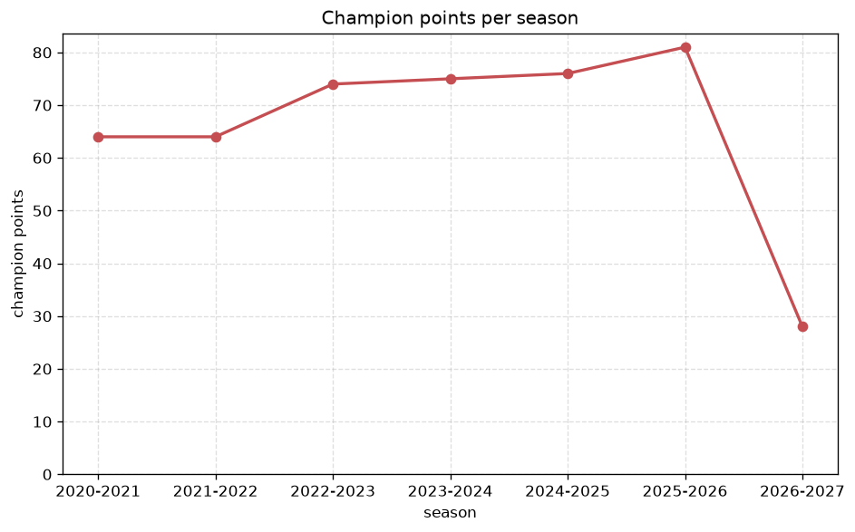
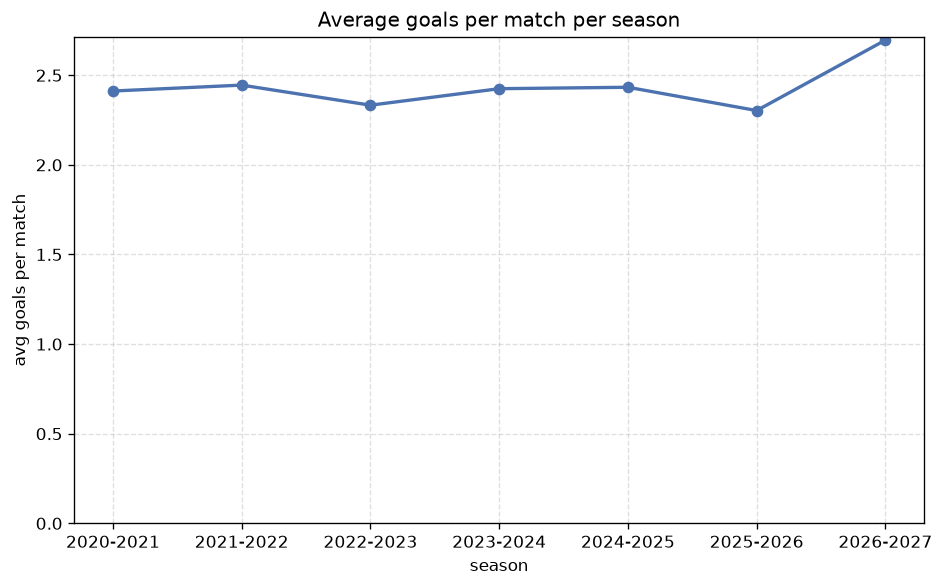

# Season Trends Analysis
- Report: `season_trends`
- Generated: 2026-10-30T03:46:24+00:00
- Script: `backend/scripts/analyze_seasons.py` v1.0.0
- League: efbet League (Bulgaria)
- Scope: league `bulgaria1`

## 1. Champions per season
| season | champion | pts | runner-up | margin |
|---|---|---|---|---|
| 2020-2021 | Ludogorets | 64 | Lok. Plovdiv | 12 pts |
| 2021-2022 | Ludogorets | 64 | CSKA Sofia | 12 pts |
| 2022-2023 | Ludogorets | 74 | CSKA Sofia | 1 pts |
| 2023-2024 | Ludogorets | 75 | CSKA Sofia | 12 pts |
| 2024-2025 | Ludogorets | 76 | Levski Sofia | 14 pts |
| 2025-2026 | Levski Sofia | 81 | Ludogorets | 14 pts |
| 2026-2027 | CSKA Sofia | 30 | Levski Sofia | 1 pts |

## 2. Title-race tightness
- Tight races (margin <= 3 pts): **2** of 7 seasons
- Tightest race: **2022-2023** - Ludogorets beat CSKA Sofia by **1** pts

| season | margin | tight |
|---|---|---|
| 2020-2021 | 12 pts |  |
| 2021-2022 | 12 pts |  |
| 2022-2023 | 1 pts | yes |
| 2023-2024 | 12 pts |  |
| 2024-2025 | 14 pts |  |
| 2025-2026 | 14 pts |  |
| 2026-2027 | 1 pts | yes |

## 3. Points thresholds
_Position-specific points per season. Key: 1 = champion, 2 = runner-up, 4 = CL line, 6 = Europa, 11 = last safe, 14 = bottom._

| season | pos 1 | pos 2 | pos 4 | pos 6 | pos 11 | pos 14 |
|---|---|---|---|---|---|---|
| 2020-2021 | 64 | 52 | 45 | 37 | 23 | 20 |
| 2021-2022 | 64 | 52 | 45 | 36 | 27 | 16 |
| 2022-2023 | 74 | 73 | 54 | 50 | 28 | 23 |
| 2023-2024 | 75 | 63 | 55 | 44 | 33 | 28 |
| 2024-2025 | 76 | 62 | 53 | 48 | 33 | 28 |
| 2025-2026 | 81 | 67 | 63 | 54 | 46 | 34 |
| 2026-2027 | 30 | 29 | 25 | 18 | 9 | 8 |

## 4. Relegation battle
| season | safe pos | safe pts | drop pos | drop pts | gap |
|---|---|---|---|---|---|
| 2020-2021 | 11 | 23 | 12 | 22 | 1 pts |
| 2021-2022 | 11 | 27 | 12 | 25 | 2 pts |
| 2022-2023 | 11 | 28 | 12 | 27 | 1 pts |
| 2023-2024 | 11 | 33 | 12 | 30 | 3 pts |
| 2024-2025 | 11 | 33 | 12 | 30 | 3 pts |
| 2025-2026 | 11 | 46 | 12 | 39 | 7 pts |
| 2026-2027 | 11 | 9 | 12 | 9 | 0 pts |

## 5. League-level trends
| season | matches | total goals | avg goals | home win | draw | away win | goalless | avg pts/team |
|---|---|---|---|---|---|---|---|---|
| 2020-2021 | 182 | 439 | 2.412 | 46.2% | 27.5% | 26.4% | 12.1% | 35.43 |
| 2021-2022 | 182 | 445 | 2.445 | 50.5% | 25.3% | 24.2% | 10.4% | 35.71 |
| 2022-2023 | 240 | 560 | 2.333 | 45.4% | 22.9% | 31.7% | 10.4% | 41.56 |
| 2023-2024 | 240 | 582 | 2.425 | 46.2% | 21.2% | 32.5% | 9.2% | 41.81 |
| 2024-2025 | 240 | 584 | 2.433 | 43.3% | 22.9% | 33.8% | 7.1% | 41.56 |
| 2025-2026 | 294 | 677 | 2.303 | 42.5% | 27.9% | 29.6% | 12.2% | 46.88 |
| 2026-2027 | 83 | 219 | 2.639 | 44.6% | 25.3% | 30.1% | 4.8% | 16.29 |

## 6. View divergence
- Largest divergence: **2025-2026** (goals view, avg abs position diff = 6.235)

_Avg absolute position difference between classic view and alternative view per season._

| season | classic vs luck | classic vs goals |
|---|---|---|
| 2020-2021 | 2.571 | 4.714 |
| 2021-2022 | 2.571 | 4.714 |
| 2022-2023 | 2.500 | 5.750 |
| 2023-2024 | 3.875 | 5.250 |
| 2024-2025 | 3.625 | 5.750 |
| 2025-2026 | 4.235 | 6.235 |
| 2026-2027 | 1.000 | 3.857 |

---
*All statistics are computed from PostgreSQL tables (read-only). Run with `python backend/scripts/analyze_seasons.py` to regenerate.*

## Charts

