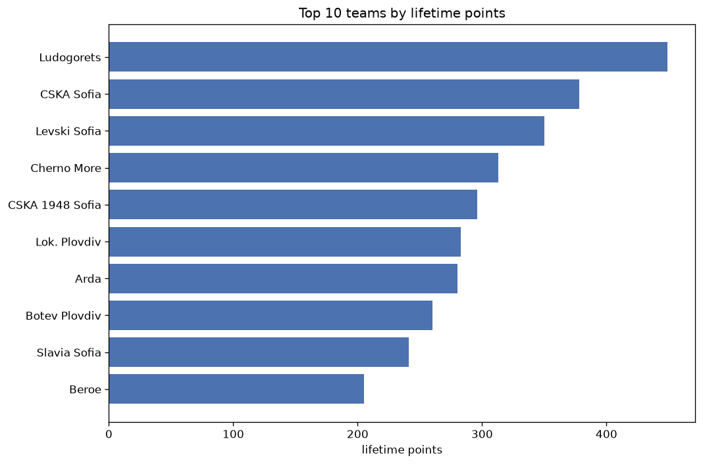
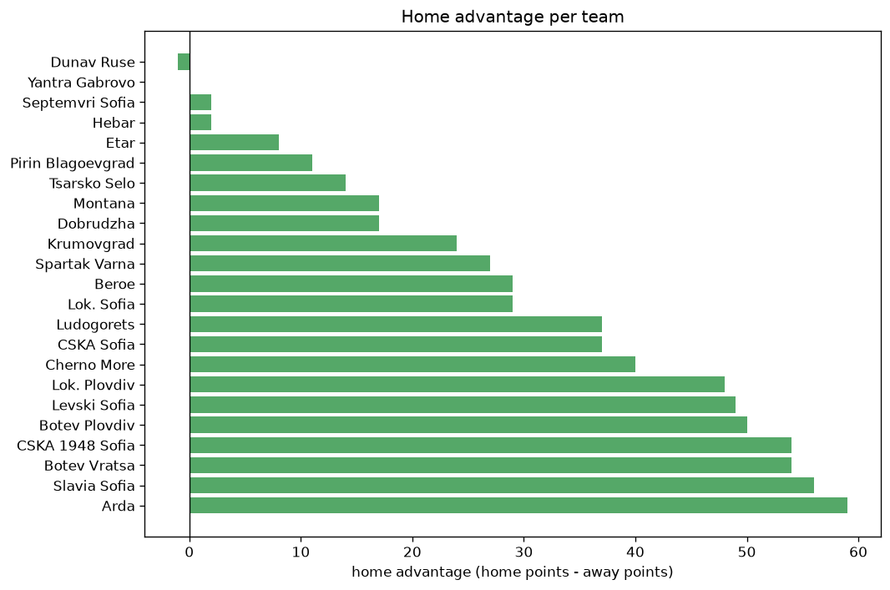

# Team Analysis
- Report: `teams_analysis`
- Generated: 2026-10-30T03:46:22+00:00
- Script: `backend/scripts/analyze_teams.py` v1.0.0
- League: efbet League (Bulgaria)
- Scope: league `bulgaria1`

- Teams: **23** | Seasons: **7** | Matches: **1461**

## 1. Team standings (lifetime)
| team | seasons | played | W | D | L | pts | GF | GA | GD | avg pts/season | best pos | worst pos | titles |
|---|---|---|---|---|---|---|---|---|---|---|---|---|---|
| Ludogorets | 7 | 190 | 140 | 29 | 21 | 449 | 418 | 125 | 293 | 64.14 | 1 | 3 | 5 |
| CSKA Sofia | 7 | 190 | 111 | 45 | 34 | 378 | 301 | 144 | 157 | 54.0 | 1 | 7 | 1 |
| Levski Sofia | 7 | 189 | 103 | 41 | 45 | 350 | 291 | 147 | 144 | 50.0 | 1 | 9 | 1 |
| Cherno More | 7 | 190 | 85 | 58 | 47 | 313 | 239 | 176 | 63 | 44.71 | 3 | 13 | 0 |
| CSKA 1948 Sofia | 7 | 190 | 82 | 50 | 58 | 296 | 266 | 207 | 59 | 42.29 | 3 | 10 | 0 |
| Lok. Plovdiv | 7 | 191 | 77 | 52 | 62 | 283 | 223 | 212 | 11 | 40.43 | 2 | 14 | 0 |
| Arda | 7 | 190 | 76 | 52 | 62 | 280 | 235 | 212 | 23 | 40.0 | 3 | 10 | 0 |
| Botev Plovdiv | 7 | 190 | 72 | 44 | 74 | 260 | 242 | 241 | 1 | 37.14 | 3 | 10 | 0 |
| Slavia Sofia | 7 | 191 | 65 | 46 | 80 | 241 | 202 | 233 | -31 | 34.43 | 6 | 11 | 0 |
| Beroe | 6 | 179 | 54 | 43 | 82 | 205 | 173 | 225 | -52 | 34.17 | 6 | 14 | 0 |
| Botev Vratsa | 7 | 191 | 44 | 46 | 101 | 178 | 164 | 305 | -141 | 25.43 | 8 | 15 | 0 |
| Lok. Sofia | 6 | 165 | 44 | 45 | 76 | 177 | 169 | 253 | -84 | 29.5 | 9 | 14 | 0 |
| Spartak Varna | 4 | 109 | 28 | 31 | 50 | 115 | 112 | 172 | -60 | 28.75 | 6 | 16 | 0 |
| Septemvri Sofia | 4 | 110 | 27 | 21 | 62 | 102 | 101 | 180 | -79 | 25.5 | 11 | 15 | 0 |
| Pirin Blagoevgrad | 3 | 86 | 19 | 24 | 43 | 81 | 78 | 121 | -43 | 27.0 | 11 | 13 | 0 |
| Krumovgrad | 2 | 60 | 19 | 17 | 24 | 74 | 51 | 66 | -15 | 37.0 | 7 | 12 | 0 |
| Hebar | 3 | 90 | 17 | 19 | 54 | 70 | 74 | 147 | -73 | 23.33 | 12 | 16 | 0 |
| Tsarsko Selo | 2 | 52 | 12 | 14 | 26 | 50 | 44 | 63 | -19 | 25.0 | 8 | 14 | 0 |
| Montana | 2 | 63 | 8 | 19 | 36 | 43 | 42 | 101 | -59 | 21.5 | 14 | 16 | 0 |
| Etar | 2 | 56 | 7 | 15 | 34 | 36 | 37 | 101 | -64 | 18.0 | 13 | 16 | 0 |
| Dobrudzha | 1 | 37 | 8 | 7 | 22 | 31 | 28 | 52 | -24 | 31.0 | 15 | 15 | 0 |
| Dunav Ruse | 1 | 12 | 3 | 2 | 7 | 11 | 15 | 21 | -6 | 11.0 | 9 | 9 | 0 |
| Yantra Gabrovo | 1 | 1 | 0 | 0 | 1 | 0 | 1 | 2 | -1 | 0.0 | 17 | 17 | 0 |

## 2. Home vs away split
| team | home P | H-W | H-D | H-L | H-pts | away P | A-W | A-D | A-L | A-pts | adv |
|---|---|---|---|---|---|---|---|---|---|---|---|
| Arda | 95 | 47 | 29 | 19 | 170 | 95 | 29 | 23 | 43 | 110 | 60 |
| Slavia Sofia | 96 | 41 | 25 | 30 | 148 | 95 | 24 | 21 | 50 | 93 | 55 |
| CSKA 1948 Sofia | 96 | 52 | 19 | 25 | 175 | 94 | 30 | 31 | 33 | 121 | 54 |
| Botev Vratsa | 95 | 30 | 26 | 39 | 116 | 96 | 14 | 20 | 62 | 62 | 54 |
| Botev Plovdiv | 95 | 45 | 20 | 30 | 155 | 95 | 27 | 24 | 44 | 105 | 50 |
| Lok. Plovdiv | 95 | 48 | 22 | 25 | 166 | 96 | 29 | 30 | 37 | 117 | 49 |
| Levski Sofia | 94 | 62 | 13 | 19 | 199 | 95 | 41 | 28 | 26 | 151 | 48 |
| Cherno More | 95 | 50 | 28 | 17 | 178 | 95 | 35 | 30 | 30 | 135 | 43 |
| CSKA Sofia | 95 | 62 | 23 | 10 | 209 | 95 | 49 | 22 | 24 | 169 | 40 |
| Ludogorets | 96 | 76 | 15 | 5 | 243 | 94 | 64 | 14 | 16 | 206 | 37 |
| Beroe | 89 | 31 | 24 | 34 | 117 | 90 | 23 | 19 | 48 | 88 | 29 |
| Lok. Sofia | 83 | 26 | 25 | 32 | 103 | 82 | 18 | 20 | 44 | 74 | 29 |
| Spartak Varna | 55 | 19 | 14 | 22 | 71 | 54 | 9 | 17 | 28 | 44 | 27 |
| Krumovgrad | 30 | 14 | 7 | 9 | 49 | 30 | 5 | 10 | 15 | 25 | 24 |
| Montana | 31 | 7 | 9 | 15 | 30 | 32 | 1 | 10 | 21 | 13 | 17 |
| Dobrudzha | 18 | 7 | 3 | 8 | 24 | 19 | 1 | 4 | 14 | 7 | 17 |
| Tsarsko Selo | 26 | 8 | 8 | 10 | 32 | 26 | 4 | 6 | 16 | 18 | 14 |
| Pirin Blagoevgrad | 43 | 11 | 13 | 19 | 46 | 43 | 8 | 11 | 24 | 35 | 11 |
| Etar | 28 | 4 | 10 | 14 | 22 | 28 | 3 | 5 | 20 | 14 | 8 |
| Septemvri Sofia | 55 | 13 | 13 | 29 | 52 | 55 | 14 | 8 | 33 | 50 | 2 |
| Hebar | 45 | 8 | 12 | 25 | 36 | 45 | 9 | 7 | 29 | 34 | 2 |
| Yantra Gabrovo | 0 | 0 | 0 | 0 | 0 | 1 | 0 | 0 | 1 | 0 | 0 |
| Dunav Ruse | 6 | 1 | 2 | 3 | 5 | 6 | 2 | 0 | 4 | 6 | -1 |

## 3. Top performers
### Best points per game (PPG)
| rank | team | PPG |
|---|---|---|
| 1 | Ludogorets | 2.36 |
| 2 | CSKA Sofia | 1.99 |
| 3 | Levski Sofia | 1.85 |
| 4 | Cherno More | 1.65 |
| 5 | CSKA 1948 Sofia | 1.56 |

### Most goals scored
| rank | team | goals |
|---|---|---|
| 1 | Ludogorets | 418 |
| 2 | CSKA Sofia | 301 |
| 3 | Levski Sofia | 291 |
| 4 | CSKA 1948 Sofia | 266 |
| 5 | Botev Plovdiv | 242 |

### Best goal difference
| rank | team | GD |
|---|---|---|
| 1 | Ludogorets | 293 |
| 2 | CSKA Sofia | 157 |
| 3 | Levski Sofia | 144 |
| 4 | Cherno More | 63 |
| 5 | CSKA 1948 Sofia | 59 |

### Best defence (goals against per match, standings)
| rank | team | GA/match |
|---|---|---|
| 1 | Ludogorets | 0.661 |
| 2 | CSKA Sofia | 0.758 |
| 3 | Levski Sofia | 0.778 |
| 4 | Cherno More | 0.926 |
| 5 | CSKA 1948 Sofia | 1.089 |

## 4. Team consistency
- Teams present in all **7** seasons: **10**

Arda, Botev Plovdiv, Botev Vratsa, CSKA 1948 Sofia, CSKA Sofia, Cherno More, Levski Sofia, Lok. Plovdiv, Ludogorets, Slavia Sofia

## 5. Head-to-head dominance
- Distinct fixtures: **209** (showing the 15 most frequent)

| fixture | meetings | home wins | draws | away wins | home pct | draw pct | away pct |
|---|---|---|---|---|---|---|---|
| Ludogorets vs CSKA Sofia | 15 | 10 | 3 | 2 | 66.7% | 20.0% | 13.3% |
| Cherno More vs Botev Plovdiv | 15 | 9 | 3 | 3 | 60.0% | 20.0% | 20.0% |
| Lok. Plovdiv vs Arda | 15 | 8 | 3 | 4 | 53.3% | 20.0% | 26.7% |
| CSKA 1948 Sofia vs Levski Sofia | 15 | 7 | 4 | 4 | 46.7% | 26.7% | 26.7% |
| Lok. Plovdiv vs Botev Plovdiv | 15 | 6 | 6 | 3 | 40.0% | 40.0% | 20.0% |
| Lok. Plovdiv vs Cherno More | 15 | 6 | 6 | 3 | 40.0% | 40.0% | 20.0% |
| Arda vs Cherno More | 15 | 5 | 7 | 3 | 33.3% | 46.7% | 20.0% |
| Arda vs Botev Plovdiv | 15 | 4 | 2 | 9 | 26.7% | 13.3% | 60.0% |
| CSKA Sofia vs CSKA 1948 Sofia | 15 | 4 | 3 | 8 | 26.7% | 20.0% | 53.3% |
| Ludogorets vs CSKA 1948 Sofia | 14 | 8 | 2 | 4 | 57.1% | 14.3% | 28.6% |
| Ludogorets vs Lok. Plovdiv | 14 | 8 | 3 | 3 | 57.1% | 21.4% | 21.4% |
| Slavia Sofia vs Botev Vratsa | 14 | 8 | 2 | 4 | 57.1% | 14.3% | 28.6% |
| Ludogorets vs Levski Sofia | 14 | 6 | 4 | 4 | 42.9% | 28.6% | 28.6% |
| CSKA Sofia vs Levski Sofia | 14 | 5 | 5 | 4 | 35.7% | 35.7% | 28.6% |
| Arda vs Slavia Sofia | 13 | 10 | 3 | 0 | 76.9% | 23.1% | 0.0% |

## 6. Position per season (classic view)
_Cells show final position; '-' when the team was absent from that season._

| team | 2020-2021 | 2021-2022 | 2022-2023 | 2023-2024 | 2024-2025 | 2025-2026 | 2026-2027 |
|---|---|---|---|---|---|---|---|
| Ludogorets | 1 | 1 | 1 | 1 | 1 | 2 | 3 |
| CSKA Sofia | 3 | 2 | 2 | 2 | 7 | 4 | 1 |
| Levski Sofia | 9 | 5 | 4 | 5 | 2 | 1 | 2 |
| Cherno More | 7 | 4 | 5 | 3 | 4 | 7 | 13 |
| CSKA 1948 Sofia | 5 | 9 | 3 | 8 | 10 | 3 | 4 |
| Lok. Plovdiv | 2 | 7 | 6 | 4 | 14 | 5 | 12 |
| Arda | 4 | 10 | 8 | 9 | 3 | 6 | 6 |
| Botev Plovdiv | 10 | 3 | 10 | 6 | 5 | 10 | 5 |
| Slavia Sofia | 11 | 6 | 7 | 10 | 9 | 11 | 8 |
| Beroe | 6 | 8 | 12 | 11 | 8 | 14 | - |
| Botev Vratsa | 12 | 13 | 11 | 15 | 15 | 8 | 10 |
| Lok. Sofia | - | 12 | 9 | 14 | 13 | 9 | 11 |
| Spartak Varna | - | - | 16 | - | 6 | 13 | 7 |
| Septemvri Sofia | - | - | 15 | - | 11 | 12 | 14 |
| Pirin Blagoevgrad | - | 11 | 13 | 13 | - | - | - |
| Krumovgrad | - | - | - | 7 | 12 | - | - |
| Hebar | - | - | 14 | 12 | 16 | - | - |
| Tsarsko Selo | 8 | 14 | - | - | - | - | - |
| Montana | 14 | - | - | - | - | 16 | - |
| Etar | 13 | - | - | 16 | - | - | - |
| Dobrudzha | - | - | - | - | - | 15 | - |
| Dunav Ruse | - | - | - | - | - | - | 9 |
| Yantra Gabrovo | - | - | - | - | - | 17 | - |

---
*All statistics are computed from PostgreSQL tables (read-only). Run with `python backend/scripts/analyze_teams.py` to regenerate.*

## Charts

