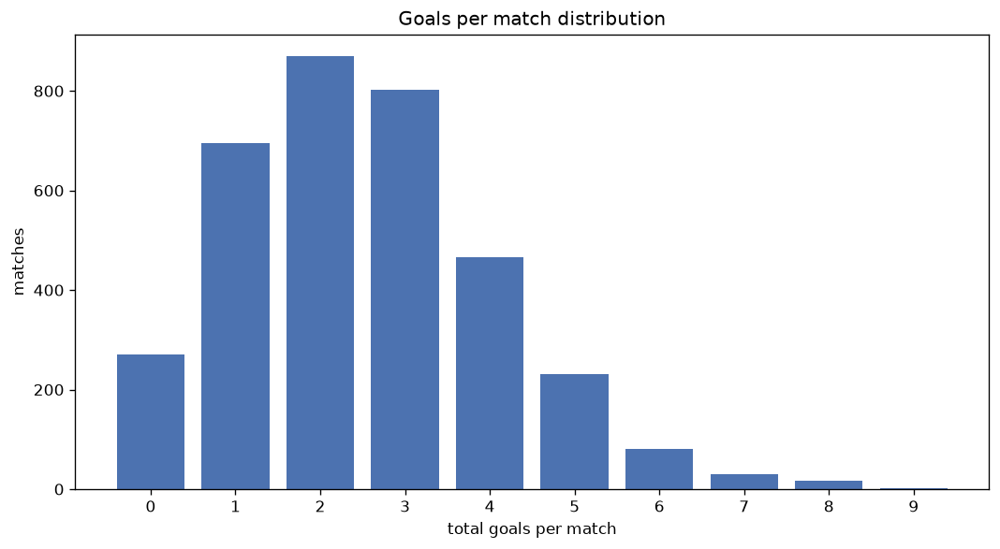
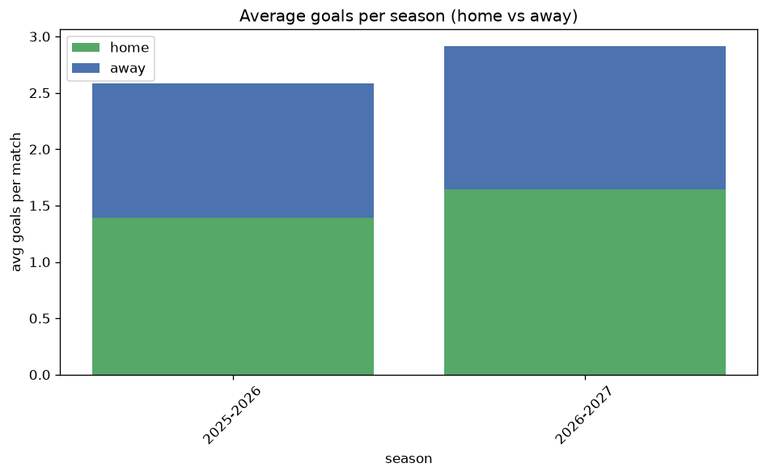

# Goal Analysis
- Report: `goals_analysis`
- Generated: 2026-10-27T01:42:23+00:00
- Script: `backend/scripts/analyze_goals.py` v1.0.0
- League: Championship (England)
- Scope: league `cha`

## 1. Goals per match distribution
| goals | matches | pct |
|---|---|---|
| 0 | 270 | 7.8% |
| 1 | 695 | 20.1% |
| 2 | 870 | 25.1% |
| 3 | 803 | 23.2% |
| 4 | 466 | 13.5% |
| 5 | 232 | 6.7% |
| 6 | 80 | 2.3% |
| 7 | 30 | 0.9% |
| 8 | 16 | 0.5% |
| 9 | 1 | 0.0% |

## 2. Goals per match per season
| season | matches | total goals | avg home | avg away | avg total |
|---|---|---|---|---|---|
| 2020-2021 | 552 | 1274 | 1.252 | 1.056 | 2.308 |
| 2021-2022 | 552 | 1385 | 1.415 | 1.094 | 2.509 |
| 2022-2023 | 552 | 1342 | 1.324 | 1.107 | 2.431 |
| 2023-2024 | 552 | 1480 | 1.482 | 1.199 | 2.681 |
| 2024-2025 | 552 | 1353 | 1.435 | 1.016 | 2.451 |
| 2025-2026 | 559 | 1445 | 1.39 | 1.195 | 2.585 |
| 2026-2027 | 144 | 416 | 1.597 | 1.292 | 2.889 |

## 3. Home vs away goal share
- Home goals: **4820** (55.4%)
- Away goals: **3875** (44.6%)
- Home/away ratio: **1.244**

| season | home goals | away goals | total | home pct | away pct |
|---|---|---|---|---|---|
| 2020-2021 | 691 | 583 | 1274 | 54.2% | 45.8% |
| 2021-2022 | 781 | 604 | 1385 | 56.4% | 43.6% |
| 2022-2023 | 731 | 611 | 1342 | 54.5% | 45.5% |
| 2023-2024 | 818 | 662 | 1480 | 55.3% | 44.7% |
| 2024-2025 | 792 | 561 | 1353 | 58.5% | 41.5% |
| 2025-2026 | 777 | 668 | 1445 | 53.8% | 46.2% |
| 2026-2027 | 230 | 186 | 416 | 55.3% | 44.7% |

## 4. BTTS (Both Teams To Score)
- Overall: **1757** of `3463` (50.7%)

| season | matches | BTTS | pct |
|---|---|---|---|
| 2020-2021 | 552 | 250 | 45.3% |
| 2021-2022 | 552 | 268 | 48.6% |
| 2022-2023 | 552 | 267 | 48.4% |
| 2023-2024 | 552 | 289 | 52.4% |
| 2024-2025 | 552 | 277 | 50.2% |
| 2025-2026 | 559 | 315 | 56.4% |
| 2026-2027 | 144 | 91 | 63.2% |

## 5. Clean sheets
- Home clean sheets: **1118** (32.3%)
- Away clean sheets: **858** (24.8%)
- Total clean sheets recorded: **1976**
- Matches with at least one clean sheet: **1706** (49.3%)
- Both teams kept clean sheets (0-0): **270**

| season | matches | home CS | away CS | total CS | matches w/ CS |
|---|---|---|---|---|---|
| 2020-2021 | 552 | 193 | 162 | 355 | 302 (54.7%) |
| 2021-2022 | 552 | 191 | 137 | 328 | 284 (51.4%) |
| 2022-2023 | 552 | 188 | 145 | 333 | 285 (51.6%) |
| 2023-2024 | 552 | 166 | 132 | 298 | 263 (47.6%) |
| 2024-2025 | 552 | 191 | 128 | 319 | 275 (49.8%) |
| 2025-2026 | 559 | 157 | 124 | 281 | 244 (43.6%) |
| 2026-2027 | 144 | 32 | 30 | 62 | 53 (36.8%) |

## 6. Scoring intensity
- First-half goals: **3896** (44.8%)
- Second-half goals: **4798** (55.2%)
- Avg first-half goals per match: **1.126**
- Avg second-half goals per match: **1.386**
- Second-half-only scoring (HT 0-0, FT goals >= 1): **835** (24.1%)
- *2 match(es) excluded (no HT score recorded).*

| season | matches | 1st half | 2nd half | 1st half pct | 2nd half pct |
|---|---|---|---|---|---|
| 2020-2021 | 552 | 569 | 705 | 44.7% | 55.3% |
| 2021-2022 | 552 | 562 | 823 | 40.6% | 59.4% |
| 2022-2023 | 552 | 606 | 736 | 45.2% | 54.8% |
| 2023-2024 | 552 | 682 | 798 | 46.1% | 53.9% |
| 2024-2025 | 552 | 604 | 749 | 44.6% | 55.4% |
| 2025-2026 | 559 | 669 | 775 | 46.3% | 53.7% |
| 2026-2027 | 144 | 204 | 212 | 49.0% | 51.0% |

## 7. First-goal timing
- Matches with first-goal time recorded: `3192` of `3463` (92.2%)
- Goalless matches: `271`
- Min `1` | Max `97` | Mean `31.77` | Median (p50) `26.0`

| bucket | count | % of matches | % of scoring matches |
|---|---|---|---|
| 1-15 | 1026 | 29.6% | 32.1% |
| 16-30 | 762 | 22.0% | 23.9% |
| 31-45 | 510 | 14.7% | 16.0% |
| 46-60 | 451 | 13.0% | 14.1% |
| 61-75 | 241 | 7.0% | 7.6% |
| 76-90 | 162 | 4.7% | 5.1% |
| 91-120 | 40 | 1.2% | 1.3% |

---
*All statistics are computed from PostgreSQL tables (read-only). Run with `python backend/scripts/analyze_goals.py` to regenerate.*

## Charts

