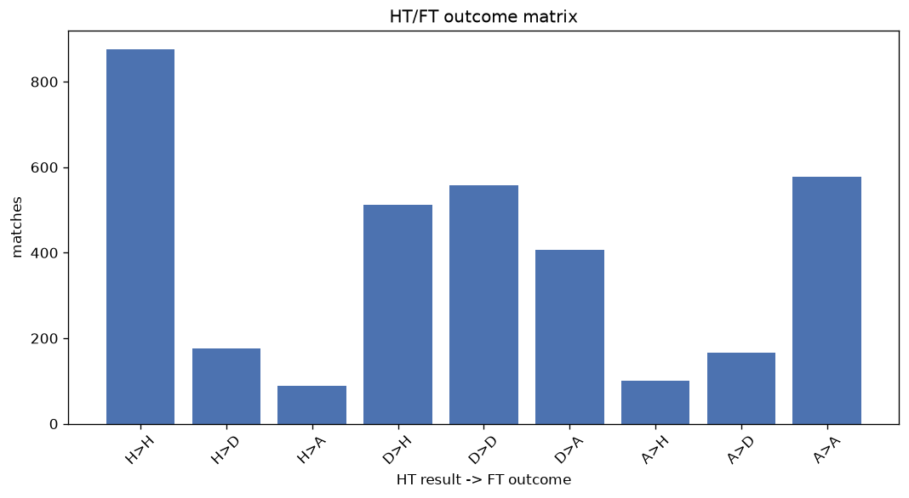
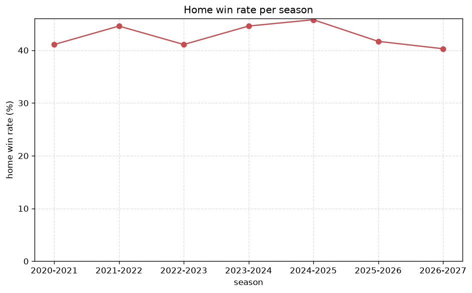

# Match Analysis
- Report: `matches_analysis`
- Generated: 2026-10-26T01:28:10+00:00
- Script: `backend/scripts/analyze_matches.py` v1.0.0
- League: Championship (England)
- Scope: league `cha`

## 1. Overall summary
| metric | value |
|---|---|
| Matches | 3463 |
| Home wins | 1490 (43.0%) |
| Draws | 901 (26.0%) |
| Away wins | 1072 (31.0%) |
| Total goals | 8695 |
| Average goals per match | 2.511 |
| Goalless matches | 270 (7.8%) |

## 2. Per-season breakdown
| season | matches | home wins | draws | away wins | total goals | avg goals | goalless |
|---|---|---|---|---|---|---|---|
| 2020-2021 | 552 | 227 (41.1%) | 139 (25.2%) | 186 (33.7%) | 1274 | 2.308 | 53 (9.6%) |
| 2021-2022 | 552 | 246 (44.6%) | 139 (25.2%) | 167 (30.3%) | 1385 | 2.509 | 44 (8.0%) |
| 2022-2023 | 552 | 227 (41.1%) | 149 (27.0%) | 176 (31.9%) | 1342 | 2.431 | 48 (8.7%) |
| 2023-2024 | 552 | 246 (44.6%) | 129 (23.4%) | 177 (32.1%) | 1480 | 2.681 | 35 (6.3%) |
| 2024-2025 | 552 | 253 (45.8%) | 156 (28.3%) | 143 (25.9%) | 1353 | 2.451 | 44 (8.0%) |
| 2025-2026 | 559 | 233 (41.7%) | 149 (26.7%) | 177 (31.7%) | 1445 | 2.585 | 37 (6.6%) |
| 2026-2027 | 144 | 58 (40.3%) | 40 (27.8%) | 46 (31.9%) | 416 | 2.889 | 9 (6.2%) |

## 3. HT/FT outcome matrix
| HT result \ FT result | Home | Draw | Away | total |
|---|---|---|---|---|
| HT home lead | 875 (76.7%) | 177 (15.5%) | 89 (7.8%) | 1141 |
| HT draw | 513 (34.8%) | 557 (37.7%) | 406 (27.5%) | 1476 |
| HT away lead | 101 (12.0%) | 166 (19.7%) | 577 (68.4%) | 844 |
- *2 match(es) excluded (no HT score recorded).*

## 4. Comeback matches
- Home comebacks (trailing at HT, won at FT): **101** (2.9%)
- Away comebacks (trailing at HT, won at FT): **89** (2.6%)

### Home comebacks
| season | home | away | HT | FT |
|---|---|---|---|---|
| 2020-2021 | Bournemouth | Reading | 0-2 | 4-2 |
| 2020-2021 | Barnsley | Preston | 0-1 | 2-1 |
| 2020-2021 | QPR | Brentford | 0-1 | 2-1 |
| 2020-2021 | Birmingham | QPR | 0-1 | 2-1 |
| 2020-2021 | Luton | Sheffield Wed | 0-2 | 3-2 |
| 2020-2021 | Brentford | Stoke | 0-1 | 2-1 |
| 2020-2021 | QPR | Millwall | 0-2 | 3-2 |
| 2020-2021 | Wycombe | Bristol City | 0-1 | 2-1 |
| 2021-2022 | Coventry | Nottingham | 0-1 | 2-1 |
| 2021-2022 | Coventry | Reading | 0-1 | 2-1 |
| 2021-2022 | West Brom | QPR | 0-1 | 2-1 |
| 2021-2022 | Coventry | Fulham | 0-1 | 4-1 |
| 2021-2022 | Swansea | West Brom | 0-1 | 2-1 |
| 2021-2022 | Preston | Coventry | 0-1 | 2-1 |
| 2021-2022 | Millwall | Stoke | 0-1 | 2-1 |
| 2021-2022 | Luton | Middlesbrough | 0-1 | 3-1 |
| 2021-2022 | Coventry | Bristol City | 0-1 | 3-2 |
| 2021-2022 | Cardiff | Huddersfield | 0-1 | 2-1 |
| 2021-2022 | Derby | Bournemouth | 1-2 | 3-2 |
| 2021-2022 | Peterborough | Millwall | 0-1 | 2-1 |
| 2021-2022 | Nottingham | Hull | 0-1 | 2-1 |
| 2021-2022 | Huddersfield | Blackpool | 1-2 | 3-2 |
| 2021-2022 | Bristol City | Millwall | 1-2 | 3-2 |
| 2021-2022 | Swansea | Bristol City | 0-1 | 3-1 |
| 2021-2022 | Middlesbrough | West Brom | 0-1 | 2-1 |
| 2021-2022 | Bournemouth | Stoke | 0-1 | 2-1 |
| 2021-2022 | Blackburn | Derby | 0-1 | 3-1 |
| 2021-2022 | Nottingham | QPR | 0-1 | 3-1 |
| 2021-2022 | Derby | Fulham | 0-1 | 2-1 |
| 2022-2023 | Hull | Bristol City | 0-1 | 2-1 |
| 2022-2023 | Millwall | Coventry | 1-2 | 3-2 |
| 2022-2023 | Sunderland | Wigan | 0-1 | 2-1 |
| 2022-2023 | Swansea | Reading | 1-2 | 3-2 |
| 2022-2023 | Sheffield Utd | Burnley | 1-2 | 5-2 |
| 2022-2023 | Wigan | Blackpool | 0-1 | 2-1 |
| 2022-2023 | Burnley | West Brom | 0-1 | 2-1 |
| 2022-2023 | Reading | Rotherham | 0-1 | 2-1 |
| 2022-2023 | Preston | Wigan | 0-1 | 2-1 |
| 2022-2023 | Huddersfield | Middlesbrough | 0-1 | 4-2 |
| 2022-2023 | Middlesbrough | Hull | 0-1 | 3-1 |
| 2022-2023 | Luton | Middlesbrough | 0-1 | 2-1 |
| 2023-2024 | Preston | Swansea | 0-1 | 2-1 |
| 2023-2024 | Ipswich | Cardiff | 0-1 | 3-2 |
| 2023-2024 | Leicester | Millwall | 0-1 | 3-2 |
| 2023-2024 | Sheffield Wed | QPR | 0-1 | 2-1 |
| 2023-2024 | Bristol City | Hull | 1-2 | 3-2 |
| 2023-2024 | Coventry | Leicester | 0-1 | 3-1 |
| 2023-2024 | Sunderland | Plymouth | 0-1 | 3-1 |
| 2023-2024 | Southampton | Huddersfield | 0-2 | 5-3 |
| 2023-2024 | Coventry | Millwall | 0-1 | 2-1 |
| 2023-2024 | Birmingham | Sunderland | 0-1 | 2-1 |
| 2023-2024 | Leeds | Leicester | 0-1 | 3-1 |
| 2023-2024 | QPR | Rotherham | 0-1 | 2-1 |
| 2023-2024 | Norwich | Plymouth | 0-1 | 2-1 |
| 2023-2024 | Ipswich | Southampton | 1-2 | 3-2 |
| 2023-2024 | Preston | Huddersfield | 0-1 | 4-1 |
| 2023-2024 | Cardiff | Southampton | 0-1 | 2-1 |
| 2024-2025 | Plymouth | Sunderland | 0-1 | 3-2 |
| 2024-2025 | Burnley | Portsmouth | 0-1 | 2-1 |
| 2024-2025 | Bristol City | Oxford Utd | 0-1 | 2-1 |
| 2024-2025 | Coventry | Luton | 0-2 | 3-2 |
| 2024-2025 | Coventry | Hull | 0-1 | 2-1 |
| 2024-2025 | Sunderland | Norwich | 0-1 | 2-1 |
| 2024-2025 | QPR | Preston | 0-1 | 2-1 |
| 2024-2025 | Watford | Portsmouth | 0-1 | 2-1 |
| 2024-2025 | Norwich | Coventry | 0-1 | 2-1 |
| 2024-2025 | Portsmouth | Middlesbrough | 0-1 | 2-1 |
| 2024-2025 | Oxford Utd | Luton | 1-2 | 3-2 |
| 2024-2025 | Leeds | Sunderland | 0-1 | 2-1 |
| 2024-2025 | Bristol City | Middlesbrough | 0-1 | 2-1 |
| 2024-2025 | Middlesbrough | Oxford Utd | 0-1 | 2-1 |
| 2024-2025 | Plymouth | Sheffield Utd | 0-1 | 2-1 |
| 2024-2025 | Bristol City | Sunderland | 0-1 | 2-1 |
| 2024-2025 | Sheffield Wed | Middlesbrough | 0-1 | 2-1 |
| 2024-2025 | Hull | Preston | 0-1 | 2-1 |
| 2025-2026 | Southampton | Wrexham | 0-1 | 2-1 |
| 2025-2026 | Leicester | Sheffield Wed | 0-1 | 2-1 |
| 2025-2026 | Watford | Hull | 0-1 | 2-1 |
| 2025-2026 | Preston | Sheffield Utd | 1-2 | 3-2 |
| 2025-2026 | Blackburn | Southampton | 0-1 | 2-1 |
| 2025-2026 | Wrexham | Coventry | 0-1 | 3-2 |
| 2025-2026 | Coventry | Sheffield Utd | 0-1 | 3-1 |
| 2025-2026 | Coventry | West Brom | 1-2 | 3-2 |
| 2025-2026 | West Brom | Swansea | 0-2 | 3-2 |
| 2025-2026 | Middlesbrough | Derby | 0-1 | 2-1 |
| 2025-2026 | Watford | Norwich | 1-2 | 3-2 |
| 2025-2026 | Portsmouth | Blackburn | 0-1 | 2-1 |
| 2025-2026 | Swansea | Wrexham | 0-1 | 2-1 |
| 2025-2026 | Wrexham | Sheffield Utd | 2-3 | 5-3 |
| 2025-2026 | Coventry | Leicester | 0-1 | 2-1 |
| 2025-2026 | Norwich | Coventry | 0-1 | 2-1 |
| 2025-2026 | Derby | Blackburn | 0-1 | 3-1 |
| 2025-2026 | Norwich | Sheffield Utd | 0-1 | 2-1 |
| 2025-2026 | Sheffield Utd | Hull | 0-1 | 2-1 |
| 2025-2026 | Southampton | Derby | 0-1 | 2-1 |
| 2026-2027 | Middlesbrough | Lincoln | 0-1 | 2-1 |
| 2026-2027 | Charlton | Derby | 0-1 | 2-1 |
| 2026-2027 | Blackburn | Middlesbrough | 0-1 | 2-1 |
| 2026-2027 | Watford | Preston | 0-1 | 2-1 |
| 2026-2027 | Swansea | Norwich | 0-1 | 2-1 |
| 2026-2027 | West Brom | Blackburn | 1-2 | 3-2 |

### Away comebacks
| season | home | away | HT | FT |
|---|---|---|---|---|
| 2020-2021 | Brentford | Preston | 2-0 | 2-4 |
| 2020-2021 | Wycombe | Millwall | 1-0 | 1-2 |
| 2020-2021 | Rotherham | Norwich | 1-0 | 1-2 |
| 2020-2021 | Huddersfield | Preston | 1-0 | 1-2 |
| 2020-2021 | Huddersfield | Bristol City | 1-0 | 1-2 |
| 2020-2021 | Birmingham | Wycombe | 1-0 | 1-2 |
| 2020-2021 | Stoke | Cardiff | 1-0 | 1-2 |
| 2020-2021 | Cardiff | Brentford | 1-0 | 2-3 |
| 2020-2021 | Huddersfield | Reading | 1-0 | 1-2 |
| 2020-2021 | Reading | Millwall | 1-0 | 1-2 |
| 2020-2021 | Huddersfield | Wycombe | 2-1 | 2-3 |
| 2020-2021 | Bournemouth | Barnsley | 2-1 | 2-3 |
| 2020-2021 | Sheffield Wed | Norwich | 1-0 | 1-2 |
| 2020-2021 | Wycombe | Luton | 1-0 | 1-3 |
| 2020-2021 | Norwich | Bournemouth | 1-0 | 1-3 |
| 2020-2021 | Derby | Birmingham | 1-0 | 1-2 |
| 2020-2021 | Bristol City | Luton | 2-0 | 2-3 |
| 2020-2021 | Nottingham | Preston | 1-0 | 1-2 |
| 2021-2022 | Middlesbrough | QPR | 1-0 | 2-3 |
| 2021-2022 | Nottingham | Cardiff | 1-0 | 1-2 |
| 2021-2022 | Middlesbrough | Blackpool | 1-0 | 1-2 |
| 2021-2022 | Barnsley | Nottingham | 1-0 | 1-3 |
| 2021-2022 | Bristol City | Nottingham | 1-0 | 1-2 |
| 2021-2022 | Reading | Blackpool | 2-0 | 2-3 |
| 2021-2022 | Birmingham | Reading | 1-0 | 1-2 |
| 2021-2022 | Preston | Cardiff | 1-0 | 1-2 |
| 2021-2022 | Middlesbrough | Preston | 1-0 | 1-2 |
| 2021-2022 | Derby | QPR | 1-0 | 1-2 |
| 2021-2022 | Cardiff | Sheffield Utd | 1-0 | 2-3 |
| 2021-2022 | Blackpool | Bournemouth | 1-0 | 1-2 |
| 2021-2022 | QPR | Cardiff | 1-0 | 1-2 |
| 2021-2022 | Luton | QPR | 1-0 | 1-2 |
| 2021-2022 | Reading | Cardiff | 1-0 | 1-2 |
| 2021-2022 | QPR | Sheffield Utd | 1-0 | 1-3 |
| 2022-2023 | Luton | Wigan | 1-0 | 1-2 |
| 2022-2023 | Watford | Swansea | 1-0 | 1-2 |
| 2022-2023 | Sunderland | Burnley | 2-0 | 2-4 |
| 2022-2023 | Coventry | Blackpool | 1-0 | 1-2 |
| 2022-2023 | Norwich | Middlesbrough | 1-0 | 1-2 |
| 2022-2023 | Sunderland | West Brom | 1-0 | 1-2 |
| 2022-2023 | Preston | Huddersfield | 1-0 | 1-2 |
| 2022-2023 | Blackburn | Middlesbrough | 1-0 | 1-2 |
| 2022-2023 | Luton | West Brom | 2-1 | 2-3 |
| 2022-2023 | Swansea | Birmingham | 2-1 | 3-4 |
| 2022-2023 | Swansea | Middlesbrough | 1-0 | 1-3 |
| 2022-2023 | Stoke | Bristol City | 1-0 | 1-2 |
| 2022-2023 | Stoke | West Brom | 1-0 | 1-2 |
| 2022-2023 | West Brom | Sunderland | 1-0 | 1-2 |
| 2022-2023 | Millwall | Blackburn | 3-1 | 3-4 |
| 2023-2024 | Swansea | Bristol City | 1-0 | 1-2 |
| 2023-2024 | Bristol City | Stoke | 2-1 | 2-3 |
| 2023-2024 | Plymouth | Swansea | 1-0 | 1-3 |
| 2023-2024 | Norwich | Leeds | 2-0 | 2-3 |
| 2023-2024 | Cardiff | Norwich | 2-1 | 2-3 |
| 2023-2024 | Bristol City | Norwich | 1-0 | 1-2 |
| 2023-2024 | Middlesbrough | Hull | 1-0 | 1-2 |
| 2023-2024 | Blackburn | Watford | 1-0 | 1-2 |
| 2023-2024 | Sheffield Wed | Cardiff | 1-0 | 1-2 |
| 2023-2024 | Rotherham | Hull | 1-0 | 1-2 |
| 2023-2024 | Birmingham | Southampton | 2-1 | 3-4 |
| 2023-2024 | Huddersfield | West Brom | 1-0 | 1-4 |
| 2024-2025 | Luton | QPR | 1-0 | 1-2 |
| 2024-2025 | Stoke | Hull | 1-0 | 1-3 |
| 2024-2025 | Portsmouth | Sheffield Wed | 1-0 | 1-2 |
| 2024-2025 | Swansea | Leeds | 2-1 | 3-4 |
| 2024-2025 | Derby | Sheffield Wed | 1-0 | 1-2 |
| 2024-2025 | Swansea | Sunderland | 2-1 | 2-3 |
| 2024-2025 | Norwich | Burnley | 1-0 | 1-2 |
| 2024-2025 | Swansea | Sheffield Utd | 1-0 | 1-2 |
| 2024-2025 | Sheffield Utd | Leeds | 1-0 | 1-3 |
| 2024-2025 | Watford | Millwall | 1-0 | 1-2 |
| 2024-2025 | Norwich | Sheffield Wed | 2-0 | 2-3 |
| 2024-2025 | Preston | QPR | 1-0 | 1-2 |
| 2024-2025 | Plymouth | Leeds | 1-0 | 1-2 |
| 2025-2026 | Norwich | Wrexham | 1-0 | 2-3 |
| 2025-2026 | Sheffield Utd | Southampton | 1-0 | 1-2 |
| 2025-2026 | Bristol City | QPR | 1-0 | 1-2 |
| 2025-2026 | Blackburn | Sheffield Utd | 1-0 | 1-3 |
| 2025-2026 | Derby | Watford | 1-0 | 2-3 |
| 2025-2026 | Stoke | Hull | 1-0 | 1-2 |
| 2025-2026 | Sheffield Wed | Preston | 2-1 | 2-3 |
| 2025-2026 | Stoke | Middlesbrough | 1-0 | 1-2 |
| 2025-2026 | QPR | Wrexham | 1-0 | 2-3 |
| 2025-2026 | Leicester | Southampton | 3-0 | 3-4 |
| 2025-2026 | Middlesbrough | Millwall | 1-0 | 1-2 |
| 2025-2026 | Bristol City | Norwich | 1-0 | 2-4 |
| 2025-2026 | Swansea | Southampton | 1-0 | 1-2 |
| 2025-2026 | Derby | Sheffield Utd | 1-0 | 1-2 |
| 2026-2027 | Lincoln | Swansea | 1-0 | 1-2 |

## 5. HT lead conversion
| HT state | matches | converted to win | held as draw | collapsed to loss |
|---|---|---|---|---|
| Home lead | 1141 | 875 (76.7%) | 177 (15.5%) | 89 (7.8%) |
| Away lead | 844 | 577 (68.4%) | 166 (19.7%) | 101 (12.0%) |

### Matches level at half-time
| FT result | count | pct |
|---|---|---|
| Home win | 513 | 34.8% |
| Draw | 557 | 37.7% |
| Away win | 406 | 27.5% |
- *2 match(es) excluded (no HT score recorded).*

## 6. First-goal timing
- Matches with a first-goal time recorded: `3192` of `3463` (92.2%)

Outcome distribution by first-goal timing bucket:
| bucket | matches | % of matches | home | draw | away |
|---|---|---|---|---|---|
| 1-15 | 1026 | 29.6% | 486 (47.4%) | 200 (19.5%) | 340 (33.1%) |
| 16-30 | 762 | 22.0% | 366 (48.0%) | 168 (22.0%) | 228 (29.9%) |
| 31-45 | 510 | 14.7% | 240 (47.1%) | 102 (20.0%) | 168 (32.9%) |
| 46-60 | 451 | 13.0% | 190 (42.1%) | 100 (22.2%) | 161 (35.7%) |
| 61-75 | 241 | 7.0% | 110 (45.6%) | 38 (15.8%) | 93 (38.6%) |
| 76-90 | 162 | 4.7% | 75 (46.3%) | 21 (13.0%) | 66 (40.7%) |
| 91-120 | 40 | 1.2% | 22 (55.0%) | 2 (5.0%) | 16 (40.0%) |

## 7. Goalless matches
- Overall: **270** of `3463` (7.8%)

| season | matches | goalless | pct |
|---|---|---|---|
| 2020-2021 | 552 | 53 | 9.6% |
| 2021-2022 | 552 | 44 | 8.0% |
| 2022-2023 | 552 | 48 | 8.7% |
| 2023-2024 | 552 | 35 | 6.3% |
| 2024-2025 | 552 | 44 | 8.0% |
| 2025-2026 | 559 | 37 | 6.6% |
| 2026-2027 | 144 | 9 | 6.2% |

---
*All statistics are computed from PostgreSQL tables (read-only). Run with `python backend/scripts/analyze_matches.py` to regenerate.*

## Charts

