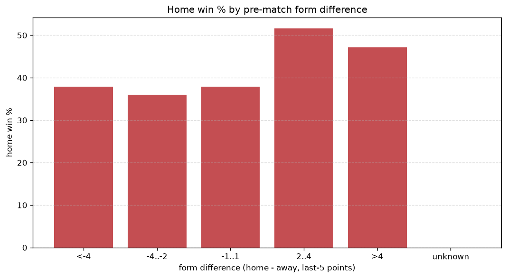
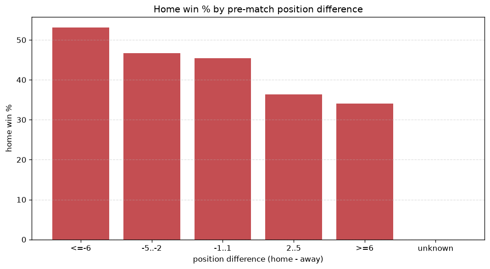

# Relationships Analysis
- Report: `relationships`
- Generated: 2026-10-29T01:55:33+00:00
- Script: `backend/scripts/analyze_relationships.py` v1.0.0
- League: Championship (England)
- Scope: league `cha`

- Matches analysed: **3319** (23 leakage-safe pre-match features).

## 1. Correlation matrix
_Pearson correlation of each pre-match feature with observed goals; sorted by |corr(total goals)|._

| feature | corr(home) | corr(away) | corr(total) |
|---|---|---|---|
| home_team_home_goals_avg | 0.096 | -0.045 | 0.043 |
| points_difference | 0.185 | -0.148 | 0.042 |
| home_position_before_match | -0.124 | 0.085 | -0.038 |
| position_difference | -0.165 | 0.133 | -0.036 |
| home_points_before_match | 0.080 | -0.039 | 0.035 |
| away_team_goals_scored_last_5 | -0.028 | 0.079 | 0.032 |
| home_team_goals_scored_last_5 | 0.097 | -0.065 | 0.030 |
| away_team_away_conceded_avg | 0.079 | -0.044 | 0.030 |
| home_team_home_win_rate | 0.078 | -0.052 | 0.024 |
| away_team_away_goals_avg | -0.056 | 0.091 | 0.019 |
| home_team_home_conceded_avg | -0.049 | 0.030 | -0.017 |
| home_rest_days | -0.015 | 0.039 | 0.015 |
| away_team_away_win_rate | -0.081 | 0.071 | -0.014 |
| home_team_goals_conceded_last_5 | -0.038 | 0.062 | 0.013 |
| away_position_before_match | 0.106 | -0.101 | 0.013 |
| away_rest_days | -0.007 | 0.025 | 0.011 |
| away_points_before_match | -0.039 | 0.056 | 0.008 |
| away_team_goals_conceded_last_5 | 0.072 | -0.069 | 0.008 |
| away_team_wins_last_5 | -0.055 | 0.072 | 0.007 |
| rest_days_difference | -0.013 | 0.022 | 0.005 |
| home_team_points_last_5 | 0.082 | -0.087 | 0.004 |
| home_team_wins_last_5 | 0.074 | -0.079 | 0.004 |
| away_team_points_last_5 | -0.062 | 0.072 | 0.001 |

## 2. Form vs outcome
_Home win/draw/away % per bucket of `home_team_points_last_5 - away_team_points_last_5`._

| bucket | matches | home | draw | away | home % | draw % | away % |
|---|---|---|---|---|---|---|---|
| <-4 | 543 | 187 | 148 | 208 | 34.4% | 27.3% | 38.3% |
| -4..-2 | 657 | 249 | 166 | 242 | 37.9% | 25.3% | 36.8% |
| -1..1 | 976 | 415 | 269 | 292 | 42.5% | 27.6% | 29.9% |
| 2..4 | 672 | 330 | 158 | 184 | 49.1% | 23.5% | 27.4% |
| >4 | 471 | 251 | 120 | 100 | 53.3% | 25.5% | 21.2% |
| unknown | 0 | 0 | 0 | 0 | - | - | - |

## 3. Position vs outcome
_Home win/draw/away % per bucket of `position_difference` (home position - away position; negative favours the home team)._

| bucket | matches | home | draw | away | home % | draw % | away % |
|---|---|---|---|---|---|---|---|
| <=-6 | 954 | 507 | 225 | 222 | 53.1% | 23.6% | 23.3% |
| -5..-2 | 527 | 246 | 123 | 158 | 46.7% | 23.3% | 30.0% |
| -1..1 | 366 | 166 | 106 | 94 | 45.4% | 29.0% | 25.7% |
| 2..5 | 473 | 172 | 138 | 163 | 36.4% | 29.2% | 34.5% |
| >=6 | 999 | 341 | 269 | 389 | 34.1% | 26.9% | 38.9% |
| unknown | 0 | 0 | 0 | 0 | - | - | - |

## 4. Rest advantage
_Home win/draw/away % per bucket of `rest_days_difference` (home rest - away rest). Matches with unknown rest are bucketed separately._

| bucket | matches | home | draw | away | home % | draw % | away % |
|---|---|---|---|---|---|---|---|
| <-1 | 214 | 104 | 39 | 71 | 48.6% | 18.2% | 33.2% |
| -1..0 | 420 | 169 | 123 | 128 | 40.2% | 29.3% | 30.5% |
| 0 | 2021 | 867 | 544 | 610 | 42.9% | 26.9% | 30.2% |
| 1..2 | 452 | 201 | 108 | 143 | 44.5% | 23.9% | 31.6% |
| >2 | 140 | 59 | 27 | 54 | 42.1% | 19.3% | 38.6% |
| unknown | 72 | 32 | 20 | 20 | 44.4% | 27.8% | 27.8% |
- *72 match(es) had unknown rest difference (missing rest data on at least one side).*

## 5. Home team quality
_Home win rate by `home_team_home_win_rate` tier (split at 0.5)._

- `< 0.5` tier: **40.5%** home win (837/2069)
- `>= 0.5` tier: **47.6%** home win (595/1250)
- Home-win gap (>= split minus < split): **+7.1 pp**

| tier | label | matches | home | draw | away | home % |
|---|---|---|---|---|---|---|
| low | < 0.5 | 2069 | 837 | 542 | 690 | 40.5% |
| high | >= 0.5 | 1250 | 595 | 319 | 336 | 47.6% |

## 6. Feature averages by result
_Mean feature value per outcome; `range` is home-minus-away spread of the group means._

| feature | home mean | draw mean | away mean | range |
|---|---|---|---|---|
| points_difference | 2.596 | -1.144 | -3.172 | 5.767 |
| position_difference | -1.681 | 0.926 | 2.197 | 3.878 |
| away_points_before_match | 29.629 | 30.477 | 33.112 | 3.483 |
| home_points_before_match | 32.225 | 29.333 | 29.941 | 2.892 |
| home_position_before_match | 11.680 | 13.113 | 13.738 | 2.058 |
| away_position_before_match | 13.361 | 12.187 | 11.541 | 1.820 |
| home_team_points_last_5 | 6.692 | 6.242 | 5.929 | 0.763 |
| away_team_points_last_5 | 6.192 | 6.491 | 6.854 | 0.662 |
| home_team_goals_scored_last_5 | 6.072 | 5.546 | 5.486 | 0.586 |
| away_team_goals_conceded_last_5 | 5.959 | 5.696 | 5.445 | 0.514 |
| home_team_goals_conceded_last_5 | 5.645 | 5.783 | 6.127 | 0.481 |
| away_team_goals_scored_last_5 | 5.633 | 5.826 | 6.102 | 0.470 |
| home_team_wins_last_5 | 1.823 | 1.672 | 1.574 | 0.249 |
| away_team_wins_last_5 | 1.650 | 1.767 | 1.879 | 0.229 |
| home_rest_days | 5.814 | 5.908 | 5.934 | 0.121 |
| home_team_home_goals_avg | 1.370 | 1.295 | 1.251 | 0.118 |
| away_team_away_conceded_avg | 1.366 | 1.289 | 1.263 | 0.103 |
| away_team_away_goals_avg | 1.033 | 1.074 | 1.130 | 0.098 |
| away_rest_days | 5.899 | 5.987 | 5.995 | 0.096 |
| home_team_home_conceded_avg | 1.045 | 1.072 | 1.113 | 0.068 |
| away_team_away_win_rate | 0.267 | 0.294 | 0.311 | 0.045 |
| home_team_home_win_rate | 0.429 | 0.402 | 0.387 | 0.042 |
| rest_days_difference | -0.086 | -0.078 | -0.061 | 0.025 |

---
*All features are leakage-safe pre-match values built by `ml.features.build_features.build_rows` from strictly prior matches. Run with `python backend/scripts/analyze_relationships.py` to regenerate.*

## Charts

