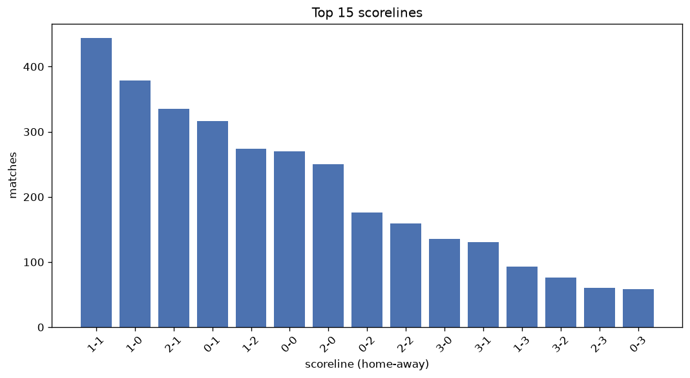
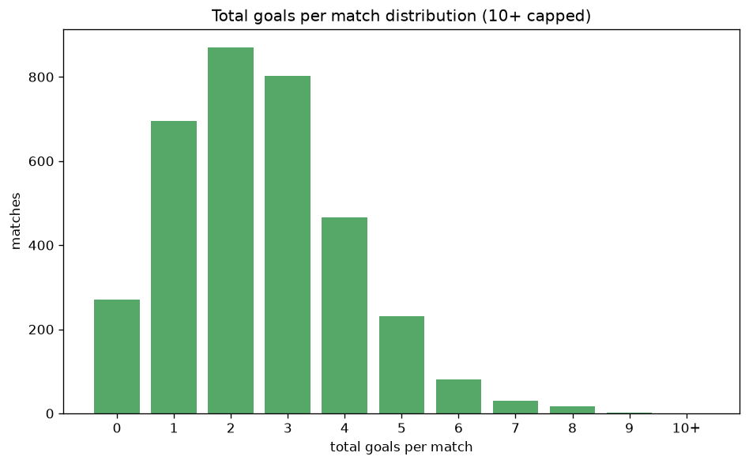

# Scoreline Analysis
- Report: `scoreline_analysis`
- Generated: 2026-10-26T01:28:16+00:00
- Script: `backend/scripts/analyze_scorelines.py` v1.0.0
- League: Championship (England)
- Scope: league `cha`

## 1. Scoreline frequency
- Matches analysed: **3463** across **7** seasons.
- Distinct scorelines seen: **41**.

| scoreline | count | pct |
|---|---|---|
| 1-1 | 444 | 12.8% |
| 1-0 | 379 | 10.9% |
| 2-1 | 335 | 9.7% |
| 0-1 | 316 | 9.1% |
| 1-2 | 274 | 7.9% |
| 0-0 | 270 | 7.8% |
| 2-0 | 250 | 7.2% |
| 0-2 | 176 | 5.1% |
| 2-2 | 159 | 4.6% |
| 3-0 | 136 | 3.9% |
| 3-1 | 131 | 3.8% |
| 1-3 | 93 | 2.7% |
| 3-2 | 76 | 2.2% |
| 2-3 | 60 | 1.7% |
| 0-3 | 58 | 1.7% |
| 4-0 | 56 | 1.6% |
| 4-1 | 42 | 1.2% |
| 0-4 | 27 | 0.8% |
| 1-4 | 26 | 0.8% |
| 3-3 | 25 | 0.7% |

## 2. Scoreline frequency per season

### 2020-2021
| scoreline | count | pct |
|---|---|---|
| 1-1 | 71 | 12.9% |
| 1-0 | 64 | 11.6% |
| 0-1 | 59 | 10.7% |
| 0-0 | 53 | 9.6% |
| 1-2 | 47 | 8.5% |

### 2021-2022
| scoreline | count | pct |
|---|---|---|
| 1-1 | 64 | 11.6% |
| 1-0 | 62 | 11.2% |
| 2-1 | 56 | 10.1% |
| 0-1 | 49 | 8.9% |
| 2-0 | 46 | 8.3% |

### 2022-2023
| scoreline | count | pct |
|---|---|---|
| 1-1 | 72 | 13.0% |
| 1-0 | 61 | 11.1% |
| 0-1 | 56 | 10.1% |
| 0-0 | 48 | 8.7% |
| 2-0 | 46 | 8.3% |

### 2023-2024
| scoreline | count | pct |
|---|---|---|
| 1-1 | 60 | 10.9% |
| 1-0 | 55 | 10.0% |
| 2-1 | 50 | 9.1% |
| 1-2 | 49 | 8.9% |
| 0-1 | 49 | 8.9% |

### 2024-2025
| scoreline | count | pct |
|---|---|---|
| 1-1 | 77 | 13.9% |
| 1-0 | 69 | 12.5% |
| 2-1 | 64 | 11.6% |
| 0-1 | 48 | 8.7% |
| 0-0 | 44 | 8.0% |

### 2025-2026
| scoreline | count | pct |
|---|---|---|
| 1-1 | 83 | 14.8% |
| 2-1 | 61 | 10.9% |
| 1-0 | 58 | 10.4% |
| 1-2 | 49 | 8.8% |
| 0-1 | 40 | 7.2% |

### 2026-2027
| scoreline | count | pct |
|---|---|---|
| 1-1 | 17 | 11.8% |
| 2-1 | 15 | 10.4% |
| 0-1 | 15 | 10.4% |
| 2-2 | 14 | 9.7% |
| 1-2 | 13 | 9.0% |

## 3. Total-goal histogram
_10+ groups all matches with 10 or more total goals._

| total goals | matches | pct |
|---|---|---|
| 0 | 270 | 7.8% |
| 1 | 695 | 20.1% |
| 2 | 870 | 25.1% |
| 3 | 803 | 23.2% |
| 4 | 466 | 13.5% |
| 5 | 232 | 6.7% |
| 6 | 80 | 2.3% |
| 7 | 30 | 0.9% |
| 8 | 16 | 0.5% |
| 9 | 1 | 0.0% |
| 10+ | 0 | 0.0% |

## 4. Extreme scorelines
- Matches with 7+ total goals: **47**

| season | date | scoreline | total goals |
|---|---|---|---|
| 2020-2021 | 2021-01-30 | 7-2 | 9 |
| 2021-2022 | 2021-09-11 | 6-2 | 8 |
| 2021-2022 | 2022-01-15 | 6-2 | 8 |
| 2021-2022 | 2022-01-18 | 6-2 | 8 |
| 2021-2022 | 2022-04-18 | 4-4 | 8 |
| 2022-2023 | 2023-04-07 | 4-4 | 8 |
| 2023-2024 | 2023-08-12 | 4-4 | 8 |
| 2023-2024 | 2023-09-23 | 6-2 | 8 |
| 2023-2024 | 2024-02-10 | 5-3 | 8 |
| 2024-2025 | 2024-11-02 | 2-6 | 8 |
| 2024-2025 | 2024-11-23 | 2-6 | 8 |
| 2024-2025 | 2025-04-18 | 3-5 | 8 |
| 2024-2025 | 2025-05-03 | 5-3 | 8 |
| 2025-2026 | 2025-08-16 | 3-5 | 8 |
| 2025-2026 | 2025-08-23 | 7-1 | 8 |
| 2025-2026 | 2025-12-26 | 5-3 | 8 |
| 2025-2026 | 2026-02-21 | 5-3 | 8 |
| 2020-2021 | 2020-11-21 | 4-3 | 7 |
| 2020-2021 | 2021-04-06 | 7-0 | 7 |
| 2020-2021 | 2021-04-24 | 5-2 | 7 |
| 2020-2021 | 2021-05-08 | 6-1 | 7 |
| 2020-2021 | 2021-05-08 | 5-2 | 7 |
| 2021-2022 | 2021-11-03 | 0-7 | 7 |
| 2021-2022 | 2022-01-11 | 0-7 | 7 |
| 2021-2022 | 2022-01-22 | 3-4 | 7 |
| 2021-2022 | 2022-04-18 | 6-1 | 7 |
| 2021-2022 | 2022-05-02 | 7-0 | 7 |
| 2022-2023 | 2022-08-20 | 5-2 | 7 |
| 2022-2023 | 2022-11-05 | 5-2 | 7 |
| 2022-2023 | 2023-02-04 | 3-4 | 7 |
| 2022-2023 | 2023-03-14 | 6-1 | 7 |
| 2022-2023 | 2023-05-08 | 3-4 | 7 |
| 2023-2024 | 2023-08-26 | 3-4 | 7 |
| 2023-2024 | 2023-09-23 | 4-3 | 7 |
| 2023-2024 | 2024-02-20 | 4-3 | 7 |
| 2023-2024 | 2024-03-02 | 3-4 | 7 |
| 2023-2024 | 2024-04-22 | 3-4 | 7 |
| 2023-2024 | 2024-05-04 | 5-2 | 7 |
| 2024-2025 | 2024-08-17 | 4-3 | 7 |
| 2024-2025 | 2024-10-02 | 6-1 | 7 |
| 2024-2025 | 2024-11-24 | 3-4 | 7 |
| 2024-2025 | 2024-11-26 | 6-1 | 7 |
| 2024-2025 | 2025-02-01 | 7-0 | 7 |
| 2025-2026 | 2026-02-10 | 3-4 | 7 |
| 2025-2026 | 2026-03-21 | 6-1 | 7 |
| 2026-2027 | 2026-09-12 | 4-3 | 7 |
| 2026-2027 | 2026-09-20 | 3-4 | 7 |

## 5. Margin-of-victory distribution (decided matches)
- Decided matches: **2562** (draws: **901**)
- Average winning margin: **1.68**

| margin | matches | pct |
|---|---|---|
| 1 | 1454 | 56.8% |
| 2 | 685 | 26.7% |
| 3+ | 423 | 16.5% |

## 6. Margin by outcome

### Home wins
- Matches: **1490** | avg margin: **1.76** | max margin: **7**
| margin | matches | pct |
|---|---|---|
| 1 | 795 | 53.4% |
| 2 | 405 | 27.2% |
| 3+ | 290 | 19.5% |
- *Full match-by-match list available in `scoreline_analysis.json`.*

### Away wins
- Matches: **1072** | avg margin: **1.57** | max margin: **7**
| margin | matches | pct |
|---|---|---|
| 1 | 659 | 61.5% |
| 2 | 280 | 26.1% |
| 3+ | 133 | 12.4% |
- *Full match-by-match list available in `scoreline_analysis.json`.*

## 7. Most common exact score by outcome type
| outcome | matches | most common score | count | pct |
|---|---|---|---|---|
| home | 1490 | 1-0 | 379 | 25.4% |
| draw | 901 | 1-1 | 444 | 49.3% |
| away | 1072 | 0-1 | 316 | 29.5% |

---
*All statistics are computed from PostgreSQL tables (read-only). Run with `python backend/scripts/analyze_scorelines.py` to regenerate.*

## Charts

