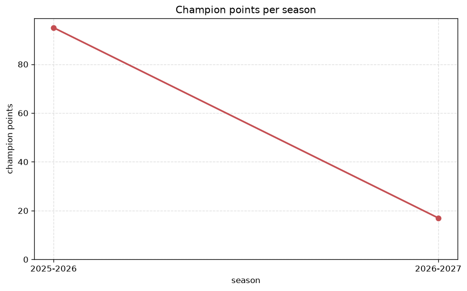
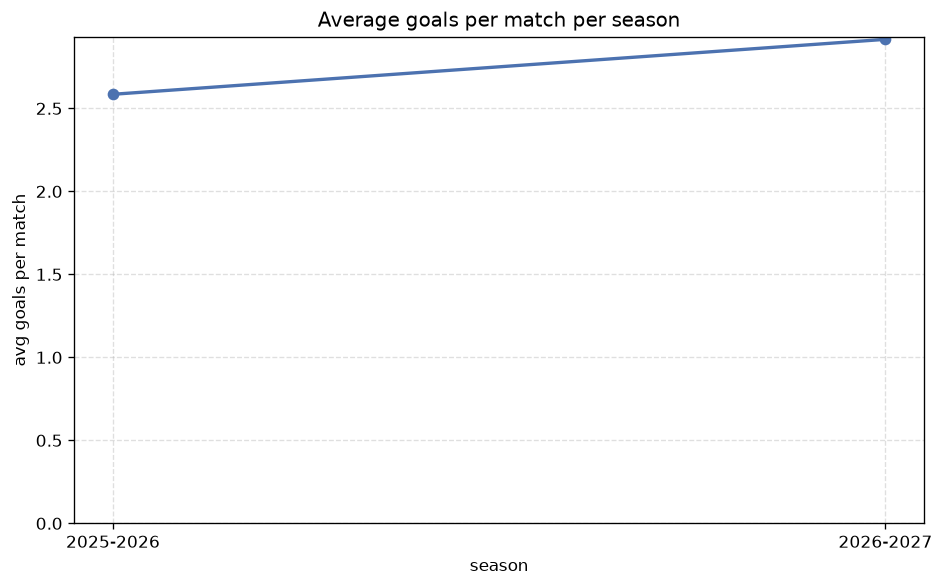

# Season Trends Analysis
- Report: `season_trends`
- Generated: 2026-10-30T03:46:43+00:00
- Script: `backend/scripts/analyze_seasons.py` v1.0.0
- League: Championship (England)
- Scope: league `cha`

## 1. Champions per season
| season | champion | pts | runner-up | margin |
|---|---|---|---|---|
| 2020-2021 | Norwich | 97 | Watford | 6 pts |
| 2021-2022 | Fulham | 90 | Bournemouth | 2 pts |
| 2022-2023 | Burnley | 101 | Sheffield Utd | 10 pts |
| 2023-2024 | Leicester | 97 | Ipswich | 1 pts |
| 2024-2025 | Leeds | 100 | Burnley | 0 pts |
| 2025-2026 | Coventry | 95 | Ipswich | 11 pts |
| 2026-2027 | Middlesbrough | 25 | Southampton | 1 pts |

## 2. Title-race tightness
- Tight races (margin <= 3 pts): **4** of 7 seasons
- Tightest race: **2024-2025** - Leeds beat Burnley by **0** pts

| season | margin | tight |
|---|---|---|
| 2020-2021 | 6 pts |  |
| 2021-2022 | 2 pts | yes |
| 2022-2023 | 10 pts |  |
| 2023-2024 | 1 pts | yes |
| 2024-2025 | 0 pts | yes |
| 2025-2026 | 11 pts |  |
| 2026-2027 | 1 pts | yes |

## 3. Points thresholds
_Position-specific points per season. Key: 1 = champion, 2 = runner-up, 4 = CL line, 6 = Europa, 21 = last safe, 24 = bottom._

| season | pos 1 | pos 2 | pos 4 | pos 6 | pos 21 | pos 24 |
|---|---|---|---|---|---|---|
| 2020-2021 | 97 | 91 | 80 | 77 | 47 | 42 |
| 2021-2022 | 90 | 88 | 80 | 75 | 47 | 30 |
| 2022-2023 | 101 | 91 | 75 | 69 | 50 | 44 |
| 2023-2024 | 97 | 96 | 87 | 73 | 51 | 27 |
| 2024-2025 | 100 | 100 | 76 | 68 | 49 | 44 |
| 2025-2026 | 95 | 84 | 81 | 80 | 53 | 18 |
| 2026-2027 | 25 | 24 | 22 | 21 | 11 | 5 |

## 4. Relegation battle
| season | safe pos | safe pts | drop pos | drop pts | gap |
|---|---|---|---|---|---|
| 2020-2021 | 21 | 47 | 22 | 44 | 3 pts |
| 2021-2022 | 21 | 47 | 22 | 47 | 0 pts |
| 2022-2023 | 21 | 50 | 22 | 49 | 1 pts |
| 2023-2024 | 21 | 51 | 22 | 50 | 1 pts |
| 2024-2025 | 21 | 49 | 22 | 49 | 0 pts |
| 2025-2026 | 21 | 53 | 22 | 52 | 1 pts |
| 2026-2027 | 21 | 11 | 22 | 8 | 3 pts |

## 5. League-level trends
| season | matches | total goals | avg goals | home win | draw | away win | goalless | avg pts/team |
|---|---|---|---|---|---|---|---|---|
| 2020-2021 | 552 | 1274 | 2.308 | 41.1% | 25.2% | 33.7% | 9.6% | 63.21 |
| 2021-2022 | 552 | 1385 | 2.509 | 44.6% | 25.2% | 30.3% | 8.0% | 63.21 |
| 2022-2023 | 552 | 1342 | 2.431 | 41.1% | 27.0% | 31.9% | 8.7% | 62.79 |
| 2023-2024 | 552 | 1480 | 2.681 | 44.6% | 23.4% | 32.1% | 6.3% | 63.62 |
| 2024-2025 | 552 | 1353 | 2.451 | 45.8% | 28.3% | 25.9% | 8.0% | 62.5 |
| 2025-2026 | 559 | 1445 | 2.585 | 41.7% | 26.7% | 31.7% | 6.6% | 63.54 |
| 2026-2027 | 144 | 416 | 2.889 | 40.3% | 27.8% | 31.9% | 6.2% | 16.33 |

## 6. View divergence
- Largest divergence: **2024-2025** (goals view, avg abs position diff = 8.667)

_Avg absolute position difference between classic view and alternative view per season._

| season | classic vs luck | classic vs goals |
|---|---|---|
| 2020-2021 | 3.333 | 6.750 |
| 2021-2022 | 4.917 | 8.583 |
| 2022-2023 | 4.500 | 6.583 |
| 2023-2024 | 4.833 | 5.917 |
| 2024-2025 | 5.167 | 8.667 |
| 2025-2026 | 4.083 | 4.583 |
| 2026-2027 | 3.833 | 7.333 |

---
*All statistics are computed from PostgreSQL tables (read-only). Run with `python backend/scripts/analyze_seasons.py` to regenerate.*

## Charts

