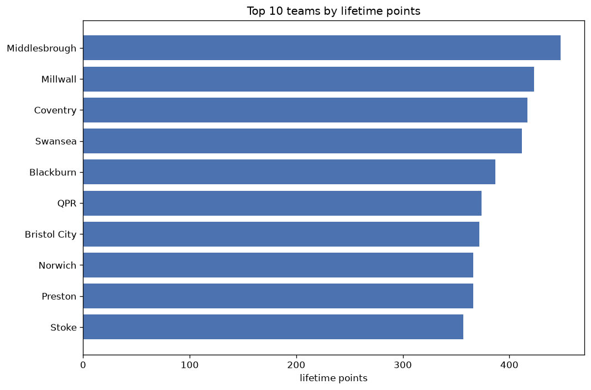
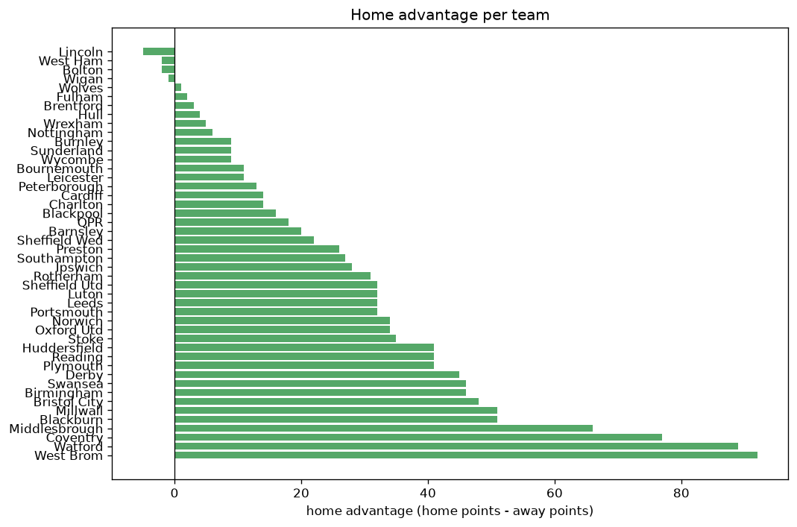

# Team Analysis
- Report: `teams_analysis`
- Generated: 2026-10-26T01:28:13+00:00
- Script: `backend/scripts/analyze_teams.py` v1.0.0
- League: Championship (England)
- Scope: league `cha`

- Teams: **46** | Seasons: **7** | Matches: **3463**

## 1. Team standings (lifetime)
| team | seasons | played | W | D | L | pts | GF | GA | GD | avg pts/season | best pos | worst pos | titles |
|---|---|---|---|---|---|---|---|---|---|---|---|---|---|
| Middlesbrough | 7 | 291 | 127 | 67 | 97 | 448 | 433 | 344 | 89 | 64.0 | 1 | 10 | 1 |
| Millwall | 7 | 290 | 114 | 81 | 95 | 423 | 332 | 322 | 10 | 60.43 | 3 | 13 | 0 |
| Coventry | 6 | 276 | 114 | 75 | 87 | 417 | 398 | 328 | 70 | 69.5 | 1 | 16 | 1 |
| Swansea | 7 | 288 | 114 | 70 | 104 | 412 | 365 | 364 | 1 | 58.86 | 3 | 15 | 0 |
| Blackburn | 7 | 289 | 106 | 69 | 114 | 387 | 351 | 352 | -1 | 55.29 | 7 | 19 | 0 |
| QPR | 7 | 288 | 101 | 71 | 116 | 374 | 342 | 391 | -49 | 53.43 | 8 | 21 | 0 |
| Bristol City | 7 | 288 | 100 | 72 | 116 | 372 | 346 | 381 | -35 | 53.14 | 6 | 19 | 0 |
| Norwich | 6 | 242 | 104 | 54 | 84 | 366 | 365 | 300 | 65 | 61.0 | 1 | 20 | 1 |
| Preston | 7 | 288 | 95 | 81 | 112 | 366 | 315 | 384 | -69 | 52.29 | 10 | 24 | 0 |
| Stoke | 7 | 288 | 94 | 75 | 119 | 357 | 325 | 352 | -27 | 51.0 | 9 | 18 | 0 |
| West Brom | 6 | 242 | 91 | 73 | 78 | 346 | 302 | 263 | 39 | 57.67 | 5 | 21 | 0 |
| Watford | 6 | 242 | 89 | 68 | 85 | 335 | 296 | 290 | 6 | 55.83 | 2 | 21 | 0 |
| Sheffield Utd | 5 | 196 | 99 | 37 | 60 | 334 | 281 | 201 | 80 | 66.8 | 2 | 13 | 0 |
| Hull | 5 | 233 | 82 | 62 | 89 | 308 | 277 | 295 | -18 | 61.6 | 6 | 21 | 0 |
| Cardiff | 6 | 242 | 77 | 59 | 106 | 290 | 277 | 335 | -58 | 48.33 | 8 | 24 | 0 |
| Birmingham | 6 | 242 | 73 | 67 | 102 | 286 | 261 | 327 | -66 | 47.67 | 7 | 22 | 0 |
| Luton | 4 | 184 | 72 | 50 | 62 | 266 | 206 | 215 | -9 | 66.5 | 3 | 22 | 0 |
| Huddersfield | 4 | 184 | 58 | 55 | 71 | 229 | 209 | 257 | -48 | 57.25 | 3 | 23 | 0 |
| Derby | 5 | 196 | 59 | 48 | 89 | 225 | 206 | 247 | -41 | 45.0 | 8 | 23 | 0 |
| Burnley | 3 | 104 | 58 | 35 | 11 | 209 | 173 | 76 | 97 | 69.67 | 1 | 22 | 1 |
| Sunderland | 3 | 138 | 55 | 36 | 47 | 201 | 178 | 153 | 25 | 67.0 | 4 | 16 | 0 |
| Southampton | 3 | 106 | 56 | 27 | 23 | 195 | 195 | 132 | 63 | 65.0 | 2 | 4 | 0 |
| Leeds | 2 | 92 | 56 | 22 | 14 | 190 | 176 | 73 | 103 | 95.0 | 1 | 3 | 1 |
| Ipswich | 2 | 92 | 51 | 27 | 14 | 180 | 172 | 104 | 68 | 90.0 | 2 | 2 | 0 |
| Sheffield Wed | 4 | 185 | 44 | 44 | 97 | 176 | 173 | 288 | -115 | 44.0 | 12 | 24 | 0 |
| Reading | 3 | 138 | 45 | 32 | 61 | 167 | 162 | 209 | -47 | 55.67 | 7 | 22 | 0 |
| Bournemouth | 2 | 92 | 47 | 24 | 21 | 165 | 147 | 85 | 62 | 82.5 | 2 | 6 | 0 |
| Leicester | 2 | 92 | 43 | 20 | 29 | 149 | 147 | 109 | 38 | 74.5 | 1 | 22 | 1 |
| Nottingham | 2 | 92 | 35 | 27 | 30 | 132 | 110 | 85 | 25 | 66.0 | 4 | 17 | 0 |
| Portsmouth | 3 | 105 | 33 | 29 | 43 | 128 | 123 | 150 | -27 | 42.67 | 11 | 17 | 0 |
| Rotherham | 3 | 138 | 27 | 38 | 73 | 119 | 130 | 209 | -79 | 39.67 | 19 | 24 | 0 |
| Barnsley | 2 | 92 | 29 | 21 | 42 | 108 | 91 | 123 | -32 | 54.0 | 5 | 24 | 0 |
| Blackpool | 2 | 92 | 27 | 23 | 42 | 104 | 102 | 130 | -28 | 52.0 | 16 | 24 | 0 |
| Oxford Utd | 2 | 92 | 24 | 28 | 40 | 100 | 94 | 124 | -30 | 50.0 | 17 | 23 | 0 |
| Plymouth | 2 | 92 | 24 | 25 | 43 | 97 | 110 | 158 | -48 | 48.5 | 21 | 23 | 0 |
| Fulham | 1 | 46 | 27 | 9 | 10 | 90 | 106 | 43 | 63 | 90.0 | 1 | 1 | 1 |
| Brentford | 1 | 46 | 24 | 15 | 7 | 87 | 79 | 42 | 37 | 87.0 | 3 | 3 | 0 |
| Wrexham | 2 | 58 | 22 | 19 | 17 | 85 | 84 | 83 | 1 | 42.5 | 7 | 17 | 0 |
| Charlton | 2 | 59 | 16 | 20 | 23 | 68 | 55 | 76 | -21 | 34.0 | 19 | 20 | 0 |
| Wigan | 1 | 46 | 10 | 15 | 21 | 45 | 38 | 65 | -27 | 45.0 | 23 | 23 | 0 |
| Wycombe | 1 | 46 | 11 | 10 | 25 | 43 | 39 | 69 | -30 | 43.0 | 23 | 23 | 0 |
| Peterborough | 1 | 46 | 9 | 10 | 27 | 37 | 43 | 87 | -44 | 37.0 | 23 | 23 | 0 |
| West Ham | 1 | 12 | 6 | 4 | 2 | 22 | 32 | 15 | 17 | 22.0 | 4 | 4 | 0 |
| Wolves | 1 | 12 | 6 | 3 | 3 | 21 | 20 | 16 | 4 | 21.0 | 5 | 5 | 0 |
| Lincoln | 1 | 12 | 4 | 3 | 5 | 15 | 13 | 20 | -7 | 15.0 | 15 | 15 | 0 |
| Bolton | 1 | 12 | 4 | 2 | 6 | 14 | 16 | 23 | -7 | 14.0 | 18 | 18 | 0 |

## 2. Home vs away split
| team | home P | H-W | H-D | H-L | H-pts | away P | A-W | A-D | A-L | A-pts | adv |
|---|---|---|---|---|---|---|---|---|---|---|---|
| West Brom | 121 | 60 | 39 | 22 | 219 | 121 | 31 | 34 | 56 | 127 | 92 |
| Watford | 121 | 61 | 29 | 31 | 212 | 121 | 28 | 39 | 54 | 123 | 89 |
| Coventry | 138 | 71 | 34 | 33 | 247 | 138 | 43 | 41 | 54 | 170 | 77 |
| Middlesbrough | 145 | 75 | 32 | 38 | 257 | 146 | 52 | 35 | 59 | 191 | 66 |
| Millwall | 145 | 67 | 36 | 42 | 237 | 145 | 47 | 45 | 53 | 186 | 51 |
| Blackburn | 145 | 61 | 36 | 48 | 219 | 144 | 45 | 33 | 66 | 168 | 51 |
| Bristol City | 144 | 59 | 33 | 52 | 210 | 144 | 41 | 39 | 64 | 162 | 48 |
| Swansea | 144 | 64 | 37 | 43 | 229 | 144 | 50 | 33 | 61 | 183 | 46 |
| Birmingham | 121 | 44 | 34 | 43 | 166 | 121 | 29 | 33 | 59 | 120 | 46 |
| Derby | 98 | 36 | 27 | 35 | 135 | 98 | 23 | 21 | 54 | 90 | 45 |
| Huddersfield | 92 | 36 | 27 | 29 | 135 | 92 | 22 | 28 | 42 | 94 | 41 |
| Reading | 69 | 29 | 17 | 23 | 104 | 69 | 16 | 15 | 38 | 63 | 41 |
| Plymouth | 46 | 19 | 12 | 15 | 69 | 46 | 5 | 13 | 28 | 28 | 41 |
| Stoke | 144 | 53 | 37 | 54 | 196 | 144 | 41 | 38 | 65 | 161 | 35 |
| Norwich | 121 | 58 | 26 | 37 | 200 | 121 | 46 | 28 | 47 | 166 | 34 |
| Oxford Utd | 46 | 18 | 13 | 15 | 67 | 46 | 6 | 15 | 25 | 33 | 34 |
| Sheffield Utd | 98 | 55 | 18 | 25 | 183 | 98 | 44 | 19 | 35 | 151 | 32 |
| Luton | 92 | 39 | 32 | 21 | 149 | 92 | 33 | 18 | 41 | 117 | 32 |
| Leeds | 46 | 34 | 9 | 3 | 111 | 46 | 22 | 13 | 11 | 79 | 32 |
| Portsmouth | 52 | 22 | 14 | 16 | 80 | 53 | 11 | 15 | 27 | 48 | 32 |
| Rotherham | 69 | 19 | 18 | 32 | 75 | 69 | 8 | 20 | 41 | 44 | 31 |
| Ipswich | 46 | 30 | 14 | 2 | 104 | 46 | 21 | 13 | 12 | 76 | 28 |
| Southampton | 53 | 33 | 12 | 8 | 111 | 53 | 23 | 15 | 15 | 84 | 27 |
| Preston | 144 | 50 | 46 | 48 | 196 | 144 | 45 | 35 | 64 | 170 | 26 |
| Sheffield Wed | 92 | 23 | 30 | 39 | 99 | 93 | 21 | 14 | 58 | 77 | 22 |
| Barnsley | 46 | 17 | 13 | 16 | 64 | 46 | 12 | 8 | 26 | 44 | 20 |
| QPR | 144 | 54 | 34 | 56 | 196 | 144 | 47 | 37 | 60 | 178 | 18 |
| Blackpool | 46 | 17 | 9 | 20 | 60 | 46 | 10 | 14 | 22 | 44 | 16 |
| Cardiff | 121 | 41 | 29 | 51 | 152 | 121 | 36 | 30 | 55 | 138 | 14 |
| Charlton | 30 | 11 | 8 | 11 | 41 | 29 | 5 | 12 | 12 | 27 | 14 |
| Peterborough | 23 | 6 | 7 | 10 | 25 | 23 | 3 | 3 | 17 | 12 | 13 |
| Bournemouth | 46 | 26 | 10 | 10 | 88 | 46 | 21 | 14 | 11 | 77 | 11 |
| Leicester | 46 | 24 | 8 | 14 | 80 | 46 | 19 | 12 | 15 | 69 | 11 |
| Burnley | 52 | 30 | 19 | 3 | 109 | 52 | 28 | 16 | 8 | 100 | 9 |
| Sunderland | 69 | 29 | 18 | 22 | 105 | 69 | 26 | 18 | 25 | 96 | 9 |
| Wycombe | 23 | 7 | 5 | 11 | 26 | 23 | 4 | 5 | 14 | 17 | 9 |
| Nottingham | 46 | 19 | 12 | 15 | 69 | 46 | 16 | 15 | 15 | 63 | 6 |
| Wrexham | 29 | 12 | 9 | 8 | 45 | 29 | 10 | 10 | 9 | 40 | 5 |
| Hull | 117 | 41 | 33 | 43 | 156 | 116 | 41 | 29 | 46 | 152 | 4 |
| Brentford | 23 | 12 | 9 | 2 | 45 | 23 | 12 | 6 | 5 | 42 | 3 |
| Fulham | 23 | 14 | 4 | 5 | 46 | 23 | 13 | 5 | 5 | 44 | 2 |
| Wolves | 6 | 3 | 2 | 1 | 11 | 6 | 3 | 1 | 2 | 10 | 1 |
| Wigan | 23 | 5 | 7 | 11 | 22 | 23 | 5 | 8 | 10 | 23 | -1 |
| West Ham | 6 | 3 | 1 | 2 | 10 | 6 | 3 | 3 | 0 | 12 | -2 |
| Bolton | 6 | 2 | 0 | 4 | 6 | 6 | 2 | 2 | 2 | 8 | -2 |
| Lincoln | 6 | 1 | 2 | 3 | 5 | 6 | 3 | 1 | 2 | 10 | -5 |

## 3. Top performers
### Best points per game (PPG)
| rank | team | PPG |
|---|---|---|
| 1 | Leeds | 2.06 |
| 2 | Burnley | 2.01 |
| 3 | Ipswich | 1.96 |
| 4 | Fulham | 1.96 |
| 5 | Brentford | 1.89 |

### Most goals scored
| rank | team | goals |
|---|---|---|
| 1 | Middlesbrough | 433 |
| 2 | Coventry | 398 |
| 3 | Swansea | 365 |
| 4 | Norwich | 365 |
| 5 | Blackburn | 351 |

### Best goal difference
| rank | team | GD |
|---|---|---|
| 1 | Leeds | 103 |
| 2 | Burnley | 97 |
| 3 | Middlesbrough | 89 |
| 4 | Sheffield Utd | 80 |
| 5 | Coventry | 70 |

### Best defence (goals against per match, standings)
| rank | team | GA/match |
|---|---|---|
| 1 | Burnley | 0.731 |
| 2 | Leeds | 0.793 |
| 3 | Brentford | 0.913 |
| 4 | Bournemouth | 0.924 |
| 5 | Nottingham | 0.924 |

## 4. Team consistency
- Teams present in all **7** seasons: **8**

Blackburn, Bristol City, Middlesbrough, Millwall, Preston, QPR, Stoke, Swansea

## 5. Head-to-head dominance
- Distinct fixtures: **748** (showing the 15 most frequent)

| fixture | meetings | home wins | draws | away wins | home pct | draw pct | away pct |
|---|---|---|---|---|---|---|---|
| QPR vs Blackburn | 13 | 7 | 0 | 6 | 53.8% | 0.0% | 46.2% |
| Middlesbrough vs Millwall | 13 | 6 | 3 | 4 | 46.2% | 23.1% | 30.8% |
| Millwall vs Blackburn | 13 | 6 | 3 | 4 | 46.2% | 23.1% | 30.8% |
| Swansea vs Stoke | 13 | 6 | 3 | 4 | 46.2% | 23.1% | 30.8% |
| Blackburn vs Bristol City | 13 | 5 | 3 | 5 | 38.5% | 23.1% | 38.5% |
| Middlesbrough vs Stoke | 13 | 5 | 4 | 4 | 38.5% | 30.8% | 30.8% |
| Millwall vs Bristol City | 13 | 5 | 1 | 7 | 38.5% | 7.7% | 53.8% |
| Stoke vs Bristol City | 13 | 5 | 2 | 6 | 38.5% | 15.4% | 46.2% |
| Preston vs Blackburn | 13 | 4 | 3 | 6 | 30.8% | 23.1% | 46.2% |
| Preston vs Bristol City | 13 | 4 | 5 | 4 | 30.8% | 38.5% | 30.8% |
| QPR vs Middlesbrough | 13 | 4 | 2 | 7 | 30.8% | 15.4% | 53.8% |
| QPR vs Preston | 13 | 4 | 4 | 5 | 30.8% | 30.8% | 38.5% |
| Swansea vs Millwall | 13 | 4 | 3 | 6 | 30.8% | 23.1% | 46.2% |
| Middlesbrough vs Blackburn | 13 | 3 | 5 | 5 | 23.1% | 38.5% | 38.5% |
| Millwall vs Preston | 13 | 3 | 6 | 4 | 23.1% | 46.2% | 30.8% |

## 6. Position per season (classic view)
_Cells show final position; '-' when the team was absent from that season._

| team | 2020-2021 | 2021-2022 | 2022-2023 | 2023-2024 | 2024-2025 | 2025-2026 | 2026-2027 |
|---|---|---|---|---|---|---|---|
| Middlesbrough | 10 | 7 | 4 | 8 | 10 | 5 | 1 |
| Millwall | 11 | 9 | 8 | 13 | 8 | 3 | 13 |
| Coventry | 16 | 12 | 5 | 9 | 5 | 1 | - |
| Swansea | 4 | 15 | 10 | 14 | 11 | 11 | 3 |
| Blackburn | 15 | 8 | 7 | 19 | 7 | 19 | 10 |
| QPR | 9 | 11 | 21 | 18 | 15 | 15 | 8 |
| Bristol City | 19 | 18 | 14 | 11 | 6 | 12 | 14 |
| Norwich | 1 | - | 13 | 6 | 13 | 9 | 20 |
| Preston | 13 | 13 | 12 | 10 | 20 | 14 | 24 |
| Stoke | 14 | 14 | 16 | 17 | 18 | 18 | 9 |
| West Brom | - | 10 | 9 | 5 | 9 | 21 | 6 |
| Watford | 2 | - | 11 | 15 | 14 | 16 | 21 |
| Sheffield Utd | - | 5 | 2 | - | 3 | 13 | 12 |
| Hull | - | 20 | 15 | 7 | 21 | 6 | - |
| Cardiff | 8 | 19 | 22 | 12 | 24 | - | 16 |
| Birmingham | 18 | 21 | 17 | 22 | - | 10 | 7 |
| Luton | 12 | 6 | 3 | - | 22 | - | - |
| Huddersfield | 20 | 3 | 18 | 23 | - | - | - |
| Derby | 22 | 17 | - | - | 19 | 8 | 23 |
| Burnley | - | - | 1 | - | 2 | - | 22 |
| Sunderland | - | - | 6 | 16 | 4 | - | - |
| Southampton | - | - | - | 4 | - | 4 | 2 |
| Leeds | - | - | - | 3 | 1 | - | - |
| Ipswich | - | - | - | 2 | - | 2 | - |
| Sheffield Wed | 21 | - | - | 20 | 12 | 24 | - |
| Reading | 7 | 22 | 20 | - | - | - | - |
| Bournemouth | 6 | 2 | - | - | - | - | - |
| Leicester | - | - | - | 1 | - | 22 | - |
| Nottingham | 17 | 4 | - | - | - | - | - |
| Portsmouth | - | - | - | - | 16 | 17 | 11 |
| Rotherham | 24 | - | 19 | 24 | - | - | - |
| Barnsley | 5 | 24 | - | - | - | - | - |
| Blackpool | - | 16 | 24 | - | - | - | - |
| Oxford Utd | - | - | - | - | 17 | 23 | - |
| Plymouth | - | - | - | 21 | 23 | - | - |
| Fulham | - | 1 | - | - | - | - | - |
| Brentford | 3 | - | - | - | - | - | - |
| Wrexham | - | - | - | - | - | 7 | 17 |
| Charlton | - | - | - | - | - | 20 | 19 |
| Wigan | - | - | 23 | - | - | - | - |
| Wycombe | 23 | - | - | - | - | - | - |
| Peterborough | - | 23 | - | - | - | - | - |
| West Ham | - | - | - | - | - | - | 4 |
| Wolves | - | - | - | - | - | - | 5 |
| Lincoln | - | - | - | - | - | - | 15 |
| Bolton | - | - | - | - | - | - | 18 |

---
*All statistics are computed from PostgreSQL tables (read-only). Run with `python backend/scripts/analyze_teams.py` to regenerate.*

## Charts

