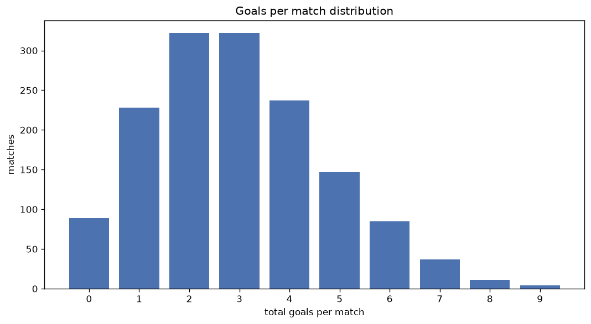
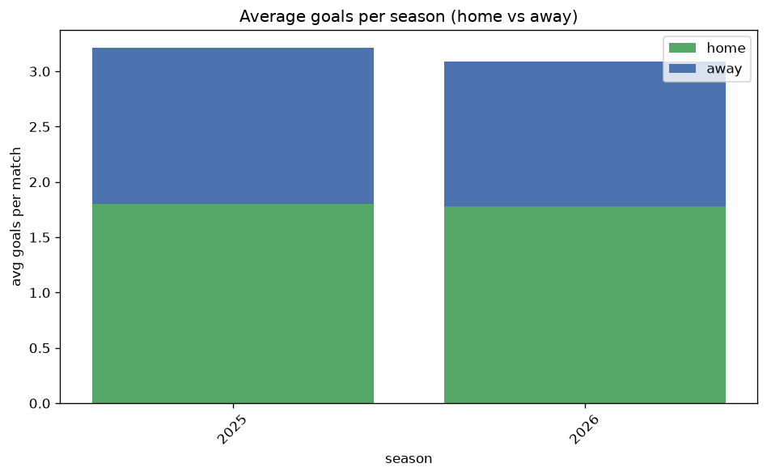

# Goal Analysis
- Report: `goals_analysis`
- Generated: 2026-10-29T01:55:43+00:00
- Script: `backend/scripts/analyze_goals.py` v1.0.0
- League: Super League (China)
- Scope: league `china`

## 1. Goals per match distribution
| goals | matches | pct |
|---|---|---|
| 0 | 89 | 6.0% |
| 1 | 228 | 15.4% |
| 2 | 322 | 21.7% |
| 3 | 322 | 21.7% |
| 4 | 237 | 16.0% |
| 5 | 147 | 9.9% |
| 6 | 85 | 5.7% |
| 7 | 37 | 2.5% |
| 8 | 11 | 0.7% |
| 9 | 4 | 0.3% |

## 2. Goals per match per season
| season | matches | total goals | avg home | avg away | avg total |
|---|---|---|---|---|---|
| 2020 | 112 | 321 | 1.491 | 1.375 | 2.866 |
| 2021 | 112 | 301 | 1.455 | 1.232 | 2.688 |
| 2022 | 306 | 875 | 1.536 | 1.324 | 2.859 |
| 2023 | 240 | 666 | 1.55 | 1.225 | 2.775 |
| 2024 | 240 | 750 | 1.796 | 1.329 | 3.125 |
| 2025 | 240 | 771 | 1.8 | 1.413 | 3.212 |
| 2026 | 232 | 730 | 1.772 | 1.375 | 3.147 |

## 3. Home vs away goal share
- Home goals: **2446** (55.4%)
- Away goals: **1968** (44.6%)
- Home/away ratio: **1.243**

| season | home goals | away goals | total | home pct | away pct |
|---|---|---|---|---|---|
| 2020 | 167 | 154 | 321 | 52.0% | 48.0% |
| 2021 | 163 | 138 | 301 | 54.2% | 45.8% |
| 2022 | 470 | 405 | 875 | 53.7% | 46.3% |
| 2023 | 372 | 294 | 666 | 55.9% | 44.1% |
| 2024 | 431 | 319 | 750 | 57.5% | 42.5% |
| 2025 | 432 | 339 | 771 | 56.0% | 44.0% |
| 2026 | 411 | 319 | 730 | 56.3% | 43.7% |

## 4. BTTS (Both Teams To Score)
- Overall: **838** of `1482` (56.5%)

| season | matches | BTTS | pct |
|---|---|---|---|
| 2020 | 112 | 62 | 55.4% |
| 2021 | 112 | 59 | 52.7% |
| 2022 | 306 | 145 | 47.4% |
| 2023 | 240 | 139 | 57.9% |
| 2024 | 240 | 135 | 56.2% |
| 2025 | 240 | 151 | 62.9% |
| 2026 | 232 | 147 | 63.4% |

## 5. Clean sheets
- Home clean sheets: **418** (28.2%)
- Away clean sheets: **315** (21.3%)
- Total clean sheets recorded: **733**
- Matches with at least one clean sheet: **644** (43.5%)
- Both teams kept clean sheets (0-0): **89**

| season | matches | home CS | away CS | total CS | matches w/ CS |
|---|---|---|---|---|---|
| 2020 | 112 | 30 | 27 | 57 | 50 (44.6%) |
| 2021 | 112 | 38 | 28 | 66 | 53 (47.3%) |
| 2022 | 306 | 100 | 81 | 181 | 161 (52.6%) |
| 2023 | 240 | 60 | 55 | 115 | 101 (42.1%) |
| 2024 | 240 | 64 | 57 | 121 | 105 (43.8%) |
| 2025 | 240 | 68 | 30 | 98 | 89 (37.1%) |
| 2026 | 232 | 58 | 37 | 95 | 85 (36.6%) |

## 6. Scoring intensity
- First-half goals: **1985** (45.2%)
- Second-half goals: **2402** (54.8%)
- Avg first-half goals per match: **1.348**
- Avg second-half goals per match: **1.631**
- Second-half-only scoring (HT 0-0, FT goals >= 1): **298** (20.1%)
- *9 match(es) excluded (no HT score recorded).*

| season | matches | 1st half | 2nd half | 1st half pct | 2nd half pct |
|---|---|---|---|---|---|
| 2020 | 112 | 149 | 172 | 46.4% | 53.6% |
| 2021 | 112 | 149 | 152 | 49.5% | 50.5% |
| 2022 | 306 | 384 | 464 | 45.3% | 54.7% |
| 2023 | 240 | 300 | 366 | 45.0% | 55.0% |
| 2024 | 240 | 344 | 406 | 45.9% | 54.1% |
| 2025 | 240 | 355 | 416 | 46.0% | 54.0% |
| 2026 | 232 | 304 | 426 | 41.6% | 58.4% |

## 7. First-goal timing
- Matches with first-goal time recorded: `1384` of `1482` (93.4%)
- Goalless matches: `98`
- Min `1` | Max `99` | Mean `29.62` | Median (p50) `24.0`

| bucket | count | % of matches | % of scoring matches |
|---|---|---|---|
| 1-15 | 481 | 32.5% | 34.8% |
| 16-30 | 352 | 23.8% | 25.4% |
| 31-45 | 227 | 15.3% | 16.4% |
| 46-60 | 166 | 11.2% | 12.0% |
| 61-75 | 88 | 5.9% | 6.4% |
| 76-90 | 48 | 3.2% | 3.5% |
| 91-120 | 22 | 1.5% | 1.6% |

---
*All statistics are computed from PostgreSQL tables (read-only). Run with `python backend/scripts/analyze_goals.py` to regenerate.*

## Charts

