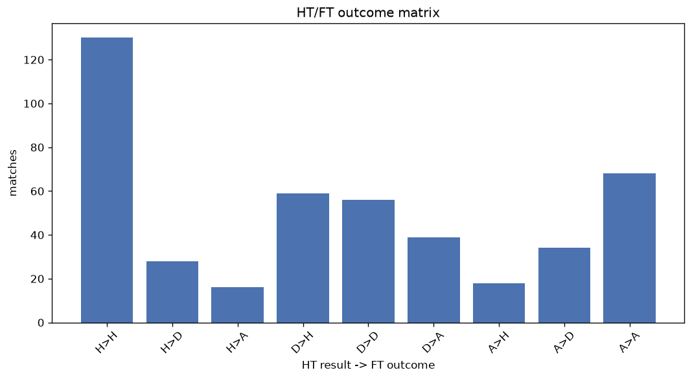
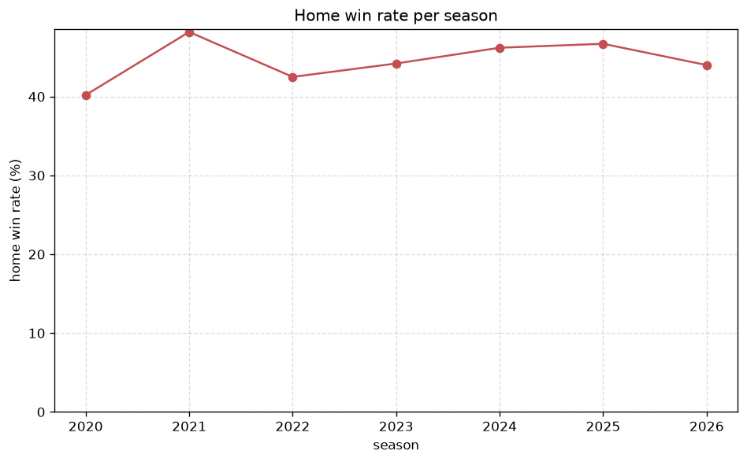

# Match Analysis
- Report: `matches_analysis`
- Generated: 2026-10-27T01:42:47+00:00
- Script: `backend/scripts/analyze_matches.py` v1.0.0
- League: Super League (China)
- Scope: league `china`

## 1. Overall summary
| metric | value |
|---|---|
| Matches | 1482 |
| Home wins | 660 (44.5%) |
| Draws | 364 (24.6%) |
| Away wins | 458 (30.9%) |
| Total goals | 4414 |
| Average goals per match | 2.978 |
| Goalless matches | 89 (6.0%) |

## 2. Per-season breakdown
| season | matches | home wins | draws | away wins | total goals | avg goals | goalless |
|---|---|---|---|---|---|---|---|
| 2020 | 112 | 45 (40.2%) | 27 (24.1%) | 40 (35.7%) | 321 | 2.866 | 7 (6.2%) |
| 2021 | 112 | 54 (48.2%) | 30 (26.8%) | 28 (25.0%) | 301 | 2.688 | 13 (11.6%) |
| 2022 | 306 | 130 (42.5%) | 62 (20.3%) | 114 (37.3%) | 875 | 2.859 | 20 (6.5%) |
| 2023 | 240 | 106 (44.2%) | 67 (27.9%) | 67 (27.9%) | 666 | 2.775 | 14 (5.8%) |
| 2024 | 240 | 111 (46.2%) | 55 (22.9%) | 74 (30.8%) | 750 | 3.125 | 16 (6.7%) |
| 2025 | 240 | 112 (46.7%) | 62 (25.8%) | 66 (27.5%) | 771 | 3.212 | 9 (3.8%) |
| 2026 | 232 | 102 (44.0%) | 61 (26.3%) | 69 (29.7%) | 730 | 3.147 | 10 (4.3%) |

## 3. HT/FT outcome matrix
| HT result \ FT result | Home | Draw | Away | total |
|---|---|---|---|---|
| HT home lead | 427 (79.2%) | 79 (14.7%) | 33 (6.1%) | 539 |
| HT draw | 180 (33.5%) | 211 (39.2%) | 147 (27.3%) | 538 |
| HT away lead | 47 (11.9%) | 74 (18.7%) | 275 (69.4%) | 396 |
- *9 match(es) excluded (no HT score recorded).*

## 4. Comeback matches
- Home comebacks (trailing at HT, won at FT): **47** (3.2%)
- Away comebacks (trailing at HT, won at FT): **33** (2.2%)

### Home comebacks
| season | home | away | HT | FT |
|---|---|---|---|---|
| 2020 | Shanghai Port | Wuhan FC | 0-1 | 2-1 |
| 2020 | Wuhan FC | Tianjin Jinmen Tiger | 0-1 | 2-1 |
| 2021 | Chongqing Liangjiang Athletic | Henan Songshan Longmen | 0-1 | 3-2 |
| 2021 | Shenzhen | Cangzhou | 0-1 | 2-1 |
| 2022 | Henan Songshan Longmen | Guangzhou City | 0-1 | 2-1 |
| 2022 | Shenzhen | Beijing Guoan | 0-1 | 2-1 |
| 2022 | Meizhou Hakka | Guangzhou City | 0-1 | 2-1 |
| 2022 | Shanghai Shenhua | Shandong Taishan | 0-1 | 2-1 |
| 2022 | Chengdu Rongcheng | Shanghai Shenhua | 1-2 | 3-2 |
| 2022 | Chengdu Rongcheng | Wuhan FC | 0-1 | 3-1 |
| 2023 | Meizhou Hakka | Shandong Taishan | 0-1 | 2-1 |
| 2023 | Cangzhou | Wuhan Three Towns | 0-1 | 2-1 |
| 2023 | Shenzhen | Meizhou Hakka | 0-2 | 3-2 |
| 2023 | Henan Songshan Longmen | Meizhou Hakka | 0-1 | 2-1 |
| 2023 | Shanghai Port | Nantong Zhiyun | 0-1 | 2-1 |
| 2023 | Zhejiang Professional | Tianjin Jinmen Tiger | 0-1 | 2-1 |
| 2024 | Shanghai Port | Shandong Taishan | 2-3 | 4-3 |
| 2024 | Cangzhou | Qingdao West Coast | 0-2 | 3-2 |
| 2024 | Beijing Guoan | Meizhou Hakka | 0-2 | 3-2 |
| 2024 | Zhejiang Professional | Changchun Yatai | 0-1 | 3-1 |
| 2024 | Henan Songshan Longmen | Beijing Guoan | 0-1 | 2-1 |
| 2024 | Shenzhen Xinpengcheng | Zhejiang Professional | 0-1 | 3-2 |
| 2024 | Qingdao West Coast | Zhejiang Professional | 1-2 | 5-2 |
| 2024 | Meizhou Hakka | Nantong Zhiyun | 0-1 | 2-1 |
| 2024 | Shenzhen Xinpengcheng | Changchun Yatai | 0-1 | 2-1 |
| 2024 | Cangzhou | Shandong Taishan | 0-1 | 3-1 |
| 2024 | Shanghai Shenhua | Shanghai Port | 0-1 | 3-1 |
| 2024 | Changchun Yatai | Nantong Zhiyun | 1-2 | 3-2 |
| 2024 | Shanghai Shenhua | Tianjin Jinmen Tiger | 0-1 | 2-1 |
| 2025 | Shanghai Shenhua | Yunnan Yukun | 0-1 | 3-1 |
| 2025 | Meizhou Hakka | Wuhan Three Towns | 0-1 | 3-1 |
| 2025 | Henan Songshan Longmen | Qingdao Hainiu | 0-1 | 3-1 |
| 2025 | Wuhan Three Towns | Tianjin Jinmen Tiger | 0-1 | 2-1 |
| 2025 | Yunnan Yukun | Shandong Taishan | 0-2 | 3-2 |
| 2025 | Yunnan Yukun | Henan Songshan Longmen | 0-1 | 2-1 |
| 2025 | Beijing Guoan | Yunnan Yukun | 0-1 | 2-1 |
| 2025 | Zhejiang Professional | Yunnan Yukun | 0-1 | 3-1 |
| 2025 | Zhejiang Professional | Wuhan Three Towns | 0-1 | 3-2 |
| 2025 | Dalian Yingbo | Shenzhen Xinpengcheng | 0-1 | 2-1 |
| 2026 | Dalian Yingbo | Henan Songshan Longmen | 0-1 | 2-1 |
| 2026 | Chengdu Rongcheng | Yunnan Yukun | 0-1 | 2-1 |
| 2026 | Zhejiang Professional | Shandong Taishan | 0-1 | 4-1 |
| 2026 | Yunnan Yukun | Henan Songshan Longmen | 0-1 | 2-1 |
| 2026 | Liaoning Tieren | Chongqing Tonglianglong | 0-1 | 3-1 |
| 2026 | Dalian Yingbo | Wuhan Three Towns | 1-2 | 3-2 |
| 2026 | Tianjin Jinmen Tiger | Yunnan Yukun | 0-1 | 3-2 |
| 2026 | Yunnan Yukun | Dalian Yingbo | 0-1 | 3-1 |

### Away comebacks
| season | home | away | HT | FT |
|---|---|---|---|---|
| 2020 | Henan Songshan Longmen | Jiangsu Suning | 1-0 | 3-4 |
| 2021 | Shanghai Shenhua | Changchun Yatai | 1-0 | 1-2 |
| 2022 | Shenzhen | Tianjin Jinmen Tiger | 2-1 | 2-3 |
| 2022 | Meizhou Hakka | Chengdu Rongcheng | 1-0 | 1-2 |
| 2022 | Guangzhou FC | Chengdu Rongcheng | 1-0 | 1-2 |
| 2022 | Tianjin Jinmen Tiger | Zhejiang Professional | 1-0 | 1-2 |
| 2022 | Changchun Yatai | Tianjin Jinmen Tiger | 2-1 | 2-3 |
| 2022 | Wuhan Three Towns | Henan Songshan Longmen | 1-0 | 1-3 |
| 2022 | Shanghai Shenhua | Beijing Guoan | 1-0 | 1-2 |
| 2023 | Changchun Yatai | Meizhou Hakka | 2-1 | 2-4 |
| 2023 | Shanghai Shenhua | Tianjin Jinmen Tiger | 1-0 | 1-2 |
| 2023 | Shanghai Port | Zhejiang Professional | 2-1 | 3-4 |
| 2023 | Shenzhen | Shandong Taishan | 1-0 | 1-2 |
| 2023 | Dalian Pro | Shanghai Port | 1-0 | 2-3 |
| 2024 | Changchun Yatai | Chengdu Rongcheng | 1-0 | 1-2 |
| 2024 | Henan Songshan Longmen | Tianjin Jinmen Tiger | 1-0 | 1-2 |
| 2025 | Henan Songshan Longmen | Shanghai Shenhua | 1-0 | 1-3 |
| 2025 | Meizhou Hakka | Shandong Taishan | 3-1 | 3-4 |
| 2025 | Henan Songshan Longmen | Qingdao West Coast | 1-0 | 2-3 |
| 2025 | Shenzhen Xinpengcheng | Shanghai Port | 1-0 | 1-2 |
| 2025 | Zhejiang Professional | Beijing Guoan | 2-1 | 3-4 |
| 2025 | Beijing Guoan | Qingdao Hainiu | 1-0 | 2-4 |
| 2025 | Chengdu Rongcheng | Henan Songshan Longmen | 1-0 | 1-2 |
| 2026 | Qingdao Hainiu | Zhejiang Professional | 1-0 | 1-4 |
| 2026 | Tianjin Jinmen Tiger | Shandong Taishan | 1-0 | 1-2 |
| 2026 | Shanghai Shenhua | Chengdu Rongcheng | 2-1 | 2-3 |
| 2026 | Yunnan Yukun | Zhejiang Professional | 1-0 | 1-2 |
| 2026 | Beijing Guoan | Henan Songshan Longmen | 1-0 | 1-2 |
| 2026 | Wuhan Three Towns | Shanghai Port | 1-0 | 2-3 |
| 2026 | Zhejiang Professional | Chengdu Rongcheng | 2-1 | 2-3 |
| 2026 | Chengdu Rongcheng | Shanghai Shenhua | 2-1 | 4-5 |
| 2026 | Shanghai Shenhua | Shandong Taishan | 2-1 | 2-3 |
| 2026 | Henan Songshan Longmen | Beijing Guoan | 3-0 | 3-4 |

## 5. HT lead conversion
| HT state | matches | converted to win | held as draw | collapsed to loss |
|---|---|---|---|---|
| Home lead | 539 | 427 (79.2%) | 79 (14.7%) | 33 (6.1%) |
| Away lead | 396 | 275 (69.4%) | 74 (18.7%) | 47 (11.9%) |

### Matches level at half-time
| FT result | count | pct |
|---|---|---|
| Home win | 180 | 33.5% |
| Draw | 211 | 39.2% |
| Away win | 147 | 27.3% |
- *9 match(es) excluded (no HT score recorded).*

## 6. First-goal timing
- Matches with a first-goal time recorded: `1384` of `1482` (93.4%)

Outcome distribution by first-goal timing bucket:
| bucket | matches | % of matches | home | draw | away |
|---|---|---|---|---|---|
| 1-15 | 481 | 32.5% | 241 (50.1%) | 83 (17.3%) | 157 (32.6%) |
| 16-30 | 352 | 23.8% | 171 (48.6%) | 80 (22.7%) | 101 (28.7%) |
| 31-45 | 227 | 15.3% | 99 (43.6%) | 46 (20.3%) | 82 (36.1%) |
| 46-60 | 166 | 11.2% | 74 (44.6%) | 42 (25.3%) | 50 (30.1%) |
| 61-75 | 88 | 5.9% | 34 (38.6%) | 21 (23.9%) | 33 (37.5%) |
| 76-90 | 48 | 3.2% | 28 (58.3%) | 3 (6.2%) | 17 (35.4%) |
| 91-120 | 22 | 1.5% | 7 (31.8%) | 0 (0.0%) | 15 (68.2%) |

## 7. Goalless matches
- Overall: **89** of `1482` (6.0%)

| season | matches | goalless | pct |
|---|---|---|---|
| 2020 | 112 | 7 | 6.2% |
| 2021 | 112 | 13 | 11.6% |
| 2022 | 306 | 20 | 6.5% |
| 2023 | 240 | 14 | 5.8% |
| 2024 | 240 | 16 | 6.7% |
| 2025 | 240 | 9 | 3.8% |
| 2026 | 232 | 10 | 4.3% |

---
*All statistics are computed from PostgreSQL tables (read-only). Run with `python backend/scripts/analyze_matches.py` to regenerate.*

## Charts

