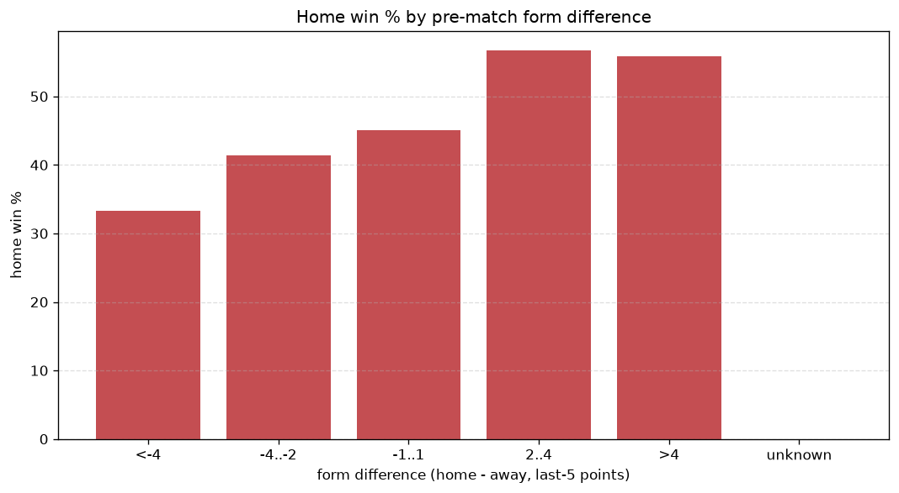
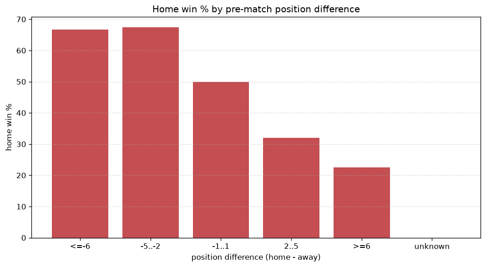

# Relationships Analysis
- Report: `relationships`
- Generated: 2026-10-29T01:55:50+00:00
- Script: `backend/scripts/analyze_relationships.py` v1.0.0
- League: Super League (China)
- Scope: league `china`

- Matches analysed: **1250** (23 leakage-safe pre-match features).

## 1. Correlation matrix
_Pearson correlation of each pre-match feature with observed goals; sorted by |corr(total goals)|._

| feature | corr(home) | corr(away) | corr(total) |
|---|---|---|---|
| home_team_home_goals_avg | 0.286 | -0.101 | 0.156 |
| home_team_home_win_rate | 0.255 | -0.110 | 0.125 |
| home_team_goals_scored_last_5 | 0.283 | -0.152 | 0.117 |
| home_points_before_match | 0.256 | -0.129 | 0.112 |
| away_team_goals_scored_last_5 | -0.052 | 0.195 | 0.097 |
| home_team_wins_last_5 | 0.252 | -0.153 | 0.092 |
| home_team_points_last_5 | 0.261 | -0.169 | 0.087 |
| home_position_before_match | -0.286 | 0.214 | -0.076 |
| away_team_wins_last_5 | -0.086 | 0.198 | 0.072 |
| away_points_before_match | -0.047 | 0.153 | 0.071 |
| away_team_points_last_5 | -0.102 | 0.211 | 0.069 |
| away_team_goals_conceded_last_5 | 0.217 | -0.150 | 0.066 |
| away_team_away_goals_avg | -0.068 | 0.162 | 0.060 |
| home_team_goals_conceded_last_5 | -0.082 | 0.171 | 0.056 |
| position_difference | -0.366 | 0.338 | -0.051 |
| points_difference | 0.365 | -0.338 | 0.051 |
| away_team_away_win_rate | -0.101 | 0.170 | 0.040 |
| away_team_away_conceded_avg | 0.170 | -0.141 | 0.035 |
| away_rest_days | -0.003 | -0.044 | -0.033 |
| home_rest_days | 0.000 | -0.037 | -0.025 |
| home_team_home_conceded_avg | -0.137 | 0.180 | 0.019 |
| rest_days_difference | 0.006 | 0.020 | 0.018 |
| away_position_before_match | 0.212 | -0.246 | -0.005 |

## 2. Form vs outcome
_Home win/draw/away % per bucket of `home_team_points_last_5 - away_team_points_last_5`._

| bucket | matches | home | draw | away | home % | draw % | away % |
|---|---|---|---|---|---|---|---|
| <-4 | 215 | 51 | 52 | 112 | 23.7% | 24.2% | 52.1% |
| -4..-2 | 227 | 73 | 48 | 106 | 32.2% | 21.1% | 46.7% |
| -1..1 | 366 | 163 | 103 | 100 | 44.5% | 28.1% | 27.3% |
| 2..4 | 238 | 129 | 61 | 48 | 54.2% | 25.6% | 20.2% |
| >4 | 204 | 142 | 39 | 23 | 69.6% | 19.1% | 11.3% |
| unknown | 0 | 0 | 0 | 0 | - | - | - |

## 3. Position vs outcome
_Home win/draw/away % per bucket of `position_difference` (home position - away position; negative favours the home team)._

| bucket | matches | home | draw | away | home % | draw % | away % |
|---|---|---|---|---|---|---|---|
| <=-6 | 269 | 191 | 48 | 30 | 71.0% | 17.8% | 11.2% |
| -5..-2 | 237 | 134 | 52 | 51 | 56.5% | 21.9% | 21.5% |
| -1..1 | 224 | 96 | 67 | 61 | 42.9% | 29.9% | 27.2% |
| 2..5 | 257 | 85 | 71 | 101 | 33.1% | 27.6% | 39.3% |
| >=6 | 263 | 52 | 65 | 146 | 19.8% | 24.7% | 55.5% |
| unknown | 0 | 0 | 0 | 0 | - | - | - |

## 4. Rest advantage
_Home win/draw/away % per bucket of `rest_days_difference` (home rest - away rest). Matches with unknown rest are bucketed separately._

| bucket | matches | home | draw | away | home % | draw % | away % |
|---|---|---|---|---|---|---|---|
| <-1 | 62 | 24 | 17 | 21 | 38.7% | 27.4% | 33.9% |
| -1..0 | 270 | 110 | 60 | 100 | 40.7% | 22.2% | 37.0% |
| 0 | 576 | 274 | 133 | 169 | 47.6% | 23.1% | 29.3% |
| 1..2 | 253 | 111 | 71 | 71 | 43.9% | 28.1% | 28.1% |
| >2 | 40 | 21 | 8 | 11 | 52.5% | 20.0% | 27.5% |
| unknown | 49 | 18 | 14 | 17 | 36.7% | 28.6% | 34.7% |
- *49 match(es) had unknown rest difference (missing rest data on at least one side).*

## 5. Home team quality
_Home win rate by `home_team_home_win_rate` tier (split at 0.5)._

- `< 0.5` tier: **37.9%** home win (286/755)
- `>= 0.5` tier: **54.9%** home win (272/495)
- Home-win gap (>= split minus < split): **+17.0 pp**

| tier | label | matches | home | draw | away | home % |
|---|---|---|---|---|---|---|
| low | < 0.5 | 755 | 286 | 195 | 274 | 37.9% |
| high | >= 0.5 | 495 | 272 | 108 | 115 | 54.9% |

## 6. Feature averages by result
_Mean feature value per outcome; `range` is home-minus-away spread of the group means._

| feature | home mean | draw mean | away mean | range |
|---|---|---|---|---|
| points_difference | 5.109 | -0.815 | -6.684 | 11.793 |
| home_points_before_match | 21.996 | 16.287 | 15.522 | 6.475 |
| position_difference | -2.778 | 0.640 | 3.383 | 6.161 |
| away_points_before_match | 16.887 | 17.102 | 22.206 | 5.319 |
| away_position_before_match | 10.317 | 8.561 | 7.051 | 3.266 |
| home_position_before_match | 7.539 | 9.201 | 10.434 | 2.895 |
| away_team_goals_conceded_last_5 | 7.520 | 5.950 | 5.368 | 2.152 |
| home_team_goals_scored_last_5 | 7.480 | 6.076 | 5.424 | 2.056 |
| home_team_points_last_5 | 6.980 | 5.799 | 4.931 | 2.050 |
| away_team_points_last_5 | 5.385 | 5.917 | 7.229 | 1.843 |
| away_team_goals_scored_last_5 | 5.905 | 6.208 | 7.447 | 1.542 |
| home_team_goals_conceded_last_5 | 6.118 | 6.129 | 7.321 | 1.203 |
| home_team_wins_last_5 | 1.950 | 1.561 | 1.326 | 0.623 |
| away_rest_days | 7.819 | 7.844 | 7.234 | 0.610 |
| away_team_wins_last_5 | 1.441 | 1.594 | 2.026 | 0.585 |
| home_rest_days | 7.594 | 7.671 | 7.086 | 0.585 |
| home_team_home_goals_avg | 1.576 | 1.327 | 1.184 | 0.392 |
| away_team_away_conceded_avg | 1.562 | 1.326 | 1.215 | 0.347 |
| home_team_home_conceded_avg | 1.072 | 1.231 | 1.386 | 0.314 |
| away_team_away_goals_avg | 1.091 | 1.231 | 1.369 | 0.278 |
| home_team_home_win_rate | 0.436 | 0.347 | 0.313 | 0.123 |
| away_team_away_win_rate | 0.242 | 0.302 | 0.360 | 0.118 |
| rest_days_difference | -0.224 | -0.173 | -0.148 | 0.076 |

---
*All features are leakage-safe pre-match values built by `ml.features.build_features.build_rows` from strictly prior matches. Run with `python backend/scripts/analyze_relationships.py` to regenerate.*

## Charts

