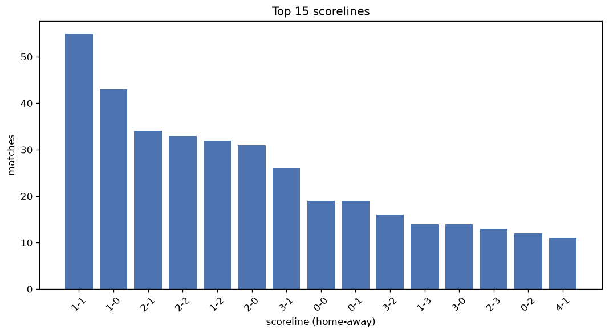
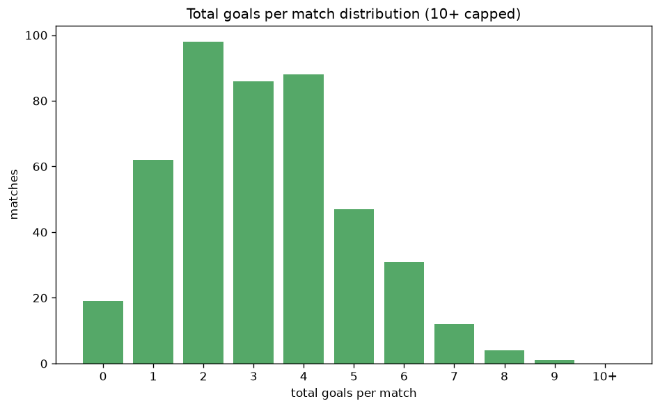

# Scoreline Analysis
- Report: `scoreline_analysis`
- Generated: 2026-10-29T01:55:48+00:00
- Script: `backend/scripts/analyze_scorelines.py` v1.0.0
- League: Super League (China)
- Scope: league `china`

## 1. Scoreline frequency
- Matches analysed: **1482** across **7** seasons.
- Distinct scorelines seen: **46**.

| scoreline | count | pct |
|---|---|---|
| 1-1 | 173 | 11.7% |
| 2-1 | 133 | 9.0% |
| 1-0 | 124 | 8.4% |
| 0-1 | 104 | 7.0% |
| 1-2 | 96 | 6.5% |
| 2-0 | 94 | 6.3% |
| 0-0 | 89 | 6.0% |
| 2-2 | 79 | 5.3% |
| 3-1 | 68 | 4.6% |
| 3-0 | 58 | 3.9% |
| 0-2 | 55 | 3.7% |
| 1-3 | 45 | 3.0% |
| 3-2 | 43 | 2.9% |
| 0-3 | 35 | 2.4% |
| 4-1 | 32 | 2.2% |
| 2-3 | 28 | 1.9% |
| 4-0 | 28 | 1.9% |
| 3-3 | 20 | 1.3% |
| 1-4 | 18 | 1.2% |
| 4-2 | 18 | 1.2% |

## 2. Scoreline frequency per season

### 2020
| scoreline | count | pct |
|---|---|---|
| 2-1 | 10 | 8.9% |
| 0-1 | 10 | 8.9% |
| 2-0 | 9 | 8.0% |
| 1-1 | 9 | 8.0% |
| 2-2 | 8 | 7.1% |

### 2021
| scoreline | count | pct |
|---|---|---|
| 2-1 | 17 | 15.2% |
| 0-0 | 13 | 11.6% |
| 1-1 | 12 | 10.7% |
| 1-0 | 11 | 9.8% |
| 2-0 | 8 | 7.1% |

### 2022
| scoreline | count | pct |
|---|---|---|
| 1-1 | 29 | 9.5% |
| 1-2 | 26 | 8.5% |
| 2-1 | 26 | 8.5% |
| 2-0 | 24 | 7.8% |
| 1-0 | 22 | 7.2% |

### 2023
| scoreline | count | pct |
|---|---|---|
| 1-1 | 41 | 17.1% |
| 2-1 | 28 | 11.7% |
| 0-1 | 24 | 10.0% |
| 1-0 | 21 | 8.8% |
| 0-0 | 14 | 5.8% |

### 2024
| scoreline | count | pct |
|---|---|---|
| 1-1 | 23 | 9.6% |
| 0-1 | 20 | 8.3% |
| 1-0 | 18 | 7.5% |
| 2-1 | 17 | 7.1% |
| 0-0 | 16 | 6.7% |

### 2025
| scoreline | count | pct |
|---|---|---|
| 1-0 | 24 | 10.0% |
| 1-1 | 24 | 10.0% |
| 2-2 | 23 | 9.6% |
| 2-0 | 20 | 8.3% |
| 2-1 | 17 | 7.1% |

### 2026
| scoreline | count | pct |
|---|---|---|
| 1-1 | 35 | 15.1% |
| 1-0 | 20 | 8.6% |
| 2-1 | 18 | 7.8% |
| 0-1 | 16 | 6.9% |
| 1-2 | 15 | 6.5% |

## 3. Total-goal histogram
_10+ groups all matches with 10 or more total goals._

| total goals | matches | pct |
|---|---|---|
| 0 | 89 | 6.0% |
| 1 | 228 | 15.4% |
| 2 | 322 | 21.7% |
| 3 | 322 | 21.7% |
| 4 | 237 | 16.0% |
| 5 | 147 | 9.9% |
| 6 | 85 | 5.7% |
| 7 | 37 | 2.5% |
| 8 | 11 | 0.7% |
| 9 | 4 | 0.3% |
| 10+ | 0 | 0.0% |

## 4. Extreme scorelines
- Matches with 7+ total goals: **52**

| season | date | scoreline | total goals |
|---|---|---|---|
| 2024 | 2024-07-26 | 8-1 | 9 |
| 2024 | 2024-08-09 | 7-2 | 9 |
| 2024 | 2024-09-28 | 8-1 | 9 |
| 2026 | 2026-08-22 | 4-5 | 9 |
| 2022 | 2022-07-11 | 6-2 | 8 |
| 2022 | 2022-08-19 | 1-7 | 8 |
| 2022 | 2022-12-19 | 8-0 | 8 |
| 2023 | 2023-05-23 | 6-2 | 8 |
| 2024 | 2024-05-18 | 3-5 | 8 |
| 2025 | 2025-04-15 | 4-4 | 8 |
| 2025 | 2025-08-02 | 4-4 | 8 |
| 2026 | 2026-03-07 | 5-3 | 8 |
| 2026 | 2026-08-23 | 4-4 | 8 |
| 2026 | 2026-10-10 | 7-1 | 8 |
| 2026 | 2026-10-24 | 3-5 | 8 |
| 2020 | 2020-07-26 | 3-4 | 7 |
| 2020 | 2020-08-30 | 5-2 | 7 |
| 2020 | 2020-09-01 | 5-2 | 7 |
| 2021 | 2021-04-22 | 1-6 | 7 |
| 2021 | 2021-08-02 | 5-2 | 7 |
| 2022 | 2022-08-11 | 3-4 | 7 |
| 2022 | 2022-08-15 | 0-7 | 7 |
| 2022 | 2022-09-24 | 3-4 | 7 |
| 2022 | 2022-10-24 | 7-0 | 7 |
| 2022 | 2022-11-26 | 1-6 | 7 |
| 2023 | 2023-06-02 | 4-3 | 7 |
| 2023 | 2023-08-04 | 6-1 | 7 |
| 2023 | 2023-08-12 | 3-4 | 7 |
| 2023 | 2023-10-29 | 6-1 | 7 |
| 2023 | 2023-11-04 | 3-4 | 7 |
| 2024 | 2024-04-14 | 4-3 | 7 |
| 2024 | 2024-05-10 | 5-2 | 7 |
| 2024 | 2024-05-17 | 5-2 | 7 |
| 2024 | 2024-05-26 | 5-2 | 7 |
| 2024 | 2024-05-26 | 7-0 | 7 |
| 2024 | 2024-07-13 | 5-2 | 7 |
| 2024 | 2024-08-03 | 4-3 | 7 |
| 2024 | 2024-09-13 | 3-4 | 7 |
| 2024 | 2024-09-21 | 3-4 | 7 |
| 2025 | 2025-03-28 | 3-4 | 7 |
| 2025 | 2025-03-29 | 3-4 | 7 |
| 2025 | 2025-04-19 | 6-1 | 7 |
| 2025 | 2025-05-05 | 3-4 | 7 |
| 2025 | 2025-08-10 | 3-4 | 7 |
| 2025 | 2025-09-19 | 2-5 | 7 |
| 2025 | 2025-09-26 | 6-1 | 7 |
| 2025 | 2025-10-17 | 3-4 | 7 |
| 2026 | 2026-04-05 | 5-2 | 7 |
| 2026 | 2026-04-12 | 3-4 | 7 |
| 2026 | 2026-07-10 | 4-3 | 7 |
| 2026 | 2026-07-26 | 4-3 | 7 |
| 2026 | 2026-10-24 | 3-4 | 7 |

## 5. Margin-of-victory distribution (decided matches)
- Decided matches: **1118** (draws: **364**)
- Average winning margin: **1.93**

| margin | matches | pct |
|---|---|---|
| 1 | 548 | 49.0% |
| 2 | 297 | 26.6% |
| 3+ | 273 | 24.4% |

## 6. Margin by outcome

### Home wins
- Matches: **660** | avg margin: **2.0** | max margin: **8**
| margin | matches | pct |
|---|---|---|
| 1 | 305 | 46.2% |
| 2 | 181 | 27.4% |
| 3+ | 174 | 26.4% |
- *Full match-by-match list available in `scoreline_analysis.json`.*

### Away wins
- Matches: **458** | avg margin: **1.83** | max margin: **7**
| margin | matches | pct |
|---|---|---|
| 1 | 243 | 53.1% |
| 2 | 116 | 25.3% |
| 3+ | 99 | 21.6% |
- *Full match-by-match list available in `scoreline_analysis.json`.*

## 7. Most common exact score by outcome type
| outcome | matches | most common score | count | pct |
|---|---|---|---|---|
| home | 660 | 2-1 | 133 | 20.2% |
| draw | 364 | 1-1 | 173 | 47.5% |
| away | 458 | 0-1 | 104 | 22.7% |

---
*All statistics are computed from PostgreSQL tables (read-only). Run with `python backend/scripts/analyze_scorelines.py` to regenerate.*

## Charts

