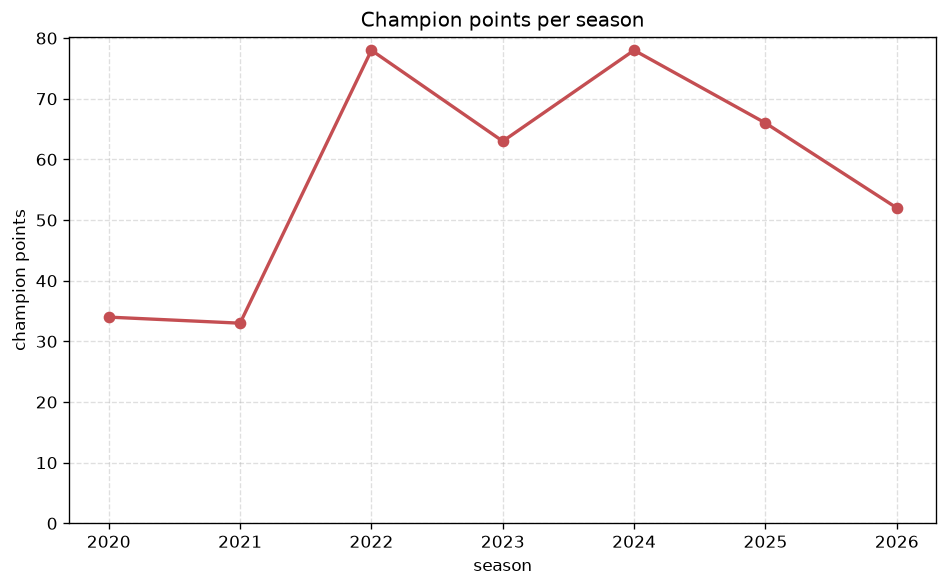
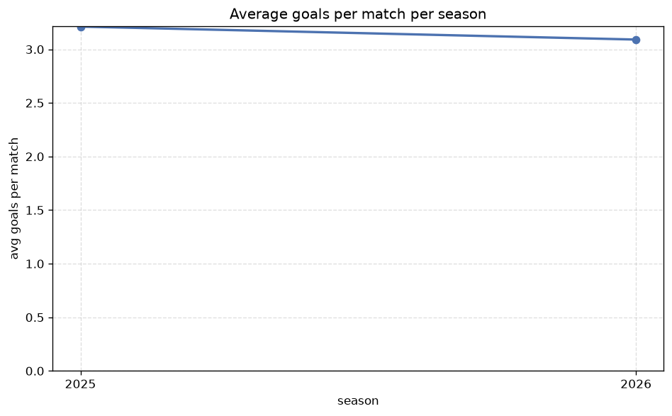

# Season Trends Analysis
- Report: `season_trends`
- Generated: 2026-10-29T01:55:46+00:00
- Script: `backend/scripts/analyze_seasons.py` v1.0.0
- League: Super League (China)
- Scope: league `china`

## 1. Champions per season
| season | champion | pts | runner-up | margin |
|---|---|---|---|---|
| 2020 | Guangzhou FC | 34 | Shanghai Port | 2 pts |
| 2021 | Shandong Taishan | 33 | Guangzhou FC | 3 pts |
| 2022 | Wuhan Three Towns | 78 | Shandong Taishan | 0 pts |
| 2023 | Shanghai Port | 63 | Shandong Taishan | 5 pts |
| 2024 | Shanghai Port | 78 | Shanghai Shenhua | 1 pts |
| 2025 | Shanghai Port | 66 | Shanghai Shenhua | 2 pts |
| 2026 | Beijing Guoan | 52 | Chengdu Rongcheng | 0 pts |

## 2. Title-race tightness
- Tight races (margin <= 3 pts): **6** of 7 seasons
- Tightest race: **2022** - Wuhan Three Towns beat Shandong Taishan by **0** pts

| season | margin | tight |
|---|---|---|
| 2020 | 2 pts | yes |
| 2021 | 3 pts | yes |
| 2022 | 0 pts | yes |
| 2023 | 5 pts |  |
| 2024 | 1 pts | yes |
| 2025 | 2 pts | yes |
| 2026 | 0 pts | yes |

## 3. Points thresholds
_Position-specific points per season. Key: 1 = champion, 2 = runner-up, 4 = CL line, 6 = Europa, 13 = last safe, 16 = bottom._

| season | pos 1 | pos 2 | pos 4 | pos 6 | pos 13 | pos 16 |
|---|---|---|---|---|---|---|
| 2020 | 34 | 32 | 26 | 24 | 11 | 3 |
| 2021 | 33 | 30 | 28 | 24 | 10 | 7 |
| 2022 | 78 | 78 | 65 | 59 | 44 | 23 |
| 2023 | 63 | 58 | 53 | 51 | 28 | 12 |
| 2024 | 78 | 77 | 56 | 42 | 29 | 22 |
| 2025 | 66 | 64 | 57 | 44 | 25 | 19 |
| 2026 | 52 | 52 | 49 | 47 | 32 | 21 |

## 4. Relegation battle
| season | safe pos | safe pts | drop pos | drop pts | gap |
|---|---|---|---|---|---|
| 2020 | 13 | 11 | 14 | 10 | 1 pts |
| 2021 | 13 | 10 | 14 | 9 | 1 pts |
| 2022 | 13 | 44 | 14 | 30 | 14 pts |
| 2023 | 13 | 28 | 14 | 22 | 6 pts |
| 2024 | 13 | 29 | 14 | 29 | 0 pts |
| 2025 | 13 | 25 | 14 | 25 | 0 pts |
| 2026 | 13 | 32 | 14 | 29 | 3 pts |

## 5. League-level trends
| season | matches | total goals | avg goals | home win | draw | away win | goalless | avg pts/team |
|---|---|---|---|---|---|---|---|---|
| 2020 | 112 | 321 | 2.866 | 40.2% | 24.1% | 35.7% | 6.2% | 19.31 |
| 2021 | 112 | 301 | 2.688 | 48.2% | 26.8% | 25.0% | 11.6% | 19.12 |
| 2022 | 306 | 875 | 2.859 | 42.5% | 20.3% | 37.3% | 6.5% | 47.56 |
| 2023 | 240 | 666 | 2.775 | 44.2% | 27.9% | 27.9% | 5.8% | 40.81 |
| 2024 | 240 | 750 | 3.125 | 46.2% | 22.9% | 30.8% | 6.7% | 41.56 |
| 2025 | 240 | 771 | 3.212 | 46.7% | 25.8% | 27.5% | 3.8% | 41.12 |
| 2026 | 232 | 730 | 3.147 | 44.0% | 26.3% | 29.7% | 4.3% | 39.69 |

## 6. View divergence
- Largest divergence: **2022** (goals view, avg abs position diff = 6.556)

_Avg absolute position difference between classic view and alternative view per season._

| season | classic vs luck | classic vs goals |
|---|---|---|
| 2020 | 2.750 | 5.500 |
| 2021 | 3.500 | 5.625 |
| 2022 | 2.778 | 6.556 |
| 2023 | 3.125 | 5.000 |
| 2024 | 3.000 | 3.875 |
| 2025 | 2.500 | 3.625 |
| 2026 | 3.375 | 5.875 |

---
*All statistics are computed from PostgreSQL tables (read-only). Run with `python backend/scripts/analyze_seasons.py` to regenerate.*

## Charts

