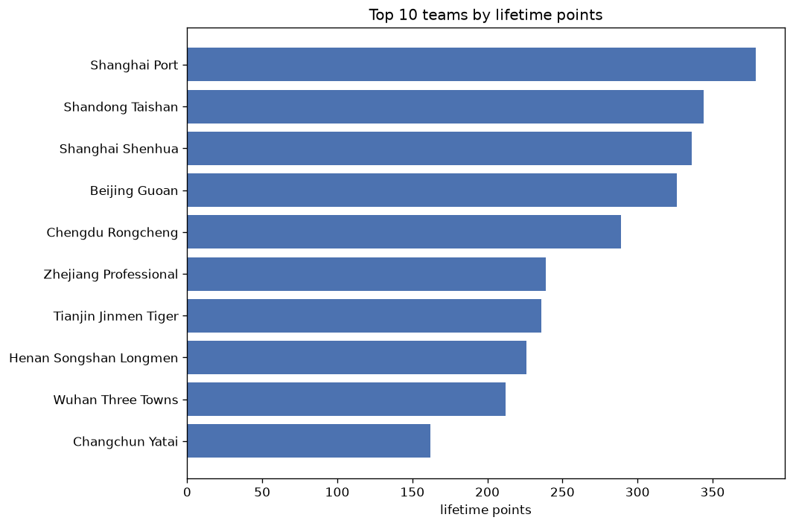
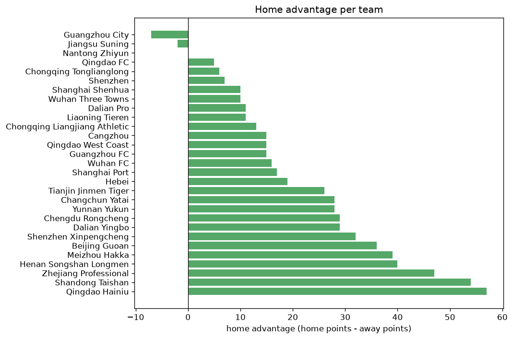

# Team Analysis
- Report: `teams_analysis`
- Generated: 2026-10-30T03:47:00+00:00
- Script: `backend/scripts/analyze_teams.py` v1.0.0
- League: Super League (China)
- Scope: league `china`

- Teams: **29** | Seasons: **7** | Matches: **1482**

## 1. Team standings (lifetime)
| team | seasons | played | W | D | L | pts | GF | GA | GD | avg pts/season | best pos | worst pos | titles |
|---|---|---|---|---|---|---|---|---|---|---|---|---|---|
| Shanghai Port | 7 | 181 | 115 | 34 | 32 | 379 | 390 | 183 | 207 | 54.14 | 1 | 5 | 3 |
| Shandong Taishan | 7 | 181 | 101 | 41 | 39 | 344 | 370 | 208 | 162 | 49.14 | 1 | 5 | 1 |
| Shanghai Shenhua | 7 | 181 | 97 | 45 | 39 | 336 | 316 | 202 | 114 | 48.0 | 2 | 8 | 0 |
| Beijing Guoan | 7 | 181 | 93 | 47 | 41 | 326 | 356 | 236 | 120 | 46.57 | 1 | 7 | 1 |
| Chengdu Rongcheng | 5 | 153 | 83 | 40 | 30 | 289 | 276 | 154 | 122 | 57.8 | 2 | 5 | 0 |
| Zhejiang Professional | 5 | 153 | 66 | 41 | 46 | 239 | 287 | 227 | 60 | 47.8 | 3 | 9 | 0 |
| Tianjin Jinmen Tiger | 7 | 181 | 62 | 50 | 69 | 236 | 227 | 253 | -26 | 33.71 | 6 | 16 | 0 |
| Henan Songshan Longmen | 7 | 181 | 58 | 52 | 71 | 226 | 249 | 248 | 1 | 32.29 | 6 | 15 | 0 |
| Wuhan Three Towns | 5 | 153 | 58 | 38 | 57 | 212 | 251 | 224 | 27 | 42.4 | 1 | 15 | 1 |
| Changchun Yatai | 5 | 138 | 41 | 39 | 58 | 162 | 188 | 219 | -31 | 32.4 | 4 | 16 | 0 |
| Meizhou Hakka | 4 | 124 | 34 | 29 | 61 | 131 | 150 | 221 | -71 | 32.75 | 10 | 15 | 0 |
| Cangzhou | 5 | 122 | 32 | 35 | 55 | 131 | 140 | 212 | -72 | 26.2 | 11 | 13 | 0 |
| Qingdao West Coast | 3 | 89 | 26 | 33 | 30 | 111 | 112 | 139 | -27 | 37.0 | 9 | 10 | 0 |
| Qingdao Hainiu | 4 | 119 | 26 | 25 | 68 | 103 | 131 | 210 | -79 | 25.75 | 13 | 16 | 0 |
| Shenzhen Xinpengcheng | 3 | 89 | 24 | 16 | 49 | 88 | 103 | 165 | -62 | 29.33 | 12 | 13 | 0 |
| Dalian Yingbo | 2 | 59 | 24 | 13 | 22 | 85 | 76 | 88 | -12 | 42.5 | 4 | 11 | 0 |
| Dalian Pro | 4 | 92 | 19 | 26 | 47 | 83 | 104 | 150 | -46 | 20.75 | 11 | 15 | 0 |
| Shenzhen | 4 | 92 | 24 | 11 | 57 | 83 | 95 | 191 | -96 | 20.75 | 5 | 16 | 0 |
| Yunnan Yukun | 2 | 59 | 22 | 16 | 21 | 82 | 104 | 112 | -8 | 41.0 | 8 | 8 | 0 |
| Guangzhou FC | 3 | 62 | 23 | 12 | 27 | 81 | 94 | 89 | 5 | 27.0 | 1 | 17 | 1 |
| Guangzhou City | 3 | 62 | 15 | 14 | 33 | 59 | 67 | 111 | -44 | 19.67 | 9 | 16 | 0 |
| Wuhan FC | 3 | 62 | 14 | 14 | 34 | 56 | 61 | 106 | -45 | 18.67 | 10 | 15 | 0 |
| Hebei | 3 | 62 | 15 | 8 | 39 | 53 | 55 | 149 | -94 | 17.67 | 7 | 18 | 0 |
| Nantong Zhiyun | 2 | 60 | 9 | 17 | 34 | 44 | 58 | 108 | -50 | 22.0 | 14 | 16 | 0 |
| Chongqing Tonglianglong | 1 | 29 | 8 | 12 | 9 | 36 | 31 | 34 | -3 | 36.0 | 11 | 11 | 0 |
| Chongqing Liangjiang Athletic | 2 | 28 | 10 | 5 | 13 | 35 | 38 | 47 | -9 | 17.5 | 6 | 12 | 0 |
| Liaoning Tieren | 1 | 29 | 8 | 5 | 16 | 29 | 41 | 52 | -11 | 29.0 | 14 | 14 | 0 |
| Jiangsu Suning | 1 | 14 | 7 | 5 | 2 | 26 | 23 | 15 | 8 | 26.0 | 4 | 4 | 0 |
| Qingdao FC | 2 | 28 | 4 | 5 | 19 | 17 | 21 | 61 | -40 | 8.5 | 14 | 16 | 0 |

## 2. Home vs away split
| team | home P | H-W | H-D | H-L | H-pts | away P | A-W | A-D | A-L | A-pts | adv |
|---|---|---|---|---|---|---|---|---|---|---|---|
| Qingdao Hainiu | 59 | 22 | 14 | 23 | 80 | 60 | 4 | 11 | 45 | 23 | 57 |
| Shandong Taishan | 90 | 61 | 16 | 13 | 199 | 91 | 40 | 25 | 26 | 145 | 54 |
| Zhejiang Professional | 76 | 41 | 20 | 15 | 143 | 77 | 25 | 21 | 31 | 96 | 47 |
| Henan Songshan Longmen | 91 | 36 | 25 | 30 | 133 | 90 | 22 | 27 | 41 | 93 | 40 |
| Meizhou Hakka | 62 | 24 | 13 | 25 | 85 | 62 | 10 | 16 | 36 | 46 | 39 |
| Beijing Guoan | 90 | 54 | 19 | 17 | 181 | 91 | 39 | 28 | 24 | 145 | 36 |
| Shenzhen Xinpengcheng | 45 | 17 | 9 | 19 | 60 | 44 | 7 | 7 | 30 | 28 | 32 |
| Chengdu Rongcheng | 77 | 47 | 18 | 12 | 159 | 76 | 36 | 22 | 18 | 130 | 29 |
| Dalian Yingbo | 29 | 18 | 3 | 8 | 57 | 30 | 6 | 10 | 14 | 28 | 29 |
| Changchun Yatai | 69 | 25 | 20 | 24 | 95 | 69 | 16 | 19 | 34 | 67 | 28 |
| Yunnan Yukun | 29 | 16 | 7 | 6 | 55 | 30 | 6 | 9 | 15 | 27 | 28 |
| Tianjin Jinmen Tiger | 91 | 34 | 29 | 28 | 131 | 90 | 28 | 21 | 41 | 105 | 26 |
| Hebei | 31 | 10 | 6 | 15 | 36 | 31 | 5 | 2 | 24 | 17 | 19 |
| Shanghai Port | 90 | 60 | 18 | 12 | 198 | 91 | 55 | 16 | 20 | 181 | 17 |
| Wuhan FC | 31 | 9 | 9 | 13 | 36 | 31 | 5 | 5 | 21 | 20 | 16 |
| Cangzhou | 61 | 18 | 19 | 24 | 73 | 61 | 14 | 16 | 31 | 58 | 15 |
| Qingdao West Coast | 45 | 14 | 21 | 10 | 63 | 44 | 12 | 12 | 20 | 48 | 15 |
| Guangzhou FC | 31 | 14 | 6 | 11 | 48 | 31 | 9 | 6 | 16 | 33 | 15 |
| Chongqing Liangjiang Athletic | 14 | 7 | 3 | 4 | 24 | 14 | 3 | 2 | 9 | 11 | 13 |
| Dalian Pro | 46 | 10 | 17 | 19 | 47 | 46 | 9 | 9 | 28 | 36 | 11 |
| Liaoning Tieren | 15 | 6 | 2 | 7 | 20 | 14 | 2 | 3 | 9 | 9 | 11 |
| Shanghai Shenhua | 90 | 50 | 23 | 17 | 173 | 91 | 47 | 22 | 22 | 163 | 10 |
| Wuhan Three Towns | 77 | 31 | 18 | 28 | 111 | 76 | 27 | 20 | 29 | 101 | 10 |
| Shenzhen | 46 | 13 | 6 | 27 | 45 | 46 | 11 | 5 | 30 | 38 | 7 |
| Chongqing Tonglianglong | 15 | 5 | 6 | 4 | 21 | 14 | 3 | 6 | 5 | 15 | 6 |
| Qingdao FC | 14 | 3 | 2 | 9 | 11 | 14 | 1 | 3 | 10 | 6 | 5 |
| Nantong Zhiyun | 30 | 5 | 7 | 18 | 22 | 30 | 4 | 10 | 16 | 22 | 0 |
| Jiangsu Suning | 7 | 3 | 3 | 1 | 12 | 7 | 4 | 2 | 1 | 14 | -2 |
| Guangzhou City | 31 | 7 | 5 | 19 | 26 | 31 | 8 | 9 | 14 | 33 | -7 |

## 3. Top performers
### Best points per game (PPG)
| rank | team | PPG |
|---|---|---|
| 1 | Shanghai Port | 2.09 |
| 2 | Shandong Taishan | 1.90 |
| 3 | Chengdu Rongcheng | 1.89 |
| 4 | Jiangsu Suning | 1.86 |
| 5 | Shanghai Shenhua | 1.86 |

### Most goals scored
| rank | team | goals |
|---|---|---|
| 1 | Shanghai Port | 390 |
| 2 | Shandong Taishan | 370 |
| 3 | Beijing Guoan | 356 |
| 4 | Shanghai Shenhua | 316 |
| 5 | Zhejiang Professional | 287 |

### Best goal difference
| rank | team | GD |
|---|---|---|
| 1 | Shanghai Port | 207 |
| 2 | Shandong Taishan | 162 |
| 3 | Chengdu Rongcheng | 122 |
| 4 | Beijing Guoan | 120 |
| 5 | Shanghai Shenhua | 114 |

### Best defence (goals against per match, standings)
| rank | team | GA/match |
|---|---|---|
| 1 | Chengdu Rongcheng | 1.007 |
| 2 | Shanghai Port | 1.011 |
| 3 | Jiangsu Suning | 1.071 |
| 4 | Shanghai Shenhua | 1.116 |
| 5 | Shandong Taishan | 1.149 |

## 4. Team consistency
- Teams present in all **7** seasons: **6**

Beijing Guoan, Henan Songshan Longmen, Shandong Taishan, Shanghai Port, Shanghai Shenhua, Tianjin Jinmen Tiger

## 5. Head-to-head dominance
- Distinct fixtures: **299** (showing the 15 most frequent)

| fixture | meetings | home wins | draws | away wins | home pct | draw pct | away pct |
|---|---|---|---|---|---|---|---|
| Shandong Taishan vs Henan Songshan Longmen | 14 | 6 | 4 | 4 | 42.9% | 28.6% | 28.6% |
| Shanghai Port vs Tianjin Jinmen Tiger | 14 | 6 | 3 | 5 | 42.9% | 21.4% | 35.7% |
| Beijing Guoan vs Tianjin Jinmen Tiger | 14 | 4 | 5 | 5 | 28.6% | 35.7% | 35.7% |
| Shanghai Port vs Beijing Guoan | 14 | 3 | 4 | 7 | 21.4% | 28.6% | 50.0% |
| Shandong Taishan vs Shanghai Shenhua | 12 | 6 | 2 | 4 | 50.0% | 16.7% | 33.3% |
| Shanghai Shenhua vs Henan Songshan Longmen | 12 | 6 | 3 | 3 | 50.0% | 25.0% | 25.0% |
| Shanghai Port vs Shanghai Shenhua | 12 | 5 | 5 | 2 | 41.7% | 41.7% | 16.7% |
| Beijing Guoan vs Shanghai Shenhua | 12 | 4 | 4 | 4 | 33.3% | 33.3% | 33.3% |
| Shanghai Shenhua vs Tianjin Jinmen Tiger | 12 | 4 | 3 | 5 | 33.3% | 25.0% | 41.7% |
| Shandong Taishan vs Zhejiang Professional | 10 | 8 | 2 | 0 | 80.0% | 20.0% | 0.0% |
| Tianjin Jinmen Tiger vs Zhejiang Professional | 10 | 8 | 1 | 1 | 80.0% | 10.0% | 10.0% |
| Beijing Guoan vs Changchun Yatai | 10 | 7 | 1 | 2 | 70.0% | 10.0% | 20.0% |
| Beijing Guoan vs Shandong Taishan | 10 | 7 | 3 | 0 | 70.0% | 30.0% | 0.0% |
| Wuhan Three Towns vs Zhejiang Professional | 10 | 7 | 1 | 2 | 70.0% | 10.0% | 20.0% |
| Beijing Guoan vs Henan Songshan Longmen | 10 | 6 | 1 | 3 | 60.0% | 10.0% | 30.0% |

## 6. Position per season (classic view)
_Cells show final position; '-' when the team was absent from that season._

| team | 2020 | 2021 | 2022 | 2023 | 2024 | 2025 | 2026 |
|---|---|---|---|---|---|---|---|
| Shanghai Port | 2 | 3 | 4 | 1 | 1 | 1 | 5 |
| Shandong Taishan | 5 | 1 | 2 | 2 | 5 | 5 | 3 |
| Shanghai Shenhua | 8 | 8 | 8 | 5 | 2 | 2 | 6 |
| Beijing Guoan | 3 | 6 | 7 | 6 | 4 | 4 | 1 |
| Chengdu Rongcheng | - | - | 5 | 4 | 3 | 3 | 2 |
| Zhejiang Professional | - | - | 3 | 3 | 7 | 7 | 9 |
| Tianjin Jinmen Tiger | 16 | 14 | 9 | 8 | 6 | 6 | 7 |
| Henan Songshan Longmen | 15 | 10 | 6 | 10 | 8 | 10 | 12 |
| Wuhan Three Towns | - | - | 1 | 7 | 11 | 14 | 15 |
| Changchun Yatai | - | 4 | 12 | 9 | 9 | 16 | - |
| Meizhou Hakka | - | - | 10 | 11 | 15 | 15 | - |
| Cangzhou | 11 | 13 | 13 | 12 | 12 | - | - |
| Qingdao West Coast | - | - | - | - | 10 | 9 | 10 |
| Qingdao Hainiu | - | - | - | 13 | 14 | 13 | 16 |
| Shenzhen Xinpengcheng | - | - | - | - | 13 | 12 | 13 |
| Dalian Yingbo | - | - | - | - | - | 11 | 4 |
| Dalian Pro | 13 | 15 | 11 | 15 | - | - | - |
| Shenzhen | 9 | 5 | 14 | 16 | - | - | - |
| Yunnan Yukun | - | - | - | - | - | 8 | 8 |
| Guangzhou FC | 1 | 2 | 17 | - | - | - | - |
| Guangzhou City | 12 | 9 | 16 | - | - | - | - |
| Wuhan FC | 10 | 11 | 15 | - | - | - | - |
| Hebei | 7 | 7 | 18 | - | - | - | - |
| Nantong Zhiyun | - | - | - | 14 | 16 | - | - |
| Chongqing Tonglianglong | - | - | - | - | - | - | 11 |
| Chongqing Liangjiang Athletic | 6 | 12 | - | - | - | - | - |
| Liaoning Tieren | - | - | - | - | - | - | 14 |
| Jiangsu Suning | 4 | - | - | - | - | - | - |
| Qingdao FC | 14 | 16 | - | - | - | - | - |

---
*All statistics are computed from PostgreSQL tables (read-only). Run with `python backend/scripts/analyze_teams.py` to regenerate.*

## Charts

