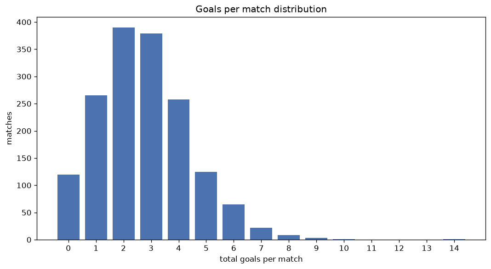
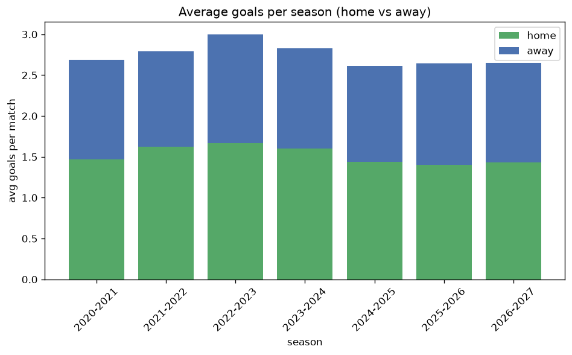

# Goal Analysis
- Report: `goals_analysis`
- Generated: 2026-10-26T01:28:45+00:00
- Script: `backend/scripts/analyze_goals.py` v1.0.0
- League: Chance Liga (Czech Republic)
- Scope: league `czech1`

## 1. Goals per match distribution
| goals | matches | pct |
|---|---|---|
| 0 | 120 | 7.3% |
| 1 | 265 | 16.2% |
| 2 | 390 | 23.8% |
| 3 | 379 | 23.2% |
| 4 | 258 | 15.8% |
| 5 | 125 | 7.6% |
| 6 | 65 | 4.0% |
| 7 | 22 | 1.3% |
| 8 | 8 | 0.5% |
| 9 | 3 | 0.2% |
| 10 | 1 | 0.1% |
| 11 | 0 | 0.0% |
| 12 | 0 | 0.0% |
| 13 | 0 | 0.0% |
| 14 | 1 | 0.1% |

## 2. Goals per match per season
| season | matches | total goals | avg home | avg away | avg total |
|---|---|---|---|---|---|
| 2020-2021 | 306 | 822 | 1.471 | 1.216 | 2.686 |
| 2021-2022 | 240 | 670 | 1.625 | 1.167 | 2.792 |
| 2022-2023 | 240 | 720 | 1.667 | 1.333 | 3.0 |
| 2023-2024 | 240 | 678 | 1.6 | 1.225 | 2.825 |
| 2024-2025 | 240 | 627 | 1.438 | 1.175 | 2.612 |
| 2025-2026 | 280 | 740 | 1.404 | 1.239 | 2.643 |
| 2026-2027 | 91 | 241 | 1.429 | 1.22 | 2.648 |

## 3. Home vs away goal share
- Home goals: **2492** (55.4%)
- Away goals: **2006** (44.6%)
- Home/away ratio: **1.242**

| season | home goals | away goals | total | home pct | away pct |
|---|---|---|---|---|---|
| 2020-2021 | 450 | 372 | 822 | 54.7% | 45.3% |
| 2021-2022 | 390 | 280 | 670 | 58.2% | 41.8% |
| 2022-2023 | 400 | 320 | 720 | 55.6% | 44.4% |
| 2023-2024 | 384 | 294 | 678 | 56.6% | 43.4% |
| 2024-2025 | 345 | 282 | 627 | 55.0% | 45.0% |
| 2025-2026 | 393 | 347 | 740 | 53.1% | 46.9% |
| 2026-2027 | 130 | 111 | 241 | 53.9% | 46.1% |

## 4. BTTS (Both Teams To Score)
- Overall: **858** of `1637` (52.4%)

| season | matches | BTTS | pct |
|---|---|---|---|
| 2020-2021 | 306 | 156 | 51.0% |
| 2021-2022 | 240 | 128 | 53.3% |
| 2022-2023 | 240 | 143 | 59.6% |
| 2023-2024 | 240 | 134 | 55.8% |
| 2024-2025 | 240 | 113 | 47.1% |
| 2025-2026 | 280 | 139 | 49.6% |
| 2026-2027 | 91 | 45 | 49.5% |

## 5. Clean sheets
- Home clean sheets: **510** (31.2%)
- Away clean sheets: **389** (23.8%)
- Total clean sheets recorded: **899**
- Matches with at least one clean sheet: **779** (47.6%)
- Both teams kept clean sheets (0-0): **120**

| season | matches | home CS | away CS | total CS | matches w/ CS |
|---|---|---|---|---|---|
| 2020-2021 | 306 | 91 | 86 | 177 | 150 (49.0%) |
| 2021-2022 | 240 | 82 | 44 | 126 | 112 (46.7%) |
| 2022-2023 | 240 | 58 | 49 | 107 | 97 (40.4%) |
| 2023-2024 | 240 | 70 | 53 | 123 | 106 (44.2%) |
| 2024-2025 | 240 | 88 | 61 | 149 | 127 (52.9%) |
| 2025-2026 | 280 | 92 | 72 | 164 | 141 (50.4%) |
| 2026-2027 | 91 | 29 | 24 | 53 | 46 (50.5%) |

## 6. Scoring intensity
- First-half goals: **2032** (45.2%)
- Second-half goals: **2463** (54.8%)
- Avg first-half goals per match: **1.242**
- Avg second-half goals per match: **1.506**
- Second-half-only scoring (HT 0-0, FT goals >= 1): **338** (20.6%)
- *1 match(es) excluded (no HT score recorded).*

| season | matches | 1st half | 2nd half | 1st half pct | 2nd half pct |
|---|---|---|---|---|---|
| 2020-2021 | 306 | 361 | 461 | 43.9% | 56.1% |
| 2021-2022 | 240 | 294 | 376 | 43.9% | 56.1% |
| 2022-2023 | 240 | 306 | 414 | 42.5% | 57.5% |
| 2023-2024 | 240 | 317 | 361 | 46.8% | 53.2% |
| 2024-2025 | 240 | 298 | 329 | 47.5% | 52.5% |
| 2025-2026 | 280 | 347 | 390 | 47.1% | 52.9% |
| 2026-2027 | 91 | 109 | 132 | 45.2% | 54.8% |

## 7. First-goal timing
- Matches with first-goal time recorded: `1516` of `1637` (92.6%)
- Goalless matches: `121`
- Min `1` | Max `95` | Mean `29.79` | Median (p50) `23.0`

| bucket | count | % of matches | % of scoring matches |
|---|---|---|---|
| 1-15 | 528 | 32.3% | 34.8% |
| 16-30 | 364 | 22.2% | 24.0% |
| 31-45 | 253 | 15.5% | 16.7% |
| 46-60 | 196 | 12.0% | 12.9% |
| 61-75 | 97 | 5.9% | 6.4% |
| 76-90 | 66 | 4.0% | 4.4% |
| 91-120 | 12 | 0.7% | 0.8% |

---
*All statistics are computed from PostgreSQL tables (read-only). Run with `python backend/scripts/analyze_goals.py` to regenerate.*

## Charts

