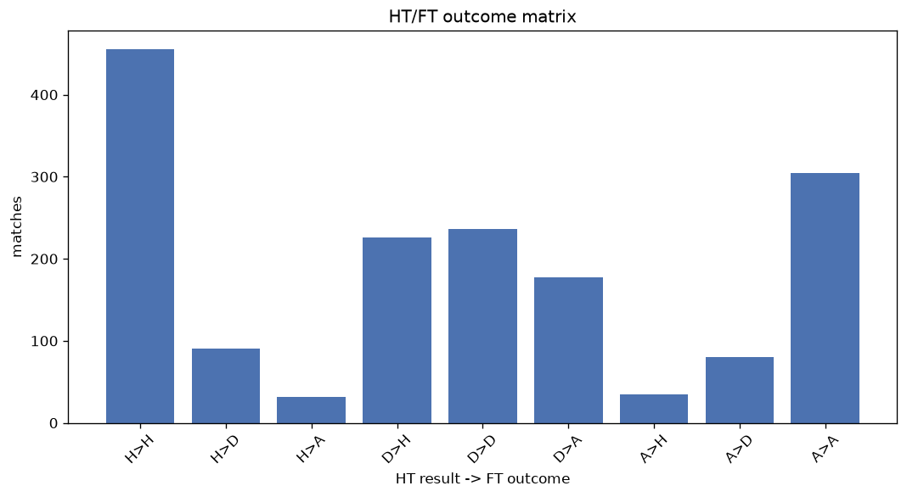
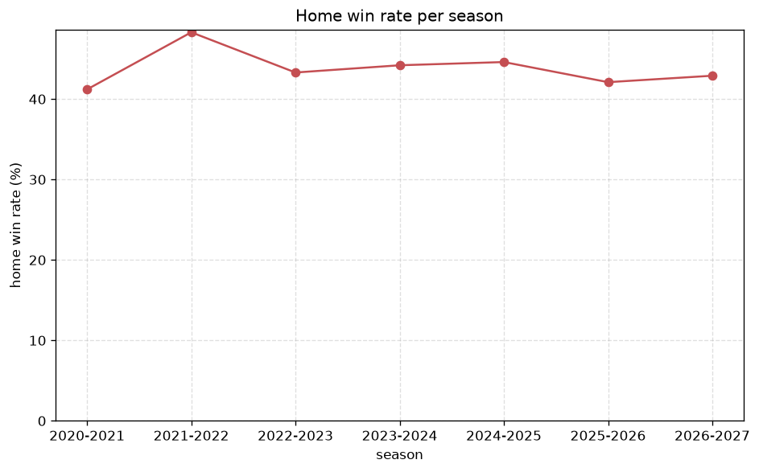

# Match Analysis
- Report: `matches_analysis`
- Generated: 2026-10-26T01:28:43+00:00
- Script: `backend/scripts/analyze_matches.py` v1.0.0
- League: Chance Liga (Czech Republic)
- Scope: league `czech1`

## 1. Overall summary
| metric | value |
|---|---|
| Matches | 1637 |
| Home wins | 716 (43.7%) |
| Draws | 407 (24.9%) |
| Away wins | 514 (31.4%) |
| Total goals | 4498 |
| Average goals per match | 2.748 |
| Goalless matches | 120 (7.3%) |

## 2. Per-season breakdown
| season | matches | home wins | draws | away wins | total goals | avg goals | goalless |
|---|---|---|---|---|---|---|---|
| 2020-2021 | 306 | 126 (41.2%) | 81 (26.5%) | 99 (32.4%) | 822 | 2.686 | 27 (8.8%) |
| 2021-2022 | 240 | 116 (48.3%) | 61 (25.4%) | 63 (26.2%) | 670 | 2.792 | 14 (5.8%) |
| 2022-2023 | 240 | 104 (43.3%) | 59 (24.6%) | 77 (32.1%) | 720 | 3.0 | 10 (4.2%) |
| 2023-2024 | 240 | 106 (44.2%) | 63 (26.2%) | 71 (29.6%) | 678 | 2.825 | 17 (7.1%) |
| 2024-2025 | 240 | 107 (44.6%) | 54 (22.5%) | 79 (32.9%) | 627 | 2.612 | 22 (9.2%) |
| 2025-2026 | 280 | 118 (42.1%) | 67 (23.9%) | 95 (33.9%) | 740 | 2.643 | 23 (8.2%) |
| 2026-2027 | 91 | 39 (42.9%) | 22 (24.2%) | 30 (33.0%) | 241 | 2.648 | 7 (7.7%) |

## 3. HT/FT outcome matrix
| HT result \ FT result | Home | Draw | Away | total |
|---|---|---|---|---|
| HT home lead | 455 (78.7%) | 91 (15.7%) | 32 (5.5%) | 578 |
| HT draw | 226 (35.4%) | 236 (36.9%) | 177 (27.7%) | 639 |
| HT away lead | 35 (8.4%) | 80 (19.1%) | 304 (72.6%) | 419 |
- *1 match(es) excluded (no HT score recorded).*

## 4. Comeback matches
- Home comebacks (trailing at HT, won at FT): **35** (2.1%)
- Away comebacks (trailing at HT, won at FT): **32** (2.0%)

### Home comebacks
| season | home | away | HT | FT |
|---|---|---|---|---|
| 2020-2021 | Sparta Prague | Zlin | 0-1 | 3-1 |
| 2020-2021 | Pribram | Mlada Boleslav | 0-1 | 2-1 |
| 2020-2021 | Jablonec | Plzen | 0-2 | 3-2 |
| 2020-2021 | Ceske Budejovice | Pribram | 0-1 | 2-1 |
| 2020-2021 | Liberec | Teplice | 0-1 | 2-1 |
| 2020-2021 | Ostrava | Mlada Boleslav | 0-1 | 2-1 |
| 2020-2021 | Sparta Prague | Plzen | 0-1 | 3-1 |
| 2021-2022 | Plzen | Slovacko | 0-1 | 2-1 |
| 2021-2022 | Liberec | Mlada Boleslav | 0-1 | 2-1 |
| 2021-2022 | Ceske Budejovice | Slovacko | 0-1 | 3-2 |
| 2021-2022 | Slovacko | Mlada Boleslav | 0-1 | 2-1 |
| 2022-2023 | Brno | Mlada Boleslav | 0-1 | 3-1 |
| 2022-2023 | Teplice | Jablonec | 1-2 | 3-2 |
| 2022-2023 | Sparta Prague | Hradec Kralove | 0-1 | 2-1 |
| 2022-2023 | Sigma Olomouc | Zlin | 0-1 | 2-1 |
| 2022-2023 | Slovacko | Teplice | 0-1 | 2-1 |
| 2022-2023 | Bohemians | Zlin | 0-2 | 3-2 |
| 2022-2023 | Slavia Prague | Plzen | 0-1 | 2-1 |
| 2022-2023 | FK Pardubice | Slovacko | 0-1 | 3-1 |
| 2023-2024 | Bohemians | Sigma Olomouc | 1-2 | 3-2 |
| 2023-2024 | Sparta Prague | Teplice | 0-1 | 2-1 |
| 2023-2024 | Zlin | Slovacko | 0-1 | 2-1 |
| 2024-2025 | Dukla Prague | FK Pardubice | 0-1 | 2-1 |
| 2024-2025 | Karvina | Sigma Olomouc | 0-1 | 2-1 |
| 2024-2025 | Sigma Olomouc | Slovacko | 0-1 | 2-1 |
| 2024-2025 | Ostrava | Karvina | 0-1 | 2-1 |
| 2024-2025 | Plzen | Jablonec | 0-2 | 3-2 |
| 2024-2025 | Sparta Prague | Jablonec | 0-1 | 2-1 |
| 2025-2026 | Slovacko | Teplice | 0-1 | 2-1 |
| 2025-2026 | Sparta Prague | Dukla Prague | 1-2 | 3-2 |
| 2025-2026 | FK Pardubice | Karvina | 0-1 | 2-1 |
| 2025-2026 | Sparta Prague | Bohemians | 0-1 | 2-1 |
| 2025-2026 | Slavia Prague | Sparta Prague | 0-1 | 3-1 |
| 2025-2026 | Slavia Prague | Sigma Olomouc | 0-1 | 2-1 |
| 2026-2027 | Jablonec | Sigma Olomouc | 0-1 | 2-1 |

### Away comebacks
| season | home | away | HT | FT |
|---|---|---|---|---|
| 2020-2021 | Ceske Budejovice | Zlin | 1-0 | 1-2 |
| 2020-2021 | Sigma Olomouc | Sparta Prague | 1-0 | 2-3 |
| 2020-2021 | Slovacko | Slavia Prague | 2-1 | 2-3 |
| 2021-2022 | Bohemians | Plzen | 1-0 | 1-2 |
| 2021-2022 | Karvina | Zlin | 1-0 | 2-3 |
| 2021-2022 | Bohemians | Slavia Prague | 1-0 | 1-5 |
| 2022-2023 | Mlada Boleslav | Sparta Prague | 1-0 | 1-3 |
| 2022-2023 | Sigma Olomouc | Slovacko | 1-0 | 1-2 |
| 2022-2023 | Liberec | Mlada Boleslav | 1-0 | 1-3 |
| 2022-2023 | Hradec Kralove | Slovacko | 1-0 | 1-2 |
| 2022-2023 | Brno | Plzen | 1-0 | 1-3 |
| 2022-2023 | Hradec Kralove | Jablonec | 1-0 | 1-4 |
| 2022-2023 | Brno | Jablonec | 1-0 | 1-2 |
| 2022-2023 | Plzen | Bohemians | 1-0 | 1-2 |
| 2022-2023 | Liberec | Sparta Prague | 1-0 | 1-3 |
| 2023-2024 | Liberec | Slavia Prague | 2-1 | 2-3 |
| 2023-2024 | Zlin | Mlada Boleslav | 2-1 | 5-9 |
| 2023-2024 | Karvina | Ostrava | 1-0 | 1-3 |
| 2023-2024 | Slavia Prague | Plzen | 1-0 | 1-2 |
| 2023-2024 | Hradec Kralove | Ostrava | 2-1 | 2-3 |
| 2024-2025 | Sparta Prague | Sigma Olomouc | 1-0 | 2-3 |
| 2024-2025 | Dukla Prague | Liberec | 1-0 | 1-4 |
| 2024-2025 | FK Pardubice | Ostrava | 1-0 | 2-3 |
| 2024-2025 | Dukla Prague | Slovacko | 1-0 | 1-2 |
| 2024-2025 | Karvina | Plzen | 1-0 | 1-2 |
| 2024-2025 | Sigma Olomouc | Slavia Prague | 1-0 | 1-2 |
| 2024-2025 | Ceske Budejovice | Karvina | 2-1 | 2-3 |
| 2025-2026 | Teplice | Zlin | 1-0 | 1-3 |
| 2025-2026 | Hradec Kralove | Liberec | 2-1 | 2-3 |
| 2025-2026 | Teplice | Plzen | 1-0 | 1-2 |
| 2025-2026 | Zlin | Teplice | 2-1 | 2-4 |
| 2026-2027 | FK Pardubice | Artis Brno | 1-0 | 1-2 |

## 5. HT lead conversion
| HT state | matches | converted to win | held as draw | collapsed to loss |
|---|---|---|---|---|
| Home lead | 578 | 455 (78.7%) | 91 (15.7%) | 32 (5.5%) |
| Away lead | 419 | 304 (72.6%) | 80 (19.1%) | 35 (8.4%) |

### Matches level at half-time
| FT result | count | pct |
|---|---|---|
| Home win | 226 | 35.4% |
| Draw | 236 | 36.9% |
| Away win | 177 | 27.7% |
- *1 match(es) excluded (no HT score recorded).*

## 6. First-goal timing
- Matches with a first-goal time recorded: `1516` of `1637` (92.6%)

Outcome distribution by first-goal timing bucket:
| bucket | matches | % of matches | home | draw | away |
|---|---|---|---|---|---|
| 1-15 | 528 | 32.3% | 250 (47.3%) | 111 (21.0%) | 167 (31.6%) |
| 16-30 | 364 | 22.2% | 165 (45.3%) | 64 (17.6%) | 135 (37.1%) |
| 31-45 | 253 | 15.5% | 123 (48.6%) | 53 (20.9%) | 77 (30.4%) |
| 46-60 | 196 | 12.0% | 102 (52.0%) | 35 (17.9%) | 59 (30.1%) |
| 61-75 | 97 | 5.9% | 41 (42.3%) | 16 (16.5%) | 40 (41.2%) |
| 76-90 | 66 | 4.0% | 28 (42.4%) | 8 (12.1%) | 30 (45.5%) |
| 91-120 | 12 | 0.7% | 7 (58.3%) | 0 (0.0%) | 5 (41.7%) |

## 7. Goalless matches
- Overall: **120** of `1637` (7.3%)

| season | matches | goalless | pct |
|---|---|---|---|
| 2020-2021 | 306 | 27 | 8.8% |
| 2021-2022 | 240 | 14 | 5.8% |
| 2022-2023 | 240 | 10 | 4.2% |
| 2023-2024 | 240 | 17 | 7.1% |
| 2024-2025 | 240 | 22 | 9.2% |
| 2025-2026 | 280 | 23 | 8.2% |
| 2026-2027 | 91 | 7 | 7.7% |

---
*All statistics are computed from PostgreSQL tables (read-only). Run with `python backend/scripts/analyze_matches.py` to regenerate.*

## Charts

