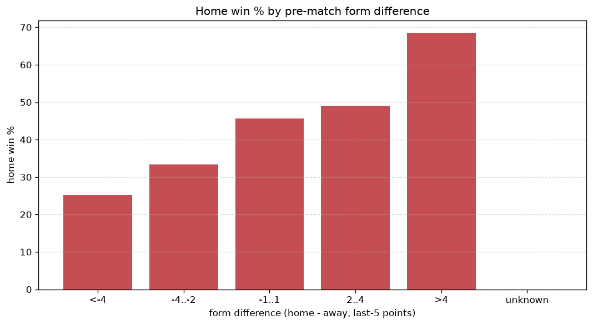
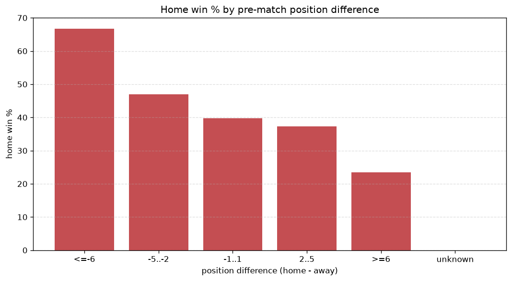

# Relationships Analysis
- Report: `relationships`
- Generated: 2026-10-30T03:47:24+00:00
- Script: `backend/scripts/analyze_relationships.py` v1.0.0
- League: Chance Liga (Czech Republic)
- Scope: league `czech1`

- Matches analysed: **1546** (23 leakage-safe pre-match features).

## 1. Correlation matrix
_Pearson correlation of each pre-match feature with observed goals; sorted by |corr(total goals)|._

| feature | corr(home) | corr(away) | corr(total) |
|---|---|---|---|
| home_position_before_match | -0.248 | 0.155 | -0.085 |
| home_team_goals_scored_last_5 | 0.205 | -0.110 | 0.082 |
| points_difference | 0.326 | -0.244 | 0.082 |
| home_team_home_goals_avg | 0.208 | -0.119 | 0.078 |
| position_difference | -0.325 | 0.254 | -0.074 |
| home_team_wins_last_5 | 0.205 | -0.134 | 0.066 |
| home_team_home_win_rate | 0.208 | -0.143 | 0.062 |
| home_team_points_last_5 | 0.203 | -0.138 | 0.061 |
| home_rest_days | -0.036 | -0.021 | -0.043 |
| away_rest_days | -0.029 | -0.025 | -0.040 |
| home_team_home_conceded_avg | -0.126 | 0.084 | -0.038 |
| home_points_before_match | 0.153 | -0.116 | 0.038 |
| away_points_before_match | -0.121 | 0.091 | -0.031 |
| home_team_goals_conceded_last_5 | -0.113 | 0.094 | -0.022 |
| away_team_goals_conceded_last_5 | 0.120 | -0.109 | 0.017 |
| away_position_before_match | 0.197 | -0.194 | 0.017 |
| away_team_away_conceded_avg | 0.127 | -0.117 | 0.017 |
| away_team_away_goals_avg | -0.114 | 0.104 | -0.016 |
| rest_days_difference | -0.018 | 0.006 | -0.009 |
| away_team_away_win_rate | -0.121 | 0.123 | -0.007 |
| away_team_goals_scored_last_5 | -0.101 | 0.106 | -0.004 |
| away_team_wins_last_5 | -0.131 | 0.147 | 0.002 |
| away_team_points_last_5 | -0.129 | 0.145 | 0.001 |

## 2. Form vs outcome
_Home win/draw/away % per bucket of `home_team_points_last_5 - away_team_points_last_5`._

| bucket | matches | home | draw | away | home % | draw % | away % |
|---|---|---|---|---|---|---|---|
| <-4 | 265 | 67 | 60 | 138 | 25.3% | 22.6% | 52.1% |
| -4..-2 | 299 | 100 | 79 | 120 | 33.4% | 26.4% | 40.1% |
| -1..1 | 441 | 201 | 114 | 126 | 45.6% | 25.9% | 28.6% |
| 2..4 | 316 | 155 | 91 | 70 | 49.1% | 28.8% | 22.2% |
| >4 | 225 | 154 | 41 | 30 | 68.4% | 18.2% | 13.3% |
| unknown | 0 | 0 | 0 | 0 | - | - | - |

## 3. Position vs outcome
_Home win/draw/away % per bucket of `position_difference` (home position - away position; negative favours the home team)._

| bucket | matches | home | draw | away | home % | draw % | away % |
|---|---|---|---|---|---|---|---|
| <=-6 | 324 | 228 | 59 | 37 | 70.4% | 18.2% | 11.4% |
| -5..-2 | 320 | 158 | 83 | 79 | 49.4% | 25.9% | 24.7% |
| -1..1 | 253 | 110 | 77 | 66 | 43.5% | 30.4% | 26.1% |
| 2..5 | 311 | 99 | 89 | 123 | 31.8% | 28.6% | 39.5% |
| >=6 | 338 | 82 | 77 | 179 | 24.3% | 22.8% | 53.0% |
| unknown | 0 | 0 | 0 | 0 | - | - | - |

## 4. Rest advantage
_Home win/draw/away % per bucket of `rest_days_difference` (home rest - away rest). Matches with unknown rest are bucketed separately._

| bucket | matches | home | draw | away | home % | draw % | away % |
|---|---|---|---|---|---|---|---|
| <-1 | 85 | 36 | 18 | 31 | 42.4% | 21.2% | 36.5% |
| -1..0 | 357 | 180 | 80 | 97 | 50.4% | 22.4% | 27.2% |
| 0 | 577 | 234 | 147 | 196 | 40.6% | 25.5% | 34.0% |
| 1..2 | 405 | 174 | 107 | 124 | 43.0% | 26.4% | 30.6% |
| >2 | 71 | 30 | 23 | 18 | 42.3% | 32.4% | 25.4% |
| unknown | 51 | 23 | 10 | 18 | 45.1% | 19.6% | 35.3% |
- *51 match(es) had unknown rest difference (missing rest data on at least one side).*

## 5. Home team quality
_Home win rate by `home_team_home_win_rate` tier (split at 0.5)._

- `< 0.5` tier: **36.8%** home win (351/955)
- `>= 0.5` tier: **55.2%** home win (326/591)
- Home-win gap (>= split minus < split): **+18.4 pp**

| tier | label | matches | home | draw | away | home % |
|---|---|---|---|---|---|---|
| low | < 0.5 | 955 | 351 | 258 | 346 | 36.8% |
| high | >= 0.5 | 591 | 326 | 127 | 138 | 55.2% |

## 6. Feature averages by result
_Mean feature value per outcome; `range` is home-minus-away spread of the group means._

| feature | home mean | draw mean | away mean | range |
|---|---|---|---|---|
| points_difference | 5.117 | -1.369 | -6.490 | 11.606 |
| home_points_before_match | 23.922 | 19.810 | 17.876 | 6.046 |
| away_points_before_match | 18.805 | 21.179 | 24.366 | 5.561 |
| position_difference | -2.325 | 0.519 | 3.205 | 5.530 |
| home_position_before_match | 7.504 | 9.543 | 10.316 | 2.812 |
| away_position_before_match | 9.829 | 9.023 | 7.112 | 2.717 |
| home_team_points_last_5 | 6.935 | 5.777 | 5.178 | 1.757 |
| away_team_points_last_5 | 5.727 | 6.205 | 7.229 | 1.503 |
| home_team_goals_scored_last_5 | 6.839 | 5.699 | 5.370 | 1.469 |
| away_team_goals_scored_last_5 | 5.812 | 6.273 | 6.930 | 1.117 |
| away_team_goals_conceded_last_5 | 6.548 | 6.156 | 5.488 | 1.060 |
| home_team_goals_conceded_last_5 | 5.727 | 6.631 | 6.727 | 1.001 |
| home_rest_days | 9.055 | 9.795 | 8.953 | 0.842 |
| away_rest_days | 9.171 | 9.520 | 8.901 | 0.619 |
| home_team_wins_last_5 | 1.938 | 1.556 | 1.329 | 0.609 |
| away_team_wins_last_5 | 1.527 | 1.686 | 2.052 | 0.524 |
| rest_days_difference | -0.107 | 0.275 | 0.041 | 0.382 |
| home_team_home_goals_avg | 1.630 | 1.349 | 1.267 | 0.362 |
| away_team_away_conceded_avg | 1.557 | 1.464 | 1.272 | 0.284 |
| away_team_away_goals_avg | 1.063 | 1.182 | 1.311 | 0.248 |
| home_team_home_conceded_avg | 1.047 | 1.251 | 1.271 | 0.224 |
| home_team_home_win_rate | 0.489 | 0.377 | 0.345 | 0.144 |
| away_team_away_win_rate | 0.253 | 0.290 | 0.362 | 0.109 |

---
*All features are leakage-safe pre-match values built by `ml.features.build_features.build_rows` from strictly prior matches. Run with `python backend/scripts/analyze_relationships.py` to regenerate.*

## Charts

