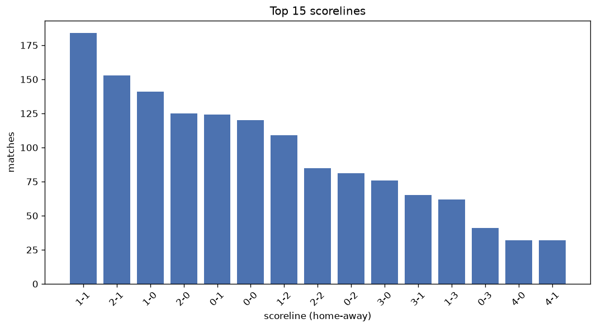
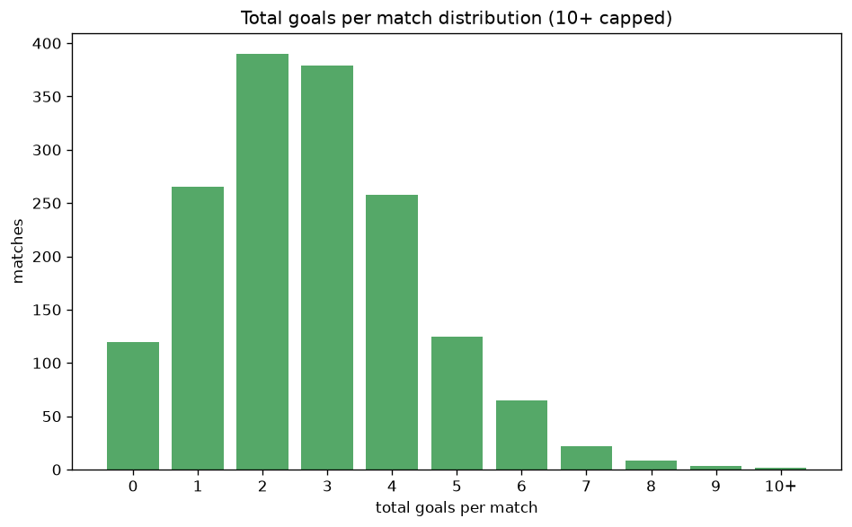

# Scoreline Analysis
- Report: `scoreline_analysis`
- Generated: 2026-10-30T03:47:22+00:00
- Script: `backend/scripts/analyze_scorelines.py` v1.0.0
- League: Chance Liga (Czech Republic)
- Scope: league `czech1`

## 1. Scoreline frequency
- Matches analysed: **1640** across **7** seasons.
- Distinct scorelines seen: **42**.

| scoreline | count | pct |
|---|---|---|
| 1-1 | 184 | 11.2% |
| 2-1 | 153 | 9.3% |
| 1-0 | 141 | 8.6% |
| 2-0 | 125 | 7.6% |
| 0-1 | 124 | 7.6% |
| 0-0 | 120 | 7.3% |
| 1-2 | 111 | 6.8% |
| 2-2 | 85 | 5.2% |
| 0-2 | 81 | 4.9% |
| 3-0 | 76 | 4.6% |
| 3-1 | 65 | 4.0% |
| 1-3 | 62 | 3.8% |
| 0-3 | 41 | 2.5% |
| 4-0 | 32 | 2.0% |
| 4-1 | 32 | 2.0% |
| 3-2 | 30 | 1.8% |
| 2-3 | 30 | 1.8% |
| 5-1 | 18 | 1.1% |
| 3-3 | 17 | 1.0% |
| 1-4 | 16 | 1.0% |

## 2. Scoreline frequency per season

### 2020-2021
| scoreline | count | pct |
|---|---|---|
| 1-1 | 39 | 12.7% |
| 2-1 | 28 | 9.2% |
| 0-1 | 28 | 9.2% |
| 0-0 | 27 | 8.8% |
| 1-0 | 20 | 6.5% |

### 2021-2022
| scoreline | count | pct |
|---|---|---|
| 1-0 | 32 | 13.3% |
| 1-1 | 23 | 9.6% |
| 2-1 | 21 | 8.8% |
| 0-1 | 19 | 7.9% |
| 2-2 | 18 | 7.5% |

### 2022-2023
| scoreline | count | pct |
|---|---|---|
| 1-1 | 30 | 12.5% |
| 2-1 | 24 | 10.0% |
| 1-2 | 20 | 8.3% |
| 2-2 | 17 | 7.1% |
| 0-2 | 16 | 6.7% |

### 2023-2024
| scoreline | count | pct |
|---|---|---|
| 1-1 | 31 | 12.9% |
| 0-1 | 25 | 10.4% |
| 2-1 | 24 | 10.0% |
| 2-0 | 22 | 9.2% |
| 0-0 | 17 | 7.1% |

### 2024-2025
| scoreline | count | pct |
|---|---|---|
| 1-0 | 26 | 10.8% |
| 2-1 | 25 | 10.4% |
| 0-0 | 22 | 9.2% |
| 1-1 | 21 | 8.8% |
| 2-0 | 19 | 7.9% |

### 2025-2026
| scoreline | count | pct |
|---|---|---|
| 1-1 | 30 | 10.7% |
| 2-0 | 29 | 10.4% |
| 1-0 | 24 | 8.6% |
| 0-0 | 23 | 8.2% |
| 1-2 | 22 | 7.9% |

### 2026-2027
| scoreline | count | pct |
|---|---|---|
| 1-1 | 10 | 10.6% |
| 2-1 | 9 | 9.6% |
| 1-2 | 9 | 9.6% |
| 1-0 | 8 | 8.5% |
| 0-0 | 7 | 7.4% |

## 3. Total-goal histogram
_10+ groups all matches with 10 or more total goals._

| total goals | matches | pct |
|---|---|---|
| 0 | 120 | 7.3% |
| 1 | 265 | 16.2% |
| 2 | 390 | 23.8% |
| 3 | 381 | 23.2% |
| 4 | 258 | 15.7% |
| 5 | 125 | 7.6% |
| 6 | 66 | 4.0% |
| 7 | 22 | 1.3% |
| 8 | 8 | 0.5% |
| 9 | 3 | 0.2% |
| 10+ | 2 | 0.1% |

## 4. Extreme scorelines
- Matches with 7+ total goals: **35**

| season | date | scoreline | total goals |
|---|---|---|---|
| 2023-2024 | 2023-10-21 | 5-9 | 14 |
| 2026-2027 | 2026-08-08 | 5-5 | 10 |
| 2020-2021 | 2021-04-03 | 7-2 | 9 |
| 2020-2021 | 2021-05-16 | 4-5 | 9 |
| 2024-2025 | 2024-12-15 | 7-2 | 9 |
| 2020-2021 | 2021-01-27 | 2-6 | 8 |
| 2021-2022 | 2021-09-26 | 3-5 | 8 |
| 2022-2023 | 2023-02-12 | 2-6 | 8 |
| 2023-2024 | 2023-09-17 | 1-7 | 8 |
| 2023-2024 | 2023-09-24 | 6-2 | 8 |
| 2023-2024 | 2023-12-09 | 5-3 | 8 |
| 2025-2026 | 2025-11-09 | 3-5 | 8 |
| 2025-2026 | 2026-03-08 | 6-2 | 8 |
| 2020-2021 | 2020-09-13 | 2-5 | 7 |
| 2020-2021 | 2020-12-15 | 7-0 | 7 |
| 2020-2021 | 2021-02-14 | 4-3 | 7 |
| 2020-2021 | 2021-05-29 | 6-1 | 7 |
| 2021-2022 | 2021-09-25 | 2-5 | 7 |
| 2022-2023 | 2022-08-21 | 7-0 | 7 |
| 2022-2023 | 2022-09-11 | 6-1 | 7 |
| 2022-2023 | 2022-10-15 | 5-2 | 7 |
| 2022-2023 | 2022-10-23 | 4-3 | 7 |
| 2023-2024 | 2023-08-05 | 5-2 | 7 |
| 2023-2024 | 2023-08-13 | 2-5 | 7 |
| 2023-2024 | 2023-09-30 | 5-2 | 7 |
| 2023-2024 | 2023-12-09 | 5-2 | 7 |
| 2023-2024 | 2024-02-11 | 4-3 | 7 |
| 2023-2024 | 2024-02-17 | 5-2 | 7 |
| 2023-2024 | 2024-04-20 | 4-3 | 7 |
| 2024-2025 | 2024-11-10 | 5-2 | 7 |
| 2024-2025 | 2025-03-29 | 5-2 | 7 |
| 2025-2026 | 2025-11-23 | 4-3 | 7 |
| 2025-2026 | 2025-12-13 | 4-3 | 7 |
| 2025-2026 | 2026-02-28 | 5-2 | 7 |
| 2025-2026 | 2026-03-15 | 5-2 | 7 |

## 5. Margin-of-victory distribution (decided matches)
- Decided matches: **1233** (draws: **407**)
- Average winning margin: **1.86**

| margin | matches | pct |
|---|---|---|
| 1 | 596 | 48.3% |
| 2 | 355 | 28.8% |
| 3+ | 282 | 22.9% |

## 6. Margin by outcome

### Home wins
- Matches: **717** | avg margin: **1.94** | max margin: **7**
| margin | matches | pct |
|---|---|---|
| 1 | 330 | 46.0% |
| 2 | 198 | 27.6% |
| 3+ | 189 | 26.4% |
- *Full match-by-match list available in `scoreline_analysis.json`.*

### Away wins
- Matches: **516** | avg margin: **1.75** | max margin: **6**
| margin | matches | pct |
|---|---|---|
| 1 | 266 | 51.6% |
| 2 | 157 | 30.4% |
| 3+ | 93 | 18.0% |
- *Full match-by-match list available in `scoreline_analysis.json`.*

## 7. Most common exact score by outcome type
| outcome | matches | most common score | count | pct |
|---|---|---|---|---|
| home | 717 | 2-1 | 153 | 21.3% |
| draw | 407 | 1-1 | 184 | 45.2% |
| away | 516 | 0-1 | 124 | 24.0% |

---
*All statistics are computed from PostgreSQL tables (read-only). Run with `python backend/scripts/analyze_scorelines.py` to regenerate.*

## Charts

