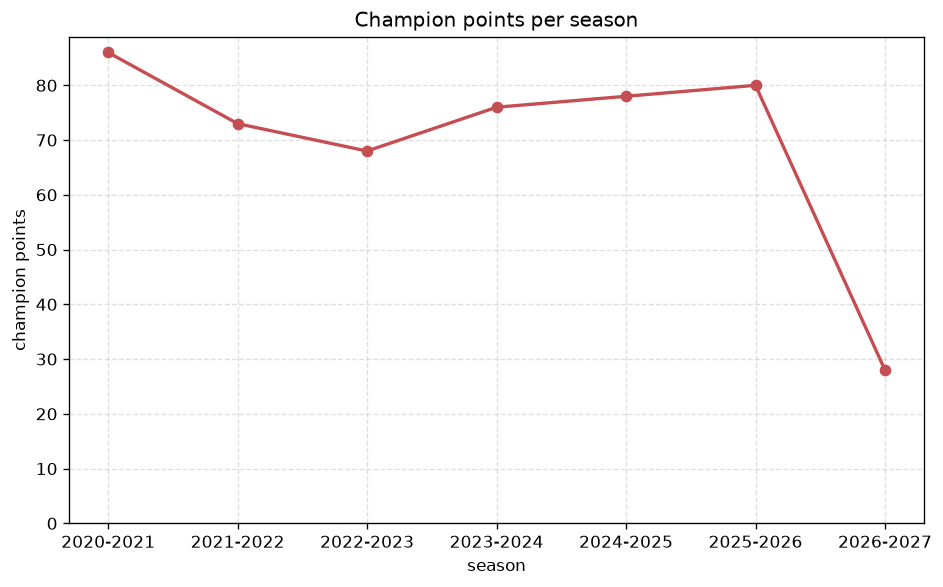
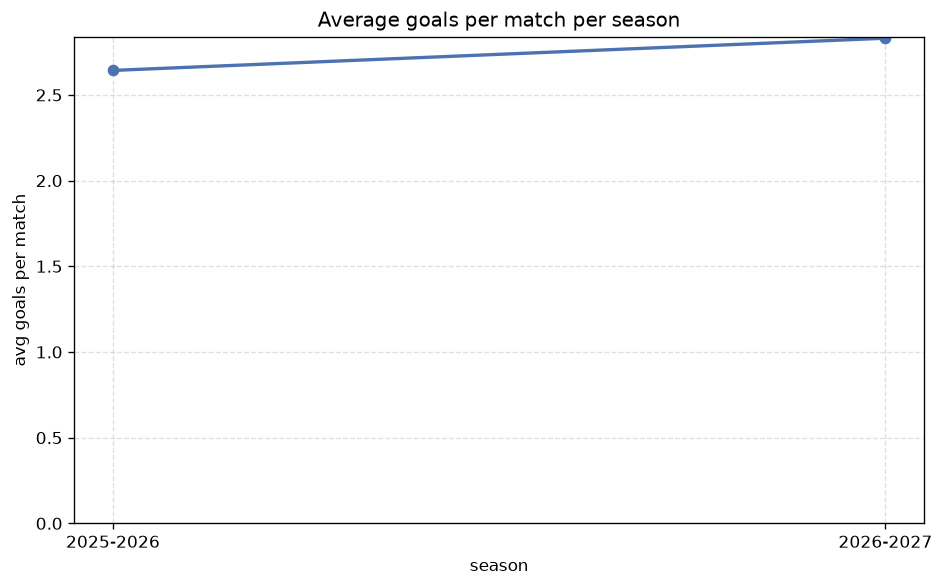

# Season Trends Analysis
- Report: `season_trends`
- Generated: 2026-10-30T03:47:20+00:00
- Script: `backend/scripts/analyze_seasons.py` v1.0.0
- League: Chance Liga (Czech Republic)
- Scope: league `czech1`

## 1. Champions per season
| season | champion | pts | runner-up | margin |
|---|---|---|---|---|
| 2020-2021 | Slavia Prague | 86 | Sparta Prague | 12 pts |
| 2021-2022 | Slavia Prague | 73 | Plzen | 1 pts |
| 2022-2023 | Sparta Prague | 68 | Slavia Prague | 2 pts |
| 2023-2024 | Sparta Prague | 76 | Slavia Prague | 4 pts |
| 2024-2025 | Slavia Prague | 78 | Plzen | 13 pts |
| 2025-2026 | Slavia Prague | 80 | Sparta Prague | 4 pts |
| 2026-2027 | Slavia Prague | 28 | Sparta Prague | 6 pts |

## 2. Title-race tightness
- Tight races (margin <= 3 pts): **2** of 7 seasons
- Tightest race: **2021-2022** - Slavia Prague beat Plzen by **1** pts

| season | margin | tight |
|---|---|---|
| 2020-2021 | 12 pts |  |
| 2021-2022 | 1 pts | yes |
| 2022-2023 | 2 pts | yes |
| 2023-2024 | 4 pts |  |
| 2024-2025 | 13 pts |  |
| 2025-2026 | 4 pts |  |
| 2026-2027 | 6 pts |  |

## 3. Points thresholds
_Position-specific points per season. Key: 1 = champion, 2 = runner-up, 4 = CL line, 6 = Europa, 13 = last safe, 16 = bottom._

| season | pos 1 | pos 2 | pos 4 | pos 6 | pos 13 | pos 16 |
|---|---|---|---|---|---|---|
| 2020-2021 | 86 | 74 | 63 | 52 | 38 | 26 |
| 2021-2022 | 73 | 72 | 59 | 40 | 26 | 17 |
| 2022-2023 | 68 | 66 | 48 | 41 | 32 | 26 |
| 2023-2024 | 76 | 72 | 45 | 41 | 28 | 24 |
| 2024-2025 | 78 | 65 | 62 | 43 | 30 | 5 |
| 2025-2026 | 80 | 76 | 56 | 52 | 36 | 26 |
| 2026-2027 | 28 | 22 | 21 | 20 | 11 | 2 |

## 4. Relegation battle
| season | safe pos | safe pts | drop pos | drop pts | gap |
|---|---|---|---|---|---|
| 2020-2021 | 13 | 38 | 14 | 32 | 6 pts |
| 2021-2022 | 13 | 26 | 14 | 26 | 0 pts |
| 2022-2023 | 13 | 32 | 14 | 31 | 1 pts |
| 2023-2024 | 13 | 28 | 14 | 25 | 3 pts |
| 2024-2025 | 13 | 30 | 14 | 24 | 6 pts |
| 2025-2026 | 13 | 36 | 14 | 36 | 0 pts |
| 2026-2027 | 13 | 11 | 14 | 9 | 2 pts |

## 5. League-level trends
| season | matches | total goals | avg goals | home win | draw | away win | goalless | avg pts/team |
|---|---|---|---|---|---|---|---|---|
| 2020-2021 | 306 | 822 | 2.686 | 41.2% | 26.5% | 32.4% | 8.8% | 46.5 |
| 2021-2022 | 240 | 670 | 2.792 | 48.3% | 25.4% | 26.2% | 5.8% | 41.19 |
| 2022-2023 | 240 | 720 | 3.0 | 43.3% | 24.6% | 32.1% | 4.2% | 41.31 |
| 2023-2024 | 240 | 678 | 2.825 | 44.2% | 26.2% | 29.6% | 7.1% | 41.06 |
| 2024-2025 | 240 | 627 | 2.612 | 44.6% | 22.5% | 32.9% | 9.2% | 41.62 |
| 2025-2026 | 280 | 740 | 2.643 | 42.1% | 23.9% | 33.9% | 8.2% | 42.61 |
| 2026-2027 | 94 | 253 | 2.691 | 42.6% | 23.4% | 34.0% | 7.4% | 16.25 |

## 6. View divergence
- Largest divergence: **2025-2026** (goals view, avg abs position diff = 5.889)

_Avg absolute position difference between classic view and alternative view per season._

| season | classic vs luck | classic vs goals |
|---|---|---|
| 2020-2021 | 2.778 | 5.111 |
| 2021-2022 | 2.000 | 5.000 |
| 2022-2023 | 3.750 | 5.875 |
| 2023-2024 | 3.125 | 4.125 |
| 2024-2025 | 1.500 | 4.250 |
| 2025-2026 | 3.333 | 5.889 |
| 2026-2027 | 3.125 | 4.625 |

---
*All statistics are computed from PostgreSQL tables (read-only). Run with `python backend/scripts/analyze_seasons.py` to regenerate.*

## Charts

