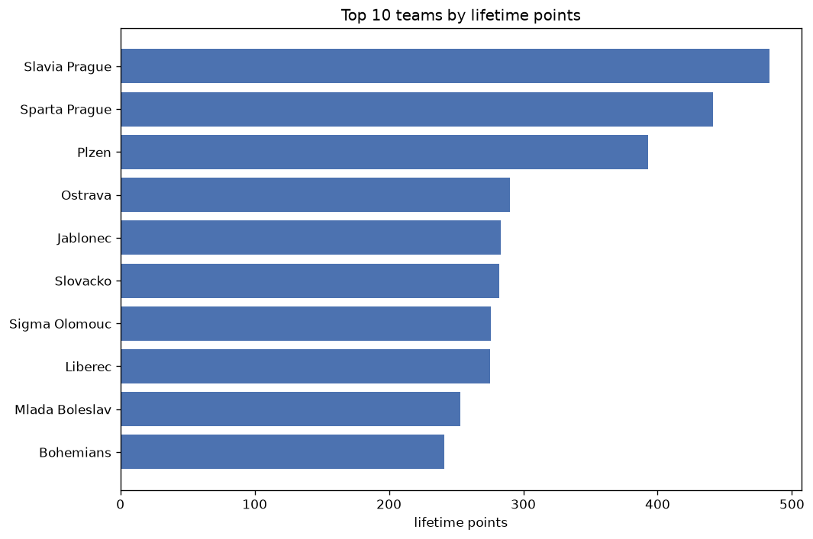
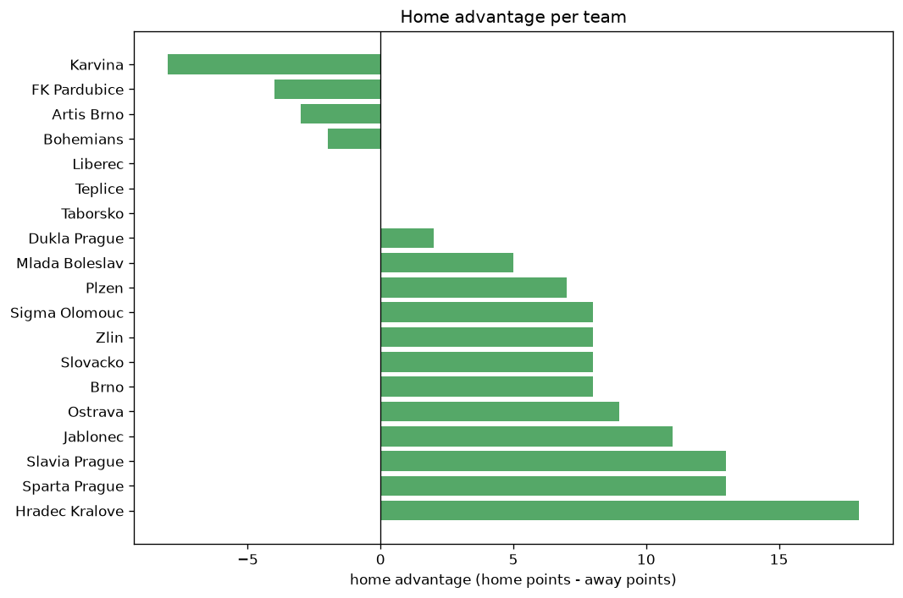

# Team Analysis
- Report: `teams_analysis`
- Generated: 2026-10-29T01:56:02+00:00
- Script: `backend/scripts/analyze_teams.py` v1.0.0
- League: Chance Liga (Czech Republic)
- Scope: league `czech1`

- Teams: **22** | Seasons: **7** | Matches: **1640**

## 1. Team standings (lifetime)
| team | seasons | played | W | D | L | pts | GF | GA | GD | avg pts/season | best pos | worst pos | titles |
|---|---|---|---|---|---|---|---|---|---|---|---|---|---|
| Slavia Prague | 7 | 201 | 148 | 39 | 14 | 483 | 461 | 136 | 325 | 69.0 | 1 | 2 | 5 |
| Sparta Prague | 7 | 201 | 136 | 36 | 29 | 444 | 437 | 210 | 227 | 63.43 | 1 | 4 | 2 |
| Plzen | 7 | 201 | 117 | 42 | 42 | 393 | 378 | 213 | 165 | 56.14 | 2 | 9 | 0 |
| Ostrava | 7 | 202 | 81 | 47 | 74 | 290 | 292 | 251 | 41 | 41.43 | 3 | 15 | 0 |
| Jablonec | 7 | 201 | 77 | 55 | 69 | 286 | 270 | 265 | 5 | 40.86 | 3 | 14 | 0 |
| Slovacko | 7 | 203 | 78 | 48 | 77 | 282 | 256 | 267 | -11 | 40.29 | 4 | 15 | 0 |
| Sigma Olomouc | 7 | 200 | 73 | 57 | 70 | 276 | 274 | 256 | 18 | 39.43 | 4 | 9 | 0 |
| Liberec | 7 | 200 | 73 | 56 | 71 | 275 | 261 | 236 | 25 | 39.29 | 5 | 9 | 0 |
| Mlada Boleslav | 7 | 201 | 66 | 55 | 80 | 253 | 291 | 301 | -10 | 36.14 | 3 | 11 | 0 |
| Bohemians | 7 | 197 | 61 | 58 | 78 | 241 | 230 | 276 | -46 | 34.43 | 4 | 13 | 0 |
| Hradec Kralove | 6 | 167 | 60 | 46 | 61 | 226 | 198 | 205 | -7 | 37.67 | 4 | 11 | 0 |
| Teplice | 7 | 201 | 56 | 51 | 94 | 219 | 222 | 319 | -97 | 31.29 | 8 | 15 | 0 |
| FK Pardubice | 7 | 198 | 55 | 44 | 99 | 209 | 212 | 325 | -113 | 29.86 | 7 | 15 | 0 |
| Karvina | 5 | 158 | 42 | 38 | 78 | 164 | 185 | 266 | -81 | 32.8 | 8 | 16 | 0 |
| Zlin | 6 | 171 | 37 | 45 | 89 | 156 | 191 | 299 | -108 | 26.0 | 10 | 16 | 0 |
| Ceske Budejovice | 5 | 154 | 34 | 36 | 84 | 138 | 156 | 287 | -131 | 27.6 | 10 | 16 | 0 |
| Brno | 3 | 76 | 19 | 20 | 37 | 77 | 89 | 129 | -40 | 25.67 | 7 | 16 | 0 |
| Dukla Prague | 2 | 65 | 10 | 20 | 35 | 50 | 46 | 98 | -52 | 25.0 | 14 | 16 | 0 |
| Pribram | 1 | 34 | 5 | 10 | 19 | 25 | 26 | 65 | -39 | 25.0 | 17 | 17 | 0 |
| Opava | 1 | 34 | 3 | 8 | 23 | 17 | 23 | 71 | -48 | 17.0 | 18 | 18 | 0 |
| Artis Brno | 2 | 13 | 2 | 3 | 8 | 9 | 12 | 27 | -15 | 4.5 | 14 | 17 | 0 |
| Taborsko | 1 | 2 | 0 | 0 | 2 | 0 | 0 | 8 | -8 | 0.0 | 18 | 18 | 0 |

## 2. Home vs away split
| team | home P | H-W | H-D | H-L | H-pts | away P | A-W | A-D | A-L | A-pts | adv |
|---|---|---|---|---|---|---|---|---|---|---|---|
| Slavia Prague | 102 | 88 | 11 | 3 | 275 | 99 | 60 | 28 | 11 | 208 | 67 |
| Jablonec | 100 | 45 | 33 | 22 | 168 | 101 | 32 | 22 | 47 | 118 | 50 |
| Plzen | 102 | 68 | 17 | 17 | 221 | 99 | 49 | 25 | 25 | 172 | 49 |
| Sparta Prague | 101 | 77 | 15 | 9 | 246 | 100 | 59 | 21 | 20 | 198 | 48 |
| Ceske Budejovice | 77 | 26 | 15 | 36 | 93 | 77 | 8 | 21 | 48 | 45 | 48 |
| Hradec Kralove | 84 | 37 | 23 | 24 | 134 | 83 | 23 | 23 | 37 | 92 | 42 |
| Zlin | 87 | 26 | 21 | 40 | 99 | 84 | 11 | 24 | 49 | 57 | 42 |
| Teplice | 102 | 34 | 28 | 40 | 130 | 99 | 22 | 23 | 54 | 89 | 41 |
| Liberec | 99 | 43 | 28 | 28 | 157 | 101 | 30 | 28 | 43 | 118 | 39 |
| Slovacko | 100 | 45 | 25 | 30 | 160 | 103 | 33 | 23 | 47 | 122 | 38 |
| Mlada Boleslav | 100 | 38 | 28 | 34 | 142 | 101 | 28 | 27 | 46 | 111 | 31 |
| Ostrava | 100 | 46 | 22 | 32 | 160 | 102 | 35 | 25 | 42 | 130 | 30 |
| Sigma Olomouc | 99 | 41 | 28 | 30 | 151 | 101 | 32 | 29 | 40 | 125 | 26 |
| Bohemians | 98 | 34 | 31 | 33 | 133 | 99 | 27 | 27 | 45 | 108 | 25 |
| FK Pardubice | 98 | 28 | 31 | 39 | 115 | 100 | 27 | 13 | 60 | 94 | 21 |
| Opava | 17 | 2 | 5 | 10 | 11 | 17 | 1 | 3 | 13 | 6 | 5 |
| Dukla Prague | 32 | 6 | 9 | 17 | 27 | 33 | 4 | 11 | 18 | 23 | 4 |
| Brno | 39 | 10 | 10 | 19 | 40 | 37 | 9 | 10 | 18 | 37 | 3 |
| Pribram | 17 | 3 | 4 | 10 | 13 | 17 | 2 | 6 | 9 | 12 | 1 |
| Karvina | 79 | 20 | 22 | 37 | 82 | 79 | 22 | 16 | 41 | 82 | 0 |
| Taborsko | 1 | 0 | 0 | 1 | 0 | 1 | 0 | 0 | 1 | 0 | 0 |
| Artis Brno | 6 | 0 | 1 | 5 | 1 | 7 | 2 | 2 | 3 | 8 | -7 |

## 3. Top performers
### Best points per game (PPG)
| rank | team | PPG |
|---|---|---|
| 1 | Slavia Prague | 2.40 |
| 2 | Sparta Prague | 2.21 |
| 3 | Plzen | 1.96 |
| 4 | Ostrava | 1.44 |
| 5 | Jablonec | 1.42 |

### Most goals scored
| rank | team | goals |
|---|---|---|
| 1 | Slavia Prague | 461 |
| 2 | Sparta Prague | 437 |
| 3 | Plzen | 378 |
| 4 | Ostrava | 292 |
| 5 | Mlada Boleslav | 291 |

### Best goal difference
| rank | team | GD |
|---|---|---|
| 1 | Slavia Prague | 325 |
| 2 | Sparta Prague | 227 |
| 3 | Plzen | 165 |
| 4 | Ostrava | 41 |
| 5 | Liberec | 25 |

### Best defence (goals against per match, standings)
| rank | team | GA/match |
|---|---|---|
| 1 | Slavia Prague | 0.677 |
| 2 | Sparta Prague | 1.045 |
| 3 | Plzen | 1.060 |
| 4 | Liberec | 1.180 |
| 5 | Hradec Kralove | 1.228 |

## 4. Team consistency
- Teams present in all **7** seasons: **12**

Bohemians, FK Pardubice, Jablonec, Liberec, Mlada Boleslav, Ostrava, Plzen, Sigma Olomouc, Slavia Prague, Slovacko, Sparta Prague, Teplice

## 5. Head-to-head dominance
- Distinct fixtures: **197** (showing the 15 most frequent)

| fixture | meetings | home wins | draws | away wins | home pct | draw pct | away pct |
|---|---|---|---|---|---|---|---|
| Sigma Olomouc vs Bohemians | 15 | 5 | 6 | 4 | 33.3% | 40.0% | 26.7% |
| Slavia Prague vs Plzen | 14 | 8 | 2 | 4 | 57.1% | 14.3% | 28.6% |
| Sparta Prague vs Jablonec | 14 | 8 | 4 | 2 | 57.1% | 28.6% | 14.3% |
| Ostrava vs Mlada Boleslav | 14 | 7 | 4 | 3 | 50.0% | 28.6% | 21.4% |
| Plzen vs Liberec | 14 | 7 | 2 | 5 | 50.0% | 14.3% | 35.7% |
| Slavia Prague vs Liberec | 14 | 7 | 3 | 4 | 50.0% | 21.4% | 28.6% |
| Slavia Prague vs Sparta Prague | 14 | 7 | 4 | 3 | 50.0% | 28.6% | 21.4% |
| Slovacko vs Ostrava | 14 | 7 | 4 | 3 | 50.0% | 28.6% | 21.4% |
| Jablonec vs Plzen | 14 | 6 | 5 | 3 | 42.9% | 35.7% | 21.4% |
| Mlada Boleslav vs Teplice | 14 | 5 | 2 | 7 | 35.7% | 14.3% | 50.0% |
| Slovacko vs Mlada Boleslav | 14 | 4 | 5 | 5 | 28.6% | 35.7% | 35.7% |
| Jablonec vs Liberec | 14 | 3 | 5 | 6 | 21.4% | 35.7% | 42.9% |
| Jablonec vs Ostrava | 13 | 8 | 1 | 4 | 61.5% | 7.7% | 30.8% |
| Jablonec vs Teplice | 13 | 8 | 1 | 4 | 61.5% | 7.7% | 30.8% |
| Liberec vs Sigma Olomouc | 13 | 8 | 3 | 2 | 61.5% | 23.1% | 15.4% |

## 6. Position per season (classic view)
_Cells show final position; '-' when the team was absent from that season._

| team | 2020-2021 | 2021-2022 | 2022-2023 | 2023-2024 | 2024-2025 | 2025-2026 | 2026-2027 |
|---|---|---|---|---|---|---|---|
| Slavia Prague | 1 | 1 | 2 | 2 | 1 | 1 | 1 |
| Sparta Prague | 2 | 3 | 1 | 1 | 4 | 2 | 2 |
| Plzen | 5 | 2 | 3 | 3 | 2 | 3 | 9 |
| Ostrava | 8 | 5 | 10 | 4 | 3 | 15 | 13 |
| Jablonec | 3 | 14 | 11 | 12 | 5 | 5 | 6 |
| Slovacko | 4 | 4 | 5 | 6 | 13 | 14 | 15 |
| Sigma Olomouc | 9 | 8 | 6 | 8 | 6 | 6 | 4 |
| Liberec | 6 | 9 | 7 | 7 | 7 | 7 | 5 |
| Mlada Boleslav | 11 | 7 | 9 | 5 | 10 | 11 | 3 |
| Bohemians | 10 | 13 | 4 | 11 | 11 | 13 | 10 |
| Hradec Kralove | - | 6 | 8 | 9 | 9 | 4 | 11 |
| Teplice | 15 | 12 | 13 | 10 | 12 | 9 | 8 |
| FK Pardubice | 7 | 15 | 15 | 13 | 15 | 8 | 12 |
| Karvina | 12 | 16 | - | 14 | 8 | 12 | - |
| Zlin | 14 | 11 | 16 | 15 | - | 10 | 16 |
| Ceske Budejovice | 13 | 10 | 12 | 16 | 16 | - | - |
| Brno | 16 | - | 14 | - | - | - | 7 |
| Dukla Prague | - | - | - | - | 14 | 16 | - |
| Pribram | 17 | - | - | - | - | - | - |
| Opava | 18 | - | - | - | - | - | - |
| Artis Brno | - | - | - | - | - | 17 | 14 |
| Taborsko | - | - | - | - | - | 18 | - |

---
*All statistics are computed from PostgreSQL tables (read-only). Run with `python backend/scripts/analyze_teams.py` to regenerate.*

## Charts

