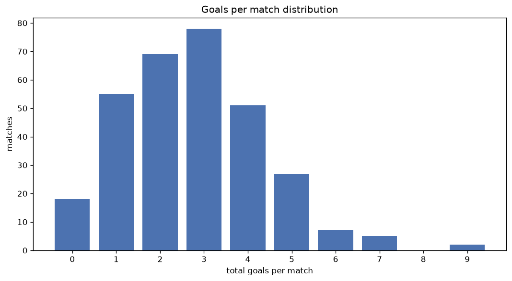
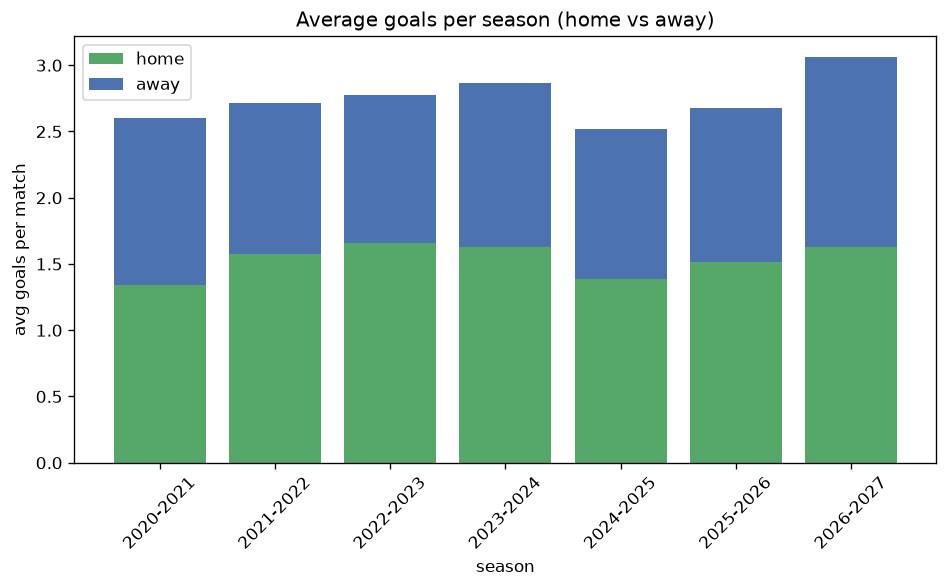

# Goal Analysis
- Report: `goals_analysis`
- Generated: 2026-10-30T03:47:35+00:00
- Script: `backend/scripts/analyze_goals.py` v1.0.0
- League: ChNL (Czech Republic)
- Scope: league `czech2`

## 1. Goals per match distribution
| goals | matches | pct |
|---|---|---|
| 0 | 102 | 6.9% |
| 1 | 272 | 18.4% |
| 2 | 341 | 23.1% |
| 3 | 334 | 22.6% |
| 4 | 227 | 15.4% |
| 5 | 109 | 7.4% |
| 6 | 59 | 4.0% |
| 7 | 20 | 1.4% |
| 8 | 7 | 0.5% |
| 9 | 7 | 0.5% |

## 2. Goals per match per season
| season | matches | total goals | avg home | avg away | avg total |
|---|---|---|---|---|---|
| 2020-2021 | 182 | 473 | 1.341 | 1.258 | 2.599 |
| 2021-2022 | 240 | 651 | 1.575 | 1.137 | 2.712 |
| 2022-2023 | 240 | 666 | 1.658 | 1.117 | 2.775 |
| 2023-2024 | 240 | 687 | 1.625 | 1.238 | 2.862 |
| 2024-2025 | 240 | 605 | 1.387 | 1.133 | 2.521 |
| 2025-2026 | 240 | 643 | 1.517 | 1.163 | 2.679 |
| 2026-2027 | 96 | 297 | 1.667 | 1.427 | 3.094 |

## 3. Home vs away goal share
- Home goals: **2267** (56.4%)
- Away goals: **1755** (43.6%)
- Home/away ratio: **1.292**

| season | home goals | away goals | total | home pct | away pct |
|---|---|---|---|---|---|
| 2020-2021 | 244 | 229 | 473 | 51.6% | 48.4% |
| 2021-2022 | 378 | 273 | 651 | 58.1% | 41.9% |
| 2022-2023 | 398 | 268 | 666 | 59.8% | 40.2% |
| 2023-2024 | 390 | 297 | 687 | 56.8% | 43.2% |
| 2024-2025 | 333 | 272 | 605 | 55.0% | 45.0% |
| 2025-2026 | 364 | 279 | 643 | 56.6% | 43.4% |
| 2026-2027 | 160 | 137 | 297 | 53.9% | 46.1% |

## 4. BTTS (Both Teams To Score)
- Overall: **801** of `1478` (54.2%)

| season | matches | BTTS | pct |
|---|---|---|---|
| 2020-2021 | 182 | 93 | 51.1% |
| 2021-2022 | 240 | 130 | 54.2% |
| 2022-2023 | 240 | 129 | 53.8% |
| 2023-2024 | 240 | 135 | 56.2% |
| 2024-2025 | 240 | 128 | 53.3% |
| 2025-2026 | 240 | 121 | 50.4% |
| 2026-2027 | 96 | 65 | 67.7% |

## 5. Clean sheets
- Home clean sheets: **441** (29.8%)
- Away clean sheets: **338** (22.9%)
- Total clean sheets recorded: **779**
- Matches with at least one clean sheet: **677** (45.8%)
- Both teams kept clean sheets (0-0): **102**

| season | matches | home CS | away CS | total CS | matches w/ CS |
|---|---|---|---|---|---|
| 2020-2021 | 182 | 59 | 42 | 101 | 89 (48.9%) |
| 2021-2022 | 240 | 72 | 57 | 129 | 110 (45.8%) |
| 2022-2023 | 240 | 76 | 48 | 124 | 111 (46.2%) |
| 2023-2024 | 240 | 64 | 58 | 122 | 105 (43.8%) |
| 2024-2025 | 240 | 78 | 57 | 135 | 112 (46.7%) |
| 2025-2026 | 240 | 71 | 62 | 133 | 119 (49.6%) |
| 2026-2027 | 96 | 21 | 14 | 35 | 31 (32.3%) |

## 6. Scoring intensity
- First-half goals: **1834** (45.6%)
- Second-half goals: **2188** (54.4%)
- Avg first-half goals per match: **1.241**
- Avg second-half goals per match: **1.48**
- Second-half-only scoring (HT 0-0, FT goals >= 1): **317** (21.4%)

| season | matches | 1st half | 2nd half | 1st half pct | 2nd half pct |
|---|---|---|---|---|---|
| 2020-2021 | 182 | 216 | 257 | 45.7% | 54.3% |
| 2021-2022 | 240 | 290 | 361 | 44.5% | 55.5% |
| 2022-2023 | 240 | 307 | 359 | 46.1% | 53.9% |
| 2023-2024 | 240 | 295 | 392 | 42.9% | 57.1% |
| 2024-2025 | 240 | 281 | 324 | 46.4% | 53.6% |
| 2025-2026 | 240 | 303 | 340 | 47.1% | 52.9% |
| 2026-2027 | 96 | 142 | 155 | 47.8% | 52.2% |

## 7. First-goal timing
- Matches with first-goal time recorded: `1376` of `1478` (93.1%)
- Goalless matches: `102`
- Min `1` | Max `98` | Mean `30.22` | Median (p50) `24.0`

| bucket | count | % of matches | % of scoring matches |
|---|---|---|---|
| 1-15 | 446 | 30.2% | 32.4% |
| 16-30 | 362 | 24.5% | 26.3% |
| 31-45 | 229 | 15.5% | 16.6% |
| 46-60 | 169 | 11.4% | 12.3% |
| 61-75 | 92 | 6.2% | 6.7% |
| 76-90 | 66 | 4.5% | 4.8% |
| 91-120 | 12 | 0.8% | 0.9% |

---
*All statistics are computed from PostgreSQL tables (read-only). Run with `python backend/scripts/analyze_goals.py` to regenerate.*

## Charts

