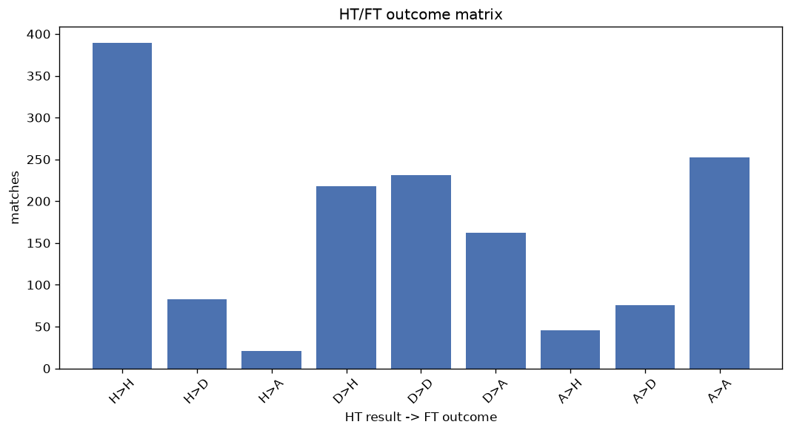
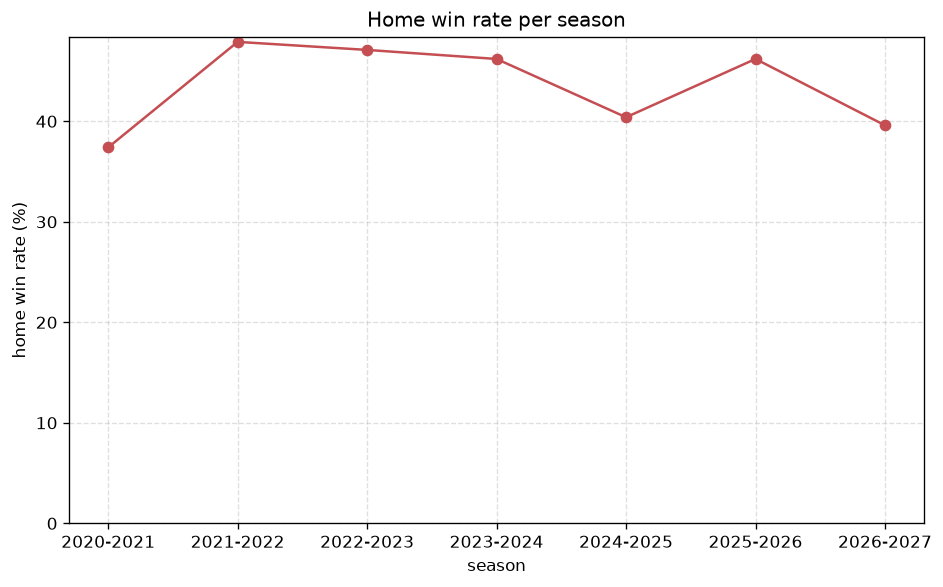

# Match Analysis
- Report: `matches_analysis`
- Generated: 2026-10-30T03:47:34+00:00
- Script: `backend/scripts/analyze_matches.py` v1.0.0
- League: ChNL (Czech Republic)
- Scope: league `czech2`

## 1. Overall summary
| metric | value |
|---|---|
| Matches | 1478 |
| Home wins | 653 (44.2%) |
| Draws | 390 (26.4%) |
| Away wins | 435 (29.4%) |
| Total goals | 4022 |
| Average goals per match | 2.721 |
| Goalless matches | 102 (6.9%) |

## 2. Per-season breakdown
| season | matches | home wins | draws | away wins | total goals | avg goals | goalless |
|---|---|---|---|---|---|---|---|
| 2020-2021 | 182 | 68 (37.4%) | 47 (25.8%) | 67 (36.8%) | 473 | 2.599 | 12 (6.6%) |
| 2021-2022 | 240 | 115 (47.9%) | 61 (25.4%) | 64 (26.7%) | 651 | 2.712 | 19 (7.9%) |
| 2022-2023 | 240 | 113 (47.1%) | 65 (27.1%) | 62 (25.8%) | 666 | 2.775 | 13 (5.4%) |
| 2023-2024 | 240 | 111 (46.2%) | 61 (25.4%) | 68 (28.3%) | 687 | 2.862 | 17 (7.1%) |
| 2024-2025 | 240 | 97 (40.4%) | 75 (31.2%) | 68 (28.3%) | 605 | 2.521 | 23 (9.6%) |
| 2025-2026 | 240 | 111 (46.2%) | 50 (20.8%) | 79 (32.9%) | 643 | 2.679 | 14 (5.8%) |
| 2026-2027 | 96 | 38 (39.6%) | 31 (32.3%) | 27 (28.1%) | 297 | 3.094 | 4 (4.2%) |

## 3. HT/FT outcome matrix
| HT result \ FT result | Home | Draw | Away | total |
|---|---|---|---|---|
| HT home lead | 389 (78.9%) | 83 (16.8%) | 21 (4.3%) | 493 |
| HT draw | 218 (35.7%) | 231 (37.8%) | 162 (26.5%) | 611 |
| HT away lead | 46 (12.3%) | 76 (20.3%) | 252 (67.4%) | 374 |

## 4. Comeback matches
- Home comebacks (trailing at HT, won at FT): **46** (3.1%)
- Away comebacks (trailing at HT, won at FT): **21** (1.4%)

### Home comebacks
| season | home | away | HT | FT |
|---|---|---|---|---|
| 2020-2021 | Usti nad Labem | Zizkov | 0-1 | 2-1 |
| 2020-2021 | Artis Brno | Vysehrad | 0-1 | 4-2 |
| 2020-2021 | Vysehrad | Blansko | 0-1 | 2-1 |
| 2020-2021 | Usti nad Labem | Blansko | 0-1 | 2-1 |
| 2021-2022 | Artis Brno | Zizkov | 0-2 | 3-2 |
| 2021-2022 | Brno | Opava | 0-1 | 2-1 |
| 2021-2022 | Varnsdorf | Prostejov | 0-1 | 3-1 |
| 2021-2022 | Trinec | Chrudim | 0-1 | 2-1 |
| 2021-2022 | Dukla Prague | Artis Brno | 1-2 | 4-2 |
| 2021-2022 | Sparta Prague B | Vyskov | 0-1 | 4-1 |
| 2022-2023 | Karvina | Vlasim | 1-2 | 3-2 |
| 2022-2023 | Vyskov | Taborsko | 0-1 | 3-1 |
| 2022-2023 | Sigma Olomouc B | Karvina | 1-2 | 3-2 |
| 2022-2023 | Sparta Prague B | Taborsko | 0-1 | 2-1 |
| 2022-2023 | Karvina | Chrudim | 0-1 | 2-1 |
| 2022-2023 | Taborsko | Dukla Prague | 0-1 | 2-1 |
| 2022-2023 | Vyskov | Jihlava | 0-1 | 2-1 |
| 2022-2023 | Opava | Varnsdorf | 0-1 | 2-1 |
| 2023-2024 | Zizkov | Artis Brno | 0-1 | 3-1 |
| 2023-2024 | Artis Brno | Varnsdorf | 0-1 | 2-1 |
| 2023-2024 | Vyskov | Sparta Prague B | 0-1 | 3-1 |
| 2023-2024 | Chrudim | Vyskov | 0-1 | 2-1 |
| 2023-2024 | Sparta Prague B | Jihlava | 0-1 | 2-1 |
| 2023-2024 | Jihlava | Prostejov | 0-1 | 2-1 |
| 2023-2024 | Prostejov | Artis Brno | 1-2 | 4-2 |
| 2023-2024 | Taborsko | Jihlava | 0-1 | 2-1 |
| 2023-2024 | Chrudim | Jihlava | 0-1 | 2-1 |
| 2023-2024 | Prostejov | Pribram | 0-1 | 2-1 |
| 2023-2024 | Vlasim | Taborsko | 0-1 | 2-1 |
| 2023-2024 | Sigma Olomouc B | Varnsdorf | 0-1 | 2-1 |
| 2024-2025 | Vlasim | Ostrava B | 0-1 | 3-2 |
| 2024-2025 | Opava | Zizkov | 0-1 | 3-1 |
| 2024-2025 | Jihlava | Ostrava B | 0-1 | 2-1 |
| 2024-2025 | Artis Brno | Sigma Olomouc B | 0-1 | 3-2 |
| 2024-2025 | Sigma Olomouc B | Chrudim | 0-1 | 3-1 |
| 2024-2025 | Zlin | Artis Brno | 0-1 | 2-1 |
| 2025-2026 | Chrudim | Zizkov | 0-1 | 3-2 |
| 2025-2026 | Zizkov | Chrudim | 0-1 | 2-1 |
| 2025-2026 | Kromeriz | Sparta Prague B | 0-1 | 2-1 |
| 2025-2026 | Prostejov | Usti nad Labem | 0-1 | 2-1 |
| 2025-2026 | Vlasim | Zizkov | 0-1 | 3-1 |
| 2025-2026 | Prostejov | Taborsko | 0-1 | 2-1 |
| 2026-2027 | Vlasim | Zizkov | 0-1 | 4-1 |
| 2026-2027 | Kromeriz | Prostejov | 0-1 | 2-1 |
| 2026-2027 | Trinec | Karvina | 0-2 | 3-2 |
| 2026-2027 | Ostrava B | Slavia Prague B | 0-1 | 2-1 |

### Away comebacks
| season | home | away | HT | FT |
|---|---|---|---|---|
| 2020-2021 | Trinec | Artis Brno | 2-1 | 2-3 |
| 2020-2021 | Vysehrad | Vlasim | 1-0 | 1-2 |
| 2020-2021 | Prostejov | Hradec Kralove | 1-0 | 1-2 |
| 2020-2021 | Vysehrad | Varnsdorf | 1-0 | 1-2 |
| 2021-2022 | Zizkov | Chrudim | 1-0 | 1-2 |
| 2022-2023 | Vlasim | Artis Brno | 1-0 | 1-2 |
| 2022-2023 | Dukla Prague | Sparta Prague B | 1-0 | 1-2 |
| 2022-2023 | Sigma Olomouc B | Jihlava | 1-0 | 1-2 |
| 2022-2023 | Sigma Olomouc B | Artis Brno | 1-0 | 1-2 |
| 2023-2024 | Sparta Prague B | Brno | 1-0 | 1-2 |
| 2023-2024 | Vlasim | Artis Brno | 3-2 | 4-5 |
| 2023-2024 | Artis Brno | Sigma Olomouc B | 1-0 | 1-2 |
| 2024-2025 | Sparta Prague B | Taborsko | 1-0 | 1-2 |
| 2024-2025 | Varnsdorf | Sigma Olomouc B | 2-0 | 2-3 |
| 2025-2026 | Slavia Prague B | Artis Brno | 1-0 | 1-2 |
| 2025-2026 | Ostrava B | Usti nad Labem | 1-0 | 1-2 |
| 2026-2027 | Jihlava | Pribram | 1-0 | 1-2 |
| 2026-2027 | Dukla Prague | Slavia Prague B | 1-0 | 1-3 |
| 2026-2027 | Opava | Dukla Prague | 1-0 | 1-2 |
| 2026-2027 | FK Ceska Lipa | Zizkov | 1-0 | 1-2 |
| 2026-2027 | Opava | Jihlava | 1-0 | 1-3 |

## 5. HT lead conversion
| HT state | matches | converted to win | held as draw | collapsed to loss |
|---|---|---|---|---|
| Home lead | 493 | 389 (78.9%) | 83 (16.8%) | 21 (4.3%) |
| Away lead | 374 | 252 (67.4%) | 76 (20.3%) | 46 (12.3%) |

### Matches level at half-time
| FT result | count | pct |
|---|---|---|
| Home win | 218 | 35.7% |
| Draw | 231 | 37.8% |
| Away win | 162 | 26.5% |

## 6. First-goal timing
- Matches with a first-goal time recorded: `1376` of `1478` (93.1%)

Outcome distribution by first-goal timing bucket:
| bucket | matches | % of matches | home | draw | away |
|---|---|---|---|---|---|
| 1-15 | 446 | 30.2% | 221 (49.6%) | 104 (23.3%) | 121 (27.1%) |
| 16-30 | 362 | 24.5% | 168 (46.4%) | 80 (22.1%) | 114 (31.5%) |
| 31-45 | 229 | 15.5% | 107 (46.7%) | 45 (19.7%) | 77 (33.6%) |
| 46-60 | 169 | 11.4% | 76 (45.0%) | 38 (22.5%) | 55 (32.5%) |
| 61-75 | 92 | 6.2% | 44 (47.8%) | 10 (10.9%) | 38 (41.3%) |
| 76-90 | 66 | 4.5% | 30 (45.5%) | 11 (16.7%) | 25 (37.9%) |
| 91-120 | 12 | 0.8% | 7 (58.3%) | 0 (0.0%) | 5 (41.7%) |

## 7. Goalless matches
- Overall: **102** of `1478` (6.9%)

| season | matches | goalless | pct |
|---|---|---|---|
| 2020-2021 | 182 | 12 | 6.6% |
| 2021-2022 | 240 | 19 | 7.9% |
| 2022-2023 | 240 | 13 | 5.4% |
| 2023-2024 | 240 | 17 | 7.1% |
| 2024-2025 | 240 | 23 | 9.6% |
| 2025-2026 | 240 | 14 | 5.8% |
| 2026-2027 | 96 | 4 | 4.2% |

---
*All statistics are computed from PostgreSQL tables (read-only). Run with `python backend/scripts/analyze_matches.py` to regenerate.*

## Charts

