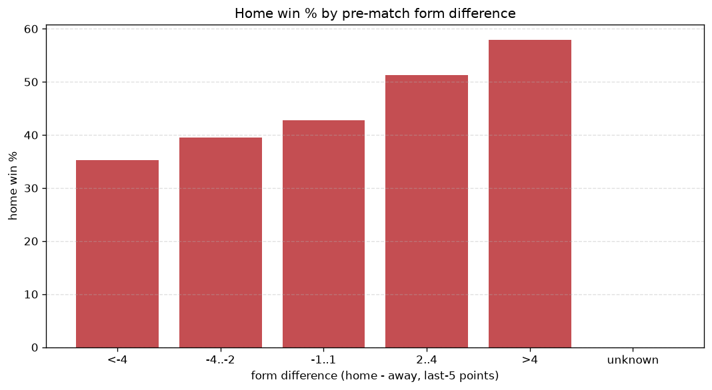
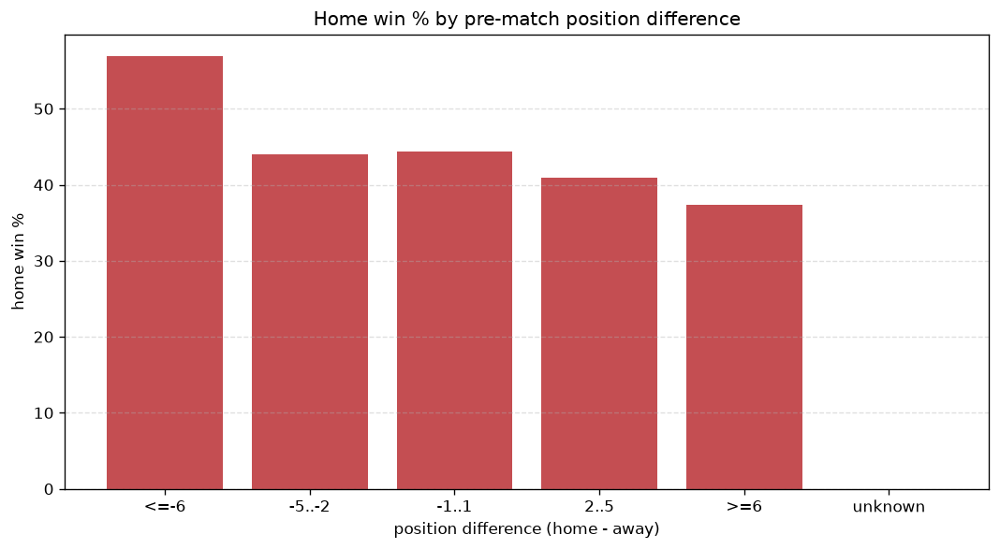

# Relationships Analysis
- Report: `relationships`
- Generated: 2026-10-26T01:29:09+00:00
- Script: `backend/scripts/analyze_relationships.py` v1.0.0
- League: ChNL (Czech Republic)
- Scope: league `czech2`

- Matches analysed: **1382** (23 leakage-safe pre-match features).

## 1. Correlation matrix
_Pearson correlation of each pre-match feature with observed goals; sorted by |corr(total goals)|._

| feature | corr(home) | corr(away) | corr(total) |
|---|---|---|---|
| away_position_before_match | 0.151 | -0.094 | 0.059 |
| away_team_away_win_rate | -0.097 | 0.038 | -0.052 |
| away_team_points_last_5 | -0.111 | 0.063 | -0.047 |
| away_team_wins_last_5 | -0.108 | 0.074 | -0.038 |
| position_difference | -0.127 | 0.099 | -0.037 |
| home_team_wins_last_5 | 0.012 | -0.067 | -0.033 |
| away_points_before_match | -0.057 | 0.019 | -0.033 |
| home_team_points_last_5 | 0.014 | -0.065 | -0.030 |
| away_team_away_conceded_avg | 0.060 | -0.038 | 0.023 |
| home_points_before_match | 0.023 | -0.064 | -0.022 |
| away_team_away_goals_avg | -0.061 | 0.041 | -0.022 |
| away_team_goals_conceded_last_5 | 0.086 | -0.071 | 0.022 |
| home_team_home_goals_avg | 0.044 | -0.022 | 0.021 |
| home_team_goals_conceded_last_5 | -0.040 | 0.018 | -0.020 |
| points_difference | 0.115 | -0.118 | 0.015 |
| rest_days_difference | -0.024 | 0.051 | 0.014 |
| away_rest_days | 0.021 | -0.046 | -0.012 |
| home_team_goals_scored_last_5 | 0.005 | -0.025 | -0.012 |
| away_team_goals_scored_last_5 | -0.062 | 0.059 | -0.011 |
| home_position_before_match | -0.025 | 0.043 | 0.008 |
| home_team_home_conceded_avg | -0.008 | 0.021 | 0.007 |
| home_rest_days | 0.011 | -0.023 | -0.006 |
| home_team_home_win_rate | 0.046 | -0.050 | 0.005 |

## 2. Form vs outcome
_Home win/draw/away % per bucket of `home_team_points_last_5 - away_team_points_last_5`._

| bucket | matches | home | draw | away | home % | draw % | away % |
|---|---|---|---|---|---|---|---|
| <-4 | 216 | 76 | 64 | 76 | 35.2% | 29.6% | 35.2% |
| -4..-2 | 296 | 117 | 83 | 96 | 39.5% | 28.0% | 32.4% |
| -1..1 | 423 | 181 | 114 | 128 | 42.8% | 27.0% | 30.3% |
| 2..4 | 269 | 138 | 61 | 70 | 51.3% | 22.7% | 26.0% |
| >4 | 178 | 103 | 37 | 38 | 57.9% | 20.8% | 21.3% |
| unknown | 0 | 0 | 0 | 0 | - | - | - |

## 3. Position vs outcome
_Home win/draw/away % per bucket of `position_difference` (home position - away position; negative favours the home team)._

| bucket | matches | home | draw | away | home % | draw % | away % |
|---|---|---|---|---|---|---|---|
| <=-6 | 269 | 153 | 53 | 63 | 56.9% | 19.7% | 23.4% |
| -5..-2 | 298 | 131 | 85 | 82 | 44.0% | 28.5% | 27.5% |
| -1..1 | 223 | 99 | 55 | 69 | 44.4% | 24.7% | 30.9% |
| 2..5 | 303 | 124 | 88 | 91 | 40.9% | 29.0% | 30.0% |
| >=6 | 289 | 108 | 78 | 103 | 37.4% | 27.0% | 35.6% |
| unknown | 0 | 0 | 0 | 0 | - | - | - |

## 4. Rest advantage
_Home win/draw/away % per bucket of `rest_days_difference` (home rest - away rest). Matches with unknown rest are bucketed separately._

| bucket | matches | home | draw | away | home % | draw % | away % |
|---|---|---|---|---|---|---|---|
| <-1 | 154 | 62 | 40 | 52 | 40.3% | 26.0% | 33.8% |
| -1..0 | 248 | 101 | 71 | 76 | 40.7% | 28.6% | 30.6% |
| 0 | 534 | 250 | 139 | 145 | 46.8% | 26.0% | 27.2% |
| 1..2 | 338 | 166 | 77 | 95 | 49.1% | 22.8% | 28.1% |
| >2 | 59 | 19 | 20 | 20 | 32.2% | 33.9% | 33.9% |
| unknown | 49 | 17 | 12 | 20 | 34.7% | 24.5% | 40.8% |
- *49 match(es) had unknown rest difference (missing rest data on at least one side).*

## 5. Home team quality
_Home win rate by `home_team_home_win_rate` tier (split at 0.5)._

- `< 0.5` tier: **43.0%** home win (357/830)
- `>= 0.5` tier: **46.7%** home win (258/552)
- Home-win gap (>= split minus < split): **+3.7 pp**

| tier | label | matches | home | draw | away | home % |
|---|---|---|---|---|---|---|
| low | < 0.5 | 830 | 357 | 220 | 253 | 43.0% |
| high | >= 0.5 | 552 | 258 | 139 | 155 | 46.7% |

## 6. Feature averages by result
_Mean feature value per outcome; `range` is home-minus-away spread of the group means._

| feature | home mean | draw mean | away mean | range |
|---|---|---|---|---|
| points_difference | 1.324 | -0.914 | -2.061 | 3.385 |
| home_points_before_match | 20.459 | 19.643 | 17.691 | 2.767 |
| away_rest_days | 11.402 | 10.986 | 9.290 | 2.112 |
| position_difference | -0.782 | 0.655 | 1.154 | 1.937 |
| away_position_before_match | 9.164 | 8.228 | 7.615 | 1.549 |
| away_points_before_match | 19.135 | 20.557 | 19.752 | 1.422 |
| rest_days_difference | -0.691 | -0.130 | 0.443 | 1.134 |
| home_rest_days | 10.713 | 10.856 | 9.746 | 1.110 |
| away_team_points_last_5 | 5.834 | 6.696 | 6.650 | 0.862 |
| away_team_goals_conceded_last_5 | 6.202 | 5.635 | 5.625 | 0.577 |
| home_position_before_match | 8.382 | 8.883 | 8.770 | 0.501 |
| away_team_goals_scored_last_5 | 5.875 | 6.340 | 6.319 | 0.465 |
| home_team_points_last_5 | 6.153 | 6.033 | 5.748 | 0.405 |
| home_team_goals_conceded_last_5 | 6.002 | 6.192 | 6.355 | 0.354 |
| away_team_wins_last_5 | 1.533 | 1.844 | 1.853 | 0.320 |
| home_team_goals_scored_last_5 | 6.002 | 5.827 | 5.865 | 0.174 |
| home_team_wins_last_5 | 1.657 | 1.630 | 1.527 | 0.130 |
| away_team_away_conceded_avg | 1.495 | 1.427 | 1.388 | 0.107 |
| away_team_away_goals_avg | 1.062 | 1.159 | 1.160 | 0.098 |
| home_team_home_goals_avg | 1.459 | 1.457 | 1.386 | 0.073 |
| home_team_home_conceded_avg | 1.097 | 1.164 | 1.128 | 0.066 |
| away_team_away_win_rate | 0.264 | 0.305 | 0.317 | 0.053 |
| home_team_home_win_rate | 0.423 | 0.411 | 0.386 | 0.037 |

---
*All features are leakage-safe pre-match values built by `ml.features.build_features.build_rows` from strictly prior matches. Run with `python backend/scripts/analyze_relationships.py` to regenerate.*

## Charts

