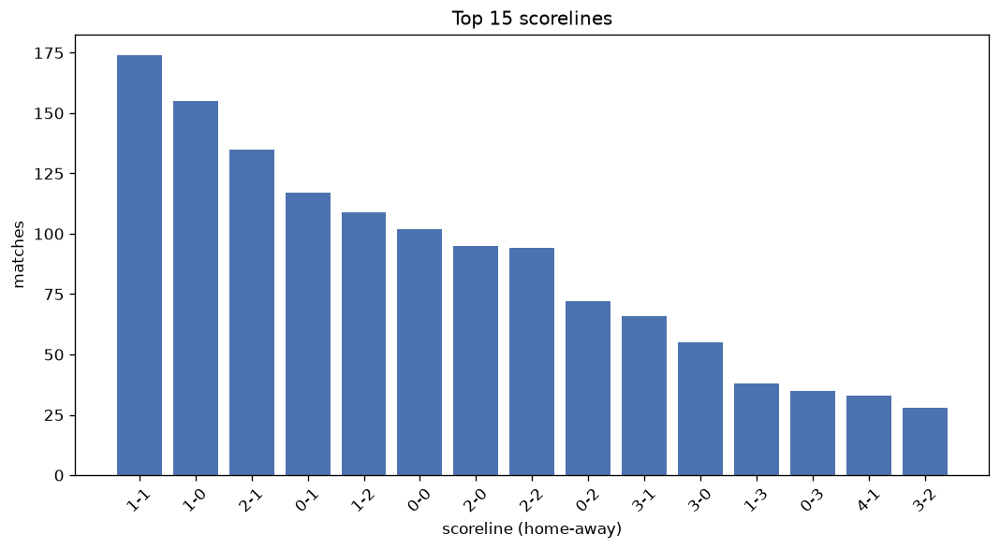
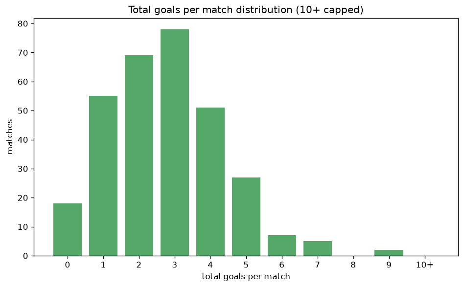

# Scoreline Analysis
- Report: `scoreline_analysis`
- Generated: 2026-10-29T01:56:23+00:00
- Script: `backend/scripts/analyze_scorelines.py` v1.0.0
- League: ChNL (Czech Republic)
- Scope: league `czech2`

## 1. Scoreline frequency
- Matches analysed: **1478** across **7** seasons.
- Distinct scorelines seen: **40**.

| scoreline | count | pct |
|---|---|---|
| 1-1 | 174 | 11.8% |
| 1-0 | 155 | 10.5% |
| 2-1 | 135 | 9.1% |
| 0-1 | 117 | 7.9% |
| 1-2 | 109 | 7.4% |
| 0-0 | 102 | 6.9% |
| 2-0 | 95 | 6.4% |
| 2-2 | 94 | 6.4% |
| 0-2 | 72 | 4.9% |
| 3-1 | 66 | 4.5% |
| 3-0 | 55 | 3.7% |
| 1-3 | 38 | 2.6% |
| 0-3 | 35 | 2.4% |
| 4-1 | 33 | 2.2% |
| 3-2 | 28 | 1.9% |
| 2-3 | 20 | 1.4% |
| 3-3 | 20 | 1.4% |
| 4-0 | 19 | 1.3% |
| 4-2 | 17 | 1.2% |
| 5-0 | 14 | 0.9% |

## 2. Scoreline frequency per season

### 2020-2021
| scoreline | count | pct |
|---|---|---|
| 1-0 | 25 | 13.7% |
| 1-1 | 22 | 12.1% |
| 1-2 | 21 | 11.5% |
| 0-1 | 14 | 7.7% |
| 0-0 | 12 | 6.6% |

### 2021-2022
| scoreline | count | pct |
|---|---|---|
| 2-1 | 26 | 10.8% |
| 1-1 | 26 | 10.8% |
| 1-0 | 23 | 9.6% |
| 0-0 | 19 | 7.9% |
| 0-1 | 18 | 7.5% |

### 2022-2023
| scoreline | count | pct |
|---|---|---|
| 1-1 | 33 | 13.8% |
| 1-0 | 22 | 9.2% |
| 2-0 | 21 | 8.8% |
| 2-1 | 20 | 8.3% |
| 2-2 | 19 | 7.9% |

### 2023-2024
| scoreline | count | pct |
|---|---|---|
| 1-0 | 28 | 11.7% |
| 2-1 | 25 | 10.4% |
| 1-1 | 25 | 10.4% |
| 0-1 | 24 | 10.0% |
| 0-0 | 17 | 7.1% |

### 2024-2025
| scoreline | count | pct |
|---|---|---|
| 1-1 | 36 | 15.0% |
| 1-0 | 25 | 10.4% |
| 0-0 | 23 | 9.6% |
| 1-2 | 20 | 8.3% |
| 2-1 | 19 | 7.9% |

### 2025-2026
| scoreline | count | pct |
|---|---|---|
| 2-1 | 28 | 11.7% |
| 1-0 | 26 | 10.8% |
| 1-1 | 21 | 8.8% |
| 0-1 | 20 | 8.3% |
| 1-2 | 20 | 8.3% |

### 2026-2027
| scoreline | count | pct |
|---|---|---|
| 2-2 | 13 | 13.5% |
| 1-1 | 11 | 11.5% |
| 2-1 | 8 | 8.3% |
| 2-0 | 6 | 6.2% |
| 1-0 | 6 | 6.2% |

## 3. Total-goal histogram
_10+ groups all matches with 10 or more total goals._

| total goals | matches | pct |
|---|---|---|
| 0 | 102 | 6.9% |
| 1 | 272 | 18.4% |
| 2 | 341 | 23.1% |
| 3 | 334 | 22.6% |
| 4 | 227 | 15.4% |
| 5 | 109 | 7.4% |
| 6 | 59 | 4.0% |
| 7 | 20 | 1.4% |
| 8 | 7 | 0.5% |
| 9 | 7 | 0.5% |
| 10+ | 0 | 0.0% |

## 4. Extreme scorelines
- Matches with 7+ total goals: **34**

| season | date | scoreline | total goals |
|---|---|---|---|
| 2022-2023 | 2023-04-19 | 7-2 | 9 |
| 2022-2023 | 2023-05-14 | 7-2 | 9 |
| 2023-2024 | 2023-08-02 | 6-3 | 9 |
| 2023-2024 | 2024-04-17 | 4-5 | 9 |
| 2023-2024 | 2024-04-27 | 6-3 | 9 |
| 2025-2026 | 2025-07-30 | 2-7 | 9 |
| 2025-2026 | 2025-11-09 | 7-2 | 9 |
| 2020-2021 | 2021-04-03 | 3-5 | 8 |
| 2020-2021 | 2021-05-22 | 3-5 | 8 |
| 2022-2023 | 2023-05-14 | 5-3 | 8 |
| 2023-2024 | 2023-08-19 | 6-2 | 8 |
| 2023-2024 | 2023-10-07 | 6-2 | 8 |
| 2023-2024 | 2024-04-07 | 5-3 | 8 |
| 2024-2025 | 2025-05-25 | 6-2 | 8 |
| 2020-2021 | 2020-08-30 | 3-4 | 7 |
| 2020-2021 | 2020-08-30 | 5-2 | 7 |
| 2021-2022 | 2021-09-24 | 1-6 | 7 |
| 2021-2022 | 2021-10-23 | 6-1 | 7 |
| 2021-2022 | 2022-05-01 | 4-3 | 7 |
| 2022-2023 | 2022-09-04 | 6-1 | 7 |
| 2022-2023 | 2023-04-04 | 3-4 | 7 |
| 2022-2023 | 2023-04-15 | 3-4 | 7 |
| 2023-2024 | 2023-08-06 | 4-3 | 7 |
| 2023-2024 | 2023-09-16 | 4-3 | 7 |
| 2023-2024 | 2024-05-19 | 4-3 | 7 |
| 2024-2025 | 2024-08-03 | 1-6 | 7 |
| 2024-2025 | 2024-08-10 | 6-1 | 7 |
| 2024-2025 | 2024-10-06 | 5-2 | 7 |
| 2024-2025 | 2025-04-16 | 3-4 | 7 |
| 2025-2026 | 2025-08-03 | 6-1 | 7 |
| 2025-2026 | 2025-10-04 | 6-1 | 7 |
| 2025-2026 | 2025-11-01 | 5-2 | 7 |
| 2025-2026 | 2026-04-10 | 6-1 | 7 |
| 2026-2027 | 2026-08-15 | 2-5 | 7 |

## 5. Margin-of-victory distribution (decided matches)
- Decided matches: **1088** (draws: **390**)
- Average winning margin: **1.77**

| margin | matches | pct |
|---|---|---|
| 1 | 573 | 52.7% |
| 2 | 299 | 27.5% |
| 3+ | 216 | 19.9% |

## 6. Margin by outcome

### Home wins
- Matches: **653** | avg margin: **1.87** | max margin: **6**
| margin | matches | pct |
|---|---|---|
| 1 | 322 | 49.3% |
| 2 | 180 | 27.6% |
| 3+ | 151 | 23.1% |
- *Full match-by-match list available in `scoreline_analysis.json`.*

### Away wins
- Matches: **435** | avg margin: **1.62** | max margin: **5**
| margin | matches | pct |
|---|---|---|
| 1 | 251 | 57.7% |
| 2 | 119 | 27.4% |
| 3+ | 65 | 14.9% |
- *Full match-by-match list available in `scoreline_analysis.json`.*

## 7. Most common exact score by outcome type
| outcome | matches | most common score | count | pct |
|---|---|---|---|---|
| home | 653 | 1-0 | 155 | 23.7% |
| draw | 390 | 1-1 | 174 | 44.6% |
| away | 435 | 0-1 | 117 | 26.9% |

---
*All statistics are computed from PostgreSQL tables (read-only). Run with `python backend/scripts/analyze_scorelines.py` to regenerate.*

## Charts

