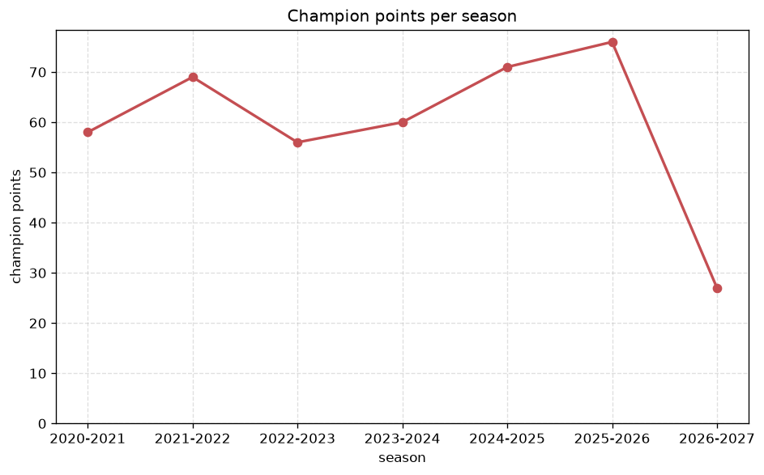
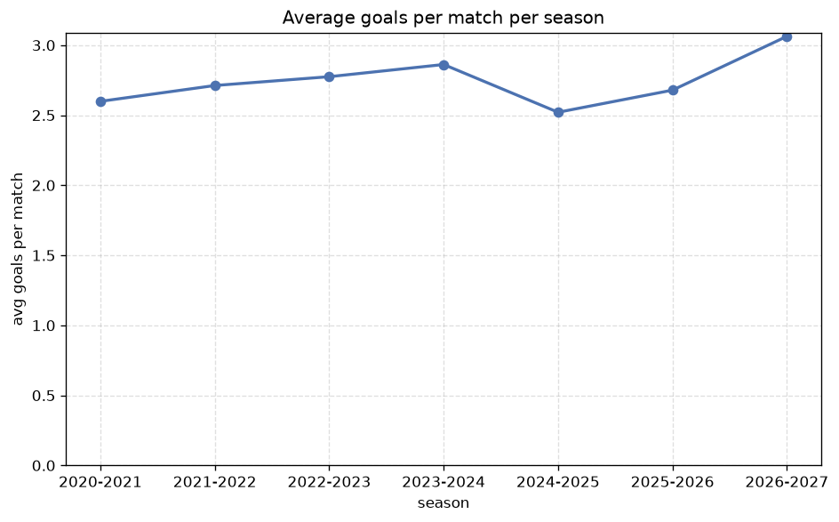

# Season Trends Analysis
- Report: `season_trends`
- Generated: 2026-10-26T01:29:05+00:00
- Script: `backend/scripts/analyze_seasons.py` v1.0.0
- League: ChNL (Czech Republic)
- Scope: league `czech2`

## 1. Champions per season
| season | champion | pts | runner-up | margin |
|---|---|---|---|---|
| 2020-2021 | Hradec Kralove | 58 | Artis Brno | 8 pts |
| 2021-2022 | Brno | 69 | Vlasim | 16 pts |
| 2022-2023 | Karvina | 56 | Vyskov | 4 pts |
| 2023-2024 | Dukla Prague | 60 | Sigma Olomouc B | 3 pts |
| 2024-2025 | Zlin | 71 | Chrudim | 18 pts |
| 2025-2026 | Brno | 76 | Taborsko | 23 pts |
| 2026-2027 | Karvina | 27 | Jihlava | 4 pts |

## 2. Title-race tightness
- Tight races (margin <= 3 pts): **1** of 7 seasons
- Tightest race: **2023-2024** - Dukla Prague beat Sigma Olomouc B by **3** pts

| season | margin | tight |
|---|---|---|
| 2020-2021 | 8 pts |  |
| 2021-2022 | 16 pts |  |
| 2022-2023 | 4 pts |  |
| 2023-2024 | 3 pts | yes |
| 2024-2025 | 18 pts |  |
| 2025-2026 | 23 pts |  |
| 2026-2027 | 4 pts |  |

## 3. Points thresholds
_Position-specific points per season. Key: 1 = champion, 2 = runner-up, 4 = CL line, 6 = Europa, 13 = last safe, 16 = bottom._

| season | pos 1 | pos 2 | pos 4 | pos 6 | pos 13 | pos 16 |
|---|---|---|---|---|---|---|
| 2020-2021 | 58 | 50 | 42 | 37 | 27 | - |
| 2021-2022 | 69 | 53 | 50 | 45 | 35 | 18 |
| 2022-2023 | 56 | 52 | 47 | 43 | 34 | 27 |
| 2023-2024 | 60 | 57 | 47 | 40 | 37 | 25 |
| 2024-2025 | 71 | 53 | 41 | 40 | 36 | 24 |
| 2025-2026 | 76 | 53 | 48 | 46 | 34 | 25 |
| 2026-2027 | 27 | 23 | 19 | 18 | 13 | 9 |

## 4. Relegation battle
| season | safe pos | safe pts | drop pos | drop pts | gap |
|---|---|---|---|---|---|
| 2020-2021 | 13 | 27 | 14 | 7 | 20 pts |
| 2021-2022 | 13 | 35 | 14 | 33 | 2 pts |
| 2022-2023 | 13 | 34 | 14 | 34 | 0 pts |
| 2023-2024 | 13 | 37 | 14 | 36 | 1 pts |
| 2024-2025 | 13 | 36 | 14 | 34 | 2 pts |
| 2025-2026 | 13 | 34 | 14 | 30 | 4 pts |
| 2026-2027 | 13 | 13 | 14 | 11 | 2 pts |

## 5. League-level trends
| season | matches | total goals | avg goals | home win | draw | away win | goalless | avg pts/team |
|---|---|---|---|---|---|---|---|---|
| 2020-2021 | 182 | 473 | 2.599 | 37.4% | 25.8% | 36.8% | 6.6% | 35.64 |
| 2021-2022 | 240 | 651 | 2.712 | 47.9% | 25.4% | 26.7% | 7.9% | 41.19 |
| 2022-2023 | 240 | 666 | 2.775 | 47.1% | 27.1% | 25.8% | 5.4% | 40.94 |
| 2023-2024 | 240 | 687 | 2.862 | 46.2% | 25.4% | 28.3% | 7.1% | 41.19 |
| 2024-2025 | 240 | 605 | 2.521 | 40.4% | 31.2% | 28.3% | 9.6% | 40.31 |
| 2025-2026 | 240 | 643 | 2.679 | 46.2% | 20.8% | 32.9% | 5.8% | 41.88 |
| 2026-2027 | 95 | 291 | 3.063 | 38.9% | 32.6% | 28.4% | 4.2% | 15.88 |

## 6. View divergence
- Largest divergence: **2023-2024** (goals view, avg abs position diff = 6.750)

_Avg absolute position difference between classic view and alternative view per season._

| season | classic vs luck | classic vs goals |
|---|---|---|
| 2020-2021 | 2.571 | 3.286 |
| 2021-2022 | 1.875 | 4.875 |
| 2022-2023 | 2.375 | 5.750 |
| 2023-2024 | 3.125 | 6.750 |
| 2024-2025 | 2.250 | 6.000 |
| 2025-2026 | 2.250 | 4.250 |
| 2026-2027 | 2.000 | 4.375 |

---
*All statistics are computed from PostgreSQL tables (read-only). Run with `python backend/scripts/analyze_seasons.py` to regenerate.*

## Charts

