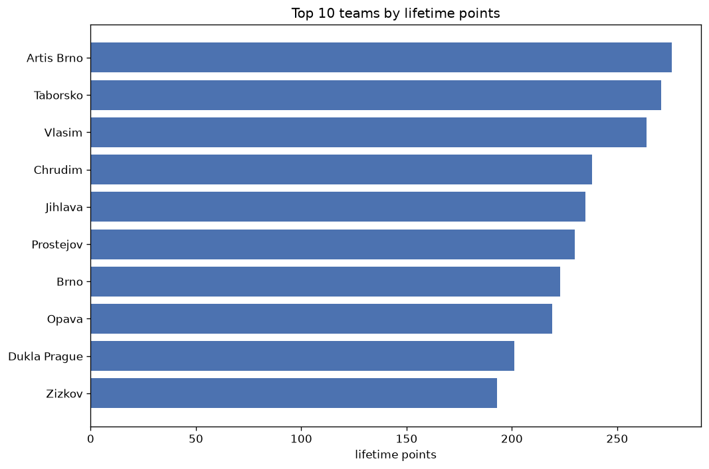
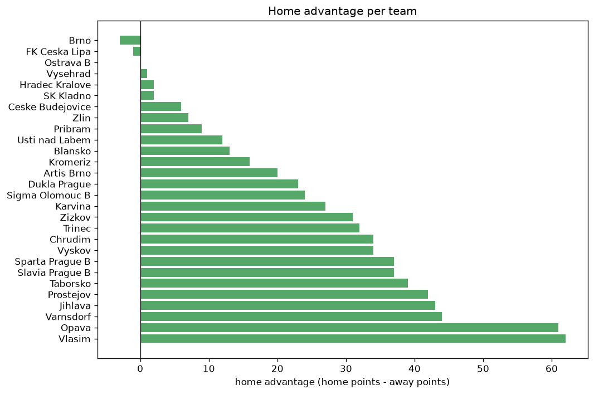

# Team Analysis
- Report: `teams_analysis`
- Generated: 2026-10-30T03:47:37+00:00
- Script: `backend/scripts/analyze_teams.py` v1.0.0
- League: ChNL (Czech Republic)
- Scope: league `czech2`

- Teams: **28** | Seasons: **7** | Matches: **1478**

## 1. Team standings (lifetime)
| team | seasons | played | W | D | L | pts | GF | GA | GD | avg pts/season | best pos | worst pos | titles |
|---|---|---|---|---|---|---|---|---|---|---|---|---|---|
| Artis Brno | 6 | 176 | 73 | 57 | 46 | 276 | 241 | 190 | 51 | 46.0 | 2 | 9 | 0 |
| Taborsko | 7 | 188 | 72 | 55 | 61 | 271 | 237 | 210 | 27 | 38.71 | 2 | 11 | 0 |
| Vlasim | 7 | 188 | 70 | 54 | 64 | 264 | 298 | 253 | 45 | 37.71 | 2 | 11 | 0 |
| Chrudim | 6 | 176 | 61 | 55 | 60 | 238 | 231 | 232 | -1 | 39.67 | 2 | 11 | 0 |
| Jihlava | 7 | 188 | 60 | 55 | 73 | 235 | 240 | 265 | -25 | 33.57 | 2 | 15 | 0 |
| Prostejov | 7 | 188 | 59 | 53 | 76 | 230 | 232 | 301 | -69 | 32.86 | 3 | 15 | 0 |
| Brno | 4 | 120 | 66 | 25 | 29 | 223 | 203 | 134 | 69 | 55.75 | 1 | 9 | 2 |
| Opava | 6 | 162 | 56 | 51 | 55 | 219 | 198 | 189 | 9 | 36.5 | 3 | 13 | 0 |
| Dukla Prague | 5 | 128 | 57 | 30 | 41 | 201 | 204 | 164 | 40 | 40.2 | 1 | 9 | 1 |
| Zizkov | 6 | 158 | 54 | 31 | 73 | 193 | 217 | 263 | -46 | 32.17 | 4 | 16 | 0 |
| Pribram | 5 | 132 | 51 | 34 | 47 | 187 | 169 | 176 | -7 | 37.4 | 3 | 13 | 0 |
| Sparta Prague B | 5 | 150 | 51 | 34 | 65 | 187 | 202 | 227 | -25 | 37.4 | 5 | 16 | 0 |
| Varnsdorf | 5 | 146 | 47 | 45 | 54 | 186 | 211 | 205 | 6 | 37.2 | 6 | 15 | 0 |
| Vyskov | 4 | 120 | 48 | 36 | 36 | 180 | 166 | 135 | 31 | 45.0 | 2 | 12 | 0 |
| Usti nad Labem | 4 | 98 | 38 | 22 | 38 | 136 | 123 | 140 | -17 | 34.0 | 4 | 15 | 0 |
| Slavia Prague B | 4 | 102 | 32 | 27 | 43 | 123 | 150 | 160 | -10 | 30.75 | 7 | 15 | 0 |
| Sigma Olomouc B | 3 | 90 | 34 | 18 | 38 | 120 | 121 | 138 | -17 | 40.0 | 2 | 16 | 0 |
| Trinec | 4 | 98 | 26 | 26 | 46 | 104 | 114 | 156 | -42 | 26.0 | 9 | 16 | 0 |
| Ostrava B | 3 | 72 | 27 | 15 | 30 | 96 | 100 | 101 | -1 | 32.0 | 5 | 14 | 0 |
| Karvina | 2 | 42 | 26 | 5 | 11 | 83 | 84 | 50 | 34 | 41.5 | 1 | 1 | 2 |
| Zlin | 1 | 30 | 21 | 8 | 1 | 71 | 45 | 14 | 31 | 71.0 | 1 | 1 | 1 |
| Kromeriz | 3 | 72 | 18 | 14 | 40 | 68 | 76 | 120 | -44 | 22.67 | 12 | 16 | 0 |
| Hradec Kralove | 1 | 26 | 17 | 7 | 2 | 58 | 51 | 22 | 29 | 58.0 | 1 | 1 | 1 |
| Ceske Budejovice | 1 | 30 | 10 | 4 | 16 | 34 | 31 | 43 | -12 | 34.0 | 13 | 13 | 0 |
| Blansko | 1 | 26 | 7 | 6 | 13 | 27 | 30 | 34 | -4 | 27.0 | 13 | 13 | 0 |
| SK Kladno | 1 | 12 | 3 | 5 | 4 | 14 | 17 | 18 | -1 | 14.0 | 10 | 10 | 0 |
| FK Ceska Lipa | 1 | 12 | 3 | 4 | 5 | 13 | 16 | 22 | -6 | 13.0 | 13 | 13 | 0 |
| Vysehrad | 1 | 26 | 1 | 4 | 21 | 7 | 15 | 60 | -45 | 7.0 | 14 | 14 | 0 |

## 2. Home vs away split
| team | home P | H-W | H-D | H-L | H-pts | away P | A-W | A-D | A-L | A-pts | adv |
|---|---|---|---|---|---|---|---|---|---|---|---|
| Vlasim | 93 | 47 | 22 | 24 | 163 | 95 | 23 | 32 | 40 | 101 | 62 |
| Opava | 82 | 38 | 26 | 18 | 140 | 80 | 18 | 25 | 37 | 79 | 61 |
| Varnsdorf | 73 | 32 | 19 | 22 | 115 | 73 | 15 | 26 | 32 | 71 | 44 |
| Jihlava | 95 | 37 | 28 | 30 | 139 | 93 | 23 | 27 | 43 | 96 | 43 |
| Prostejov | 94 | 36 | 28 | 30 | 136 | 94 | 23 | 25 | 46 | 94 | 42 |
| Taborsko | 94 | 43 | 26 | 25 | 155 | 94 | 29 | 29 | 36 | 116 | 39 |
| Sparta Prague B | 75 | 31 | 19 | 25 | 112 | 75 | 20 | 15 | 40 | 75 | 37 |
| Slavia Prague B | 52 | 22 | 14 | 16 | 80 | 50 | 10 | 13 | 27 | 43 | 37 |
| Chrudim | 88 | 37 | 25 | 26 | 136 | 88 | 24 | 30 | 34 | 102 | 34 |
| Vyskov | 60 | 30 | 17 | 13 | 107 | 60 | 18 | 19 | 23 | 73 | 34 |
| Trinec | 48 | 18 | 14 | 16 | 68 | 50 | 8 | 12 | 30 | 36 | 32 |
| Zizkov | 78 | 31 | 19 | 28 | 112 | 80 | 23 | 12 | 45 | 81 | 31 |
| Karvina | 20 | 18 | 1 | 1 | 55 | 22 | 8 | 4 | 10 | 28 | 27 |
| Sigma Olomouc B | 45 | 20 | 12 | 13 | 72 | 45 | 14 | 6 | 25 | 48 | 24 |
| Dukla Prague | 65 | 32 | 16 | 17 | 112 | 63 | 25 | 14 | 24 | 89 | 23 |
| Artis Brno | 88 | 40 | 28 | 20 | 148 | 88 | 33 | 29 | 26 | 128 | 20 |
| Kromeriz | 37 | 11 | 9 | 17 | 42 | 35 | 7 | 5 | 23 | 26 | 16 |
| Blansko | 13 | 6 | 2 | 5 | 20 | 13 | 1 | 4 | 8 | 7 | 13 |
| Usti nad Labem | 50 | 20 | 14 | 16 | 74 | 48 | 18 | 8 | 22 | 62 | 12 |
| Pribram | 65 | 27 | 17 | 21 | 98 | 67 | 24 | 17 | 26 | 89 | 9 |
| Zlin | 15 | 12 | 3 | 0 | 39 | 15 | 9 | 5 | 1 | 32 | 7 |
| Ceske Budejovice | 15 | 6 | 2 | 7 | 20 | 15 | 4 | 2 | 9 | 14 | 6 |
| Hradec Kralove | 13 | 9 | 3 | 1 | 30 | 13 | 8 | 4 | 1 | 28 | 2 |
| SK Kladno | 5 | 2 | 2 | 1 | 8 | 7 | 1 | 3 | 3 | 6 | 2 |
| Vysehrad | 13 | 1 | 1 | 11 | 4 | 13 | 0 | 3 | 10 | 3 | 1 |
| Ostrava B | 36 | 14 | 6 | 16 | 48 | 36 | 13 | 9 | 14 | 48 | 0 |
| FK Ceska Lipa | 6 | 1 | 3 | 2 | 6 | 6 | 2 | 1 | 3 | 7 | -1 |
| Brno | 60 | 32 | 14 | 14 | 110 | 60 | 34 | 11 | 15 | 113 | -3 |

## 3. Top performers
### Best points per game (PPG)
| rank | team | PPG |
|---|---|---|
| 1 | Zlin | 2.37 |
| 2 | Hradec Kralove | 2.23 |
| 3 | Karvina | 1.98 |
| 4 | Brno | 1.86 |
| 5 | Dukla Prague | 1.57 |

### Most goals scored
| rank | team | goals |
|---|---|---|
| 1 | Vlasim | 298 |
| 2 | Artis Brno | 241 |
| 3 | Jihlava | 240 |
| 4 | Taborsko | 237 |
| 5 | Prostejov | 232 |

### Best goal difference
| rank | team | GD |
|---|---|---|
| 1 | Brno | 69 |
| 2 | Artis Brno | 51 |
| 3 | Vlasim | 45 |
| 4 | Dukla Prague | 40 |
| 5 | Karvina | 34 |

### Best defence (goals against per match, standings)
| rank | team | GA/match |
|---|---|---|
| 1 | Zlin | 0.467 |
| 2 | Hradec Kralove | 0.846 |
| 3 | Artis Brno | 1.080 |
| 4 | Taborsko | 1.117 |
| 5 | Brno | 1.117 |

## 4. Team consistency
- Teams present in all **7** seasons: **4**

Jihlava, Prostejov, Taborsko, Vlasim

## 5. Head-to-head dominance
- Distinct fixtures: **295** (showing the 15 most frequent)

| fixture | meetings | home wins | draws | away wins | home pct | draw pct | away pct |
|---|---|---|---|---|---|---|---|
| Taborsko vs Vlasim | 13 | 8 | 2 | 3 | 61.5% | 15.4% | 23.1% |
| Prostejov vs Jihlava | 13 | 7 | 3 | 3 | 53.8% | 23.1% | 23.1% |
| Taborsko vs Prostejov | 13 | 7 | 4 | 2 | 53.8% | 30.8% | 15.4% |
| Taborsko vs Jihlava | 13 | 6 | 4 | 3 | 46.2% | 30.8% | 23.1% |
| Vlasim vs Jihlava | 13 | 6 | 4 | 3 | 46.2% | 30.8% | 23.1% |
| Vlasim vs Chrudim | 12 | 7 | 3 | 2 | 58.3% | 25.0% | 16.7% |
| Artis Brno vs Prostejov | 12 | 6 | 4 | 2 | 50.0% | 33.3% | 16.7% |
| Artis Brno vs Jihlava | 12 | 5 | 4 | 3 | 41.7% | 33.3% | 25.0% |
| Artis Brno vs Vlasim | 12 | 5 | 2 | 5 | 41.7% | 16.7% | 41.7% |
| Prostejov vs Chrudim | 12 | 4 | 5 | 3 | 33.3% | 41.7% | 25.0% |
| Prostejov vs Vlasim | 12 | 4 | 3 | 5 | 33.3% | 25.0% | 41.7% |
| Taborsko vs Chrudim | 12 | 4 | 4 | 4 | 33.3% | 33.3% | 33.3% |
| Artis Brno vs Taborsko | 12 | 3 | 7 | 2 | 25.0% | 58.3% | 16.7% |
| Jihlava vs Chrudim | 12 | 3 | 4 | 5 | 25.0% | 33.3% | 41.7% |
| Artis Brno vs Chrudim | 12 | 2 | 6 | 4 | 16.7% | 50.0% | 33.3% |

## 6. Position per season (classic view)
_Cells show final position; '-' when the team was absent from that season._

| team | 2020-2021 | 2021-2022 | 2022-2023 | 2023-2024 | 2024-2025 | 2025-2026 | 2026-2027 |
|---|---|---|---|---|---|---|---|
| Artis Brno | 2 | 4 | 5 | 8 | 9 | 3 | - |
| Taborsko | 11 | 8 | 7 | 3 | 4 | 2 | 9 |
| Vlasim | 6 | 2 | 11 | 7 | 5 | 9 | 5 |
| Chrudim | 10 | 10 | 8 | 5 | 2 | 11 | - |
| Jihlava | 7 | 7 | 14 | 15 | 11 | 15 | 2 |
| Prostejov | 3 | 11 | 12 | 12 | 12 | 14 | 15 |
| Brno | - | 1 | - | 9 | 8 | 1 | - |
| Opava | - | 3 | 13 | 6 | 13 | 7 | 11 |
| Dukla Prague | 8 | 9 | 4 | 1 | - | - | 3 |
| Zizkov | 4 | 16 | - | 10 | 7 | 8 | 12 |
| Pribram | - | 13 | 3 | 13 | - | 6 | 6 |
| Sparta Prague B | - | 5 | 10 | 11 | 6 | 16 | - |
| Varnsdorf | 12 | 6 | 6 | 14 | 15 | - | - |
| Vyskov | - | 12 | 2 | 4 | 3 | - | - |
| Usti nad Labem | 5 | 15 | - | - | - | 4 | 4 |
| Slavia Prague B | - | - | 15 | - | 10 | 10 | 7 |
| Sigma Olomouc B | - | - | 9 | 2 | 16 | - | - |
| Trinec | 9 | 14 | 16 | - | - | - | 14 |
| Ostrava B | - | - | - | - | 14 | 5 | 8 |
| Karvina | - | - | 1 | - | - | - | 1 |
| Zlin | - | - | - | - | 1 | - | - |
| Kromeriz | - | - | - | 16 | - | 12 | 16 |
| Hradec Kralove | 1 | - | - | - | - | - | - |
| Ceske Budejovice | - | - | - | - | - | 13 | - |
| Blansko | 13 | - | - | - | - | - | - |
| SK Kladno | - | - | - | - | - | - | 10 |
| FK Ceska Lipa | - | - | - | - | - | - | 13 |
| Vysehrad | 14 | - | - | - | - | - | - |

---
*All statistics are computed from PostgreSQL tables (read-only). Run with `python backend/scripts/analyze_teams.py` to regenerate.*

## Charts

