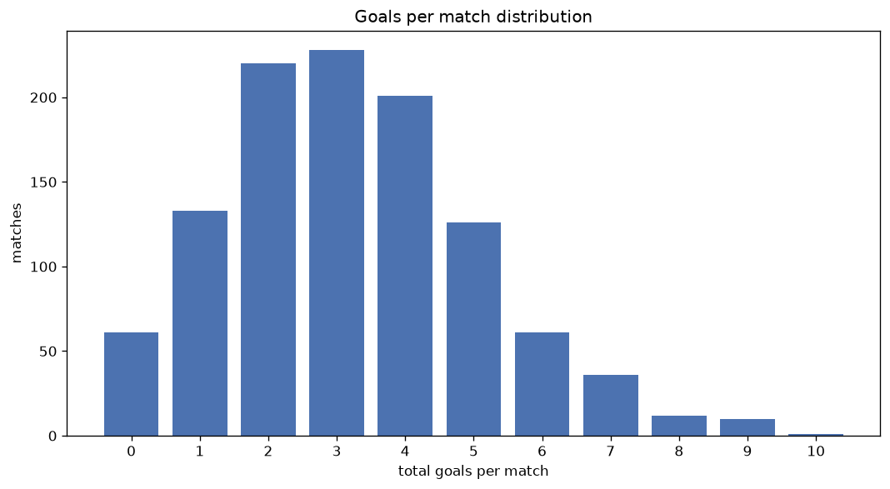
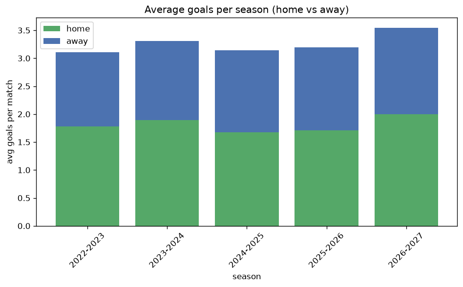

# Goal Analysis
- Report: `goals_analysis`
- Generated: 2026-10-30T03:47:52+00:00
- Script: `backend/scripts/analyze_goals.py` v1.0.0
- League: 3. CFL - Group A (Czech Republic)
- Scope: league `czech3a`

## 1. Goals per match distribution
| goals | matches | pct |
|---|---|---|
| 0 | 61 | 5.6% |
| 1 | 133 | 12.2% |
| 2 | 220 | 20.2% |
| 3 | 228 | 20.9% |
| 4 | 201 | 18.5% |
| 5 | 126 | 11.6% |
| 6 | 61 | 5.6% |
| 7 | 36 | 3.3% |
| 8 | 12 | 1.1% |
| 9 | 10 | 0.9% |
| 10 | 1 | 0.1% |

## 2. Goals per match per season
| season | matches | total goals | avg home | avg away | avg total |
|---|---|---|---|---|---|
| 2022-2023 | 240 | 745 | 1.783 | 1.321 | 3.104 |
| 2023-2024 | 240 | 793 | 1.892 | 1.413 | 3.304 |
| 2024-2025 | 240 | 754 | 1.675 | 1.467 | 3.142 |
| 2025-2026 | 272 | 869 | 1.706 | 1.489 | 3.195 |
| 2026-2027 | 97 | 344 | 2.0 | 1.546 | 3.546 |

## 3. Home vs away goal share
- Home goals: **1942** (55.4%)
- Away goals: **1563** (44.6%)
- Home/away ratio: **1.242**

| season | home goals | away goals | total | home pct | away pct |
|---|---|---|---|---|---|
| 2022-2023 | 428 | 317 | 745 | 57.4% | 42.6% |
| 2023-2024 | 454 | 339 | 793 | 57.3% | 42.7% |
| 2024-2025 | 402 | 352 | 754 | 53.3% | 46.7% |
| 2025-2026 | 464 | 405 | 869 | 53.4% | 46.6% |
| 2026-2027 | 194 | 150 | 344 | 56.4% | 43.6% |

## 4. BTTS (Both Teams To Score)
- Overall: **635** of `1089` (58.3%)

| season | matches | BTTS | pct |
|---|---|---|---|
| 2022-2023 | 240 | 136 | 56.7% |
| 2023-2024 | 240 | 153 | 63.8% |
| 2024-2025 | 240 | 131 | 54.6% |
| 2025-2026 | 272 | 156 | 57.4% |
| 2026-2027 | 97 | 59 | 60.8% |

## 5. Clean sheets
- Home clean sheets: **293** (26.9%)
- Away clean sheets: **222** (20.4%)
- Total clean sheets recorded: **515**
- Matches with at least one clean sheet: **454** (41.7%)
- Both teams kept clean sheets (0-0): **61**

| season | matches | home CS | away CS | total CS | matches w/ CS |
|---|---|---|---|---|---|
| 2022-2023 | 240 | 68 | 51 | 119 | 104 (43.3%) |
| 2023-2024 | 240 | 60 | 38 | 98 | 87 (36.2%) |
| 2024-2025 | 240 | 67 | 52 | 119 | 109 (45.4%) |
| 2025-2026 | 272 | 73 | 60 | 133 | 116 (42.6%) |
| 2026-2027 | 97 | 25 | 21 | 46 | 38 (39.2%) |

## 6. Scoring intensity
- First-half goals: **1642** (46.9%)
- Second-half goals: **1860** (53.1%)
- Avg first-half goals per match: **1.511**
- Avg second-half goals per match: **1.711**
- Second-half-only scoring (HT 0-0, FT goals >= 1): **177** (16.3%)
- *2 match(es) excluded (no HT score recorded).*

| season | matches | 1st half | 2nd half | 1st half pct | 2nd half pct |
|---|---|---|---|---|---|
| 2022-2023 | 240 | 346 | 396 | 46.6% | 53.4% |
| 2023-2024 | 240 | 381 | 412 | 48.0% | 52.0% |
| 2024-2025 | 240 | 339 | 415 | 45.0% | 55.0% |
| 2025-2026 | 272 | 408 | 461 | 47.0% | 53.0% |
| 2026-2027 | 97 | 168 | 176 | 48.8% | 51.2% |

## 7. First-goal timing
- Matches with first-goal time recorded: `1027` of `1089` (94.3%)
- Goalless matches: `62`
- Min `1` | Max `95` | Mean `26.54` | Median (p50) `20`

| bucket | count | % of matches | % of scoring matches |
|---|---|---|---|
| 1-15 | 430 | 39.5% | 41.9% |
| 16-30 | 244 | 22.4% | 23.8% |
| 31-45 | 162 | 14.9% | 15.8% |
| 46-60 | 98 | 9.0% | 9.5% |
| 61-75 | 48 | 4.4% | 4.7% |
| 76-90 | 41 | 3.8% | 4.0% |
| 91-120 | 4 | 0.4% | 0.4% |

---
*All statistics are computed from PostgreSQL tables (read-only). Run with `python backend/scripts/analyze_goals.py` to regenerate.*

## Charts

