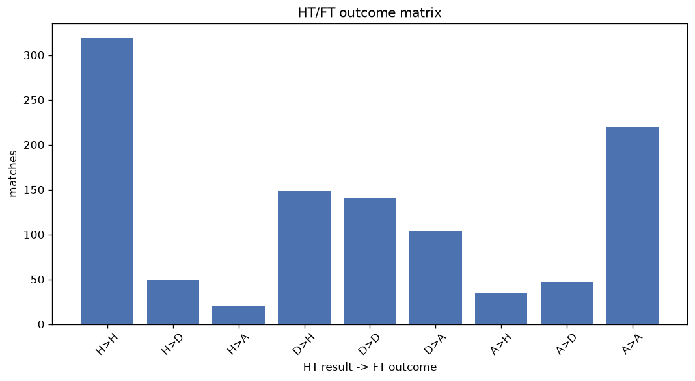
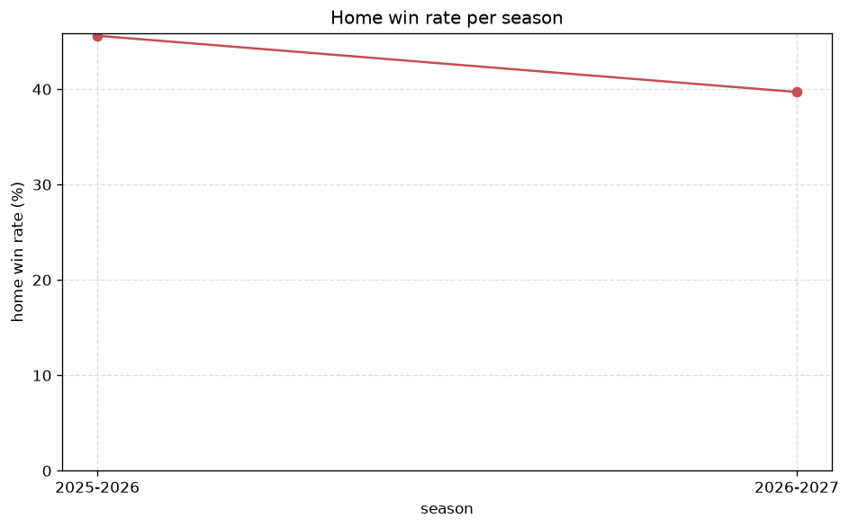

# Match Analysis
- Report: `matches_analysis`
- Generated: 2026-10-29T01:56:32+00:00
- Script: `backend/scripts/analyze_matches.py` v1.0.0
- League: 3. CFL - Group A (Czech Republic)
- Scope: league `czech3a`

## 1. Overall summary
| metric | value |
|---|---|
| Matches | 1087 |
| Home wins | 504 (46.4%) |
| Draws | 239 (22.0%) |
| Away wins | 344 (31.6%) |
| Total goals | 3498 |
| Average goals per match | 3.218 |
| Goalless matches | 61 (5.6%) |

## 2. Per-season breakdown
| season | matches | home wins | draws | away wins | total goals | avg goals | goalless |
|---|---|---|---|---|---|---|---|
| 2022-2023 | 240 | 121 (50.4%) | 50 (20.8%) | 69 (28.8%) | 745 | 3.104 | 15 (6.2%) |
| 2023-2024 | 240 | 117 (48.8%) | 54 (22.5%) | 69 (28.8%) | 793 | 3.304 | 11 (4.6%) |
| 2024-2025 | 240 | 102 (42.5%) | 50 (20.8%) | 88 (36.7%) | 754 | 3.142 | 10 (4.2%) |
| 2025-2026 | 272 | 124 (45.6%) | 57 (21.0%) | 91 (33.5%) | 869 | 3.195 | 17 (6.2%) |
| 2026-2027 | 95 | 40 (42.1%) | 28 (29.5%) | 27 (28.4%) | 337 | 3.547 | 8 (8.4%) |

## 3. HT/FT outcome matrix
| HT result \ FT result | Home | Draw | Away | total |
|---|---|---|---|---|
| HT home lead | 319 (81.8%) | 50 (12.8%) | 21 (5.4%) | 390 |
| HT draw | 149 (37.8%) | 141 (35.8%) | 104 (26.4%) | 394 |
| HT away lead | 35 (11.6%) | 47 (15.6%) | 219 (72.8%) | 301 |
- *2 match(es) excluded (no HT score recorded).*

## 4. Comeback matches
- Home comebacks (trailing at HT, won at FT): **35** (3.2%)
- Away comebacks (trailing at HT, won at FT): **21** (1.9%)

### Home comebacks
| season | home | away | HT | FT |
|---|---|---|---|---|
| 2022-2023 | FK Robstav | Motorlet Prague | 0-1 | 2-1 |
| 2022-2023 | Plzen B | Kraluv Dvur | 1-2 | 4-2 |
| 2022-2023 | Kraluv Dvur | Pisek | 0-1 | 3-2 |
| 2022-2023 | Plzen B | Hostoun | 1-2 | 4-2 |
| 2022-2023 | Pisek | Dukla Prague B | 0-1 | 3-1 |
| 2022-2023 | Karlovy Vary | Plzen B | 0-1 | 3-2 |
| 2022-2023 | Loko Praha | Admira Prague | 0-1 | 2-1 |
| 2022-2023 | FK Robstav | Hostoun | 0-1 | 2-1 |
| 2022-2023 | Povltavska FA | Plzen B | 0-1 | 2-1 |
| 2023-2024 | Pisek | FK Robstav | 0-1 | 3-2 |
| 2023-2024 | Karlovy Vary | Bohemians 1905 B | 0-1 | 2-1 |
| 2023-2024 | Bohemians 1905 B | Pisek | 1-2 | 4-2 |
| 2023-2024 | Motorlet Prague | Admira Prague | 0-1 | 2-1 |
| 2023-2024 | FK Robstav | Motorlet Prague | 1-2 | 3-2 |
| 2024-2025 | Ceske Budejovice B | Motorlet Prague | 0-1 | 3-2 |
| 2024-2025 | Ceske Budejovice B | Bohemians 1905 B | 1-2 | 3-2 |
| 2024-2025 | Petrin Plzen | Povltavska FA | 0-1 | 3-1 |
| 2024-2025 | Velvary | Ceske Budejovice B | 1-2 | 4-2 |
| 2024-2025 | Velvary | Bohemians 1905 B | 1-2 | 3-2 |
| 2024-2025 | Domazlice | Loko Praha | 0-1 | 2-1 |
| 2024-2025 | Admira Prague | Chomutov | 0-1 | 2-1 |
| 2024-2025 | Taborsko akademie | Petrin Plzen | 0-1 | 2-1 |
| 2025-2026 | SK Kladno | Pribram B | 1-2 | 5-2 |
| 2025-2026 | Pisek | Domazlice | 0-1 | 3-1 |
| 2025-2026 | Pribram B | Aritma Prague | 0-1 | 3-2 |
| 2025-2026 | Plzen B | Domazlice | 0-1 | 2-1 |
| 2025-2026 | Slavia Prague U20 | SK Kladno | 0-1 | 2-1 |
| 2025-2026 | Aritma Prague | Loko Praha | 0-1 | 3-1 |
| 2025-2026 | Aritma Prague | Dukla Prague B | 0-1 | 2-1 |
| 2025-2026 | Domazlice | Pisek | 1-2 | 3-2 |
| 2025-2026 | Domazlice | Slavia Prague U20 | 1-2 | 4-3 |
| 2025-2026 | Pisek | Kraluv Dvur | 0-1 | 3-1 |
| 2026-2027 | Domazlice | Motorlet Prague | 0-1 | 5-2 |
| 2026-2027 | Loko Praha | Slavia Prague U20 | 0-1 | 2-1 |
| 2026-2027 | Motorlet Prague | Slavia Prague U20 | 0-1 | 3-2 |

### Away comebacks
| season | home | away | HT | FT |
|---|---|---|---|---|
| 2022-2023 | Hostoun | Ceske Budejovice B | 1-0 | 1-2 |
| 2022-2023 | Motorlet Prague | Admira Prague | 1-0 | 1-2 |
| 2022-2023 | Kraluv Dvur | Karlovy Vary | 1-0 | 1-2 |
| 2022-2023 | Sokolov | Bohemians 1905 B | 2-1 | 3-5 |
| 2022-2023 | Dukla Prague B | Pisek | 1-0 | 1-2 |
| 2023-2024 | Admira Prague | Povltavska FA | 1-0 | 1-3 |
| 2023-2024 | Plzen B | Hostoun | 1-0 | 2-3 |
| 2023-2024 | Karlovy Vary | Admira Prague | 1-0 | 1-2 |
| 2023-2024 | Bohemians 1905 B | Domazlice | 1-0 | 1-3 |
| 2023-2024 | FK Robstav | Povltavska FA | 1-0 | 2-4 |
| 2024-2025 | Motorlet Prague | Pribram | 1-0 | 1-4 |
| 2024-2025 | Loko Praha | Plzen B | 1-0 | 1-2 |
| 2024-2025 | Hostoun | Povltavska FA | 1-0 | 1-2 |
| 2024-2025 | Dukla Prague B | Taborsko akademie | 2-0 | 2-3 |
| 2024-2025 | Pisek | Hostoun | 1-0 | 1-2 |
| 2024-2025 | Ceske Budejovice B | Hostoun | 1-0 | 1-2 |
| 2024-2025 | Taborsko akademie | Ceske Budejovice B | 2-1 | 2-3 |
| 2025-2026 | Petrin Plzen | Plzen B | 3-0 | 3-4 |
| 2025-2026 | Taborsko akademie | Dukla Prague B | 1-0 | 1-2 |
| 2025-2026 | Loko Praha | Bohemians 1905 B | 1-0 | 1-2 |
| 2025-2026 | Dukla Prague B | Taborsko akademie | 1-0 | 2-3 |

## 5. HT lead conversion
| HT state | matches | converted to win | held as draw | collapsed to loss |
|---|---|---|---|---|
| Home lead | 390 | 319 (81.8%) | 50 (12.8%) | 21 (5.4%) |
| Away lead | 301 | 219 (72.8%) | 47 (15.6%) | 35 (11.6%) |

### Matches level at half-time
| FT result | count | pct |
|---|---|---|
| Home win | 149 | 37.8% |
| Draw | 141 | 35.8% |
| Away win | 104 | 26.4% |
- *2 match(es) excluded (no HT score recorded).*

## 6. First-goal timing
- Matches with a first-goal time recorded: `1025` of `1087` (94.3%)

Outcome distribution by first-goal timing bucket:
| bucket | matches | % of matches | home | draw | away |
|---|---|---|---|---|---|
| 1-15 | 429 | 39.5% | 216 (50.3%) | 72 (16.8%) | 141 (32.9%) |
| 16-30 | 244 | 22.4% | 115 (47.1%) | 38 (15.6%) | 91 (37.3%) |
| 31-45 | 162 | 14.9% | 81 (50.0%) | 36 (22.2%) | 45 (27.8%) |
| 46-60 | 98 | 9.0% | 37 (37.8%) | 18 (18.4%) | 43 (43.9%) |
| 61-75 | 48 | 4.4% | 25 (52.1%) | 8 (16.7%) | 15 (31.2%) |
| 76-90 | 40 | 3.7% | 26 (65.0%) | 6 (15.0%) | 8 (20.0%) |
| 91-120 | 4 | 0.4% | 3 (75.0%) | 0 (0.0%) | 1 (25.0%) |

## 7. Goalless matches
- Overall: **61** of `1087` (5.6%)

| season | matches | goalless | pct |
|---|---|---|---|
| 2022-2023 | 240 | 15 | 6.2% |
| 2023-2024 | 240 | 11 | 4.6% |
| 2024-2025 | 240 | 10 | 4.2% |
| 2025-2026 | 272 | 17 | 6.2% |
| 2026-2027 | 95 | 8 | 8.4% |

---
*All statistics are computed from PostgreSQL tables (read-only). Run with `python backend/scripts/analyze_matches.py` to regenerate.*

## Charts

