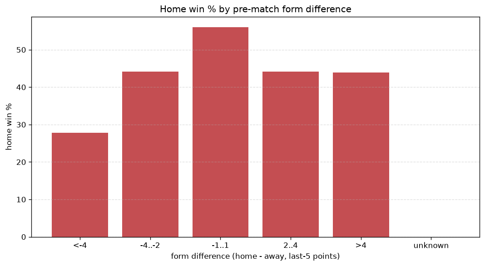
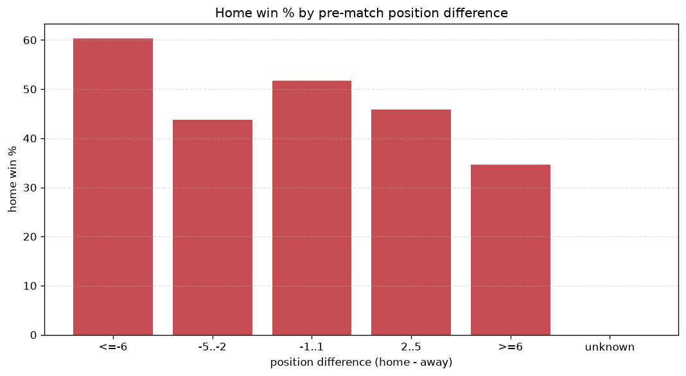

# Relationships Analysis
- Report: `relationships`
- Generated: 2026-10-30T03:47:59+00:00
- Script: `backend/scripts/analyze_relationships.py` v1.0.0
- League: 3. CFL - Group A (Czech Republic)
- Scope: league `czech3a`

- Matches analysed: **992** (23 leakage-safe pre-match features).

## 1. Correlation matrix
_Pearson correlation of each pre-match feature with observed goals; sorted by |corr(total goals)|._

| feature | corr(home) | corr(away) | corr(total) |
|---|---|---|---|
| home_position_before_match | -0.155 | 0.071 | -0.071 |
| away_team_goals_conceded_last_5 | 0.089 | -0.014 | 0.060 |
| position_difference | -0.202 | 0.141 | -0.060 |
| home_team_home_goals_avg | 0.155 | -0.090 | 0.059 |
| home_rest_days | -0.007 | -0.075 | -0.058 |
| away_rest_days | -0.004 | -0.077 | -0.058 |
| away_team_wins_last_5 | -0.104 | 0.034 | -0.057 |
| home_team_home_win_rate | 0.126 | -0.068 | 0.051 |
| home_team_goals_scored_last_5 | 0.132 | -0.076 | 0.050 |
| away_team_points_last_5 | -0.101 | 0.042 | -0.049 |
| points_difference | 0.220 | -0.181 | 0.046 |
| home_team_goals_conceded_last_5 | -0.056 | 0.011 | -0.036 |
| home_team_wins_last_5 | 0.113 | -0.090 | 0.025 |
| away_points_before_match | -0.090 | 0.072 | -0.020 |
| home_team_points_last_5 | 0.103 | -0.088 | 0.019 |
| home_points_before_match | 0.071 | -0.060 | 0.014 |
| away_position_before_match | 0.130 | -0.126 | 0.013 |
| rest_days_difference | -0.015 | 0.004 | -0.009 |
| away_team_away_goals_avg | -0.070 | 0.086 | 0.005 |
| away_team_away_conceded_avg | 0.069 | -0.083 | -0.004 |
| away_team_away_win_rate | -0.092 | 0.101 | -0.002 |
| home_team_home_conceded_avg | 0.016 | -0.018 | -0.000 |
| away_team_goals_scored_last_5 | -0.085 | 0.096 | 0.000 |

## 2. Form vs outcome
_Home win/draw/away % per bucket of `home_team_points_last_5 - away_team_points_last_5`._

| bucket | matches | home | draw | away | home % | draw % | away % |
|---|---|---|---|---|---|---|---|
| <-4 | 154 | 55 | 27 | 72 | 35.7% | 17.5% | 46.8% |
| -4..-2 | 206 | 87 | 45 | 74 | 42.2% | 21.8% | 35.9% |
| -1..1 | 305 | 157 | 58 | 90 | 51.5% | 19.0% | 29.5% |
| 2..4 | 187 | 90 | 51 | 46 | 48.1% | 27.3% | 24.6% |
| >4 | 140 | 75 | 30 | 35 | 53.6% | 21.4% | 25.0% |
| unknown | 0 | 0 | 0 | 0 | - | - | - |

## 3. Position vs outcome
_Home win/draw/away % per bucket of `position_difference` (home position - away position; negative favours the home team)._

| bucket | matches | home | draw | away | home % | draw % | away % |
|---|---|---|---|---|---|---|---|
| <=-6 | 209 | 126 | 31 | 52 | 60.3% | 14.8% | 24.9% |
| -5..-2 | 210 | 92 | 59 | 59 | 43.8% | 28.1% | 28.1% |
| -1..1 | 151 | 78 | 34 | 39 | 51.7% | 22.5% | 25.8% |
| 2..5 | 194 | 89 | 40 | 65 | 45.9% | 20.6% | 33.5% |
| >=6 | 228 | 79 | 47 | 102 | 34.6% | 20.6% | 44.7% |
| unknown | 0 | 0 | 0 | 0 | - | - | - |

## 4. Rest advantage
_Home win/draw/away % per bucket of `rest_days_difference` (home rest - away rest). Matches with unknown rest are bucketed separately._

| bucket | matches | home | draw | away | home % | draw % | away % |
|---|---|---|---|---|---|---|---|
| <-1 | 85 | 34 | 22 | 29 | 40.0% | 25.9% | 34.1% |
| -1..0 | 234 | 122 | 48 | 64 | 52.1% | 20.5% | 27.4% |
| 0 | 317 | 150 | 61 | 106 | 47.3% | 19.2% | 33.4% |
| 1..2 | 267 | 120 | 65 | 82 | 44.9% | 24.3% | 30.7% |
| >2 | 55 | 25 | 8 | 22 | 45.5% | 14.5% | 40.0% |
| unknown | 34 | 13 | 7 | 14 | 38.2% | 20.6% | 41.2% |
- *34 match(es) had unknown rest difference (missing rest data on at least one side).*

## 5. Home team quality
_Home win rate by `home_team_home_win_rate` tier (split at 0.5)._

- `< 0.5` tier: **42.2%** home win (210/498)
- `>= 0.5` tier: **51.4%** home win (254/494)
- Home-win gap (>= split minus < split): **+9.2 pp**

| tier | label | matches | home | draw | away | home % |
|---|---|---|---|---|---|---|
| low | < 0.5 | 498 | 210 | 113 | 175 | 42.2% |
| high | >= 0.5 | 494 | 254 | 98 | 142 | 51.4% |

## 6. Feature averages by result
_Mean feature value per outcome; `range` is home-minus-away spread of the group means._

| feature | home mean | draw mean | away mean | range |
|---|---|---|---|---|
| points_difference | 1.705 | -0.199 | -3.208 | 4.913 |
| away_points_before_match | 19.261 | 21.232 | 22.678 | 3.417 |
| position_difference | -1.080 | 0.521 | 1.590 | 2.670 |
| away_position_before_match | 9.543 | 8.559 | 7.921 | 1.622 |
| home_points_before_match | 20.966 | 21.033 | 19.470 | 1.563 |
| away_rest_days | 10.692 | 10.324 | 9.444 | 1.248 |
| home_rest_days | 10.705 | 10.618 | 9.577 | 1.128 |
| home_position_before_match | 8.463 | 9.081 | 9.511 | 1.048 |
| home_team_goals_scored_last_5 | 7.356 | 7.422 | 6.543 | 0.879 |
| home_team_points_last_5 | 6.461 | 6.526 | 5.672 | 0.854 |
| away_team_goals_scored_last_5 | 6.871 | 7.223 | 7.543 | 0.672 |
| away_team_points_last_5 | 6.084 | 6.332 | 6.722 | 0.638 |
| away_team_goals_conceded_last_5 | 7.256 | 6.834 | 6.855 | 0.422 |
| home_team_goals_conceded_last_5 | 7.019 | 7.365 | 7.410 | 0.391 |
| home_team_wins_last_5 | 1.858 | 1.834 | 1.539 | 0.318 |
| rest_days_difference | 0.013 | 0.294 | 0.139 | 0.281 |
| home_team_home_goals_avg | 1.761 | 1.695 | 1.528 | 0.233 |
| away_team_wins_last_5 | 1.713 | 1.739 | 1.937 | 0.224 |
| away_team_away_conceded_avg | 1.735 | 1.676 | 1.573 | 0.163 |
| away_team_away_goals_avg | 1.304 | 1.325 | 1.449 | 0.146 |
| away_team_away_win_rate | 0.266 | 0.287 | 0.344 | 0.077 |
| home_team_home_win_rate | 0.478 | 0.456 | 0.410 | 0.068 |
| home_team_home_conceded_avg | 1.367 | 1.381 | 1.345 | 0.036 |

---
*All features are leakage-safe pre-match values built by `ml.features.build_features.build_rows` from strictly prior matches. Run with `python backend/scripts/analyze_relationships.py` to regenerate.*

## Charts

