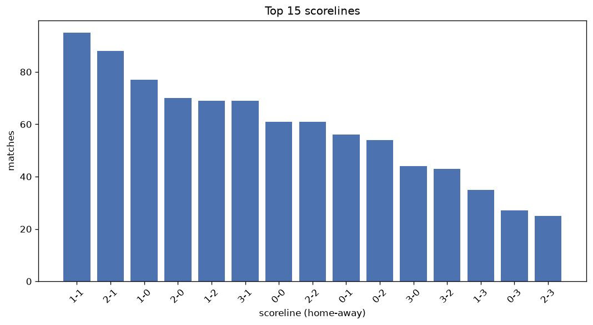
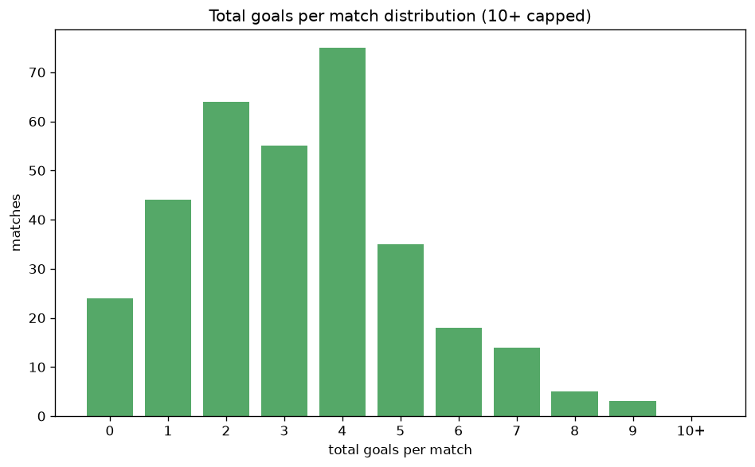

# Scoreline Analysis
- Report: `scoreline_analysis`
- Generated: 2026-10-29T01:56:39+00:00
- Script: `backend/scripts/analyze_scorelines.py` v1.0.0
- League: 3. CFL - Group A (Czech Republic)
- Scope: league `czech3a`

## 1. Scoreline frequency
- Matches analysed: **1087** across **5** seasons.
- Distinct scorelines seen: **47**.

| scoreline | count | pct |
|---|---|---|
| 1-1 | 95 | 8.7% |
| 2-1 | 88 | 8.1% |
| 1-0 | 77 | 7.1% |
| 2-0 | 70 | 6.4% |
| 1-2 | 69 | 6.3% |
| 3-1 | 69 | 6.3% |
| 0-0 | 61 | 5.6% |
| 2-2 | 61 | 5.6% |
| 0-1 | 56 | 5.2% |
| 0-2 | 54 | 5.0% |
| 3-0 | 44 | 4.0% |
| 3-2 | 43 | 4.0% |
| 1-3 | 35 | 3.2% |
| 0-3 | 27 | 2.5% |
| 2-3 | 25 | 2.3% |
| 4-0 | 24 | 2.2% |
| 4-1 | 21 | 1.9% |
| 3-3 | 19 | 1.7% |
| 1-4 | 19 | 1.7% |
| 4-2 | 13 | 1.2% |

## 2. Scoreline frequency per season

### 2022-2023
| scoreline | count | pct |
|---|---|---|
| 3-1 | 23 | 9.6% |
| 2-1 | 19 | 7.9% |
| 2-0 | 19 | 7.9% |
| 1-1 | 19 | 7.9% |
| 1-0 | 19 | 7.9% |

### 2023-2024
| scoreline | count | pct |
|---|---|---|
| 2-1 | 28 | 11.7% |
| 1-1 | 25 | 10.4% |
| 1-2 | 16 | 6.7% |
| 1-0 | 15 | 6.2% |
| 3-1 | 14 | 5.8% |

### 2024-2025
| scoreline | count | pct |
|---|---|---|
| 1-1 | 22 | 9.2% |
| 2-0 | 21 | 8.8% |
| 1-2 | 19 | 7.9% |
| 1-0 | 18 | 7.5% |
| 2-1 | 16 | 6.7% |

### 2025-2026
| scoreline | count | pct |
|---|---|---|
| 1-1 | 22 | 8.1% |
| 1-0 | 22 | 8.1% |
| 2-0 | 19 | 7.0% |
| 3-1 | 18 | 6.6% |
| 0-0 | 17 | 6.2% |

### 2026-2027
| scoreline | count | pct |
|---|---|---|
| 2-2 | 9 | 9.5% |
| 0-0 | 8 | 8.4% |
| 0-2 | 8 | 8.4% |
| 2-1 | 8 | 8.4% |
| 3-0 | 7 | 7.4% |

## 3. Total-goal histogram
_10+ groups all matches with 10 or more total goals._

| total goals | matches | pct |
|---|---|---|
| 0 | 61 | 5.6% |
| 1 | 133 | 12.2% |
| 2 | 219 | 20.1% |
| 3 | 228 | 21.0% |
| 4 | 201 | 18.5% |
| 5 | 125 | 11.5% |
| 6 | 61 | 5.6% |
| 7 | 36 | 3.3% |
| 8 | 12 | 1.1% |
| 9 | 10 | 0.9% |
| 10+ | 1 | 0.1% |

## 4. Extreme scorelines
- Matches with 7+ total goals: **59**

| season | date | scoreline | total goals |
|---|---|---|---|
| 2024-2025 | 2025-06-08 | 9-1 | 10 |
| 2022-2023 | 2022-08-20 | 7-2 | 9 |
| 2023-2024 | 2023-08-13 | 4-5 | 9 |
| 2023-2024 | 2024-06-02 | 5-4 | 9 |
| 2024-2025 | 2024-09-08 | 3-6 | 9 |
| 2024-2025 | 2025-04-20 | 7-2 | 9 |
| 2024-2025 | 2025-05-07 | 9-0 | 9 |
| 2025-2026 | 2026-05-20 | 3-6 | 9 |
| 2026-2027 | 2026-09-05 | 7-2 | 9 |
| 2026-2027 | 2026-09-26 | 6-3 | 9 |
| 2026-2027 | 2026-10-18 | 7-2 | 9 |
| 2022-2023 | 2023-04-29 | 3-5 | 8 |
| 2022-2023 | 2023-04-29 | 4-4 | 8 |
| 2022-2023 | 2023-06-03 | 7-1 | 8 |
| 2023-2024 | 2024-04-20 | 6-2 | 8 |
| 2024-2025 | 2024-10-05 | 4-4 | 8 |
| 2024-2025 | 2025-03-29 | 3-5 | 8 |
| 2025-2026 | 2025-08-08 | 3-5 | 8 |
| 2025-2026 | 2025-10-04 | 5-3 | 8 |
| 2025-2026 | 2026-05-16 | 6-2 | 8 |
| 2025-2026 | 2026-05-20 | 3-5 | 8 |
| 2026-2027 | 2026-09-02 | 3-5 | 8 |
| 2026-2027 | 2026-10-04 | 4-4 | 8 |
| 2022-2023 | 2022-10-22 | 3-4 | 7 |
| 2022-2023 | 2023-03-05 | 5-2 | 7 |
| 2022-2023 | 2023-03-19 | 4-3 | 7 |
| 2022-2023 | 2023-03-31 | 2-5 | 7 |
| 2022-2023 | 2023-05-27 | 3-4 | 7 |
| 2023-2024 | 2023-08-26 | 6-1 | 7 |
| 2023-2024 | 2023-09-10 | 6-1 | 7 |
| 2023-2024 | 2023-09-16 | 2-5 | 7 |
| 2023-2024 | 2023-10-07 | 5-2 | 7 |
| 2023-2024 | 2023-10-08 | 5-2 | 7 |
| 2023-2024 | 2024-03-31 | 7-0 | 7 |
| 2023-2024 | 2024-03-31 | 3-4 | 7 |
| 2023-2024 | 2024-06-08 | 5-2 | 7 |
| 2024-2025 | 2024-08-24 | 2-5 | 7 |
| 2024-2025 | 2024-09-01 | 2-5 | 7 |
| 2024-2025 | 2024-09-06 | 1-6 | 7 |
| 2024-2025 | 2024-09-06 | 3-4 | 7 |
| 2024-2025 | 2024-10-20 | 4-3 | 7 |
| 2024-2025 | 2024-11-23 | 2-5 | 7 |
| 2024-2025 | 2025-04-27 | 6-1 | 7 |
| 2024-2025 | 2025-05-03 | 3-4 | 7 |
| 2025-2026 | 2025-08-08 | 3-4 | 7 |
| 2025-2026 | 2025-08-17 | 4-3 | 7 |
| 2025-2026 | 2025-09-10 | 5-2 | 7 |
| 2025-2026 | 2025-09-27 | 3-4 | 7 |
| 2025-2026 | 2025-09-28 | 5-2 | 7 |
| 2025-2026 | 2025-10-11 | 4-3 | 7 |
| 2025-2026 | 2025-11-08 | 5-2 | 7 |
| 2025-2026 | 2025-11-15 | 2-5 | 7 |
| 2025-2026 | 2026-05-01 | 4-3 | 7 |
| 2025-2026 | 2026-05-24 | 2-5 | 7 |
| 2025-2026 | 2026-05-30 | 5-2 | 7 |
| 2025-2026 | 2026-06-06 | 5-2 | 7 |
| 2026-2027 | 2026-09-12 | 5-2 | 7 |
| 2026-2027 | 2026-09-19 | 7-0 | 7 |
| 2026-2027 | 2026-10-17 | 3-4 | 7 |

## 5. Margin-of-victory distribution (decided matches)
- Decided matches: **848** (draws: **239**)
- Average winning margin: **2.0**

| margin | matches | pct |
|---|---|---|
| 1 | 373 | 44.0% |
| 2 | 255 | 30.1% |
| 3+ | 220 | 25.9% |

## 6. Margin by outcome

### Home wins
- Matches: **504** | avg margin: **2.06** | max margin: **9**
| margin | matches | pct |
|---|---|---|
| 1 | 214 | 42.5% |
| 2 | 153 | 30.4% |
| 3+ | 137 | 27.2% |
- *Full match-by-match list available in `scoreline_analysis.json`.*

### Away wins
- Matches: **344** | avg margin: **1.91** | max margin: **6**
| margin | matches | pct |
|---|---|---|
| 1 | 159 | 46.2% |
| 2 | 102 | 29.7% |
| 3+ | 83 | 24.1% |
- *Full match-by-match list available in `scoreline_analysis.json`.*

## 7. Most common exact score by outcome type
| outcome | matches | most common score | count | pct |
|---|---|---|---|---|
| home | 504 | 2-1 | 88 | 17.5% |
| draw | 239 | 1-1 | 95 | 39.7% |
| away | 344 | 1-2 | 69 | 20.1% |

---
*All statistics are computed from PostgreSQL tables (read-only). Run with `python backend/scripts/analyze_scorelines.py` to regenerate.*

## Charts

