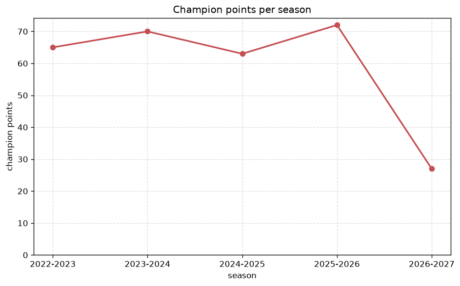
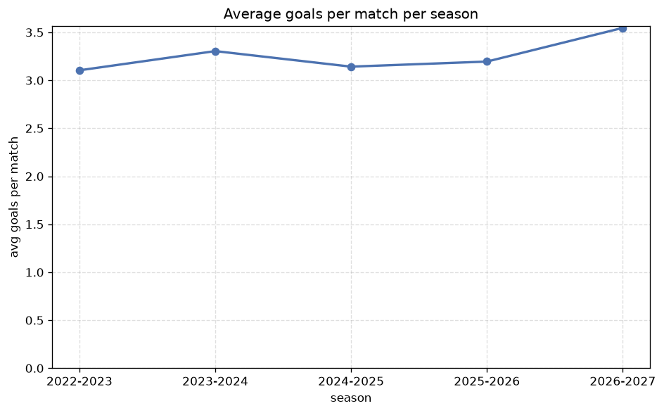

# Season Trends Analysis
- Report: `season_trends`
- Generated: 2026-10-30T03:47:56+00:00
- Script: `backend/scripts/analyze_seasons.py` v1.0.0
- League: 3. CFL - Group A (Czech Republic)
- Scope: league `czech3a`

## 1. Champions per season
| season | champion | pts | runner-up | margin |
|---|---|---|---|---|
| 2022-2023 | Domazlice | 65 | Bohemians 1905 B | 8 pts |
| 2023-2024 | Slavia Prague B | 70 | Domazlice | 6 pts |
| 2024-2025 | Domazlice | 63 | Plzen B | 6 pts |
| 2025-2026 | SK Kladno | 72 | Domazlice | 3 pts |
| 2026-2027 | Kraluv Dvur | 27 | Ceske Budejovice | 1 pts |

## 2. Title-race tightness
- Tight races (margin <= 3 pts): **2** of 5 seasons
- Tightest race: **2026-2027** - Kraluv Dvur beat Ceske Budejovice by **1** pts

| season | margin | tight |
|---|---|---|
| 2022-2023 | 8 pts |  |
| 2023-2024 | 6 pts |  |
| 2024-2025 | 6 pts |  |
| 2025-2026 | 3 pts | yes |
| 2026-2027 | 1 pts | yes |

## 3. Points thresholds
_Position-specific points per season. Key: 1 = champion, 2 = runner-up, 4 = CL line, 6 = Europa, 13 = last safe, 16 = bottom._

| season | pos 1 | pos 2 | pos 4 | pos 6 | pos 13 | pos 16 |
|---|---|---|---|---|---|---|
| 2022-2023 | 65 | 57 | 54 | 40 | 36 | 23 |
| 2023-2024 | 70 | 64 | 45 | 43 | 34 | 26 |
| 2024-2025 | 63 | 57 | 50 | 46 | 30 | 22 |
| 2025-2026 | 72 | 69 | 52 | 48 | 38 | 28 |
| 2026-2027 | 27 | 26 | 23 | 18 | 13 | 3 |

## 4. Relegation battle
| season | safe pos | safe pts | drop pos | drop pts | gap |
|---|---|---|---|---|---|
| 2022-2023 | 13 | 36 | 14 | 35 | 1 pts |
| 2023-2024 | 13 | 34 | 14 | 33 | 1 pts |
| 2024-2025 | 13 | 30 | 14 | 29 | 1 pts |
| 2025-2026 | 13 | 38 | 14 | 34 | 4 pts |
| 2026-2027 | 13 | 13 | 14 | 12 | 1 pts |

## 5. League-level trends
| season | matches | total goals | avg goals | home win | draw | away win | goalless | avg pts/team |
|---|---|---|---|---|---|---|---|---|
| 2022-2023 | 240 | 745 | 3.104 | 50.4% | 20.8% | 28.8% | 6.2% | 41.88 |
| 2023-2024 | 240 | 793 | 3.304 | 48.8% | 22.5% | 28.8% | 4.6% | 41.62 |
| 2024-2025 | 240 | 754 | 3.142 | 42.5% | 20.8% | 36.7% | 4.2% | 39.41 |
| 2025-2026 | 272 | 869 | 3.195 | 45.6% | 21.0% | 33.5% | 6.2% | 44.65 |
| 2026-2027 | 97 | 344 | 3.546 | 41.2% | 29.9% | 28.9% | 8.2% | 16.38 |

## 6. View divergence
- Largest divergence: **2022-2023** (goals view, avg abs position diff = 6.375)

_Avg absolute position difference between classic view and alternative view per season._

| season | classic vs luck | classic vs goals |
|---|---|---|
| 2022-2023 | 3.000 | 6.375 |
| 2023-2024 | 3.500 | 3.875 |
| 2024-2025 | 3.294 | 5.059 |
| 2025-2026 | 3.059 | 4.471 |
| 2026-2027 | 2.375 | 3.625 |

---
*All statistics are computed from PostgreSQL tables (read-only). Run with `python backend/scripts/analyze_seasons.py` to regenerate.*

## Charts

