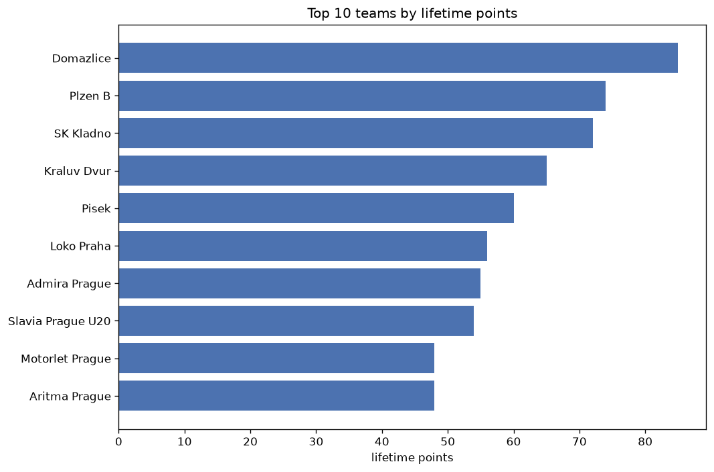
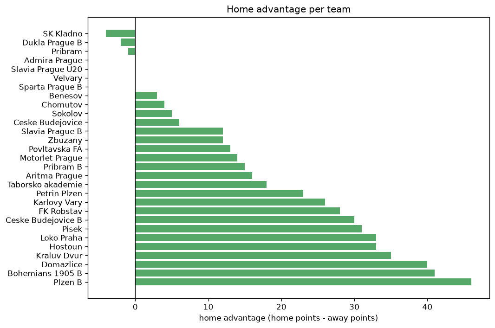

# Team Analysis
- Report: `teams_analysis`
- Generated: 2026-10-30T03:47:54+00:00
- Script: `backend/scripts/analyze_teams.py` v1.0.0
- League: 3. CFL - Group A (Czech Republic)
- Scope: league `czech3a`

- Teams: **29** | Seasons: **5** | Matches: **1089**

## 1. Team standings (lifetime)
| team | seasons | played | W | D | L | pts | GF | GA | GD | avg pts/season | best pos | worst pos | titles |
|---|---|---|---|---|---|---|---|---|---|---|---|---|---|
| Domazlice | 5 | 134 | 86 | 24 | 24 | 282 | 304 | 164 | 140 | 56.4 | 1 | 5 | 2 |
| Plzen B | 5 | 133 | 70 | 30 | 33 | 240 | 278 | 177 | 101 | 48.0 | 2 | 4 | 0 |
| Bohemians 1905 B | 5 | 134 | 55 | 26 | 53 | 191 | 250 | 234 | 16 | 38.2 | 2 | 12 | 0 |
| Admira Prague | 5 | 134 | 54 | 28 | 52 | 190 | 185 | 210 | -25 | 38.0 | 5 | 10 | 0 |
| Loko Praha | 5 | 134 | 52 | 29 | 53 | 185 | 182 | 191 | -9 | 37.0 | 4 | 13 | 0 |
| Motorlet Prague | 5 | 135 | 48 | 38 | 49 | 182 | 191 | 197 | -6 | 36.4 | 3 | 14 | 0 |
| Pisek | 5 | 134 | 48 | 35 | 51 | 179 | 192 | 227 | -35 | 35.8 | 4 | 14 | 0 |
| Dukla Prague B | 5 | 135 | 44 | 38 | 53 | 170 | 216 | 217 | -1 | 34.0 | 6 | 14 | 0 |
| Ceske Budejovice B | 4 | 122 | 45 | 27 | 50 | 162 | 214 | 220 | -6 | 40.5 | 5 | 13 | 0 |
| Hostoun | 4 | 122 | 40 | 29 | 53 | 149 | 144 | 186 | -42 | 37.25 | 6 | 15 | 0 |
| Kraluv Dvur | 4 | 104 | 40 | 17 | 47 | 137 | 169 | 194 | -25 | 34.25 | 1 | 16 | 1 |
| Povltavska FA | 4 | 103 | 34 | 19 | 50 | 121 | 150 | 193 | -43 | 30.25 | 3 | 16 | 0 |
| Taborsko akademie | 3 | 92 | 28 | 16 | 48 | 100 | 120 | 175 | -55 | 33.33 | 7 | 17 | 0 |
| FK Robstav | 3 | 60 | 21 | 15 | 24 | 78 | 103 | 103 | 0 | 26.0 | 7 | 17 | 0 |
| SK Kladno | 1 | 32 | 22 | 6 | 4 | 72 | 84 | 26 | 58 | 72.0 | 1 | 1 | 1 |
| Slavia Prague B | 1 | 30 | 22 | 4 | 4 | 70 | 81 | 27 | 54 | 70.0 | 1 | 1 | 1 |
| Karlovy Vary | 2 | 60 | 18 | 12 | 30 | 66 | 80 | 106 | -26 | 33.0 | 12 | 15 | 0 |
| Slavia Prague U20 | 2 | 44 | 17 | 9 | 18 | 60 | 74 | 66 | 8 | 30.0 | 7 | 8 | 0 |
| Pribram | 1 | 30 | 17 | 6 | 7 | 57 | 58 | 35 | 23 | 57.0 | 3 | 3 | 0 |
| Petrin Plzen | 2 | 62 | 15 | 12 | 35 | 57 | 73 | 125 | -52 | 28.5 | 14 | 16 | 0 |
| Aritma Prague | 2 | 44 | 12 | 18 | 14 | 54 | 55 | 72 | -17 | 27.0 | 9 | 15 | 0 |
| Pribram B | 2 | 44 | 15 | 8 | 21 | 53 | 64 | 77 | -13 | 26.5 | 11 | 11 | 0 |
| Velvary | 1 | 30 | 12 | 6 | 12 | 42 | 54 | 52 | 2 | 42.0 | 8 | 8 | 0 |
| Zbuzany | 1 | 30 | 7 | 7 | 16 | 28 | 41 | 54 | -13 | 28.0 | 15 | 15 | 0 |
| Ceske Budejovice | 1 | 12 | 8 | 2 | 2 | 26 | 39 | 18 | 21 | 26.0 | 2 | 2 | 0 |
| Sokolov | 1 | 30 | 7 | 2 | 21 | 23 | 31 | 63 | -32 | 23.0 | 16 | 16 | 0 |
| Chomutov | 1 | 30 | 5 | 7 | 18 | 22 | 39 | 65 | -26 | 22.0 | 16 | 16 | 0 |
| Sparta Prague B | 1 | 12 | 4 | 6 | 2 | 18 | 19 | 9 | 10 | 18.0 | 6 | 6 | 0 |
| Benesov | 1 | 12 | 3 | 4 | 5 | 13 | 15 | 22 | -7 | 13.0 | 13 | 13 | 0 |

## 2. Home vs away split
| team | home P | H-W | H-D | H-L | H-pts | away P | A-W | A-D | A-L | A-pts | adv |
|---|---|---|---|---|---|---|---|---|---|---|---|
| Plzen B | 66 | 44 | 11 | 11 | 143 | 67 | 26 | 19 | 22 | 97 | 46 |
| Bohemians 1905 B | 66 | 34 | 14 | 18 | 116 | 68 | 21 | 12 | 35 | 75 | 41 |
| Domazlice | 68 | 50 | 11 | 7 | 161 | 66 | 36 | 13 | 17 | 121 | 40 |
| Kraluv Dvur | 53 | 26 | 8 | 19 | 86 | 51 | 14 | 9 | 28 | 51 | 35 |
| Loko Praha | 68 | 30 | 19 | 19 | 109 | 66 | 22 | 10 | 34 | 76 | 33 |
| Hostoun | 61 | 25 | 16 | 20 | 91 | 61 | 15 | 13 | 33 | 58 | 33 |
| Pisek | 66 | 28 | 21 | 17 | 105 | 68 | 20 | 14 | 34 | 74 | 31 |
| Ceske Budejovice B | 61 | 27 | 15 | 19 | 96 | 61 | 18 | 12 | 31 | 66 | 30 |
| FK Robstav | 30 | 16 | 5 | 9 | 53 | 30 | 5 | 10 | 15 | 25 | 28 |
| Karlovy Vary | 30 | 14 | 4 | 12 | 46 | 30 | 4 | 8 | 18 | 20 | 26 |
| Petrin Plzen | 31 | 11 | 7 | 13 | 40 | 31 | 4 | 5 | 22 | 17 | 23 |
| Taborsko akademie | 46 | 18 | 5 | 23 | 59 | 46 | 10 | 11 | 25 | 41 | 18 |
| Aritma Prague | 22 | 9 | 8 | 5 | 35 | 22 | 3 | 10 | 9 | 19 | 16 |
| Pribram B | 21 | 10 | 4 | 7 | 34 | 23 | 5 | 4 | 14 | 19 | 15 |
| Motorlet Prague | 69 | 25 | 23 | 21 | 98 | 66 | 23 | 15 | 28 | 84 | 14 |
| Povltavska FA | 53 | 19 | 10 | 24 | 67 | 50 | 15 | 9 | 26 | 54 | 13 |
| Slavia Prague B | 15 | 13 | 2 | 0 | 41 | 15 | 9 | 2 | 4 | 29 | 12 |
| Zbuzany | 15 | 6 | 2 | 7 | 20 | 15 | 1 | 5 | 9 | 8 | 12 |
| Ceske Budejovice | 6 | 5 | 1 | 0 | 16 | 6 | 3 | 1 | 2 | 10 | 6 |
| Sokolov | 15 | 4 | 2 | 9 | 14 | 15 | 3 | 0 | 12 | 9 | 5 |
| Chomutov | 15 | 4 | 1 | 10 | 13 | 15 | 1 | 6 | 8 | 9 | 4 |
| Benesov | 7 | 2 | 2 | 3 | 8 | 5 | 1 | 2 | 2 | 5 | 3 |
| Admira Prague | 66 | 26 | 17 | 23 | 95 | 68 | 28 | 11 | 29 | 95 | 0 |
| Slavia Prague U20 | 22 | 9 | 3 | 10 | 30 | 22 | 8 | 6 | 8 | 30 | 0 |
| Velvary | 15 | 6 | 3 | 6 | 21 | 15 | 6 | 3 | 6 | 21 | 0 |
| Sparta Prague B | 5 | 3 | 0 | 2 | 9 | 7 | 1 | 6 | 0 | 9 | 0 |
| Pribram | 15 | 8 | 4 | 3 | 28 | 15 | 9 | 2 | 4 | 29 | -1 |
| Dukla Prague B | 66 | 22 | 18 | 26 | 84 | 69 | 22 | 20 | 27 | 86 | -2 |
| SK Kladno | 16 | 10 | 4 | 2 | 34 | 16 | 12 | 2 | 2 | 38 | -4 |

## 3. Top performers
### Best points per game (PPG)
| rank | team | PPG |
|---|---|---|
| 1 | Slavia Prague B | 2.33 |
| 2 | SK Kladno | 2.25 |
| 3 | Ceske Budejovice | 2.17 |
| 4 | Domazlice | 2.10 |
| 5 | Pribram | 1.90 |

### Most goals scored
| rank | team | goals |
|---|---|---|
| 1 | Domazlice | 304 |
| 2 | Plzen B | 278 |
| 3 | Bohemians 1905 B | 250 |
| 4 | Dukla Prague B | 216 |
| 5 | Ceske Budejovice B | 214 |

### Best goal difference
| rank | team | GD |
|---|---|---|
| 1 | Domazlice | 140 |
| 2 | Plzen B | 101 |
| 3 | SK Kladno | 58 |
| 4 | Slavia Prague B | 54 |
| 5 | Pribram | 23 |

### Best defence (goals against per match, standings)
| rank | team | GA/match |
|---|---|---|
| 1 | Sparta Prague B | 0.750 |
| 2 | SK Kladno | 0.812 |
| 3 | Slavia Prague B | 0.900 |
| 4 | Pribram | 1.167 |
| 5 | Domazlice | 1.224 |

## 4. Team consistency
- Teams present in all **5** seasons: **8**

Admira Prague, Bohemians 1905 B, Domazlice, Dukla Prague B, Loko Praha, Motorlet Prague, Pisek, Plzen B

## 5. Head-to-head dominance
- Distinct fixtures: **298** (showing the 15 most frequent)

| fixture | meetings | home wins | draws | away wins | home pct | draw pct | away pct |
|---|---|---|---|---|---|---|---|
| Motorlet Prague vs Dukla Prague B | 10 | 3 | 3 | 4 | 30.0% | 30.0% | 40.0% |
| Domazlice vs Bohemians 1905 B | 9 | 7 | 0 | 2 | 77.8% | 0.0% | 22.2% |
| Bohemians 1905 B vs Dukla Prague B | 9 | 6 | 3 | 0 | 66.7% | 33.3% | 0.0% |
| Loko Praha vs Pisek | 9 | 6 | 2 | 1 | 66.7% | 22.2% | 11.1% |
| Bohemians 1905 B vs Plzen B | 9 | 5 | 1 | 3 | 55.6% | 11.1% | 33.3% |
| Domazlice vs Loko Praha | 9 | 5 | 1 | 3 | 55.6% | 11.1% | 33.3% |
| Domazlice vs Motorlet Prague | 9 | 5 | 2 | 2 | 55.6% | 22.2% | 22.2% |
| Domazlice vs Plzen B | 9 | 5 | 1 | 3 | 55.6% | 11.1% | 33.3% |
| Loko Praha vs Admira Prague | 9 | 5 | 1 | 3 | 55.6% | 11.1% | 33.3% |
| Loko Praha vs Dukla Prague B | 9 | 5 | 2 | 2 | 55.6% | 22.2% | 22.2% |
| Motorlet Prague vs Pisek | 9 | 5 | 2 | 2 | 55.6% | 22.2% | 22.2% |
| Plzen B vs Dukla Prague B | 9 | 5 | 3 | 1 | 55.6% | 33.3% | 11.1% |
| Plzen B vs Pisek | 9 | 5 | 4 | 0 | 55.6% | 44.4% | 0.0% |
| Admira Prague vs Dukla Prague B | 9 | 4 | 4 | 1 | 44.4% | 44.4% | 11.1% |
| Bohemians 1905 B vs Pisek | 9 | 4 | 1 | 4 | 44.4% | 11.1% | 44.4% |

## 6. Position per season (classic view)
_Cells show final position; '-' when the team was absent from that season._

| team | 2022-2023 | 2023-2024 | 2024-2025 | 2025-2026 | 2026-2027 |
|---|---|---|---|---|---|
| Domazlice | 1 | 2 | 1 | 2 | 5 |
| Plzen B | 3 | 4 | 2 | 3 | 4 |
| Bohemians 1905 B | 2 | 12 | 5 | 12 | 12 |
| Admira Prague | 5 | 10 | 10 | 6 | 9 |
| Loko Praha | 4 | 8 | 13 | 10 | 7 |
| Motorlet Prague | 6 | 13 | 4 | 14 | 3 |
| Pisek | 11 | 14 | 9 | 4 | 10 |
| Dukla Prague B | 9 | 11 | 6 | 13 | 14 |
| Ceske Budejovice B | 13 | 5 | 11 | 8 | - |
| Hostoun | 10 | 6 | 12 | 15 | - |
| Kraluv Dvur | 14 | 16 | - | 5 | 1 |
| Povltavska FA | 8 | 3 | 15 | - | 16 |
| Taborsko akademie | - | 7 | 7 | 17 | - |
| FK Robstav | 7 | 9 | 17 | - | - |
| SK Kladno | - | - | - | 1 | - |
| Slavia Prague B | - | 1 | - | - | - |
| Karlovy Vary | 12 | 15 | - | - | - |
| Slavia Prague U20 | - | - | - | 7 | 8 |
| Pribram | - | - | 3 | - | - |
| Petrin Plzen | - | - | 14 | 16 | - |
| Aritma Prague | - | - | - | 9 | 15 |
| Pribram B | - | - | - | 11 | 11 |
| Velvary | - | - | 8 | - | - |
| Zbuzany | 15 | - | - | - | - |
| Ceske Budejovice | - | - | - | - | 2 |
| Sokolov | 16 | - | - | - | - |
| Chomutov | - | - | 16 | - | - |
| Sparta Prague B | - | - | - | - | 6 |
| Benesov | - | - | - | - | 13 |

---
*All statistics are computed from PostgreSQL tables (read-only). Run with `python backend/scripts/analyze_teams.py` to regenerate.*

## Charts

