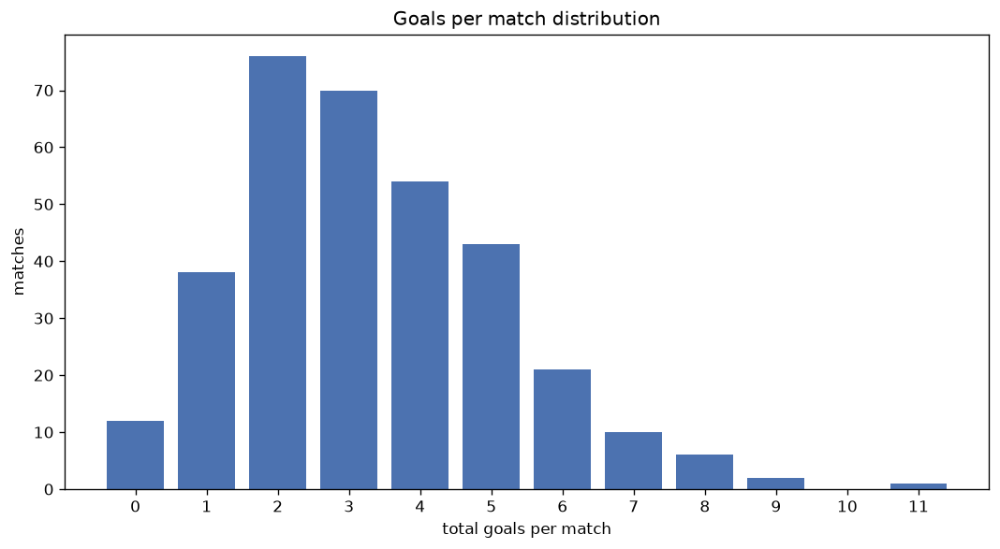
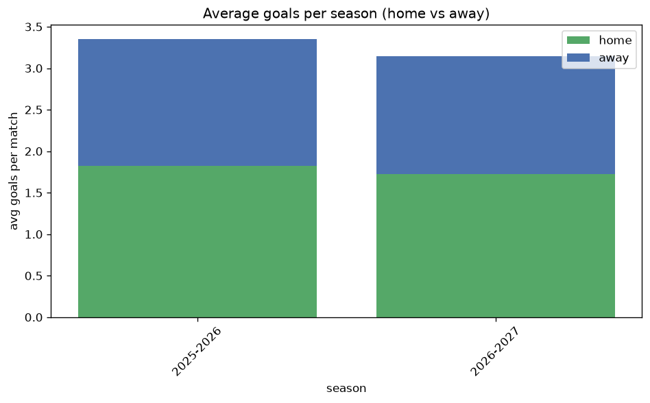

# Goal Analysis
- Report: `goals_analysis`
- Generated: 2026-10-29T01:56:51+00:00
- Script: `backend/scripts/analyze_goals.py` v1.0.0
- League: 3. CFL - Group B (Czech Republic)
- Scope: league `czech3b`

## 1. Goals per match distribution
| goals | matches | pct |
|---|---|---|
| 0 | 74 | 5.2% |
| 1 | 202 | 14.2% |
| 2 | 306 | 21.5% |
| 3 | 300 | 21.1% |
| 4 | 240 | 16.9% |
| 5 | 161 | 11.3% |
| 6 | 86 | 6.1% |
| 7 | 35 | 2.5% |
| 8 | 9 | 0.6% |
| 9 | 5 | 0.4% |
| 10 | 2 | 0.1% |
| 11 | 1 | 0.1% |

## 2. Goals per match per season
| season | matches | total goals | avg home | avg away | avg total |
|---|---|---|---|---|---|
| 2020-2021 | 63 | 213 | 2.079 | 1.302 | 3.381 |
| 2021-2022 | 240 | 732 | 1.758 | 1.292 | 3.05 |
| 2022-2023 | 240 | 713 | 1.646 | 1.325 | 2.971 |
| 2023-2024 | 240 | 720 | 1.708 | 1.292 | 3.0 |
| 2024-2025 | 272 | 796 | 1.71 | 1.217 | 2.926 |
| 2025-2026 | 272 | 912 | 1.82 | 1.533 | 3.353 |
| 2026-2027 | 94 | 302 | 1.798 | 1.415 | 3.213 |

## 3. Home vs away goal share
- Home goals: **2487** (56.7%)
- Away goals: **1901** (43.3%)
- Home/away ratio: **1.308**

| season | home goals | away goals | total | home pct | away pct |
|---|---|---|---|---|---|
| 2020-2021 | 131 | 82 | 213 | 61.5% | 38.5% |
| 2021-2022 | 422 | 310 | 732 | 57.7% | 42.3% |
| 2022-2023 | 395 | 318 | 713 | 55.4% | 44.6% |
| 2023-2024 | 410 | 310 | 720 | 56.9% | 43.1% |
| 2024-2025 | 465 | 331 | 796 | 58.4% | 41.6% |
| 2025-2026 | 495 | 417 | 912 | 54.3% | 45.7% |
| 2026-2027 | 169 | 133 | 302 | 56.0% | 44.0% |

## 4. BTTS (Both Teams To Score)
- Overall: **773** of `1421` (54.4%)

| season | matches | BTTS | pct |
|---|---|---|---|
| 2020-2021 | 63 | 35 | 55.6% |
| 2021-2022 | 240 | 133 | 55.4% |
| 2022-2023 | 240 | 130 | 54.2% |
| 2023-2024 | 240 | 136 | 56.7% |
| 2024-2025 | 272 | 129 | 47.4% |
| 2025-2026 | 272 | 158 | 58.1% |
| 2026-2027 | 94 | 52 | 55.3% |

## 5. Clean sheets
- Home clean sheets: **436** (30.7%)
- Away clean sheets: **286** (20.1%)
- Total clean sheets recorded: **722**
- Matches with at least one clean sheet: **648** (45.6%)
- Both teams kept clean sheets (0-0): **74**

| season | matches | home CS | away CS | total CS | matches w/ CS |
|---|---|---|---|---|---|
| 2020-2021 | 63 | 16 | 12 | 28 | 28 (44.4%) |
| 2021-2022 | 240 | 74 | 45 | 119 | 107 (44.6%) |
| 2022-2023 | 240 | 68 | 57 | 125 | 110 (45.8%) |
| 2023-2024 | 240 | 77 | 41 | 118 | 104 (43.3%) |
| 2024-2025 | 272 | 103 | 59 | 162 | 143 (52.6%) |
| 2025-2026 | 272 | 73 | 48 | 121 | 114 (41.9%) |
| 2026-2027 | 94 | 25 | 24 | 49 | 42 (44.7%) |

## 6. Scoring intensity
- First-half goals: **2032** (46.7%)
- Second-half goals: **2315** (53.3%)
- Avg first-half goals per match: **1.44**
- Avg second-half goals per match: **1.641**
- Second-half-only scoring (HT 0-0, FT goals >= 1): **251** (17.7%)
- *10 match(es) excluded (no HT score recorded).*

| season | matches | 1st half | 2nd half | 1st half pct | 2nd half pct |
|---|---|---|---|---|---|
| 2020-2021 | 63 | 83 | 96 | 46.4% | 53.6% |
| 2021-2022 | 240 | 340 | 392 | 46.4% | 53.6% |
| 2022-2023 | 240 | 324 | 389 | 45.4% | 54.6% |
| 2023-2024 | 240 | 355 | 365 | 49.3% | 50.7% |
| 2024-2025 | 272 | 365 | 424 | 46.3% | 53.7% |
| 2025-2026 | 272 | 434 | 478 | 47.6% | 52.4% |
| 2026-2027 | 94 | 131 | 171 | 43.4% | 56.6% |

## 7. First-goal timing
- Matches with first-goal time recorded: `1344` of `1421` (94.6%)
- Goalless matches: `77`
- Min `1` | Max `93` | Mean `27.45` | Median (p50) `21.0`

| bucket | count | % of matches | % of scoring matches |
|---|---|---|---|
| 1-15 | 484 | 34.1% | 36.0% |
| 16-30 | 370 | 26.0% | 27.5% |
| 31-45 | 228 | 16.0% | 17.0% |
| 46-60 | 143 | 10.1% | 10.6% |
| 61-75 | 63 | 4.4% | 4.7% |
| 76-90 | 48 | 3.4% | 3.6% |
| 91-120 | 8 | 0.6% | 0.6% |

---
*All statistics are computed from PostgreSQL tables (read-only). Run with `python backend/scripts/analyze_goals.py` to regenerate.*

## Charts

