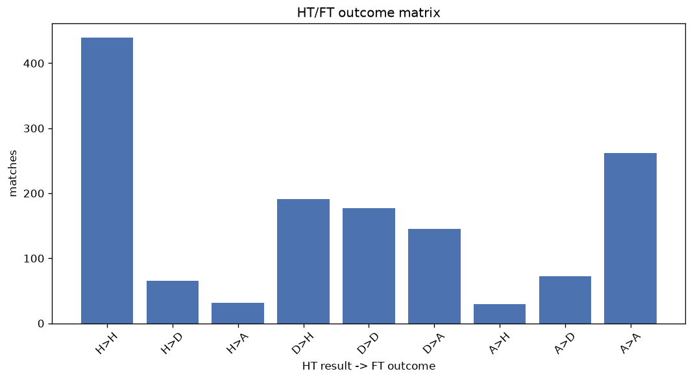
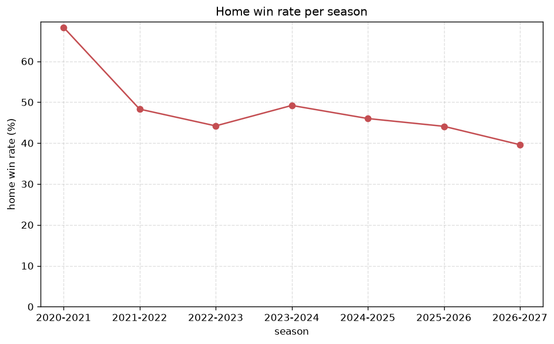

# Match Analysis
- Report: `matches_analysis`
- Generated: 2026-10-30T03:48:08+00:00
- Script: `backend/scripts/analyze_matches.py` v1.0.0
- League: 3. CFL - Group B (Czech Republic)
- Scope: league `czech3b`

## 1. Overall summary
| metric | value |
|---|---|
| Matches | 1423 |
| Home wins | 666 (46.8%) |
| Draws | 314 (22.1%) |
| Away wins | 443 (31.1%) |
| Total goals | 4392 |
| Average goals per match | 3.086 |
| Goalless matches | 75 (5.3%) |

## 2. Per-season breakdown
| season | matches | home wins | draws | away wins | total goals | avg goals | goalless |
|---|---|---|---|---|---|---|---|
| 2020-2021 | 63 | 43 (68.3%) | 0 (0.0%) | 20 (31.7%) | 213 | 3.381 | 0 (0.0%) |
| 2021-2022 | 240 | 116 (48.3%) | 50 (20.8%) | 74 (30.8%) | 732 | 3.05 | 12 (5.0%) |
| 2022-2023 | 240 | 106 (44.2%) | 58 (24.2%) | 76 (31.7%) | 713 | 2.971 | 15 (6.2%) |
| 2023-2024 | 240 | 118 (49.2%) | 56 (23.3%) | 66 (27.5%) | 720 | 3.0 | 14 (5.8%) |
| 2024-2025 | 272 | 125 (46.0%) | 66 (24.3%) | 81 (29.8%) | 796 | 2.926 | 19 (7.0%) |
| 2025-2026 | 272 | 120 (44.1%) | 60 (22.1%) | 92 (33.8%) | 912 | 3.353 | 7 (2.6%) |
| 2026-2027 | 96 | 38 (39.6%) | 24 (25.0%) | 34 (35.4%) | 306 | 3.188 | 8 (8.3%) |

## 3. HT/FT outcome matrix
| HT result \ FT result | Home | Draw | Away | total |
|---|---|---|---|---|
| HT home lead | 439 (81.9%) | 65 (12.1%) | 32 (6.0%) | 536 |
| HT draw | 191 (37.2%) | 177 (34.5%) | 145 (28.3%) | 513 |
| HT away lead | 30 (8.2%) | 72 (19.8%) | 262 (72.0%) | 364 |
- *10 match(es) excluded (no HT score recorded).*

## 4. Comeback matches
- Home comebacks (trailing at HT, won at FT): **30** (2.1%)
- Away comebacks (trailing at HT, won at FT): **32** (2.2%)

### Home comebacks
| season | home | away | HT | FT |
|---|---|---|---|---|
| 2020-2021 | Jablonec B | Mlada Boleslav B | 0-1 | 2-1 |
| 2021-2022 | Zapy | Hradec Kralove B | 1-2 | 3-2 |
| 2021-2022 | Bohemians 1905 B | Teplice B | 0-1 | 4-2 |
| 2021-2022 | Prepere | Usti nad Orlici | 1-2 | 4-2 |
| 2021-2022 | Prepere | Jablonec B | 0-1 | 2-1 |
| 2021-2022 | Jablonec B | Chlumec nad Cidlinou | 3-4 | 6-4 |
| 2021-2022 | Zapy | Velvary | 1-2 | 3-2 |
| 2021-2022 | Chlumec nad Cidlinou | Hradec Kralove B | 0-1 | 3-1 |
| 2022-2023 | Zizkov | Benesov | 0-1 | 2-1 |
| 2022-2023 | Banik Most-Sous | Velvary | 0-1 | 2-1 |
| 2022-2023 | Prepere | Benesov | 0-1 | 2-1 |
| 2022-2023 | Kolin | Prepere | 0-1 | 2-1 |
| 2022-2023 | Velvary | Prepere | 0-1 | 2-1 |
| 2022-2023 | Zivanice | Pardubice B | 0-2 | 3-2 |
| 2023-2024 | Jablonec B | Zivanice | 0-1 | 2-1 |
| 2023-2024 | Hradec Kralove B | Zivanice | 0-1 | 3-2 |
| 2023-2024 | FK Ceska Lipa | Hradec Kralove B | 1-2 | 6-3 |
| 2023-2024 | Brozany | Kolin | 1-2 | 4-2 |
| 2023-2024 | Chlumec nad Cidlinou | FK Ceska Lipa | 0-2 | 3-2 |
| 2024-2025 | Hradec Kralove B | Liberec B | 1-2 | 3-2 |
| 2024-2025 | Hradec Kralove B | FK Ceska Lipa | 0-1 | 2-1 |
| 2024-2025 | Usti nad Labem | Pardubice B | 0-2 | 3-2 |
| 2024-2025 | Kolin | Jablonec B | 0-1 | 2-1 |
| 2024-2025 | Benatky n. Jiz. | Hradec Kralove B | 0-1 | 3-2 |
| 2024-2025 | Brozany | Liberec B | 2-4 | 5-4 |
| 2025-2026 | Zapy | FK Ceska Lipa | 1-2 | 3-2 |
| 2025-2026 | Hradec Kralove B | Varnsdorf | 1-2 | 3-2 |
| 2025-2026 | Hradec Kralove B | Usti nad Orlici | 0-1 | 3-1 |
| 2025-2026 | Zapy | Kolin | 0-1 | 2-1 |
| 2026-2027 | Varnsdorf | Brozany | 0-2 | 3-2 |

### Away comebacks
| season | home | away | HT | FT |
|---|---|---|---|---|
| 2020-2021 | Liberec B | Mlada Boleslav B | 2-1 | 3-4 |
| 2021-2022 | Hradec Kralove B | Brozany | 2-1 | 2-3 |
| 2021-2022 | Chlumec nad Cidlinou | Prepere | 2-1 | 2-3 |
| 2021-2022 | Bohemians 1905 B | Dukla Prague B | 1-0 | 2-3 |
| 2021-2022 | Chlumec nad Cidlinou | Liberec B | 2-1 | 2-3 |
| 2021-2022 | Liberec B | Teplice B | 3-2 | 3-4 |
| 2021-2022 | Mlada Boleslav B | Jablonec B | 1-0 | 1-2 |
| 2021-2022 | Jablonec B | Prepere | 1-0 | 1-3 |
| 2022-2023 | Banik Most-Sous | Usti nad Labem | 1-0 | 1-3 |
| 2022-2023 | Pardubice B | Velvary | 2-1 | 2-3 |
| 2022-2023 | Zivanice | Usti nad Labem | 1-0 | 1-2 |
| 2022-2023 | Mlada Boleslav B | Velvary | 1-0 | 1-2 |
| 2022-2023 | Benesov | Hradec Kralove B | 1-0 | 2-4 |
| 2022-2023 | Brozany | Hradec Kralove B | 1-0 | 1-3 |
| 2023-2024 | Prepere | Liberec B | 1-0 | 2-3 |
| 2023-2024 | Hradec Kralove B | Pardubice B | 2-1 | 2-4 |
| 2023-2024 | Teplice B | Usti nad Labem | 2-1 | 2-3 |
| 2023-2024 | Prepere | Zivanice | 1-0 | 1-2 |
| 2023-2024 | Banik Most-Sous | Prepere | 1-0 | 1-2 |
| 2024-2025 | Pardubice B | Hradec Kralove B | 1-0 | 1-2 |
| 2024-2025 | Chlumec nad Cidlinou | Teplice B | 2-1 | 3-4 |
| 2024-2025 | Mlada Boleslav B | Jablonec B | 1-0 | 1-2 |
| 2024-2025 | Chlumec nad Cidlinou | Liberec B | 2-1 | 2-4 |
| 2024-2025 | Pardubice B | SK Kladno | 1-0 | 2-3 |
| 2025-2026 | Liberec B | Jablonec B | 1-0 | 1-3 |
| 2025-2026 | Benatky n. Jiz. | Banik Most-Sous | 1-0 | 1-2 |
| 2025-2026 | Kolin | Zapy | 2-0 | 2-3 |
| 2025-2026 | Liberec B | Banik Most-Sous | 1-0 | 1-2 |
| 2025-2026 | Varnsdorf | Jablonec B | 1-0 | 1-2 |
| 2025-2026 | Usti nad Orlici | Jablonec B | 1-0 | 1-3 |
| 2025-2026 | Velke Hamry | FK Ceska Lipa | 1-0 | 1-2 |
| 2025-2026 | Jablonec B | FK Ceska Lipa | 1-0 | 1-3 |

## 5. HT lead conversion
| HT state | matches | converted to win | held as draw | collapsed to loss |
|---|---|---|---|---|
| Home lead | 536 | 439 (81.9%) | 65 (12.1%) | 32 (6.0%) |
| Away lead | 364 | 262 (72.0%) | 72 (19.8%) | 30 (8.2%) |

### Matches level at half-time
| FT result | count | pct |
|---|---|---|
| Home win | 191 | 37.2% |
| Draw | 177 | 34.5% |
| Away win | 145 | 28.3% |
- *10 match(es) excluded (no HT score recorded).*

## 6. First-goal timing
- Matches with a first-goal time recorded: `1345` of `1423` (94.5%)

Outcome distribution by first-goal timing bucket:
| bucket | matches | % of matches | home | draw | away |
|---|---|---|---|---|---|
| 1-15 | 484 | 34.0% | 241 (49.8%) | 88 (18.2%) | 155 (32.0%) |
| 16-30 | 370 | 26.0% | 188 (50.8%) | 62 (16.8%) | 120 (32.4%) |
| 31-45 | 228 | 16.0% | 110 (48.2%) | 51 (22.4%) | 67 (29.4%) |
| 46-60 | 144 | 10.1% | 62 (43.1%) | 22 (15.3%) | 60 (41.7%) |
| 61-75 | 63 | 4.4% | 32 (50.8%) | 13 (20.6%) | 18 (28.6%) |
| 76-90 | 48 | 3.4% | 25 (52.1%) | 3 (6.2%) | 20 (41.7%) |
| 91-120 | 8 | 0.6% | 7 (87.5%) | 0 (0.0%) | 1 (12.5%) |

## 7. Goalless matches
- Overall: **75** of `1423` (5.3%)

| season | matches | goalless | pct |
|---|---|---|---|
| 2020-2021 | 63 | 0 | 0.0% |
| 2021-2022 | 240 | 12 | 5.0% |
| 2022-2023 | 240 | 15 | 6.2% |
| 2023-2024 | 240 | 14 | 5.8% |
| 2024-2025 | 272 | 19 | 7.0% |
| 2025-2026 | 272 | 7 | 2.6% |
| 2026-2027 | 96 | 8 | 8.3% |

---
*All statistics are computed from PostgreSQL tables (read-only). Run with `python backend/scripts/analyze_matches.py` to regenerate.*

## Charts

