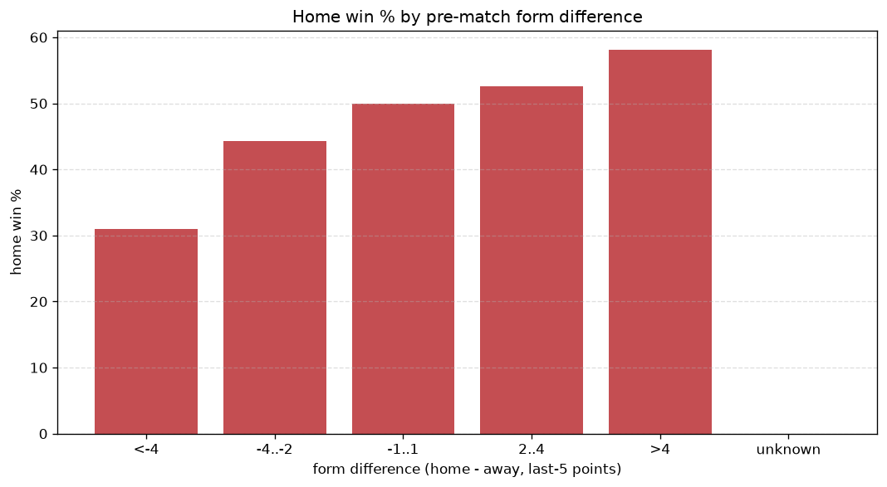
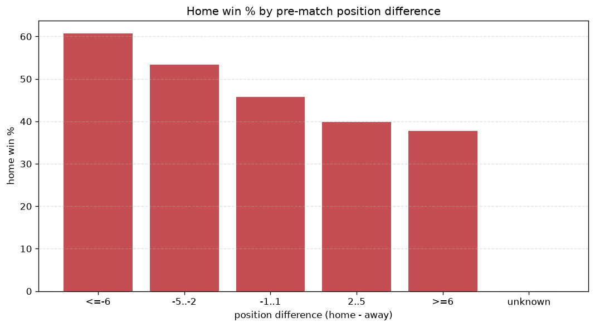

# Relationships Analysis
- Report: `relationships`
- Generated: 2026-10-27T01:44:29+00:00
- Script: `backend/scripts/analyze_relationships.py` v1.0.0
- League: 3. CFL - Group B (Czech Republic)
- Scope: league `czech3b`

- Matches analysed: **1327** (23 leakage-safe pre-match features).

## 1. Correlation matrix
_Pearson correlation of each pre-match feature with observed goals; sorted by |corr(total goals)|._

| feature | corr(home) | corr(away) | corr(total) |
|---|---|---|---|
| home_team_goals_conceded_last_5 | -0.063 | 0.123 | 0.040 |
| home_team_points_last_5 | 0.062 | -0.118 | -0.038 |
| home_team_home_goals_avg | 0.086 | -0.045 | 0.034 |
| away_team_away_win_rate | -0.049 | 0.099 | 0.034 |
| away_team_away_goals_avg | -0.028 | 0.070 | 0.029 |
| home_rest_days | -0.011 | -0.024 | -0.026 |
| points_difference | 0.188 | -0.169 | 0.025 |
| home_team_goals_scored_last_5 | 0.080 | -0.052 | 0.024 |
| home_team_wins_last_5 | 0.080 | -0.118 | -0.024 |
| position_difference | -0.168 | 0.148 | -0.024 |
| away_team_wins_last_5 | -0.095 | 0.073 | -0.022 |
| away_position_before_match | 0.137 | -0.117 | 0.021 |
| away_team_points_last_5 | -0.094 | 0.074 | -0.020 |
| home_team_home_win_rate | 0.101 | -0.082 | 0.019 |
| away_rest_days | -0.004 | -0.020 | -0.018 |
| home_points_before_match | 0.070 | -0.060 | 0.011 |
| home_position_before_match | -0.097 | 0.089 | -0.011 |
| rest_days_difference | -0.010 | -0.004 | -0.011 |
| away_points_before_match | -0.073 | 0.069 | -0.007 |
| away_team_away_conceded_avg | 0.080 | -0.079 | 0.005 |
| away_team_goals_conceded_last_5 | 0.065 | -0.075 | -0.004 |
| home_team_home_conceded_avg | -0.077 | 0.080 | -0.002 |
| away_team_goals_scored_last_5 | -0.070 | 0.076 | 0.000 |

## 2. Form vs outcome
_Home win/draw/away % per bucket of `home_team_points_last_5 - away_team_points_last_5`._

| bucket | matches | home | draw | away | home % | draw % | away % |
|---|---|---|---|---|---|---|---|
| <-4 | 210 | 65 | 46 | 99 | 31.0% | 21.9% | 47.1% |
| -4..-2 | 282 | 125 | 67 | 90 | 44.3% | 23.8% | 31.9% |
| -1..1 | 389 | 194 | 78 | 117 | 49.9% | 20.1% | 30.1% |
| 2..4 | 274 | 144 | 68 | 62 | 52.6% | 24.8% | 22.6% |
| >4 | 172 | 100 | 31 | 41 | 58.1% | 18.0% | 23.8% |
| unknown | 0 | 0 | 0 | 0 | - | - | - |

## 3. Position vs outcome
_Home win/draw/away % per bucket of `position_difference` (home position - away position; negative favours the home team)._

| bucket | matches | home | draw | away | home % | draw % | away % |
|---|---|---|---|---|---|---|---|
| <=-6 | 272 | 165 | 56 | 51 | 60.7% | 20.6% | 18.8% |
| -5..-2 | 264 | 141 | 58 | 65 | 53.4% | 22.0% | 24.6% |
| -1..1 | 219 | 100 | 52 | 67 | 45.7% | 23.7% | 30.6% |
| 2..5 | 289 | 115 | 63 | 111 | 39.8% | 21.8% | 38.4% |
| >=6 | 283 | 107 | 61 | 115 | 37.8% | 21.6% | 40.6% |
| unknown | 0 | 0 | 0 | 0 | - | - | - |

## 4. Rest advantage
_Home win/draw/away % per bucket of `rest_days_difference` (home rest - away rest). Matches with unknown rest are bucketed separately._

| bucket | matches | home | draw | away | home % | draw % | away % |
|---|---|---|---|---|---|---|---|
| <-1 | 112 | 50 | 31 | 31 | 44.6% | 27.7% | 27.7% |
| -1..0 | 285 | 134 | 71 | 80 | 47.0% | 24.9% | 28.1% |
| 0 | 461 | 223 | 96 | 142 | 48.4% | 20.8% | 30.8% |
| 1..2 | 310 | 148 | 61 | 101 | 47.7% | 19.7% | 32.6% |
| >2 | 106 | 54 | 20 | 32 | 50.9% | 18.9% | 30.2% |
| unknown | 53 | 19 | 11 | 23 | 35.8% | 20.8% | 43.4% |
- *53 match(es) had unknown rest difference (missing rest data on at least one side).*

## 5. Home team quality
_Home win rate by `home_team_home_win_rate` tier (split at 0.5)._

- `< 0.5` tier: **42.9%** home win (332/773)
- `>= 0.5` tier: **53.4%** home win (296/554)
- Home-win gap (>= split minus < split): **+10.5 pp**

| tier | label | matches | home | draw | away | home % |
|---|---|---|---|---|---|---|
| low | < 0.5 | 773 | 332 | 178 | 263 | 42.9% |
| high | >= 0.5 | 554 | 296 | 112 | 146 | 53.4% |

## 6. Feature averages by result
_Mean feature value per outcome; `range` is home-minus-away spread of the group means._

| feature | home mean | draw mean | away mean | range |
|---|---|---|---|---|
| points_difference | 2.193 | -0.369 | -3.846 | 6.039 |
| home_points_before_match | 21.349 | 19.341 | 17.711 | 3.637 |
| position_difference | -1.065 | 0.283 | 2.044 | 3.109 |
| away_points_before_match | 19.156 | 19.710 | 21.557 | 2.401 |
| away_position_before_match | 9.424 | 9.000 | 7.643 | 1.781 |
| home_position_before_match | 8.358 | 9.283 | 9.687 | 1.329 |
| away_rest_days | 9.972 | 11.104 | 9.982 | 1.132 |
| away_team_goals_conceded_last_5 | 6.987 | 6.762 | 5.985 | 1.002 |
| home_team_points_last_5 | 6.529 | 5.697 | 5.557 | 0.971 |
| away_team_points_last_5 | 5.981 | 6.090 | 6.912 | 0.931 |
| home_team_goals_conceded_last_5 | 6.497 | 7.210 | 7.333 | 0.836 |
| away_team_goals_scored_last_5 | 6.658 | 6.534 | 7.323 | 0.788 |
| home_team_goals_scored_last_5 | 7.054 | 6.483 | 6.298 | 0.756 |
| rest_days_difference | -0.164 | -0.738 | -0.197 | 0.574 |
| home_rest_days | 9.810 | 10.354 | 9.796 | 0.558 |
| home_team_wins_last_5 | 1.865 | 1.531 | 1.516 | 0.349 |
| away_team_wins_last_5 | 1.653 | 1.693 | 1.995 | 0.342 |
| away_team_away_conceded_avg | 1.690 | 1.608 | 1.482 | 0.208 |
| home_team_home_goals_avg | 1.693 | 1.565 | 1.519 | 0.174 |
| home_team_home_conceded_avg | 1.170 | 1.335 | 1.319 | 0.165 |
| away_team_away_goals_avg | 1.232 | 1.199 | 1.341 | 0.142 |
| home_team_home_win_rate | 0.451 | 0.394 | 0.362 | 0.088 |
| away_team_away_win_rate | 0.282 | 0.296 | 0.339 | 0.056 |

---
*All features are leakage-safe pre-match values built by `ml.features.build_features.build_rows` from strictly prior matches. Run with `python backend/scripts/analyze_relationships.py` to regenerate.*

## Charts

