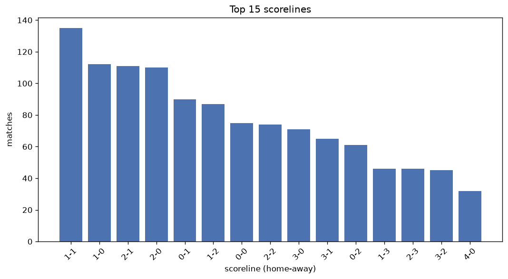
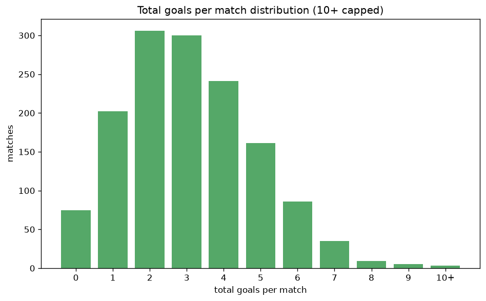

# Scoreline Analysis
- Report: `scoreline_analysis`
- Generated: 2026-10-30T03:48:15+00:00
- Script: `backend/scripts/analyze_scorelines.py` v1.0.0
- League: 3. CFL - Group B (Czech Republic)
- Scope: league `czech3b`

## 1. Scoreline frequency
- Matches analysed: **1423** across **7** seasons.
- Distinct scorelines seen: **48**.

| scoreline | count | pct |
|---|---|---|
| 1-1 | 135 | 9.5% |
| 1-0 | 112 | 7.9% |
| 2-1 | 111 | 7.8% |
| 2-0 | 110 | 7.7% |
| 0-1 | 90 | 6.3% |
| 1-2 | 87 | 6.1% |
| 0-0 | 75 | 5.3% |
| 2-2 | 74 | 5.2% |
| 3-0 | 71 | 5.0% |
| 3-1 | 65 | 4.6% |
| 0-2 | 61 | 4.3% |
| 1-3 | 46 | 3.2% |
| 2-3 | 46 | 3.2% |
| 3-2 | 45 | 3.2% |
| 4-0 | 32 | 2.2% |
| 4-1 | 31 | 2.2% |
| 0-3 | 31 | 2.2% |
| 3-3 | 27 | 1.9% |
| 0-4 | 24 | 1.7% |
| 5-0 | 22 | 1.5% |

## 2. Scoreline frequency per season

### 2020-2021
| scoreline | count | pct |
|---|---|---|
| 0-1 | 8 | 12.7% |
| 3-1 | 8 | 12.7% |
| 2-0 | 6 | 9.5% |
| 2-1 | 6 | 9.5% |
| 1-0 | 5 | 7.9% |

### 2021-2022
| scoreline | count | pct |
|---|---|---|
| 1-1 | 25 | 10.4% |
| 2-0 | 22 | 9.2% |
| 1-0 | 20 | 8.3% |
| 2-1 | 20 | 8.3% |
| 0-1 | 19 | 7.9% |

### 2022-2023
| scoreline | count | pct |
|---|---|---|
| 2-1 | 22 | 9.2% |
| 1-1 | 20 | 8.3% |
| 2-2 | 20 | 8.3% |
| 1-0 | 18 | 7.5% |
| 1-2 | 18 | 7.5% |

### 2023-2024
| scoreline | count | pct |
|---|---|---|
| 1-1 | 27 | 11.2% |
| 2-1 | 25 | 10.4% |
| 1-0 | 22 | 9.2% |
| 2-0 | 19 | 7.9% |
| 3-0 | 16 | 6.7% |

### 2024-2025
| scoreline | count | pct |
|---|---|---|
| 1-1 | 24 | 8.8% |
| 2-0 | 24 | 8.8% |
| 1-0 | 24 | 8.8% |
| 0-1 | 19 | 7.0% |
| 0-0 | 19 | 7.0% |

### 2025-2026
| scoreline | count | pct |
|---|---|---|
| 1-1 | 31 | 11.4% |
| 2-0 | 20 | 7.4% |
| 1-2 | 18 | 6.6% |
| 1-0 | 17 | 6.2% |
| 2-1 | 16 | 5.9% |

### 2026-2027
| scoreline | count | pct |
|---|---|---|
| 1-2 | 8 | 8.3% |
| 0-0 | 8 | 8.3% |
| 1-1 | 8 | 8.3% |
| 2-1 | 7 | 7.3% |
| 1-0 | 6 | 6.2% |

## 3. Total-goal histogram
_10+ groups all matches with 10 or more total goals._

| total goals | matches | pct |
|---|---|---|
| 0 | 75 | 5.3% |
| 1 | 202 | 14.2% |
| 2 | 306 | 21.5% |
| 3 | 300 | 21.1% |
| 4 | 241 | 16.9% |
| 5 | 161 | 11.3% |
| 6 | 86 | 6.0% |
| 7 | 35 | 2.5% |
| 8 | 9 | 0.6% |
| 9 | 5 | 0.4% |
| 10+ | 3 | 0.2% |

## 4. Extreme scorelines
- Matches with 7+ total goals: **52**

| season | date | scoreline | total goals |
|---|---|---|---|
| 2025-2026 | 2026-05-06 | 2-9 | 11 |
| 2021-2022 | 2022-03-12 | 6-4 | 10 |
| 2024-2025 | 2024-08-10 | 7-3 | 10 |
| 2021-2022 | 2022-05-22 | 3-6 | 9 |
| 2023-2024 | 2023-10-28 | 6-3 | 9 |
| 2024-2025 | 2025-05-11 | 5-4 | 9 |
| 2025-2026 | 2025-11-08 | 3-6 | 9 |
| 2025-2026 | 2026-05-03 | 8-1 | 9 |
| 2021-2022 | 2021-09-04 | 2-6 | 8 |
| 2021-2022 | 2022-05-14 | 5-3 | 8 |
| 2022-2023 | 2023-05-07 | 4-4 | 8 |
| 2025-2026 | 2025-10-04 | 3-5 | 8 |
| 2025-2026 | 2025-11-16 | 2-6 | 8 |
| 2025-2026 | 2025-11-22 | 1-7 | 8 |
| 2025-2026 | 2026-04-11 | 5-3 | 8 |
| 2025-2026 | 2026-04-18 | 4-4 | 8 |
| 2026-2027 | 2026-09-12 | 4-4 | 8 |
| 2020-2021 | 2020-08-29 | 5-2 | 7 |
| 2020-2021 | 2020-09-12 | 2-5 | 7 |
| 2020-2021 | 2020-09-13 | 1-6 | 7 |
| 2020-2021 | 2020-09-18 | 3-4 | 7 |
| 2020-2021 | 2020-09-27 | 4-3 | 7 |
| 2021-2022 | 2021-09-11 | 7-0 | 7 |
| 2021-2022 | 2022-04-16 | 1-6 | 7 |
| 2021-2022 | 2022-04-17 | 3-4 | 7 |
| 2021-2022 | 2022-05-15 | 3-4 | 7 |
| 2021-2022 | 2022-06-01 | 6-1 | 7 |
| 2022-2023 | 2022-10-01 | 5-2 | 7 |
| 2022-2023 | 2022-10-28 | 6-1 | 7 |
| 2022-2023 | 2023-04-15 | 6-1 | 7 |
| 2022-2023 | 2023-05-28 | 4-3 | 7 |
| 2023-2024 | 2023-09-22 | 6-1 | 7 |
| 2023-2024 | 2023-10-15 | 2-5 | 7 |
| 2023-2024 | 2023-10-27 | 4-3 | 7 |
| 2023-2024 | 2024-05-11 | 2-5 | 7 |
| 2023-2024 | 2024-05-19 | 1-6 | 7 |
| 2024-2025 | 2024-10-13 | 3-4 | 7 |
| 2024-2025 | 2024-10-19 | 7-0 | 7 |
| 2024-2025 | 2024-11-09 | 1-6 | 7 |
| 2024-2025 | 2024-11-10 | 0-7 | 7 |
| 2024-2025 | 2025-06-07 | 3-4 | 7 |
| 2025-2026 | 2025-09-06 | 5-2 | 7 |
| 2025-2026 | 2025-09-13 | 4-3 | 7 |
| 2025-2026 | 2026-03-08 | 1-6 | 7 |
| 2025-2026 | 2026-05-06 | 4-3 | 7 |
| 2025-2026 | 2026-05-06 | 2-5 | 7 |
| 2025-2026 | 2026-05-31 | 7-0 | 7 |
| 2025-2026 | 2026-05-31 | 5-2 | 7 |
| 2026-2027 | 2026-08-08 | 6-1 | 7 |
| 2026-2027 | 2026-08-16 | 5-2 | 7 |
| 2026-2027 | 2026-08-30 | 7-0 | 7 |
| 2026-2027 | 2026-10-24 | 6-1 | 7 |

## 5. Margin-of-victory distribution (decided matches)
- Decided matches: **1109** (draws: **314**)
- Average winning margin: **2.0**

| margin | matches | pct |
|---|---|---|
| 1 | 502 | 45.3% |
| 2 | 319 | 28.8% |
| 3+ | 288 | 26.0% |

## 6. Margin by outcome

### Home wins
- Matches: **666** | avg margin: **2.1** | max margin: **7**
| margin | matches | pct |
|---|---|---|
| 1 | 274 | 41.1% |
| 2 | 199 | 29.9% |
| 3+ | 193 | 29.0% |
- *Full match-by-match list available in `scoreline_analysis.json`.*

### Away wins
- Matches: **443** | avg margin: **1.84** | max margin: **7**
| margin | matches | pct |
|---|---|---|
| 1 | 228 | 51.5% |
| 2 | 120 | 27.1% |
| 3+ | 95 | 21.4% |
- *Full match-by-match list available in `scoreline_analysis.json`.*

## 7. Most common exact score by outcome type
| outcome | matches | most common score | count | pct |
|---|---|---|---|---|
| home | 666 | 1-0 | 112 | 16.8% |
| draw | 314 | 1-1 | 135 | 43.0% |
| away | 443 | 0-1 | 90 | 20.3% |

---
*All statistics are computed from PostgreSQL tables (read-only). Run with `python backend/scripts/analyze_scorelines.py` to regenerate.*

## Charts

