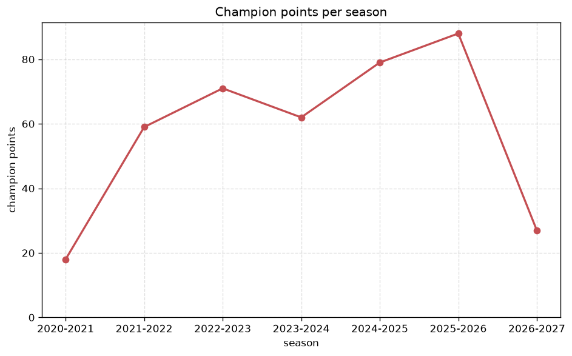
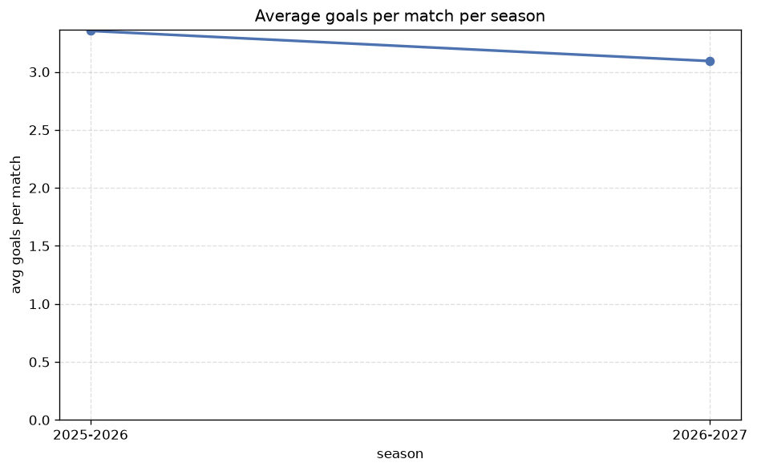

# Season Trends Analysis
- Report: `season_trends`
- Generated: 2026-10-29T01:56:55+00:00
- Script: `backend/scripts/analyze_seasons.py` v1.0.0
- League: 3. CFL - Group B (Czech Republic)
- Scope: league `czech3b`

## 1. Champions per season
| season | champion | pts | runner-up | margin |
|---|---|---|---|---|
| 2020-2021 | Chlumec nad Cidlinou | 18 | Zapy | 0 pts |
| 2021-2022 | Zapy | 59 | Prepere | 2 pts |
| 2022-2023 | Zizkov | 71 | Velvary | 11 pts |
| 2023-2024 | Zapy | 62 | Velvary | 0 pts |
| 2024-2025 | Usti nad Labem | 79 | SK Kladno | 13 pts |
| 2025-2026 | FK Ceska Lipa | 88 | Zapy | 14 pts |
| 2026-2027 | Jablonec B | 27 | Mlada Boleslav B | 1 pts |

## 2. Title-race tightness
- Tight races (margin <= 3 pts): **4** of 7 seasons
- Tightest race: **2020-2021** - Chlumec nad Cidlinou beat Zapy by **0** pts

| season | margin | tight |
|---|---|---|
| 2020-2021 | 0 pts | yes |
| 2021-2022 | 2 pts | yes |
| 2022-2023 | 11 pts |  |
| 2023-2024 | 0 pts | yes |
| 2024-2025 | 13 pts |  |
| 2025-2026 | 14 pts |  |
| 2026-2027 | 1 pts | yes |

## 3. Points thresholds
_Position-specific points per season. Key: 1 = champion, 2 = runner-up, 4 = CL line, 6 = Europa, 13 = last safe, 16 = bottom._

| season | pos 1 | pos 2 | pos 4 | pos 6 | pos 13 | pos 16 |
|---|---|---|---|---|---|---|
| 2020-2021 | 18 | 18 | 15 | 15 | 9 | 3 |
| 2021-2022 | 59 | 57 | 51 | 47 | 38 | 19 |
| 2022-2023 | 71 | 60 | 50 | 41 | 29 | - |
| 2023-2024 | 62 | 62 | 49 | 37 | 32 | - |
| 2024-2025 | 79 | 66 | 49 | 42 | 35 | 30 |
| 2025-2026 | 88 | 74 | 61 | 44 | 34 | 25 |
| 2026-2027 | 27 | 26 | 21 | 18 | 12 | 8 |

## 4. Relegation battle
| season | safe pos | safe pts | drop pos | drop pts | gap |
|---|---|---|---|---|---|
| 2020-2021 | 13 | 9 | 14 | 9 | 0 pts |
| 2021-2022 | 13 | 38 | 14 | 32 | 6 pts |
| 2022-2023 | 13 | 29 | 14 | 29 | 0 pts |
| 2023-2024 | 13 | 32 | 14 | 31 | 1 pts |
| 2024-2025 | 13 | 35 | 14 | 32 | 3 pts |
| 2025-2026 | 13 | 34 | 14 | 31 | 3 pts |
| 2026-2027 | 13 | 12 | 14 | 9 | 3 pts |

## 5. League-level trends
| season | matches | total goals | avg goals | home win | draw | away win | goalless | avg pts/team |
|---|---|---|---|---|---|---|---|---|
| 2020-2021 | 63 | 213 | 3.381 | 68.3% | 0.0% | 31.7% | 0.0% | 11.81 |
| 2021-2022 | 240 | 732 | 3.05 | 48.3% | 20.8% | 30.8% | 5.0% | 41.88 |
| 2022-2023 | 240 | 713 | 2.971 | 44.2% | 24.2% | 31.7% | 6.2% | 38.88 |
| 2023-2024 | 240 | 720 | 3.0 | 49.2% | 23.3% | 27.5% | 5.8% | 39.06 |
| 2024-2025 | 272 | 796 | 2.926 | 46.0% | 24.3% | 29.8% | 7.0% | 41.53 |
| 2025-2026 | 272 | 912 | 3.353 | 44.1% | 22.1% | 33.8% | 2.6% | 44.47 |
| 2026-2027 | 94 | 302 | 3.213 | 40.4% | 24.5% | 35.1% | 7.4% | 16.19 |

## 6. View divergence
- Largest divergence: **2024-2025** (luck view, avg abs position diff = 10.529)

_Avg absolute position difference between classic view and alternative view per season._

| season | classic vs luck | classic vs goals |
|---|---|---|
| 2020-2021 | 1.875 | 5.250 |
| 2021-2022 | 2.500 | 4.500 |
| 2022-2023 | 9.812 | 8.875 |
| 2023-2024 | 9.125 | 7.812 |
| 2024-2025 | 10.529 | 6.941 |
| 2025-2026 | 2.235 | 5.529 |
| 2026-2027 | 2.875 | 5.750 |

---
*All statistics are computed from PostgreSQL tables (read-only). Run with `python backend/scripts/analyze_seasons.py` to regenerate.*

## Charts

