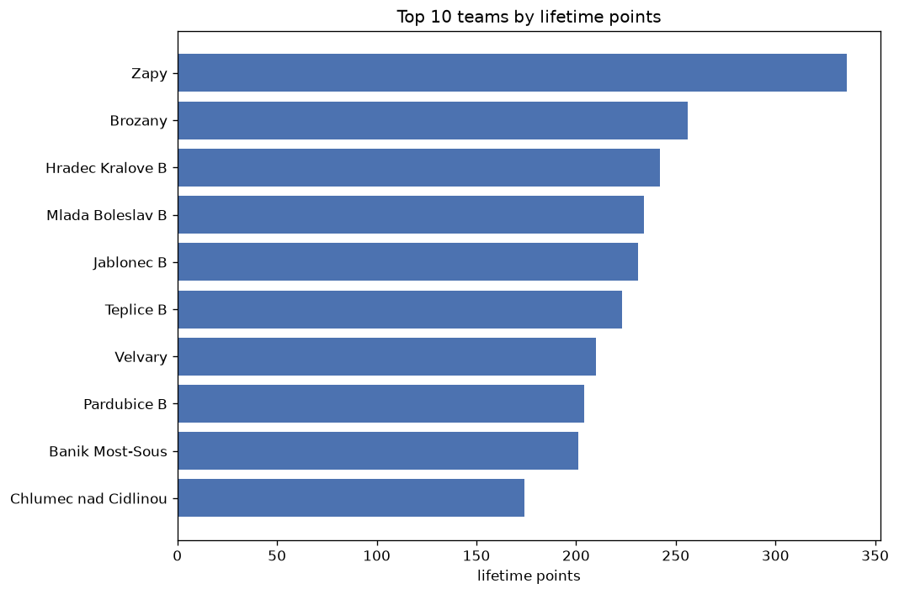
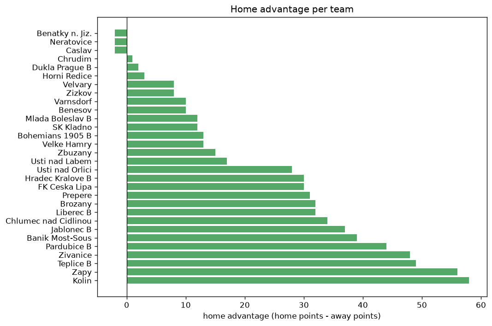

# Team Analysis
- Report: `teams_analysis`
- Generated: 2026-10-26T01:29:36+00:00
- Script: `backend/scripts/analyze_teams.py` v1.0.0
- League: 3. CFL - Group B (Czech Republic)
- Scope: league `czech3b`

- Teams: **30** | Seasons: **7** | Matches: **1417**

## 1. Team standings (lifetime)
| team | seasons | played | W | D | L | pts | GF | GA | GD | avg pts/season | best pos | worst pos | titles |
|---|---|---|---|---|---|---|---|---|---|---|---|---|---|
| Zapy | 7 | 173 | 98 | 42 | 33 | 336 | 336 | 186 | 150 | 48.0 | 1 | 6 | 2 |
| Brozany | 7 | 173 | 71 | 43 | 59 | 256 | 238 | 231 | 7 | 36.57 | 3 | 15 | 0 |
| Hradec Kralove B | 7 | 173 | 70 | 32 | 71 | 242 | 253 | 260 | -7 | 34.57 | 4 | 13 | 0 |
| Mlada Boleslav B | 7 | 174 | 65 | 39 | 70 | 234 | 268 | 257 | 11 | 33.43 | 1 | 13 | 1 |
| Jablonec B | 7 | 172 | 64 | 39 | 69 | 231 | 259 | 264 | -5 | 33.0 | 2 | 11 | 0 |
| Teplice B | 7 | 172 | 64 | 31 | 77 | 223 | 258 | 300 | -42 | 31.86 | 5 | 15 | 0 |
| Velvary | 5 | 130 | 61 | 27 | 42 | 210 | 223 | 191 | 32 | 42.0 | 2 | 16 | 0 |
| Pardubice B | 7 | 173 | 56 | 36 | 81 | 204 | 259 | 292 | -33 | 29.14 | 5 | 15 | 0 |
| Banik Most-Sous | 5 | 135 | 57 | 30 | 48 | 201 | 195 | 166 | 29 | 40.2 | 3 | 18 | 0 |
| Chlumec nad Cidlinou | 5 | 130 | 47 | 33 | 50 | 174 | 205 | 216 | -11 | 34.8 | 1 | 16 | 1 |
| Usti nad Labem | 3 | 92 | 50 | 17 | 25 | 167 | 185 | 122 | 63 | 55.67 | 1 | 14 | 1 |
| Liberec B | 6 | 144 | 45 | 29 | 70 | 164 | 250 | 260 | -10 | 27.33 | 6 | 15 | 0 |
| Zivanice | 5 | 130 | 46 | 26 | 58 | 164 | 182 | 209 | -27 | 32.8 | 3 | 14 | 0 |
| FK Ceska Lipa | 3 | 94 | 49 | 15 | 30 | 162 | 161 | 131 | 30 | 54.0 | 1 | 12 | 1 |
| Kolin | 4 | 124 | 38 | 38 | 48 | 152 | 179 | 214 | -35 | 38.0 | 4 | 17 | 0 |
| Prepere | 4 | 98 | 37 | 18 | 43 | 129 | 152 | 172 | -20 | 32.25 | 2 | 15 | 0 |
| Usti nad Orlici | 4 | 102 | 25 | 29 | 48 | 104 | 109 | 171 | -62 | 26.0 | 5 | 16 | 0 |
| Benatky n. Jiz. | 3 | 76 | 25 | 25 | 26 | 100 | 112 | 113 | -1 | 33.33 | 4 | 13 | 0 |
| Zizkov | 1 | 30 | 22 | 6 | 2 | 72 | 66 | 19 | 47 | 72.0 | 1 | 1 | 1 |
| SK Kladno | 1 | 32 | 20 | 6 | 6 | 66 | 64 | 34 | 30 | 66.0 | 2 | 2 | 0 |
| Zbuzany | 2 | 38 | 15 | 8 | 15 | 53 | 53 | 59 | -6 | 26.5 | 4 | 13 | 0 |
| Varnsdorf | 2 | 42 | 14 | 10 | 18 | 52 | 61 | 80 | -19 | 26.0 | 8 | 11 | 0 |
| Neratovice | 2 | 44 | 13 | 13 | 18 | 52 | 61 | 85 | -24 | 26.0 | 7 | 12 | 0 |
| Dukla Prague B | 2 | 38 | 14 | 6 | 18 | 48 | 63 | 73 | -10 | 24.0 | 10 | 14 | 0 |
| Bohemians 1905 B | 2 | 38 | 12 | 5 | 21 | 41 | 49 | 50 | -1 | 20.5 | 12 | 16 | 0 |
| Velke Hamry | 2 | 44 | 9 | 12 | 23 | 39 | 57 | 89 | -32 | 19.5 | 14 | 16 | 0 |
| Benesov | 1 | 30 | 7 | 5 | 18 | 26 | 33 | 54 | -21 | 26.0 | 15 | 15 | 0 |
| Caslav | 1 | 11 | 4 | 2 | 5 | 14 | 13 | 23 | -10 | 14.0 | 9 | 9 | 0 |
| Chrudim | 1 | 12 | 3 | 4 | 5 | 13 | 18 | 28 | -10 | 13.0 | 11 | 11 | 0 |
| Horni Redice | 1 | 10 | 3 | 0 | 7 | 9 | 10 | 23 | -13 | 9.0 | 14 | 14 | 0 |

## 2. Home vs away split
| team | home P | H-W | H-D | H-L | H-pts | away P | A-W | A-D | A-L | A-pts | adv |
|---|---|---|---|---|---|---|---|---|---|---|---|
| Kolin | 62 | 29 | 18 | 15 | 105 | 62 | 9 | 20 | 33 | 47 | 58 |
| Zapy | 88 | 60 | 16 | 12 | 196 | 85 | 38 | 26 | 21 | 140 | 56 |
| Teplice B | 85 | 39 | 19 | 27 | 136 | 87 | 25 | 12 | 50 | 87 | 49 |
| Zivanice | 66 | 31 | 13 | 22 | 106 | 64 | 15 | 13 | 36 | 58 | 48 |
| Pardubice B | 86 | 35 | 19 | 32 | 124 | 87 | 21 | 17 | 49 | 80 | 44 |
| Banik Most-Sous | 68 | 34 | 18 | 16 | 120 | 67 | 23 | 12 | 32 | 81 | 39 |
| Jablonec B | 86 | 39 | 17 | 30 | 134 | 86 | 25 | 22 | 39 | 97 | 37 |
| Chlumec nad Cidlinou | 65 | 29 | 17 | 19 | 104 | 65 | 18 | 16 | 31 | 70 | 34 |
| Brozany | 88 | 41 | 21 | 26 | 144 | 85 | 30 | 22 | 33 | 112 | 32 |
| Liberec B | 71 | 27 | 17 | 27 | 98 | 73 | 18 | 12 | 43 | 66 | 32 |
| Prepere | 49 | 24 | 8 | 17 | 80 | 49 | 13 | 10 | 26 | 49 | 31 |
| Hradec Kralove B | 87 | 40 | 16 | 31 | 136 | 86 | 30 | 16 | 40 | 106 | 30 |
| FK Ceska Lipa | 47 | 30 | 6 | 11 | 96 | 47 | 19 | 9 | 19 | 66 | 30 |
| Usti nad Orlici | 51 | 18 | 12 | 21 | 66 | 51 | 7 | 17 | 27 | 38 | 28 |
| Usti nad Labem | 46 | 27 | 11 | 8 | 92 | 46 | 23 | 6 | 17 | 75 | 17 |
| Zbuzany | 19 | 10 | 4 | 5 | 34 | 19 | 5 | 4 | 10 | 19 | 15 |
| Bohemians 1905 B | 18 | 8 | 3 | 7 | 27 | 20 | 4 | 2 | 14 | 14 | 13 |
| Velke Hamry | 23 | 6 | 8 | 9 | 26 | 21 | 3 | 4 | 14 | 13 | 13 |
| Mlada Boleslav B | 87 | 34 | 21 | 32 | 123 | 87 | 31 | 18 | 38 | 111 | 12 |
| SK Kladno | 16 | 13 | 0 | 3 | 39 | 16 | 7 | 6 | 3 | 27 | 12 |
| Varnsdorf | 21 | 9 | 4 | 8 | 31 | 21 | 5 | 6 | 10 | 21 | 10 |
| Benesov | 15 | 5 | 3 | 7 | 18 | 15 | 2 | 2 | 11 | 8 | 10 |
| Velvary | 65 | 31 | 16 | 18 | 109 | 65 | 30 | 11 | 24 | 101 | 8 |
| Zizkov | 15 | 13 | 1 | 1 | 40 | 15 | 9 | 5 | 1 | 32 | 8 |
| Horni Redice | 5 | 2 | 0 | 3 | 6 | 5 | 1 | 0 | 4 | 3 | 3 |
| Dukla Prague B | 19 | 7 | 4 | 8 | 25 | 19 | 7 | 2 | 10 | 23 | 2 |
| Chrudim | 5 | 2 | 1 | 2 | 7 | 7 | 1 | 3 | 3 | 6 | 1 |
| Benatky n. Jiz. | 37 | 11 | 16 | 10 | 49 | 39 | 14 | 9 | 16 | 51 | -2 |
| Neratovice | 22 | 7 | 4 | 11 | 25 | 22 | 6 | 9 | 7 | 27 | -2 |
| Caslav | 5 | 2 | 0 | 3 | 6 | 6 | 2 | 2 | 2 | 8 | -2 |

## 3. Top performers
### Best points per game (PPG)
| rank | team | PPG |
|---|---|---|
| 1 | Zizkov | 2.40 |
| 2 | SK Kladno | 2.06 |
| 3 | Zapy | 1.94 |
| 4 | Usti nad Labem | 1.81 |
| 5 | FK Ceska Lipa | 1.72 |

### Most goals scored
| rank | team | goals |
|---|---|---|
| 1 | Zapy | 336 |
| 2 | Mlada Boleslav B | 268 |
| 3 | Jablonec B | 259 |
| 4 | Pardubice B | 259 |
| 5 | Teplice B | 258 |

### Best goal difference
| rank | team | GD |
|---|---|---|
| 1 | Zapy | 150 |
| 2 | Usti nad Labem | 63 |
| 3 | Zizkov | 47 |
| 4 | Velvary | 32 |
| 5 | FK Ceska Lipa | 30 |

### Best defence (goals against per match, standings)
| rank | team | GA/match |
|---|---|---|
| 1 | Zizkov | 0.655 |
| 2 | SK Kladno | 1.000 |
| 3 | Zapy | 1.071 |
| 4 | Banik Most-Sous | 1.315 |
| 5 | Bohemians 1905 B | 1.316 |

## 4. Team consistency
- Teams present in all **7** seasons: **7**

Brozany, Hradec Kralove B, Jablonec B, Mlada Boleslav B, Pardubice B, Teplice B, Zapy

## 5. Head-to-head dominance
- Distinct fixtures: **314** (showing the 15 most frequent)

| fixture | meetings | home wins | draws | away wins | home pct | draw pct | away pct |
|---|---|---|---|---|---|---|---|
| Zapy vs Hradec Kralove B | 12 | 8 | 2 | 2 | 66.7% | 16.7% | 16.7% |
| Brozany vs Teplice B | 12 | 5 | 1 | 6 | 41.7% | 8.3% | 50.0% |
| Brozany vs Pardubice B | 12 | 4 | 3 | 5 | 33.3% | 25.0% | 41.7% |
| Mlada Boleslav B vs Hradec Kralove B | 12 | 3 | 2 | 7 | 25.0% | 16.7% | 58.3% |
| Mlada Boleslav B vs Jablonec B | 12 | 3 | 2 | 7 | 25.0% | 16.7% | 58.3% |
| Zapy vs Brozany | 12 | 3 | 4 | 5 | 25.0% | 33.3% | 41.7% |
| Hradec Kralove B vs Pardubice B | 12 | 2 | 3 | 7 | 16.7% | 25.0% | 58.3% |
| Hradec Kralove B vs Teplice B | 11 | 6 | 1 | 4 | 54.5% | 9.1% | 36.4% |
| Zapy vs Mlada Boleslav B | 11 | 6 | 2 | 3 | 54.5% | 18.2% | 27.3% |
| Brozany vs Hradec Kralove B | 11 | 5 | 2 | 4 | 45.5% | 18.2% | 36.4% |
| Brozany vs Jablonec B | 11 | 5 | 3 | 3 | 45.5% | 27.3% | 27.3% |
| Zapy vs Jablonec B | 11 | 5 | 3 | 3 | 45.5% | 27.3% | 27.3% |
| Zapy vs Pardubice B | 11 | 5 | 2 | 4 | 45.5% | 18.2% | 36.4% |
| Mlada Boleslav B vs Brozany | 11 | 4 | 2 | 5 | 36.4% | 18.2% | 45.5% |
| Jablonec B vs Hradec Kralove B | 11 | 3 | 4 | 4 | 27.3% | 36.4% | 36.4% |

## 6. Position per season (classic view)
_Cells show final position; '-' when the team was absent from that season._

| team | 2020-2021 | 2021-2022 | 2022-2023 | 2023-2024 | 2024-2025 | 2025-2026 | 2026-2027 |
|---|---|---|---|---|---|---|---|
| Zapy | 2 | 1 | 6 | 1 | 3 | 2 | 3 |
| Brozany | 9 | 5 | 3 | 4 | 4 | 13 | 15 |
| Hradec Kralove B | 11 | 6 | 9 | 10 | 7 | 4 | 13 |
| Mlada Boleslav B | 5 | 11 | 8 | 13 | 6 | 9 | 1 |
| Jablonec B | 10 | 4 | 10 | 11 | 10 | 8 | 2 |
| Teplice B | 15 | 9 | 7 | 14 | 11 | 5 | 10 |
| Velvary | 6 | 7 | 2 | 2 | - | 16 | - |
| Pardubice B | 13 | 14 | 12 | 8 | 15 | 7 | 5 |
| Banik Most-Sous | - | - | 17 | 17 | 18 | 3 | 6 |
| Chlumec nad Cidlinou | 1 | 8 | 5 | 7 | 16 | - | - |
| Usti nad Labem | - | - | 14 | 3 | 1 | - | - |
| Liberec B | 7 | 15 | - | 6 | 9 | 10 | 12 |
| Zivanice | 8 | 3 | 11 | 9 | 14 | - | - |
| FK Ceska Lipa | - | - | - | 12 | 8 | 1 | - |
| Kolin | - | - | 4 | 5 | 12 | 17 | - |
| Prepere | 3 | 2 | 13 | 15 | - | - | - |
| Usti nad Orlici | 12 | 16 | - | - | 5 | 15 | - |
| Benatky n. Jiz. | - | - | - | - | 13 | 6 | 4 |
| Zizkov | - | - | 1 | - | - | - | - |
| SK Kladno | - | - | - | - | 2 | - | - |
| Zbuzany | 4 | 13 | - | - | - | - | - |
| Varnsdorf | - | - | - | - | - | 11 | 8 |
| Neratovice | - | - | - | - | - | 12 | 7 |
| Dukla Prague B | 14 | 10 | - | - | - | - | - |
| Bohemians 1905 B | 16 | 12 | - | - | - | - | - |
| Velke Hamry | - | - | - | - | - | 14 | 16 |
| Benesov | - | - | 15 | - | - | - | - |
| Caslav | - | - | - | - | - | - | 9 |
| Chrudim | - | - | - | - | - | - | 11 |
| Horni Redice | - | - | - | - | - | - | 14 |

---
*All statistics are computed from PostgreSQL tables (read-only). Run with `python backend/scripts/analyze_teams.py` to regenerate.*

## Charts

