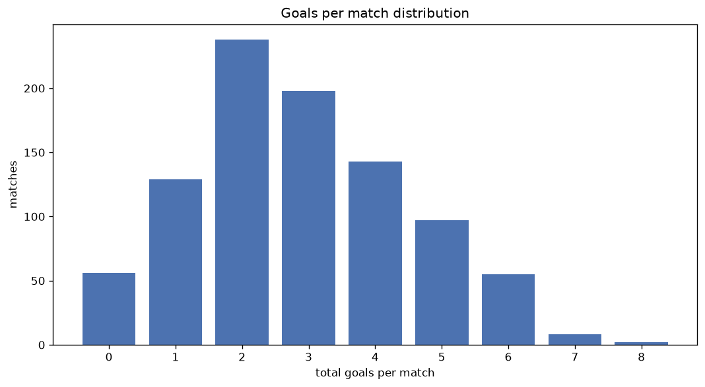
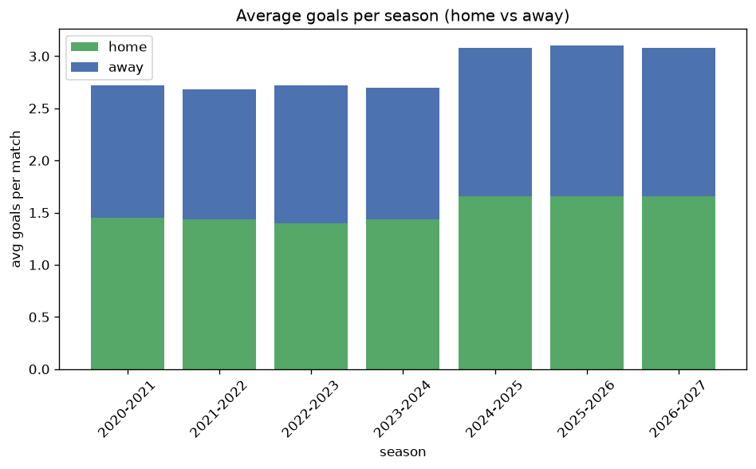

# Goal Analysis
- Report: `goals_analysis`
- Generated: 2026-10-29T01:57:07+00:00
- Script: `backend/scripts/analyze_goals.py` v1.0.0
- League: Superliga (Denmark)
- Scope: league `denmark1`

## 1. Goals per match distribution
| goals | matches | pct |
|---|---|---|
| 0 | 56 | 6.0% |
| 1 | 129 | 13.9% |
| 2 | 238 | 25.7% |
| 3 | 198 | 21.4% |
| 4 | 143 | 15.4% |
| 5 | 97 | 10.5% |
| 6 | 55 | 5.9% |
| 7 | 8 | 0.9% |
| 8 | 2 | 0.2% |

## 2. Goals per match per season
| season | matches | total goals | avg home | avg away | avg total |
|---|---|---|---|---|---|
| 2020-2021 | 132 | 359 | 1.447 | 1.273 | 2.72 |
| 2021-2022 | 132 | 354 | 1.439 | 1.242 | 2.682 |
| 2022-2023 | 132 | 359 | 1.394 | 1.326 | 2.72 |
| 2023-2024 | 132 | 356 | 1.432 | 1.265 | 2.697 |
| 2024-2025 | 132 | 406 | 1.659 | 1.417 | 3.076 |
| 2025-2026 | 193 | 599 | 1.658 | 1.446 | 3.104 |
| 2026-2027 | 73 | 225 | 1.658 | 1.425 | 3.082 |

## 3. Home vs away goal share
- Home goals: **1414** (53.2%)
- Away goals: **1244** (46.8%)
- Home/away ratio: **1.137**

| season | home goals | away goals | total | home pct | away pct |
|---|---|---|---|---|---|
| 2020-2021 | 191 | 168 | 359 | 53.2% | 46.8% |
| 2021-2022 | 190 | 164 | 354 | 53.7% | 46.3% |
| 2022-2023 | 184 | 175 | 359 | 51.3% | 48.7% |
| 2023-2024 | 189 | 167 | 356 | 53.1% | 46.9% |
| 2024-2025 | 219 | 187 | 406 | 53.9% | 46.1% |
| 2025-2026 | 320 | 279 | 599 | 53.4% | 46.6% |
| 2026-2027 | 121 | 104 | 225 | 53.8% | 46.2% |

## 4. BTTS (Both Teams To Score)
- Overall: **539** of `926` (58.2%)

| season | matches | BTTS | pct |
|---|---|---|---|
| 2020-2021 | 132 | 77 | 58.3% |
| 2021-2022 | 132 | 71 | 53.8% |
| 2022-2023 | 132 | 75 | 56.8% |
| 2023-2024 | 132 | 70 | 53.0% |
| 2024-2025 | 132 | 85 | 64.4% |
| 2025-2026 | 193 | 115 | 59.6% |
| 2026-2027 | 73 | 46 | 63.0% |

## 5. Clean sheets
- Home clean sheets: **242** (26.1%)
- Away clean sheets: **201** (21.7%)
- Total clean sheets recorded: **443**
- Matches with at least one clean sheet: **387** (41.8%)
- Both teams kept clean sheets (0-0): **56**

| season | matches | home CS | away CS | total CS | matches w/ CS |
|---|---|---|---|---|---|
| 2020-2021 | 132 | 31 | 34 | 65 | 55 (41.7%) |
| 2021-2022 | 132 | 39 | 30 | 69 | 61 (46.2%) |
| 2022-2023 | 132 | 33 | 34 | 67 | 57 (43.2%) |
| 2023-2024 | 132 | 41 | 29 | 70 | 62 (47.0%) |
| 2024-2025 | 132 | 32 | 21 | 53 | 47 (35.6%) |
| 2025-2026 | 193 | 49 | 40 | 89 | 78 (40.4%) |
| 2026-2027 | 73 | 17 | 13 | 30 | 27 (37.0%) |

## 6. Scoring intensity
- First-half goals: **1219** (45.9%)
- Second-half goals: **1439** (54.1%)
- Avg first-half goals per match: **1.316**
- Avg second-half goals per match: **1.554**
- Second-half-only scoring (HT 0-0, FT goals >= 1): **192** (20.7%)

| season | matches | 1st half | 2nd half | 1st half pct | 2nd half pct |
|---|---|---|---|---|---|
| 2020-2021 | 132 | 160 | 199 | 44.6% | 55.4% |
| 2021-2022 | 132 | 178 | 176 | 50.3% | 49.7% |
| 2022-2023 | 132 | 153 | 206 | 42.6% | 57.4% |
| 2023-2024 | 132 | 148 | 208 | 41.6% | 58.4% |
| 2024-2025 | 132 | 189 | 217 | 46.6% | 53.4% |
| 2025-2026 | 193 | 282 | 317 | 47.1% | 52.9% |
| 2026-2027 | 73 | 109 | 116 | 48.4% | 51.6% |

## 7. First-goal timing
- Matches with first-goal time recorded: `870` of `926` (94.0%)
- Goalless matches: `56`
- Min `1` | Max `99` | Mean `29.5` | Median (p50) `24.5`

| bucket | count | % of matches | % of scoring matches |
|---|---|---|---|
| 1-15 | 317 | 34.2% | 36.4% |
| 16-30 | 195 | 21.1% | 22.4% |
| 31-45 | 150 | 16.2% | 17.2% |
| 46-60 | 111 | 12.0% | 12.8% |
| 61-75 | 49 | 5.3% | 5.6% |
| 76-90 | 38 | 4.1% | 4.4% |
| 91-120 | 10 | 1.1% | 1.1% |

---
*All statistics are computed from PostgreSQL tables (read-only). Run with `python backend/scripts/analyze_goals.py` to regenerate.*

## Charts

