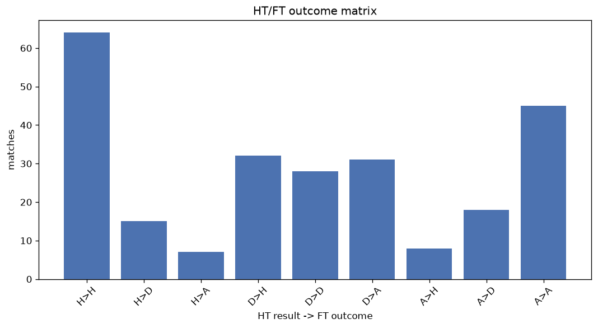
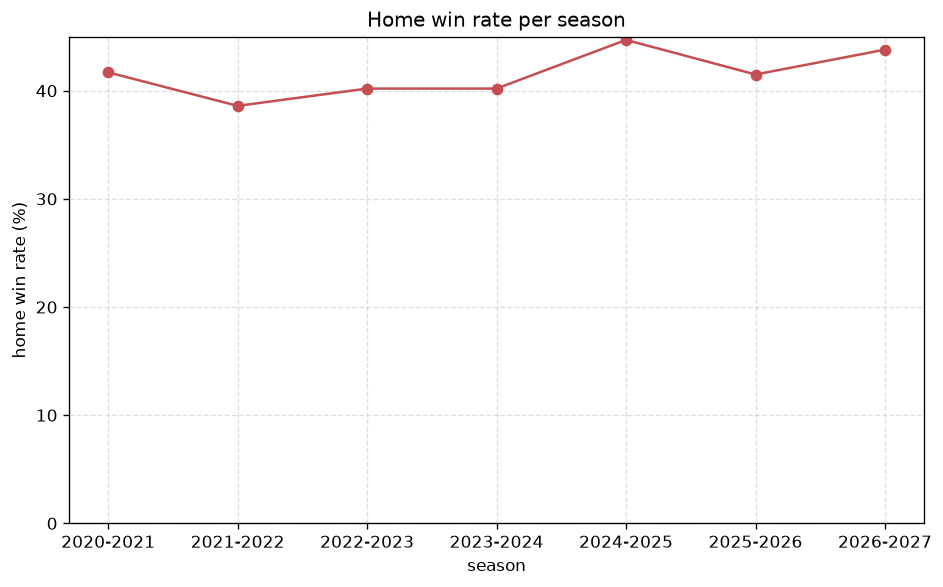

# Match Analysis
- Report: `matches_analysis`
- Generated: 2026-10-30T03:48:26+00:00
- Script: `backend/scripts/analyze_matches.py` v1.0.0
- League: Superliga (Denmark)
- Scope: league `denmark1`

## 1. Overall summary
| metric | value |
|---|---|
| Matches | 926 |
| Home wins | 383 (41.4%) |
| Draws | 254 (27.4%) |
| Away wins | 289 (31.2%) |
| Total goals | 2658 |
| Average goals per match | 2.870 |
| Goalless matches | 56 (6.0%) |

## 2. Per-season breakdown
| season | matches | home wins | draws | away wins | total goals | avg goals | goalless |
|---|---|---|---|---|---|---|---|
| 2020-2021 | 132 | 55 (41.7%) | 34 (25.8%) | 43 (32.6%) | 359 | 2.72 | 10 (7.6%) |
| 2021-2022 | 132 | 51 (38.6%) | 40 (30.3%) | 41 (31.1%) | 354 | 2.682 | 8 (6.1%) |
| 2022-2023 | 132 | 53 (40.2%) | 38 (28.8%) | 41 (31.1%) | 359 | 2.72 | 10 (7.6%) |
| 2023-2024 | 132 | 53 (40.2%) | 33 (25.0%) | 46 (34.8%) | 356 | 2.697 | 8 (6.1%) |
| 2024-2025 | 132 | 59 (44.7%) | 41 (31.1%) | 32 (24.2%) | 406 | 3.076 | 6 (4.5%) |
| 2025-2026 | 193 | 80 (41.5%) | 45 (23.3%) | 68 (35.2%) | 599 | 3.104 | 11 (5.7%) |
| 2026-2027 | 73 | 32 (43.8%) | 23 (31.5%) | 18 (24.7%) | 225 | 3.082 | 3 (4.1%) |

## 3. HT/FT outcome matrix
| HT result \ FT result | Home | Draw | Away | total |
|---|---|---|---|---|
| HT home lead | 241 (73.9%) | 64 (19.6%) | 21 (6.4%) | 326 |
| HT draw | 116 (31.9%) | 138 (37.9%) | 110 (30.2%) | 364 |
| HT away lead | 26 (11.0%) | 52 (22.0%) | 158 (66.9%) | 236 |

## 4. Comeback matches
- Home comebacks (trailing at HT, won at FT): **26** (2.8%)
- Away comebacks (trailing at HT, won at FT): **21** (2.3%)

### Home comebacks
| season | home | away | HT | FT |
|---|---|---|---|---|
| 2020-2021 | Brondby | Nordsjaelland | 0-2 | 3-2 |
| 2020-2021 | Nordsjaelland | Lyngby | 0-1 | 4-1 |
| 2020-2021 | Midtjylland | Odense | 0-1 | 3-1 |
| 2020-2021 | Odense | Aalborg | 0-1 | 2-1 |
| 2020-2021 | Randers FC | Vejle | 0-1 | 3-1 |
| 2021-2022 | Brondby | Aalborg | 0-1 | 2-1 |
| 2022-2023 | Horsens | Aarhus | 0-1 | 2-1 |
| 2022-2023 | Brondby | Horsens | 1-2 | 5-2 |
| 2022-2023 | Silkeborg | Nordsjaelland | 0-1 | 2-1 |
| 2022-2023 | Nordsjaelland | Brondby | 0-1 | 2-1 |
| 2023-2024 | Nordsjaelland | Brondby | 0-1 | 3-1 |
| 2023-2024 | Viborg | FC Copenhagen | 0-1 | 2-1 |
| 2024-2025 | FC Copenhagen | Aarhus | 1-2 | 3-2 |
| 2024-2025 | Brondby | Vejle | 0-1 | 2-1 |
| 2024-2025 | Midtjylland | Sonderjyske | 1-2 | 3-2 |
| 2024-2025 | Aarhus | Nordsjaelland | 1-2 | 4-2 |
| 2024-2025 | Midtjylland | FC Copenhagen | 0-1 | 2-1 |
| 2024-2025 | Viborg | FC Copenhagen | 0-2 | 3-2 |
| 2025-2026 | Aarhus | Odense | 0-1 | 2-1 |
| 2025-2026 | Sonderjyske | Silkeborg | 0-1 | 2-1 |
| 2025-2026 | Odense | FC Copenhagen | 0-1 | 2-1 |
| 2025-2026 | Nordsjaelland | Brondby | 0-1 | 2-1 |
| 2025-2026 | Silkeborg | Odense | 0-1 | 3-1 |
| 2025-2026 | Midtjylland | Aarhus | 0-1 | 2-1 |
| 2026-2027 | FC Copenhagen | Lyngby | 1-2 | 3-2 |
| 2026-2027 | Brondby | Silkeborg | 0-1 | 3-1 |

### Away comebacks
| season | home | away | HT | FT |
|---|---|---|---|---|
| 2020-2021 | Brondby | Midtjylland | 1-0 | 2-3 |
| 2020-2021 | Lyngby | Aarhus | 1-0 | 1-2 |
| 2020-2021 | Aalborg | FC Copenhagen | 2-0 | 2-3 |
| 2020-2021 | Randers FC | Lyngby | 1-0 | 1-2 |
| 2021-2022 | Odense | Randers FC | 1-0 | 1-2 |
| 2021-2022 | Sonderjyske | Aarhus | 2-1 | 2-3 |
| 2022-2023 | Odense | Viborg | 1-0 | 1-2 |
| 2022-2023 | Silkeborg | Viborg | 1-0 | 1-2 |
| 2022-2023 | Aalborg | Silkeborg | 1-0 | 1-2 |
| 2022-2023 | Horsens | FC Copenhagen | 1-0 | 1-4 |
| 2023-2024 | Brondby | FC Copenhagen | 1-0 | 2-3 |
| 2023-2024 | Hvidovre IF | Randers FC | 1-0 | 1-3 |
| 2023-2024 | Lyngby | Hvidovre IF | 2-0 | 2-4 |
| 2024-2025 | Vejle | Randers FC | 1-0 | 2-3 |
| 2025-2026 | Aarhus | Randers FC | 1-0 | 1-2 |
| 2025-2026 | Odense | Nordsjaelland | 1-0 | 1-2 |
| 2025-2026 | Viborg | Odense | 1-0 | 1-2 |
| 2025-2026 | Nordsjaelland | Odense | 1-0 | 2-4 |
| 2025-2026 | Aarhus | Sonderjyske | 2-1 | 2-3 |
| 2025-2026 | FC Copenhagen | Nordsjaelland | 1-0 | 1-2 |
| 2025-2026 | Midtjylland | Brondby | 2-0 | 2-3 |

## 5. HT lead conversion
| HT state | matches | converted to win | held as draw | collapsed to loss |
|---|---|---|---|---|
| Home lead | 326 | 241 (73.9%) | 64 (19.6%) | 21 (6.4%) |
| Away lead | 236 | 158 (66.9%) | 52 (22.0%) | 26 (11.0%) |

### Matches level at half-time
| FT result | count | pct |
|---|---|---|
| Home win | 116 | 31.9% |
| Draw | 138 | 37.9% |
| Away win | 110 | 30.2% |

## 6. First-goal timing
- Matches with a first-goal time recorded: `870` of `926` (94.0%)

Outcome distribution by first-goal timing bucket:
| bucket | matches | % of matches | home | draw | away |
|---|---|---|---|---|---|
| 1-15 | 317 | 34.2% | 134 (42.3%) | 79 (24.9%) | 104 (32.8%) |
| 16-30 | 195 | 21.1% | 85 (43.6%) | 39 (20.0%) | 71 (36.4%) |
| 31-45 | 150 | 16.2% | 78 (52.0%) | 38 (25.3%) | 34 (22.7%) |
| 46-60 | 111 | 12.0% | 45 (40.5%) | 25 (22.5%) | 41 (36.9%) |
| 61-75 | 49 | 5.3% | 18 (36.7%) | 11 (22.4%) | 20 (40.8%) |
| 76-90 | 38 | 4.1% | 18 (47.4%) | 6 (15.8%) | 14 (36.8%) |
| 91-120 | 10 | 1.1% | 5 (50.0%) | 0 (0.0%) | 5 (50.0%) |

## 7. Goalless matches
- Overall: **56** of `926` (6.0%)

| season | matches | goalless | pct |
|---|---|---|---|
| 2020-2021 | 132 | 10 | 7.6% |
| 2021-2022 | 132 | 8 | 6.1% |
| 2022-2023 | 132 | 10 | 7.6% |
| 2023-2024 | 132 | 8 | 6.1% |
| 2024-2025 | 132 | 6 | 4.5% |
| 2025-2026 | 193 | 11 | 5.7% |
| 2026-2027 | 73 | 3 | 4.1% |

---
*All statistics are computed from PostgreSQL tables (read-only). Run with `python backend/scripts/analyze_matches.py` to regenerate.*

## Charts

