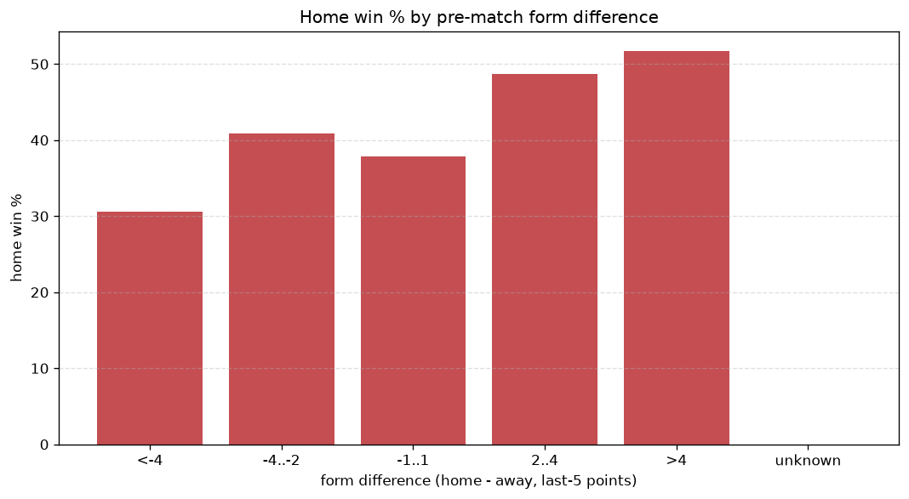
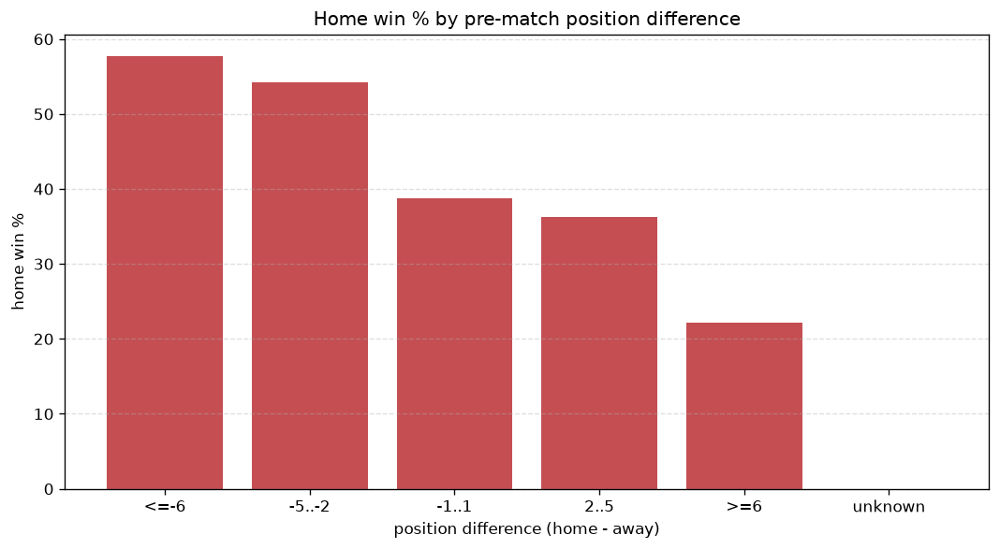

# Relationships Analysis
- Report: `relationships`
- Generated: 2026-10-27T01:44:49+00:00
- Script: `backend/scripts/analyze_relationships.py` v1.0.0
- League: Superliga (Denmark)
- Scope: league `denmark1`

- Matches analysed: **853** (23 leakage-safe pre-match features).

## 1. Correlation matrix
_Pearson correlation of each pre-match feature with observed goals; sorted by |corr(total goals)|._

| feature | corr(home) | corr(away) | corr(total) |
|---|---|---|---|
| away_team_away_conceded_avg | 0.087 | -0.026 | 0.050 |
| away_position_before_match | 0.176 | -0.129 | 0.047 |
| away_points_before_match | -0.100 | 0.053 | -0.041 |
| position_difference | -0.232 | 0.205 | -0.038 |
| home_team_home_win_rate | 0.096 | -0.057 | 0.035 |
| away_team_points_last_5 | -0.147 | 0.114 | -0.035 |
| points_difference | 0.231 | -0.209 | 0.034 |
| away_team_goals_conceded_last_5 | 0.117 | -0.083 | 0.033 |
| away_team_wins_last_5 | -0.143 | 0.113 | -0.033 |
| home_team_wins_last_5 | 0.127 | -0.098 | 0.031 |
| home_team_home_goals_avg | 0.083 | -0.062 | 0.021 |
| home_team_home_conceded_avg | -0.090 | 0.071 | -0.021 |
| home_points_before_match | 0.069 | -0.101 | -0.016 |
| away_team_goals_scored_last_5 | -0.102 | 0.138 | 0.016 |
| home_team_points_last_5 | 0.116 | -0.107 | 0.016 |
| home_rest_days | -0.052 | 0.036 | -0.015 |
| away_rest_days | -0.041 | 0.025 | -0.015 |
| away_team_away_goals_avg | -0.088 | 0.119 | 0.014 |
| away_team_away_win_rate | -0.114 | 0.112 | -0.010 |
| home_team_goals_conceded_last_5 | -0.104 | 0.105 | -0.008 |
| home_team_goals_scored_last_5 | 0.081 | -0.080 | 0.007 |
| home_position_before_match | -0.142 | 0.151 | -0.005 |
| rest_days_difference | -0.040 | 0.039 | -0.004 |

## 2. Form vs outcome
_Home win/draw/away % per bucket of `home_team_points_last_5 - away_team_points_last_5`._

| bucket | matches | home | draw | away | home % | draw % | away % |
|---|---|---|---|---|---|---|---|
| <-4 | 154 | 43 | 41 | 70 | 27.9% | 26.6% | 45.5% |
| -4..-2 | 171 | 52 | 49 | 70 | 30.4% | 28.7% | 40.9% |
| -1..1 | 230 | 98 | 65 | 67 | 42.6% | 28.3% | 29.1% |
| 2..4 | 158 | 78 | 40 | 40 | 49.4% | 25.3% | 25.3% |
| >4 | 140 | 80 | 36 | 24 | 57.1% | 25.7% | 17.1% |
| unknown | 0 | 0 | 0 | 0 | - | - | - |

## 3. Position vs outcome
_Home win/draw/away % per bucket of `position_difference` (home position - away position; negative favours the home team)._

| bucket | matches | home | draw | away | home % | draw % | away % |
|---|---|---|---|---|---|---|---|
| <=-6 | 106 | 65 | 22 | 19 | 61.3% | 20.8% | 17.9% |
| -5..-2 | 211 | 108 | 52 | 51 | 51.2% | 24.6% | 24.2% |
| -1..1 | 202 | 82 | 63 | 57 | 40.6% | 31.2% | 28.2% |
| 2..5 | 214 | 63 | 61 | 90 | 29.4% | 28.5% | 42.1% |
| >=6 | 120 | 33 | 33 | 54 | 27.5% | 27.5% | 45.0% |
| unknown | 0 | 0 | 0 | 0 | - | - | - |

## 4. Rest advantage
_Home win/draw/away % per bucket of `rest_days_difference` (home rest - away rest). Matches with unknown rest are bucketed separately._

| bucket | matches | home | draw | away | home % | draw % | away % |
|---|---|---|---|---|---|---|---|
| <-1 | 120 | 57 | 28 | 35 | 47.5% | 23.3% | 29.2% |
| -1..0 | 126 | 49 | 26 | 51 | 38.9% | 20.6% | 40.5% |
| 0 | 324 | 137 | 97 | 90 | 42.3% | 29.9% | 27.8% |
| 1..2 | 220 | 89 | 57 | 74 | 40.5% | 25.9% | 33.6% |
| >2 | 27 | 7 | 11 | 9 | 25.9% | 40.7% | 33.3% |
| unknown | 36 | 12 | 12 | 12 | 33.3% | 33.3% | 33.3% |
- *36 match(es) had unknown rest difference (missing rest data on at least one side).*

## 5. Home team quality
_Home win rate by `home_team_home_win_rate` tier (split at 0.5)._

- `< 0.5` tier: **38.9%** home win (192/493)
- `>= 0.5` tier: **44.2%** home win (159/360)
- Home-win gap (>= split minus < split): **+5.3 pp**

| tier | label | matches | home | draw | away | home % |
|---|---|---|---|---|---|---|
| low | < 0.5 | 493 | 192 | 130 | 171 | 38.9% |
| high | >= 0.5 | 360 | 159 | 101 | 100 | 44.2% |

## 6. Feature averages by result
_Mean feature value per outcome; `range` is home-minus-away spread of the group means._

| feature | home mean | draw mean | away mean | range |
|---|---|---|---|---|
| points_difference | 2.242 | -0.900 | -2.764 | 5.006 |
| away_rest_days | 10.159 | 9.388 | 12.529 | 3.141 |
| home_rest_days | 10.094 | 9.489 | 12.568 | 3.079 |
| away_points_before_match | 14.422 | 17.186 | 17.365 | 2.944 |
| position_difference | -1.179 | 0.472 | 1.472 | 2.652 |
| home_points_before_match | 16.664 | 16.286 | 14.601 | 2.062 |
| away_position_before_match | 7.325 | 6.368 | 5.941 | 1.384 |
| away_team_points_last_5 | 5.481 | 6.087 | 6.812 | 1.330 |
| home_team_points_last_5 | 6.439 | 5.753 | 5.151 | 1.287 |
| home_position_before_match | 6.145 | 6.840 | 7.413 | 1.268 |
| away_team_goals_scored_last_5 | 5.789 | 6.277 | 6.948 | 1.159 |
| away_team_goals_conceded_last_5 | 6.732 | 5.861 | 5.649 | 1.083 |
| home_team_goals_conceded_last_5 | 5.923 | 6.307 | 6.808 | 0.885 |
| home_team_goals_scored_last_5 | 6.538 | 6.169 | 5.723 | 0.815 |
| away_team_wins_last_5 | 1.430 | 1.619 | 1.871 | 0.441 |
| home_team_wins_last_5 | 1.755 | 1.519 | 1.317 | 0.438 |
| away_team_away_goals_avg | 1.149 | 1.313 | 1.345 | 0.196 |
| home_team_home_goals_avg | 1.504 | 1.411 | 1.327 | 0.177 |
| rest_days_difference | -0.065 | 0.100 | 0.039 | 0.165 |
| away_team_away_conceded_avg | 1.492 | 1.348 | 1.381 | 0.144 |
| home_team_home_conceded_avg | 1.185 | 1.292 | 1.325 | 0.140 |
| home_team_home_win_rate | 0.419 | 0.389 | 0.351 | 0.068 |
| away_team_away_win_rate | 0.266 | 0.309 | 0.333 | 0.067 |

---
*All features are leakage-safe pre-match values built by `ml.features.build_features.build_rows` from strictly prior matches. Run with `python backend/scripts/analyze_relationships.py` to regenerate.*

## Charts

