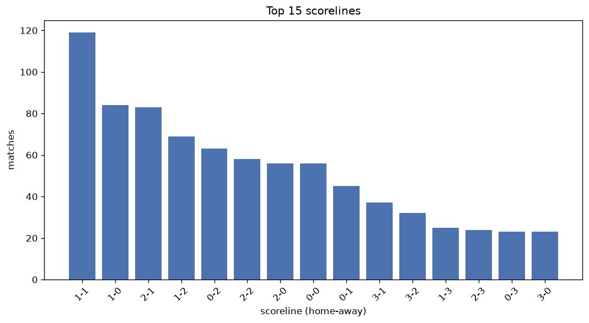
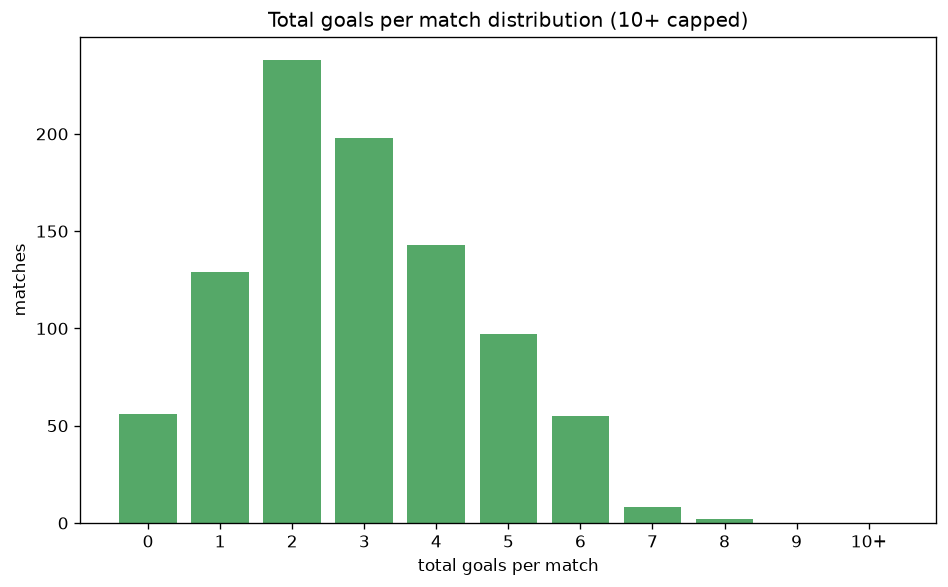

# Scoreline Analysis
- Report: `scoreline_analysis`
- Generated: 2026-10-29T01:57:12+00:00
- Script: `backend/scripts/analyze_scorelines.py` v1.0.0
- League: Superliga (Denmark)
- Scope: league `denmark1`

## 1. Scoreline frequency
- Matches analysed: **926** across **7** seasons.
- Distinct scorelines seen: **32**.

| scoreline | count | pct |
|---|---|---|
| 1-1 | 119 | 12.9% |
| 1-0 | 84 | 9.1% |
| 2-1 | 83 | 9.0% |
| 1-2 | 69 | 7.5% |
| 0-2 | 63 | 6.8% |
| 2-2 | 58 | 6.3% |
| 2-0 | 56 | 6.0% |
| 0-0 | 56 | 6.0% |
| 0-1 | 45 | 4.9% |
| 3-1 | 37 | 4.0% |
| 3-2 | 32 | 3.5% |
| 1-3 | 25 | 2.7% |
| 2-3 | 24 | 2.6% |
| 0-3 | 23 | 2.5% |
| 3-0 | 23 | 2.5% |
| 3-3 | 21 | 2.3% |
| 4-1 | 19 | 2.1% |
| 1-4 | 14 | 1.5% |
| 4-2 | 13 | 1.4% |
| 4-0 | 13 | 1.4% |

## 2. Scoreline frequency per season

### 2020-2021
| scoreline | count | pct |
|---|---|---|
| 1-1 | 16 | 12.1% |
| 1-2 | 14 | 10.6% |
| 2-1 | 13 | 9.8% |
| 0-0 | 10 | 7.6% |
| 1-0 | 9 | 6.8% |

### 2021-2022
| scoreline | count | pct |
|---|---|---|
| 1-1 | 23 | 17.4% |
| 0-2 | 11 | 8.3% |
| 1-0 | 11 | 8.3% |
| 2-0 | 11 | 8.3% |
| 2-2 | 9 | 6.8% |

### 2022-2023
| scoreline | count | pct |
|---|---|---|
| 1-1 | 17 | 12.9% |
| 1-0 | 16 | 12.1% |
| 2-1 | 15 | 11.4% |
| 0-2 | 14 | 10.6% |
| 0-0 | 10 | 7.6% |

### 2023-2024
| scoreline | count | pct |
|---|---|---|
| 1-2 | 14 | 10.6% |
| 1-1 | 14 | 10.6% |
| 1-0 | 13 | 9.8% |
| 2-0 | 11 | 8.3% |
| 2-1 | 11 | 8.3% |

### 2024-2025
| scoreline | count | pct |
|---|---|---|
| 1-1 | 19 | 14.4% |
| 1-0 | 13 | 9.8% |
| 2-2 | 13 | 9.8% |
| 2-1 | 9 | 6.8% |
| 3-2 | 9 | 6.8% |

### 2025-2026
| scoreline | count | pct |
|---|---|---|
| 2-1 | 21 | 10.9% |
| 1-2 | 19 | 9.8% |
| 1-1 | 18 | 9.3% |
| 1-0 | 15 | 7.8% |
| 0-2 | 14 | 7.3% |

### 2026-2027
| scoreline | count | pct |
|---|---|---|
| 1-1 | 12 | 16.4% |
| 1-0 | 7 | 9.6% |
| 2-1 | 7 | 9.6% |
| 2-2 | 6 | 8.2% |
| 2-0 | 4 | 5.5% |

## 3. Total-goal histogram
_10+ groups all matches with 10 or more total goals._

| total goals | matches | pct |
|---|---|---|
| 0 | 56 | 6.0% |
| 1 | 129 | 13.9% |
| 2 | 238 | 25.7% |
| 3 | 198 | 21.4% |
| 4 | 143 | 15.4% |
| 5 | 97 | 10.5% |
| 6 | 55 | 5.9% |
| 7 | 8 | 0.9% |
| 8 | 2 | 0.2% |
| 9 | 0 | 0.0% |
| 10+ | 0 | 0.0% |

## 4. Extreme scorelines
- Matches with 7+ total goals: **10**

| season | date | scoreline | total goals |
|---|---|---|---|
| 2025-2026 | 2025-07-28 | 6-2 | 8 |
| 2025-2026 | 2026-05-17 | 6-2 | 8 |
| 2021-2022 | 2021-10-25 | 2-5 | 7 |
| 2022-2023 | 2023-02-19 | 5-2 | 7 |
| 2022-2023 | 2023-03-05 | 7-0 | 7 |
| 2025-2026 | 2025-11-23 | 5-2 | 7 |
| 2025-2026 | 2026-02-22 | 5-2 | 7 |
| 2025-2026 | 2026-04-05 | 7-0 | 7 |
| 2026-2027 | 2026-09-06 | 2-5 | 7 |
| 2026-2027 | 2026-10-11 | 5-2 | 7 |

## 5. Margin-of-victory distribution (decided matches)
- Decided matches: **672** (draws: **254**)
- Average winning margin: **1.81**

| margin | matches | pct |
|---|---|---|
| 1 | 337 | 50.1% |
| 2 | 198 | 29.5% |
| 3+ | 137 | 20.4% |

## 6. Margin by outcome

### Home wins
- Matches: **383** | avg margin: **1.81** | max margin: **7**
| margin | matches | pct |
|---|---|---|
| 1 | 199 | 52.0% |
| 2 | 106 | 27.7% |
| 3+ | 78 | 20.4% |
- *Full match-by-match list available in `scoreline_analysis.json`.*

### Away wins
- Matches: **289** | avg margin: **1.81** | max margin: **6**
| margin | matches | pct |
|---|---|---|
| 1 | 138 | 47.8% |
| 2 | 92 | 31.8% |
| 3+ | 59 | 20.4% |
- *Full match-by-match list available in `scoreline_analysis.json`.*

## 7. Most common exact score by outcome type
| outcome | matches | most common score | count | pct |
|---|---|---|---|---|
| home | 383 | 1-0 | 84 | 21.9% |
| draw | 254 | 1-1 | 119 | 46.9% |
| away | 289 | 1-2 | 69 | 23.9% |

---
*All statistics are computed from PostgreSQL tables (read-only). Run with `python backend/scripts/analyze_scorelines.py` to regenerate.*

## Charts

