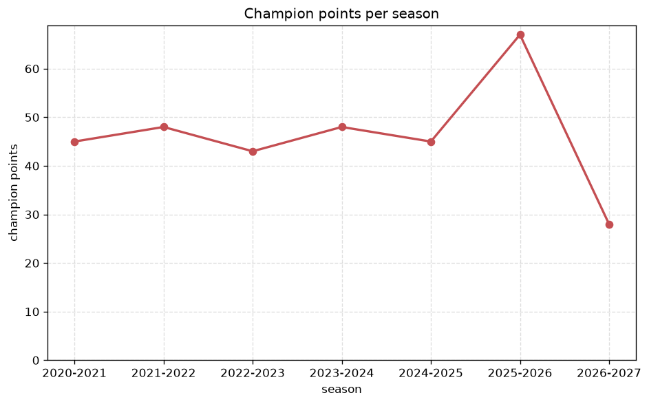
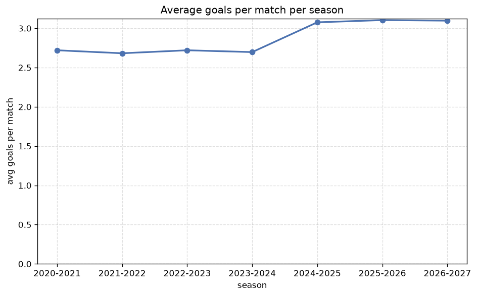

# Season Trends Analysis
- Report: `season_trends`
- Generated: 2026-10-27T01:44:45+00:00
- Script: `backend/scripts/analyze_seasons.py` v1.0.0
- League: Superliga (Denmark)
- Scope: league `denmark1`

## 1. Champions per season
| season | champion | pts | runner-up | margin |
|---|---|---|---|---|
| 2020-2021 | Brondby | 45 | Midtjylland | 2 pts |
| 2021-2022 | FC Copenhagen | 48 | Midtjylland | 6 pts |
| 2022-2023 | Nordsjaelland | 43 | FC Copenhagen | 1 pts |
| 2023-2024 | Midtjylland | 48 | Brondby | 1 pts |
| 2024-2025 | Midtjylland | 45 | FC Copenhagen | 4 pts |
| 2025-2026 | Aarhus | 67 | Midtjylland | 7 pts |
| 2026-2027 | Midtjylland | 28 | FC Copenhagen | 3 pts |

## 2. Title-race tightness
- Tight races (margin <= 3 pts): **4** of 7 seasons
- Tightest race: **2022-2023** - Nordsjaelland beat FC Copenhagen by **1** pts

| season | margin | tight |
|---|---|---|
| 2020-2021 | 2 pts | yes |
| 2021-2022 | 6 pts |  |
| 2022-2023 | 1 pts | yes |
| 2023-2024 | 1 pts | yes |
| 2024-2025 | 4 pts |  |
| 2025-2026 | 7 pts |  |
| 2026-2027 | 3 pts | yes |

## 3. Points thresholds
_Position-specific points per season. Key: 1 = champion, 2 = runner-up, 4 = CL line, 6 = Europa, 9 = last safe, 12 = bottom._

| season | pos 1 | pos 2 | pos 4 | pos 6 | pos 9 | pos 12 |
|---|---|---|---|---|---|---|
| 2020-2021 | 45 | 43 | 35 | 29 | 28 | 12 |
| 2021-2022 | 48 | 42 | 38 | 31 | 21 | 13 |
| 2022-2023 | 43 | 42 | 35 | 30 | 28 | 15 |
| 2023-2024 | 48 | 47 | 37 | 27 | 23 | 11 |
| 2024-2025 | 45 | 41 | 35 | 33 | 21 | 13 |
| 2025-2026 | 67 | 60 | 50 | 44 | 36 | 24 |
| 2026-2027 | 28 | 25 | 20 | 16 | 13 | 8 |

## 4. Relegation battle
| season | safe pos | safe pts | drop pos | drop pts | gap |
|---|---|---|---|---|---|
| 2020-2021 | 9 | 28 | 10 | 24 | 4 pts |
| 2021-2022 | 9 | 21 | 10 | 21 | 0 pts |
| 2022-2023 | 9 | 28 | 10 | 23 | 5 pts |
| 2023-2024 | 9 | 23 | 10 | 23 | 0 pts |
| 2024-2025 | 9 | 21 | 10 | 18 | 3 pts |
| 2025-2026 | 9 | 36 | 10 | 35 | 1 pts |
| 2026-2027 | 9 | 13 | 10 | 11 | 2 pts |

## 5. League-level trends
| season | matches | total goals | avg goals | home win | draw | away win | goalless | avg pts/team |
|---|---|---|---|---|---|---|---|---|
| 2020-2021 | 132 | 359 | 2.72 | 41.7% | 25.8% | 32.6% | 7.6% | 30.17 |
| 2021-2022 | 132 | 354 | 2.682 | 38.6% | 30.3% | 31.1% | 6.1% | 29.67 |
| 2022-2023 | 132 | 359 | 2.72 | 40.2% | 28.8% | 31.1% | 7.6% | 29.83 |
| 2023-2024 | 132 | 356 | 2.697 | 40.2% | 25.0% | 34.8% | 6.1% | 30.25 |
| 2024-2025 | 132 | 406 | 3.076 | 44.7% | 31.1% | 24.2% | 4.5% | 29.58 |
| 2025-2026 | 193 | 599 | 3.104 | 41.5% | 23.3% | 35.2% | 5.7% | 44.25 |
| 2026-2027 | 72 | 223 | 3.097 | 44.4% | 30.6% | 25.0% | 4.2% | 16.17 |

## 6. View divergence
- Largest divergence: **2021-2022** (goals view, avg abs position diff = 5.167)

_Avg absolute position difference between classic view and alternative view per season._

| season | classic vs luck | classic vs goals |
|---|---|---|
| 2020-2021 | 2.000 | 3.500 |
| 2021-2022 | 1.167 | 5.167 |
| 2022-2023 | 1.833 | 3.833 |
| 2023-2024 | 1.833 | 3.167 |
| 2024-2025 | 2.333 | 4.500 |
| 2025-2026 | 2.833 | 4.000 |
| 2026-2027 | 2.167 | 4.000 |

---
*All statistics are computed from PostgreSQL tables (read-only). Run with `python backend/scripts/analyze_seasons.py` to regenerate.*

## Charts

