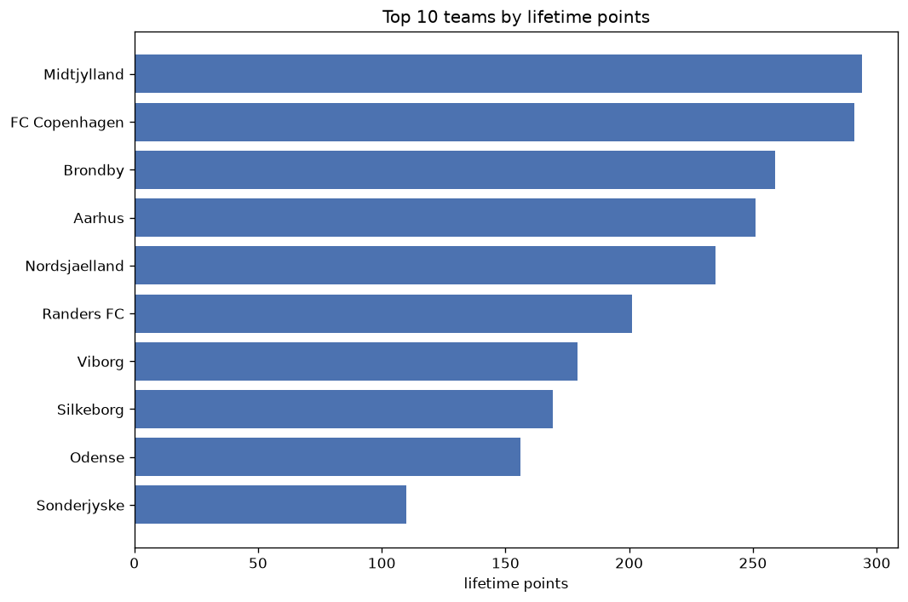
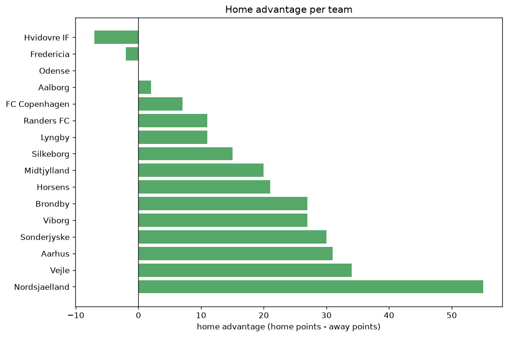

# Team Analysis
- Report: `teams_analysis`
- Generated: 2026-10-30T03:48:30+00:00
- Script: `backend/scripts/analyze_teams.py` v1.0.0
- League: Superliga (Denmark)
- Scope: league `denmark1`

- Teams: **16** | Seasons: **7** | Matches: **926**

## 1. Team standings (lifetime)
| team | seasons | played | W | D | L | pts | GF | GA | GD | avg pts/season | best pos | worst pos | titles |
|---|---|---|---|---|---|---|---|---|---|---|---|---|---|
| Midtjylland | 7 | 154 | 85 | 39 | 30 | 294 | 285 | 170 | 115 | 42.0 | 1 | 8 | 3 |
| FC Copenhagen | 7 | 155 | 86 | 33 | 36 | 291 | 306 | 174 | 132 | 41.57 | 1 | 4 | 1 |
| Brondby | 7 | 155 | 74 | 37 | 44 | 259 | 254 | 192 | 62 | 37.0 | 1 | 6 | 1 |
| Aarhus | 7 | 155 | 65 | 56 | 34 | 251 | 234 | 168 | 66 | 35.86 | 1 | 8 | 1 |
| Nordsjaelland | 7 | 154 | 64 | 43 | 47 | 235 | 240 | 204 | 36 | 33.57 | 1 | 10 | 1 |
| Randers FC | 7 | 154 | 52 | 45 | 57 | 201 | 192 | 207 | -15 | 28.71 | 4 | 10 | 0 |
| Viborg | 6 | 132 | 48 | 35 | 49 | 179 | 193 | 197 | -4 | 29.83 | 3 | 9 | 0 |
| Silkeborg | 6 | 133 | 43 | 40 | 50 | 169 | 193 | 206 | -13 | 28.17 | 6 | 9 | 0 |
| Odense | 6 | 132 | 38 | 42 | 52 | 156 | 170 | 209 | -39 | 26.0 | 7 | 9 | 0 |
| Sonderjyske | 5 | 110 | 28 | 26 | 56 | 110 | 134 | 202 | -68 | 22.0 | 7 | 12 | 0 |
| Aalborg | 4 | 88 | 26 | 24 | 38 | 102 | 101 | 130 | -29 | 25.5 | 4 | 12 | 0 |
| Vejle | 5 | 120 | 22 | 30 | 68 | 96 | 125 | 221 | -96 | 19.2 | 10 | 12 | 0 |
| Lyngby | 5 | 100 | 18 | 31 | 51 | 85 | 105 | 171 | -66 | 17.0 | 8 | 11 | 0 |
| Horsens | 3 | 56 | 12 | 15 | 29 | 51 | 64 | 94 | -30 | 17.0 | 6 | 12 | 0 |
| Fredericia | 1 | 32 | 9 | 7 | 16 | 34 | 45 | 68 | -23 | 34.0 | 11 | 11 | 0 |
| Hvidovre IF | 1 | 22 | 2 | 5 | 15 | 11 | 17 | 45 | -28 | 11.0 | 12 | 12 | 0 |

## 2. Home vs away split
| team | home P | H-W | H-D | H-L | H-pts | away P | A-W | A-D | A-L | A-pts | adv |
|---|---|---|---|---|---|---|---|---|---|---|---|
| Nordsjaelland | 76 | 41 | 22 | 13 | 145 | 78 | 23 | 21 | 34 | 90 | 55 |
| Vejle | 60 | 16 | 17 | 27 | 65 | 60 | 6 | 13 | 41 | 31 | 34 |
| Aarhus | 78 | 39 | 24 | 15 | 141 | 77 | 26 | 32 | 19 | 110 | 31 |
| Sonderjyske | 55 | 19 | 13 | 23 | 70 | 55 | 9 | 13 | 33 | 40 | 30 |
| Brondby | 78 | 41 | 20 | 17 | 143 | 77 | 33 | 17 | 27 | 116 | 27 |
| Viborg | 66 | 29 | 16 | 21 | 103 | 66 | 19 | 19 | 28 | 76 | 27 |
| Horsens | 29 | 9 | 9 | 11 | 36 | 27 | 3 | 6 | 18 | 15 | 21 |
| Midtjylland | 77 | 48 | 13 | 16 | 157 | 77 | 37 | 26 | 14 | 137 | 20 |
| Silkeborg | 66 | 24 | 20 | 22 | 92 | 67 | 19 | 20 | 28 | 77 | 15 |
| Randers FC | 78 | 29 | 19 | 30 | 106 | 76 | 23 | 26 | 27 | 95 | 11 |
| Lyngby | 50 | 8 | 24 | 18 | 48 | 50 | 10 | 7 | 33 | 37 | 11 |
| FC Copenhagen | 77 | 43 | 20 | 14 | 149 | 78 | 43 | 13 | 22 | 142 | 7 |
| Aalborg | 44 | 13 | 13 | 18 | 52 | 44 | 13 | 11 | 20 | 50 | 2 |
| Odense | 65 | 20 | 18 | 27 | 78 | 67 | 18 | 24 | 25 | 78 | 0 |
| Fredericia | 16 | 4 | 4 | 8 | 16 | 16 | 5 | 3 | 8 | 18 | -2 |
| Hvidovre IF | 11 | 0 | 2 | 9 | 2 | 11 | 2 | 3 | 6 | 9 | -7 |

## 3. Top performers
### Best points per game (PPG)
| rank | team | PPG |
|---|---|---|
| 1 | Midtjylland | 1.91 |
| 2 | FC Copenhagen | 1.88 |
| 3 | Brondby | 1.67 |
| 4 | Aarhus | 1.62 |
| 5 | Nordsjaelland | 1.53 |

### Most goals scored
| rank | team | goals |
|---|---|---|
| 1 | FC Copenhagen | 306 |
| 2 | Midtjylland | 285 |
| 3 | Brondby | 254 |
| 4 | Nordsjaelland | 240 |
| 5 | Aarhus | 234 |

### Best goal difference
| rank | team | GD |
|---|---|---|
| 1 | FC Copenhagen | 132 |
| 2 | Midtjylland | 115 |
| 3 | Aarhus | 66 |
| 4 | Brondby | 62 |
| 5 | Nordsjaelland | 36 |

### Best defence (goals against per match, standings)
| rank | team | GA/match |
|---|---|---|
| 1 | Aarhus | 1.084 |
| 2 | Midtjylland | 1.104 |
| 3 | FC Copenhagen | 1.123 |
| 4 | Brondby | 1.227 |
| 5 | Nordsjaelland | 1.325 |

## 4. Team consistency
- Teams present in all **7** seasons: **6**

Aarhus, Brondby, FC Copenhagen, Midtjylland, Nordsjaelland, Randers FC

## 5. Head-to-head dominance
- Distinct fixtures: **113** (showing the 15 most frequent)

| fixture | meetings | home wins | draws | away wins | home pct | draw pct | away pct |
|---|---|---|---|---|---|---|---|
| Brondby vs Nordsjaelland | 15 | 8 | 2 | 5 | 53.3% | 13.3% | 33.3% |
| Midtjylland vs Nordsjaelland | 15 | 8 | 6 | 1 | 53.3% | 40.0% | 6.7% |
| Aarhus vs Nordsjaelland | 15 | 5 | 5 | 5 | 33.3% | 33.3% | 33.3% |
| Brondby vs Midtjylland | 15 | 5 | 1 | 9 | 33.3% | 6.7% | 60.0% |
| Brondby vs Aarhus | 15 | 4 | 8 | 3 | 26.7% | 53.3% | 20.0% |
| FC Copenhagen vs Randers FC | 15 | 4 | 1 | 10 | 26.7% | 6.7% | 66.7% |
| Midtjylland vs Aarhus | 15 | 4 | 5 | 6 | 26.7% | 33.3% | 40.0% |
| Aarhus vs Viborg | 14 | 8 | 4 | 2 | 57.1% | 28.6% | 14.3% |
| Brondby vs FC Copenhagen | 14 | 7 | 3 | 4 | 50.0% | 21.4% | 28.6% |
| FC Copenhagen vs Odense | 14 | 7 | 4 | 3 | 50.0% | 28.6% | 21.4% |
| Brondby vs Randers FC | 14 | 3 | 6 | 5 | 21.4% | 42.9% | 35.7% |
| Nordsjaelland vs Viborg | 13 | 9 | 2 | 2 | 69.2% | 15.4% | 15.4% |
| FC Copenhagen vs Nordsjaelland | 13 | 7 | 2 | 4 | 53.8% | 15.4% | 30.8% |
| Midtjylland vs FC Copenhagen | 13 | 7 | 3 | 3 | 53.8% | 23.1% | 23.1% |
| Randers FC vs Nordsjaelland | 13 | 7 | 4 | 2 | 53.8% | 30.8% | 15.4% |

## 6. Position per season (classic view)
_Cells show final position; '-' when the team was absent from that season._

| team | 2020-2021 | 2021-2022 | 2022-2023 | 2023-2024 | 2024-2025 | 2025-2026 | 2026-2027 |
|---|---|---|---|---|---|---|---|
| Midtjylland | 2 | 2 | 8 | 1 | 1 | 2 | 1 |
| FC Copenhagen | 4 | 1 | 2 | 3 | 2 | 3 | 2 |
| Brondby | 1 | 3 | 6 | 2 | 6 | 5 | 5 |
| Aarhus | 3 | 8 | 4 | 5 | 3 | 1 | 8 |
| Nordsjaelland | 6 | 10 | 1 | 4 | 5 | 4 | 4 |
| Randers FC | 5 | 5 | 5 | 10 | 4 | 10 | 10 |
| Viborg | - | 7 | 3 | 9 | 8 | 6 | 3 |
| Silkeborg | - | 6 | 7 | 6 | 7 | 9 | 9 |
| Odense | 8 | 9 | 9 | 7 | - | 8 | 7 |
| Sonderjyske | 7 | 12 | - | - | 11 | 7 | 12 |
| Aalborg | 9 | 4 | 12 | - | 9 | - | - |
| Vejle | 10 | 11 | - | 11 | 12 | 12 | - |
| Lyngby | 11 | - | 11 | 8 | 10 | - | 11 |
| Horsens | 12 | - | 10 | - | - | - | 6 |
| Fredericia | - | - | - | - | - | 11 | - |
| Hvidovre IF | - | - | - | 12 | - | - | - |

---
*All statistics are computed from PostgreSQL tables (read-only). Run with `python backend/scripts/analyze_teams.py` to regenerate.*

## Charts

