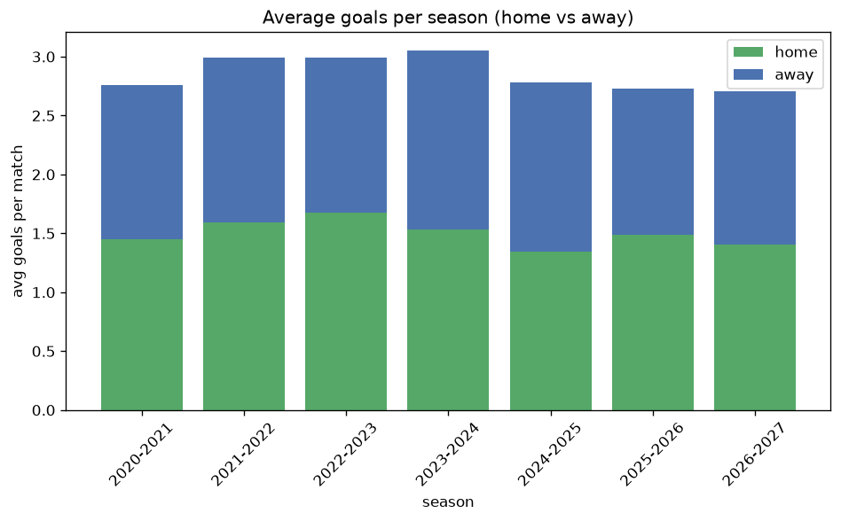

# Goal Analysis
- Report: `goals_analysis`
- Generated: 2026-10-30T03:48:47+00:00
- Script: `backend/scripts/analyze_goals.py` v1.0.0
- League: 1st Division (Denmark)
- Scope: league `denmark2`

## 1. Goals per match distribution
| goals | matches | pct |
|---|---|---|
| 0 | 52 | 6.1% |
| 1 | 134 | 15.8% |
| 2 | 190 | 22.4% |
| 3 | 197 | 23.2% |
| 4 | 138 | 16.3% |
| 5 | 77 | 9.1% |
| 6 | 44 | 5.2% |
| 7 | 10 | 1.2% |
| 8 | 3 | 0.4% |
| 9 | 3 | 0.4% |

## 2. Goals per match per season
| season | matches | total goals | avg home | avg away | avg total |
|---|---|---|---|---|---|
| 2020-2021 | 132 | 364 | 1.447 | 1.311 | 2.758 |
| 2021-2022 | 132 | 395 | 1.591 | 1.402 | 2.992 |
| 2022-2023 | 132 | 395 | 1.674 | 1.318 | 2.992 |
| 2023-2024 | 110 | 336 | 1.536 | 1.518 | 3.055 |
| 2024-2025 | 110 | 306 | 1.345 | 1.436 | 2.782 |
| 2025-2026 | 160 | 436 | 1.488 | 1.238 | 2.725 |
| 2026-2027 | 72 | 195 | 1.403 | 1.306 | 2.708 |

## 3. Home vs away goal share
- Home goals: **1278** (52.7%)
- Away goals: **1149** (47.3%)
- Home/away ratio: **1.112**

| season | home goals | away goals | total | home pct | away pct |
|---|---|---|---|---|---|
| 2020-2021 | 191 | 173 | 364 | 52.5% | 47.5% |
| 2021-2022 | 210 | 185 | 395 | 53.2% | 46.8% |
| 2022-2023 | 221 | 174 | 395 | 55.9% | 44.1% |
| 2023-2024 | 169 | 167 | 336 | 50.3% | 49.7% |
| 2024-2025 | 148 | 158 | 306 | 48.4% | 51.6% |
| 2025-2026 | 238 | 198 | 436 | 54.6% | 45.4% |
| 2026-2027 | 101 | 94 | 195 | 51.8% | 48.2% |

## 4. BTTS (Both Teams To Score)
- Overall: **460** of `848` (54.2%)

| season | matches | BTTS | pct |
|---|---|---|---|
| 2020-2021 | 132 | 68 | 51.5% |
| 2021-2022 | 132 | 73 | 55.3% |
| 2022-2023 | 132 | 68 | 51.5% |
| 2023-2024 | 110 | 67 | 60.9% |
| 2024-2025 | 110 | 56 | 50.9% |
| 2025-2026 | 160 | 85 | 53.1% |
| 2026-2027 | 72 | 43 | 59.7% |

## 5. Clean sheets
- Home clean sheets: **235** (27.7%)
- Away clean sheets: **205** (24.2%)
- Total clean sheets recorded: **440**
- Matches with at least one clean sheet: **388** (45.8%)
- Both teams kept clean sheets (0-0): **52**

| season | matches | home CS | away CS | total CS | matches w/ CS |
|---|---|---|---|---|---|
| 2020-2021 | 132 | 34 | 36 | 70 | 64 (48.5%) |
| 2021-2022 | 132 | 37 | 27 | 64 | 59 (44.7%) |
| 2022-2023 | 132 | 43 | 29 | 72 | 64 (48.5%) |
| 2023-2024 | 110 | 26 | 23 | 49 | 43 (39.1%) |
| 2024-2025 | 110 | 30 | 31 | 61 | 54 (49.1%) |
| 2025-2026 | 160 | 46 | 41 | 87 | 75 (46.9%) |
| 2026-2027 | 72 | 19 | 18 | 37 | 29 (40.3%) |

## 6. Scoring intensity
- First-half goals: **1078** (44.4%)
- Second-half goals: **1349** (55.6%)
- Avg first-half goals per match: **1.271**
- Avg second-half goals per match: **1.591**
- Second-half-only scoring (HT 0-0, FT goals >= 1): **173** (20.4%)

| season | matches | 1st half | 2nd half | 1st half pct | 2nd half pct |
|---|---|---|---|---|---|
| 2020-2021 | 132 | 163 | 201 | 44.8% | 55.2% |
| 2021-2022 | 132 | 186 | 209 | 47.1% | 52.9% |
| 2022-2023 | 132 | 175 | 220 | 44.3% | 55.7% |
| 2023-2024 | 110 | 136 | 200 | 40.5% | 59.5% |
| 2024-2025 | 110 | 136 | 170 | 44.4% | 55.6% |
| 2025-2026 | 160 | 195 | 241 | 44.7% | 55.3% |
| 2026-2027 | 72 | 87 | 108 | 44.6% | 55.4% |

## 7. First-goal timing
- Matches with first-goal time recorded: `796` of `848` (93.9%)
- Goalless matches: `52`
- Min `1` | Max `94` | Mean `28.4` | Median (p50) `21.0`

| bucket | count | % of matches | % of scoring matches |
|---|---|---|---|
| 1-15 | 307 | 36.2% | 38.6% |
| 16-30 | 189 | 22.3% | 23.7% |
| 31-45 | 110 | 13.0% | 13.8% |
| 46-60 | 100 | 11.8% | 12.6% |
| 61-75 | 50 | 5.9% | 6.3% |
| 76-90 | 31 | 3.7% | 3.9% |
| 91-120 | 9 | 1.1% | 1.1% |

---
*All statistics are computed from PostgreSQL tables (read-only). Run with `python backend/scripts/analyze_goals.py` to regenerate.*

## Charts

