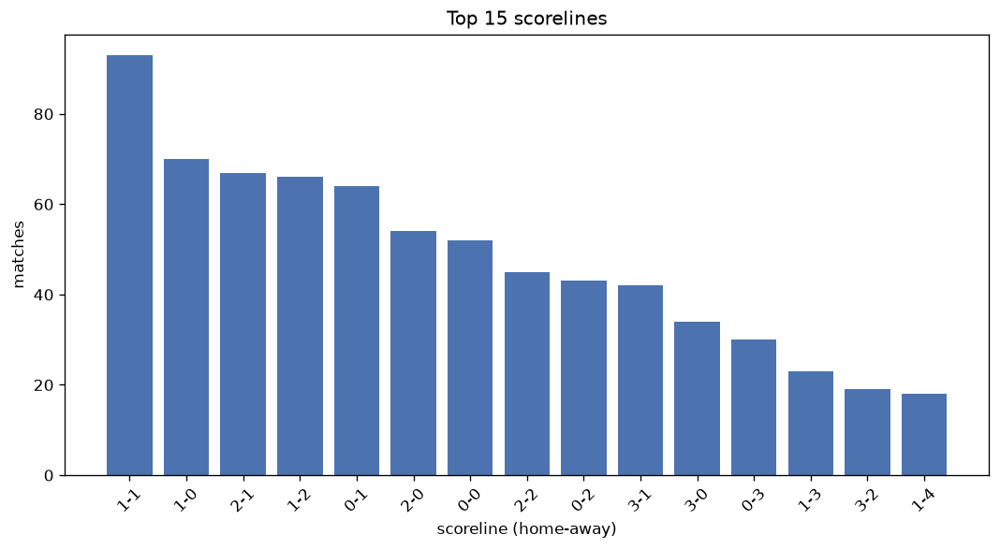
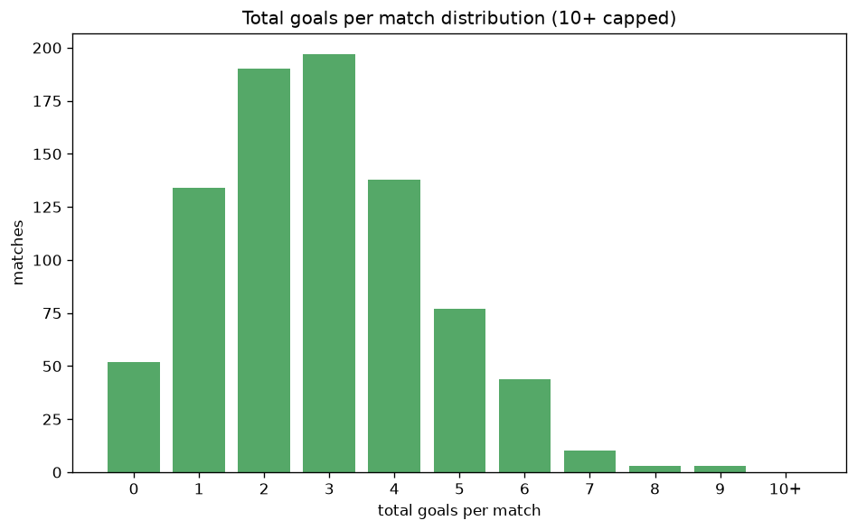

# Scoreline Analysis
- Report: `scoreline_analysis`
- Generated: 2026-10-26T01:30:12+00:00
- Script: `backend/scripts/analyze_scorelines.py` v1.0.0
- League: 1st Division (Denmark)
- Scope: league `denmark2`

## 1. Scoreline frequency
- Matches analysed: **848** across **7** seasons.
- Distinct scorelines seen: **39**.

| scoreline | count | pct |
|---|---|---|
| 1-1 | 93 | 11.0% |
| 1-0 | 70 | 8.3% |
| 2-1 | 67 | 7.9% |
| 1-2 | 66 | 7.8% |
| 0-1 | 64 | 7.5% |
| 2-0 | 54 | 6.4% |
| 0-0 | 52 | 6.1% |
| 2-2 | 45 | 5.3% |
| 0-2 | 43 | 5.1% |
| 3-1 | 42 | 5.0% |
| 3-0 | 34 | 4.0% |
| 0-3 | 30 | 3.5% |
| 1-3 | 23 | 2.7% |
| 3-2 | 19 | 2.2% |
| 1-4 | 18 | 2.1% |
| 2-3 | 17 | 2.0% |
| 4-0 | 16 | 1.9% |
| 4-1 | 16 | 1.9% |
| 3-3 | 13 | 1.5% |
| 0-4 | 12 | 1.4% |

## 2. Scoreline frequency per season

### 2020-2021
| scoreline | count | pct |
|---|---|---|
| 1-1 | 16 | 12.1% |
| 1-2 | 14 | 10.6% |
| 0-1 | 13 | 9.8% |
| 2-1 | 12 | 9.1% |
| 2-0 | 12 | 9.1% |

### 2021-2022
| scoreline | count | pct |
|---|---|---|
| 1-1 | 17 | 12.9% |
| 1-0 | 13 | 9.8% |
| 1-2 | 10 | 7.6% |
| 2-1 | 10 | 7.6% |
| 3-0 | 9 | 6.8% |

### 2022-2023
| scoreline | count | pct |
|---|---|---|
| 1-0 | 12 | 9.1% |
| 1-1 | 11 | 8.3% |
| 2-1 | 9 | 6.8% |
| 0-1 | 9 | 6.8% |
| 2-0 | 9 | 6.8% |

### 2023-2024
| scoreline | count | pct |
|---|---|---|
| 1-1 | 12 | 10.9% |
| 1-2 | 10 | 9.1% |
| 0-1 | 9 | 8.2% |
| 2-1 | 7 | 6.4% |
| 1-0 | 7 | 6.4% |

### 2024-2025
| scoreline | count | pct |
|---|---|---|
| 1-0 | 11 | 10.0% |
| 1-2 | 11 | 10.0% |
| 1-1 | 10 | 9.1% |
| 2-0 | 9 | 8.2% |
| 0-1 | 9 | 8.2% |

### 2025-2026
| scoreline | count | pct |
|---|---|---|
| 1-1 | 18 | 11.2% |
| 2-1 | 15 | 9.4% |
| 0-1 | 14 | 8.8% |
| 1-0 | 13 | 8.1% |
| 0-0 | 12 | 7.5% |

### 2026-2027
| scoreline | count | pct |
|---|---|---|
| 2-2 | 9 | 12.5% |
| 1-1 | 9 | 12.5% |
| 2-1 | 8 | 11.1% |
| 0-0 | 8 | 11.1% |
| 1-0 | 7 | 9.7% |

## 3. Total-goal histogram
_10+ groups all matches with 10 or more total goals._

| total goals | matches | pct |
|---|---|---|
| 0 | 52 | 6.1% |
| 1 | 134 | 15.8% |
| 2 | 190 | 22.4% |
| 3 | 197 | 23.2% |
| 4 | 138 | 16.3% |
| 5 | 77 | 9.1% |
| 6 | 44 | 5.2% |
| 7 | 10 | 1.2% |
| 8 | 3 | 0.4% |
| 9 | 3 | 0.4% |
| 10+ | 0 | 0.0% |

## 4. Extreme scorelines
- Matches with 7+ total goals: **16**

| season | date | scoreline | total goals |
|---|---|---|---|
| 2022-2023 | 2022-10-29 | 4-5 | 9 |
| 2024-2025 | 2024-07-26 | 3-6 | 9 |
| 2026-2027 | 2026-08-09 | 5-4 | 9 |
| 2021-2022 | 2021-08-01 | 4-4 | 8 |
| 2021-2022 | 2021-10-29 | 2-6 | 8 |
| 2023-2024 | 2024-02-23 | 4-4 | 8 |
| 2020-2021 | 2020-11-29 | 3-4 | 7 |
| 2021-2022 | 2021-09-12 | 4-3 | 7 |
| 2021-2022 | 2021-11-07 | 6-1 | 7 |
| 2023-2024 | 2023-08-23 | 1-6 | 7 |
| 2023-2024 | 2023-09-24 | 3-4 | 7 |
| 2023-2024 | 2024-03-10 | 4-3 | 7 |
| 2024-2025 | 2024-09-01 | 3-4 | 7 |
| 2024-2025 | 2025-02-28 | 3-4 | 7 |
| 2025-2026 | 2026-04-04 | 2-5 | 7 |
| 2026-2027 | 2026-09-21 | 5-2 | 7 |

## 5. Margin-of-victory distribution (decided matches)
- Decided matches: **643** (draws: **205**)
- Average winning margin: **1.87**

| margin | matches | pct |
|---|---|---|
| 1 | 311 | 48.4% |
| 2 | 177 | 27.5% |
| 3+ | 155 | 24.1% |

## 6. Margin by outcome

### Home wins
- Matches: **349** | avg margin: **1.91** | max margin: **6**
| margin | matches | pct |
|---|---|---|
| 1 | 159 | 45.6% |
| 2 | 107 | 30.7% |
| 3+ | 83 | 23.8% |
- *Full match-by-match list available in `scoreline_analysis.json`.*

### Away wins
- Matches: **294** | avg margin: **1.83** | max margin: **6**
| margin | matches | pct |
|---|---|---|
| 1 | 152 | 51.7% |
| 2 | 70 | 23.8% |
| 3+ | 72 | 24.5% |
- *Full match-by-match list available in `scoreline_analysis.json`.*

## 7. Most common exact score by outcome type
| outcome | matches | most common score | count | pct |
|---|---|---|---|---|
| home | 349 | 1-0 | 70 | 20.1% |
| draw | 205 | 1-1 | 93 | 45.4% |
| away | 294 | 1-2 | 66 | 22.4% |

---
*All statistics are computed from PostgreSQL tables (read-only). Run with `python backend/scripts/analyze_scorelines.py` to regenerate.*

## Charts

