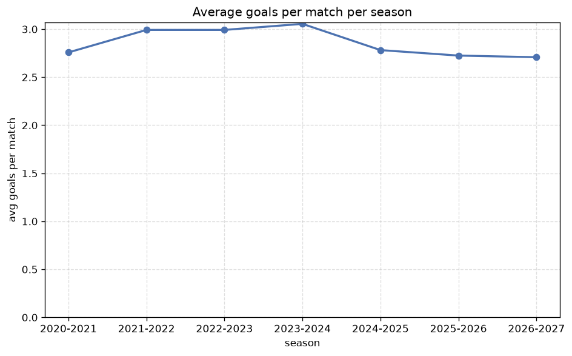

# Season Trends Analysis
- Report: `season_trends`
- Generated: 2026-10-30T03:48:50+00:00
- Script: `backend/scripts/analyze_seasons.py` v1.0.0
- League: 1st Division (Denmark)
- Scope: league `denmark2`

## 1. Champions per season
| season | champion | pts | runner-up | margin |
|---|---|---|---|---|
| 2020-2021 | Viborg | 56 | Silkeborg | 7 pts |
| 2021-2022 | Helsingor | 51 | Lyngby | 8 pts |
| 2022-2023 | Vejle | 50 | Hvidovre IF | 6 pts |
| 2023-2024 | Aalborg | 51 | Sonderjyske | 2 pts |
| 2024-2025 | Odense | 49 | Fredericia | 9 pts |
| 2025-2026 | Lyngby | 60 | Horsens | 6 pts |
| 2026-2027 | Hvidovre IF | 28 | Vejle | 5 pts |

## 2. Title-race tightness
- Tight races (margin <= 3 pts): **1** of 7 seasons
- Tightest race: **2023-2024** - Aalborg beat Sonderjyske by **2** pts

| season | margin | tight |
|---|---|---|
| 2020-2021 | 7 pts |  |
| 2021-2022 | 8 pts |  |
| 2022-2023 | 6 pts |  |
| 2023-2024 | 2 pts | yes |
| 2024-2025 | 9 pts |  |
| 2025-2026 | 6 pts |  |
| 2026-2027 | 5 pts |  |

## 3. Points thresholds
_Position-specific points per season. Key: 1 = champion, 2 = runner-up, 4 = CL line, 6 = Europa, 9 = last safe, 12 = bottom._

| season | pos 1 | pos 2 | pos 4 | pos 6 | pos 9 | pos 12 |
|---|---|---|---|---|---|---|
| 2020-2021 | 56 | 49 | 36 | 30 | 23 | 14 |
| 2021-2022 | 51 | 43 | 40 | 25 | 22 | 16 |
| 2022-2023 | 50 | 44 | 35 | 32 | 23 | 17 |
| 2023-2024 | 51 | 49 | 35 | 33 | 18 | - |
| 2024-2025 | 49 | 40 | 36 | 34 | 22 | - |
| 2025-2026 | 60 | 54 | 50 | 46 | 40 | - |
| 2026-2027 | 28 | 23 | 18 | 15 | 12 | 10 |

## 4. Relegation battle
| season | safe pos | safe pts | drop pos | drop pts | gap |
|---|---|---|---|---|---|
| 2020-2021 | 9 | 23 | 10 | 16 | 7 pts |
| 2021-2022 | 9 | 22 | 10 | 20 | 2 pts |
| 2022-2023 | 9 | 23 | 10 | 23 | 0 pts |
| 2023-2024 | 9 | 18 | 10 | 14 | 4 pts |
| 2024-2025 | 9 | 22 | 10 | 20 | 2 pts |
| 2025-2026 | 9 | 40 | 10 | 38 | 2 pts |
| 2026-2027 | 9 | 12 | 10 | 11 | 1 pts |

## 5. League-level trends
| season | matches | total goals | avg goals | home win | draw | away win | goalless | avg pts/team |
|---|---|---|---|---|---|---|---|---|
| 2020-2021 | 132 | 364 | 2.758 | 41.7% | 19.7% | 38.6% | 4.5% | 30.83 |
| 2021-2022 | 132 | 395 | 2.992 | 43.9% | 24.2% | 31.8% | 3.8% | 30.33 |
| 2022-2023 | 132 | 395 | 2.992 | 46.2% | 18.9% | 34.8% | 6.1% | 30.92 |
| 2023-2024 | 110 | 336 | 3.055 | 36.4% | 25.5% | 38.2% | 5.5% | 30.55 |
| 2024-2025 | 110 | 306 | 2.782 | 40.0% | 20.0% | 40.0% | 6.4% | 31.45 |
| 2025-2026 | 160 | 436 | 2.725 | 41.2% | 28.1% | 30.6% | 7.5% | 44.27 |
| 2026-2027 | 72 | 195 | 2.708 | 34.7% | 37.5% | 27.8% | 11.1% | 15.75 |

## 6. View divergence
- Largest divergence: **2020-2021** (goals view, avg abs position diff = 4.833)

_Avg absolute position difference between classic view and alternative view per season._

| season | classic vs luck | classic vs goals |
|---|---|---|
| 2020-2021 | 1.000 | 4.833 |
| 2021-2022 | 2.167 | 4.333 |
| 2022-2023 | 2.500 | 4.000 |
| 2023-2024 | 1.273 | 4.000 |
| 2024-2025 | 1.818 | 2.909 |
| 2025-2026 | 1.818 | 3.636 |
| 2026-2027 | 1.500 | 4.500 |

---
*All statistics are computed from PostgreSQL tables (read-only). Run with `python backend/scripts/analyze_seasons.py` to regenerate.*

## Charts

