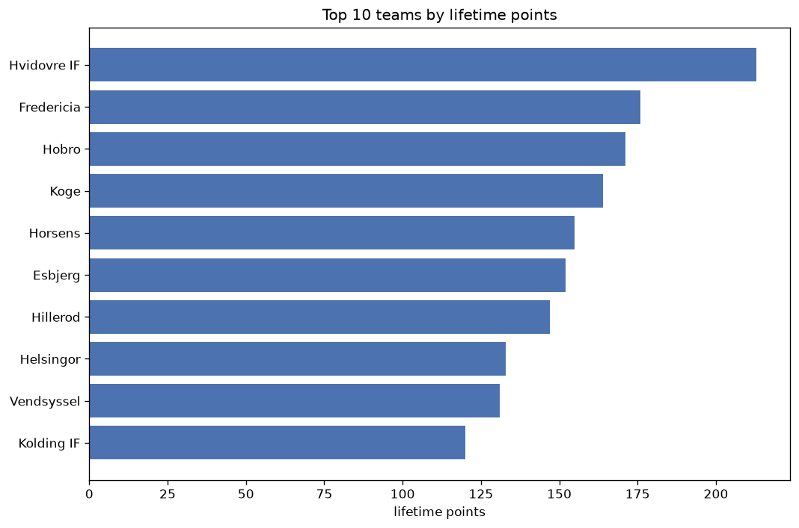

# Team Analysis
- Report: `teams_analysis`
- Generated: 2026-10-27T01:45:03+00:00
- Script: `backend/scripts/analyze_teams.py` v1.0.0
- League: 1st Division (Denmark)
- Scope: league `denmark2`

- Teams: **26** | Seasons: **7** | Matches: **848**

## 1. Team standings (lifetime)
| team | seasons | played | W | D | L | pts | GF | GA | GD | avg pts/season | best pos | worst pos | titles |
|---|---|---|---|---|---|---|---|---|---|---|---|---|---|
| Hvidovre IF | 6 | 128 | 60 | 33 | 35 | 213 | 191 | 152 | 39 | 35.5 | 1 | 9 | 1 |
| Fredericia | 6 | 118 | 50 | 26 | 42 | 176 | 179 | 160 | 19 | 29.33 | 2 | 11 | 0 |
| Hobro | 7 | 146 | 44 | 39 | 63 | 171 | 179 | 224 | -45 | 24.43 | 6 | 9 | 0 |
| Koge | 7 | 146 | 43 | 35 | 68 | 164 | 180 | 230 | -50 | 23.43 | 6 | 10 | 0 |
| Horsens | 4 | 92 | 45 | 20 | 27 | 155 | 139 | 105 | 34 | 38.75 | 2 | 8 | 0 |
| Esbjerg | 5 | 106 | 44 | 20 | 42 | 152 | 141 | 153 | -12 | 30.4 | 3 | 12 | 0 |
| Hillerod | 5 | 104 | 39 | 30 | 35 | 147 | 153 | 152 | 1 | 29.4 | 4 | 9 | 0 |
| Helsingor | 4 | 86 | 39 | 16 | 31 | 133 | 136 | 126 | 10 | 33.25 | 1 | 11 | 1 |
| Vendsyssel | 6 | 118 | 33 | 32 | 53 | 131 | 142 | 184 | -42 | 21.83 | 3 | 11 | 0 |
| Kolding IF | 5 | 104 | 30 | 30 | 44 | 120 | 116 | 138 | -22 | 24.0 | 5 | 11 | 0 |
| Lyngby | 2 | 52 | 29 | 12 | 11 | 99 | 110 | 56 | 54 | 49.5 | 1 | 2 | 1 |
| Aalborg | 3 | 60 | 26 | 19 | 15 | 97 | 99 | 80 | 19 | 32.33 | 1 | 7 | 1 |
| Sonderjyske | 2 | 42 | 23 | 9 | 10 | 78 | 91 | 53 | 38 | 39.0 | 2 | 4 | 0 |
| Vejle | 2 | 34 | 22 | 7 | 5 | 73 | 71 | 35 | 36 | 36.5 | 1 | 2 | 1 |
| F. Amager | 3 | 66 | 20 | 9 | 37 | 69 | 90 | 121 | -31 | 23.0 | 7 | 11 | 0 |
| Viborg | 1 | 22 | 17 | 5 | 0 | 56 | 45 | 14 | 31 | 56.0 | 1 | 1 | 1 |
| Aarhus Fremad | 2 | 40 | 12 | 16 | 12 | 52 | 53 | 42 | 11 | 26.0 | 5 | 7 | 0 |
| Silkeborg | 1 | 22 | 16 | 1 | 5 | 49 | 53 | 19 | 34 | 49.0 | 2 | 2 | 0 |
| Odense | 1 | 20 | 13 | 6 | 1 | 45 | 42 | 18 | 24 | 45.0 | 1 | 1 | 1 |
| Naestved | 2 | 42 | 9 | 18 | 15 | 45 | 57 | 67 | -10 | 22.5 | 6 | 10 | 0 |
| Nykobing | 2 | 44 | 11 | 9 | 24 | 42 | 61 | 81 | -20 | 21.0 | 6 | 12 | 0 |
| AB Copenhagen | 1 | 12 | 5 | 3 | 4 | 18 | 17 | 12 | 5 | 18.0 | 4 | 4 | 0 |
| Jammerbugt | 1 | 22 | 4 | 4 | 14 | 16 | 19 | 51 | -32 | 16.0 | 12 | 12 | 0 |
| Skive | 1 | 22 | 3 | 5 | 14 | 14 | 19 | 45 | -26 | 14.0 | 12 | 12 | 0 |
| Middelfart | 1 | 28 | 3 | 5 | 20 | 14 | 27 | 68 | -41 | 14.0 | 11 | 11 | 0 |
| Roskilde | 1 | 20 | 3 | 1 | 16 | 10 | 17 | 41 | -24 | 10.0 | 11 | 11 | 0 |

## 2. Home vs away split
| team | home P | H-W | H-D | H-L | H-pts | away P | A-W | A-D | A-L | A-pts | adv |
|---|---|---|---|---|---|---|---|---|---|---|---|
| Vendsyssel | 58 | 23 | 13 | 22 | 82 | 60 | 10 | 19 | 31 | 49 | 33 |
| Hillerod | 52 | 23 | 14 | 15 | 83 | 52 | 16 | 16 | 20 | 64 | 19 |
| Esbjerg | 53 | 24 | 13 | 16 | 85 | 53 | 20 | 7 | 26 | 67 | 18 |
| Kolding IF | 52 | 18 | 14 | 20 | 68 | 52 | 12 | 16 | 24 | 52 | 16 |
| Hobro | 74 | 26 | 15 | 33 | 93 | 72 | 18 | 24 | 30 | 78 | 15 |
| F. Amager | 33 | 12 | 6 | 15 | 42 | 33 | 8 | 3 | 22 | 27 | 15 |
| Naestved | 21 | 6 | 10 | 5 | 28 | 21 | 3 | 8 | 10 | 17 | 11 |
| Aarhus Fremad | 20 | 8 | 7 | 5 | 31 | 20 | 4 | 9 | 7 | 21 | 10 |
| Nykobing | 22 | 6 | 7 | 9 | 25 | 22 | 5 | 2 | 15 | 17 | 8 |
| Hvidovre IF | 64 | 30 | 20 | 14 | 110 | 64 | 30 | 13 | 21 | 103 | 7 |
| Silkeborg | 11 | 9 | 1 | 1 | 28 | 11 | 7 | 0 | 4 | 21 | 7 |
| Fredericia | 59 | 26 | 13 | 20 | 91 | 59 | 24 | 13 | 22 | 85 | 6 |
| Koge | 73 | 23 | 16 | 34 | 85 | 73 | 20 | 19 | 34 | 79 | 6 |
| Viborg | 11 | 10 | 1 | 0 | 31 | 11 | 7 | 4 | 0 | 25 | 6 |
| Helsingor | 43 | 20 | 9 | 14 | 69 | 43 | 19 | 7 | 17 | 64 | 5 |
| AB Copenhagen | 6 | 3 | 2 | 1 | 11 | 6 | 2 | 1 | 3 | 7 | 4 |
| Vejle | 17 | 12 | 2 | 3 | 38 | 17 | 10 | 5 | 2 | 35 | 3 |
| Roskilde | 10 | 2 | 0 | 8 | 6 | 10 | 1 | 1 | 8 | 4 | 2 |
| Aalborg | 30 | 13 | 10 | 7 | 49 | 30 | 13 | 9 | 8 | 48 | 1 |
| Odense | 10 | 7 | 2 | 1 | 23 | 10 | 6 | 4 | 0 | 22 | 1 |
| Jammerbugt | 11 | 2 | 2 | 7 | 8 | 11 | 2 | 2 | 7 | 8 | 0 |
| Middelfart | 14 | 1 | 3 | 10 | 6 | 14 | 2 | 2 | 10 | 8 | -2 |
| Lyngby | 26 | 14 | 6 | 6 | 48 | 26 | 15 | 6 | 5 | 51 | -3 |
| Skive | 11 | 0 | 4 | 7 | 4 | 11 | 3 | 1 | 7 | 10 | -6 |
| Sonderjyske | 21 | 10 | 5 | 6 | 35 | 21 | 13 | 4 | 4 | 43 | -8 |
| Horsens | 46 | 21 | 10 | 15 | 73 | 46 | 24 | 10 | 12 | 82 | -9 |

## 3. Top performers
### Best points per game (PPG)
| rank | team | PPG |
|---|---|---|
| 1 | Viborg | 2.54 |
| 2 | Odense | 2.25 |
| 3 | Silkeborg | 2.23 |
| 4 | Vejle | 2.15 |
| 5 | Lyngby | 1.90 |

### Most goals scored
| rank | team | goals |
|---|---|---|
| 1 | Hvidovre IF | 191 |
| 2 | Koge | 180 |
| 3 | Fredericia | 179 |
| 4 | Hobro | 179 |
| 5 | Hillerod | 153 |

### Best goal difference
| rank | team | GD |
|---|---|---|
| 1 | Lyngby | 54 |
| 2 | Hvidovre IF | 39 |
| 3 | Sonderjyske | 38 |
| 4 | Vejle | 36 |
| 5 | Horsens | 34 |

### Best defence (goals against per match, standings)
| rank | team | GA/match |
|---|---|---|
| 1 | Viborg | 0.636 |
| 2 | Silkeborg | 0.864 |
| 3 | Odense | 1.000 |
| 4 | AB Copenhagen | 1.000 |
| 5 | Vejle | 1.029 |

## 4. Team consistency
- Teams present in all **7** seasons: **2**

Hobro, Koge

## 5. Head-to-head dominance
- Distinct fixtures: **220** (showing the 15 most frequent)

| fixture | meetings | home wins | draws | away wins | home pct | draw pct | away pct |
|---|---|---|---|---|---|---|---|
| Koge vs Hobro | 15 | 7 | 4 | 4 | 46.7% | 26.7% | 26.7% |
| Hvidovre IF vs Koge | 12 | 6 | 2 | 4 | 50.0% | 16.7% | 33.3% |
| Hobro vs Vendsyssel | 12 | 5 | 3 | 4 | 41.7% | 25.0% | 33.3% |
| Hvidovre IF vs Esbjerg | 11 | 5 | 0 | 6 | 45.5% | 0.0% | 54.5% |
| Koge vs Vendsyssel | 11 | 5 | 2 | 4 | 45.5% | 18.2% | 36.4% |
| Fredericia vs Hobro | 11 | 4 | 3 | 4 | 36.4% | 27.3% | 36.4% |
| Fredericia vs Vendsyssel | 11 | 4 | 5 | 2 | 36.4% | 45.5% | 18.2% |
| Fredericia vs Koge | 11 | 3 | 4 | 4 | 27.3% | 36.4% | 36.4% |
| Hvidovre IF vs Hobro | 11 | 3 | 4 | 4 | 27.3% | 36.4% | 36.4% |
| Esbjerg vs Koge | 9 | 5 | 1 | 3 | 55.6% | 11.1% | 33.3% |
| Hobro vs Kolding IF | 9 | 5 | 3 | 1 | 55.6% | 33.3% | 11.1% |
| Hvidovre IF vs Fredericia | 9 | 5 | 0 | 4 | 55.6% | 0.0% | 44.4% |
| Hvidovre IF vs Hillerod | 9 | 5 | 4 | 0 | 55.6% | 44.4% | 0.0% |
| Esbjerg vs Hobro | 9 | 4 | 1 | 4 | 44.4% | 11.1% | 44.4% |
| Hvidovre IF vs Vendsyssel | 9 | 4 | 2 | 3 | 44.4% | 22.2% | 33.3% |

## 6. Position per season (classic view)
_Cells show final position; '-' when the team was absent from that season._

| team | 2020-2021 | 2021-2022 | 2022-2023 | 2023-2024 | 2024-2025 | 2025-2026 | 2026-2027 |
|---|---|---|---|---|---|---|---|
| Hvidovre IF | 9 | 3 | 2 | - | 4 | 5 | 1 |
| Fredericia | 5 | 5 | 11 | 4 | 2 | - | 3 |
| Hobro | 8 | 9 | 9 | 6 | 8 | 8 | 6 |
| Koge | 6 | 7 | 8 | 9 | 9 | 9 | 10 |
| Horsens | - | 4 | - | 8 | 3 | 2 | - |
| Esbjerg | 3 | 10 | - | - | 6 | 3 | 12 |
| Hillerod | - | - | 7 | 7 | 7 | 4 | 9 |
| Helsingor | 4 | 1 | 3 | 11 | - | - | - |
| Vendsyssel | 10 | 8 | 5 | 3 | 10 | - | 11 |
| Kolding IF | 11 | - | - | 5 | 5 | 10 | 8 |
| Lyngby | - | 2 | - | - | - | 1 | - |
| Aalborg | - | - | - | 1 | - | 6 | 7 |
| Sonderjyske | - | - | 4 | 2 | - | - | - |
| Vejle | - | - | 1 | - | - | - | 2 |
| F. Amager | 7 | 11 | 10 | - | - | - | - |
| Viborg | 1 | - | - | - | - | - | - |
| Aarhus Fremad | - | - | - | - | - | 7 | 5 |
| Silkeborg | 2 | - | - | - | - | - | - |
| Odense | - | - | - | - | 1 | - | - |
| Naestved | - | - | 6 | 10 | - | - | - |
| Nykobing | - | 6 | 12 | - | - | - | - |
| AB Copenhagen | - | - | - | - | - | - | 4 |
| Jammerbugt | - | 12 | - | - | - | - | - |
| Skive | 12 | - | - | - | - | - | - |
| Middelfart | - | - | - | - | - | 11 | - |
| Roskilde | - | - | - | - | 11 | - | - |

---
*All statistics are computed from PostgreSQL tables (read-only). Run with `python backend/scripts/analyze_teams.py` to regenerate.*

## Charts

